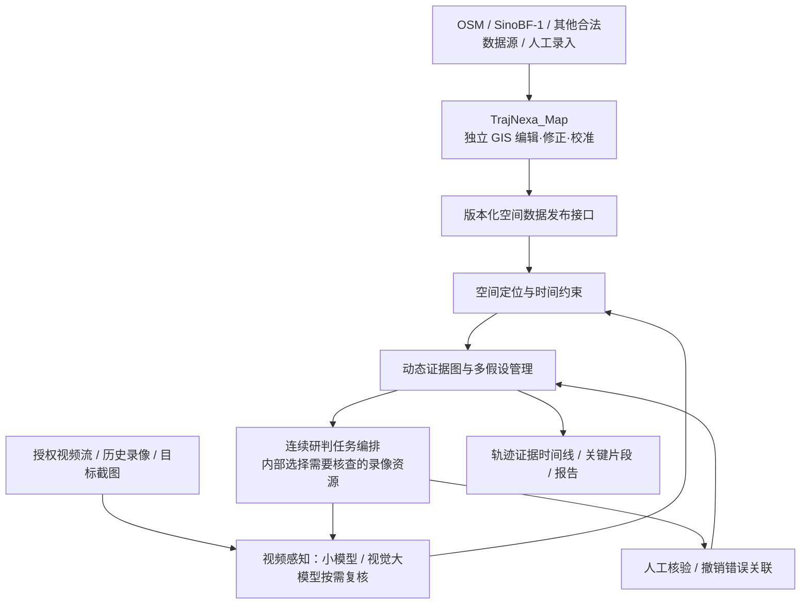

# TrajNexa（迹枢）总体规划与 TrajNexa_Map 职责边界

> **文档版本**：V1.0 — 总体方向确认稿  
> **日期**：2026-10-25  
> **文档类型**：产品目标、系统架构、分模块验证与实施路线  
> **建议仓库位置**：`design/16_TrajNexa_总体规划与Map职责边界_V1.0.md`  
> **适用范围**：TrajNexa 主系统 / TrajNexa_Map 独立空间数据维护系统  
> **基线说明**：依据现有 CameraMap（PanoptiCity 派生工程）、既有 V3 双线规划以及项目负责人最新确认的产品目标。本文更新**目标和职责定义**，不表示任何尚未完成的模块已经实现。

---

## 0. 核心决策（本版必须遵守）

1. **TrajNexa 是主系统**：其最终目标不是一次性视频检索，也不是推荐几个摄像头，而是以用户提供的人员或车辆目标为起点，面向依法授权的监控资源开展**连续、多轮的跨镜头时空分析与轨迹研判**；尽可能还原有证据支撑的活动轨迹、找到具有核验价值的清晰视频片段或关键画面（条件允许时包含人脸画面），直到任务达到证据目标、无法继续可靠核查或由授权人员终止。
2. **TrajNexa_Map 是独立 GIS 数据编辑、修正、校准与发布系统**。它不是 TrajNexa 主系统、不是主系统的业务展示地图，不执行视频模型推理，也不承担目标追踪或轨迹研判。
3. **摄像头点位、朝向、视野及其历史版本是空间数据核心**；道路、建筑、围墙、通道等是**不完整且不断补充的辅助信息**。地图缺少某项数据，不等于现场不存在该道路/通道、也不代表没有障碍。
4. **视觉、时间、空间和上下文共同构成可审计证据**。模糊画面中的衣物、鞋子、物品、两轮车/汽车、前后邻近的人车等可以成为*待核实的场景线索*，但不得仅凭相似性或时空合理性自动确认为同一人的身份，更不得将推测轨迹显示为已证实轨迹。
5. **内部摄像头选择是循环研判过程的一步，不是产品终点**。系统必须能持续处理新观测、回退错误假设、暂停或求助人工核实。
6. **数据来源与人工修正必须隔离且可追溯**。OSM、SinoBF-1、其他供应商数据、本地录入均保留来源和版本；再次导入 OSM 不得静默覆盖人工完善的数据；摄像头默认本地维护，OSM 摄像头数据仅经显式选择才导入。
7. **合规是准入条件**。涉及特定人员的跨镜头关联、清晰人脸画面等能力必须限定于有明确法律依据和授权的场景，最小化处理无关人员数据，按权限、审批与审计执行；不得将猜测结果作为身份事实。

## 1. 项目目标、输入与成果

### 1.1 TrajNexa 产品定位

**TrajNexa：面向复杂监控环境的跨摄像头时空智能追踪与轨迹研判系统。**

系统以用户提供的目标图像、截图或视频片段为调查起点，在有授权的摄像头网络中，结合视频感知、设备空间数据、时间信息、动态证据与人机协作，进行连续、多轮分析。

重点应对：夜间低照度、红外灰度画面、运动模糊、远距离小目标、短时遮挡、画面断档、摄像头时钟偏差、路网或建筑数据不完整。目标是**降低传统视频外观匹配失效时的调查中断率**，但不能保证必然识别身份、连续跨过每一处盲区或取得清晰人脸。

### 1.2 主要输入

- **任务输入**：目标截图、目标所在视频片段，或已有且人工核实的观测记录；用户填写或确认事件时间范围、相机来源（可未知）、任务范围与授权依据。
- **视频输入**：RTSP / GB28181 或合规导入的历史录像、截图；时间信息及录像可用性索引。
- **地图输入**：来自 TrajNexa_Map 的摄像头坐标、姿态、理论/校准视野、遮挡和不完整环境数据及其来源版本。
- **人工反馈**：确认某段观察、排除不可靠关联、修正属性、补充时间或场景信息、标记无法判断。

### 1.3 主要输出（不是一张推荐列表）

1. **可追溯的跨镜头观测时间线**：按时间组织证据源、镜头、片段、检测与人工审核状态。
2. **有证据支撑的轨迹还原**：明确区分“录像直接支持的空间片段”“待验证的可能连接”“无观测的盲区”；不强制画出连续路线。
3. **关键画面与录像片段**：挑选视觉质量较高、可用于合法人工核验的原始画面；必要时附增强后的辅助图像但不得代替原件。清晰人脸是*可能取得的关键画面类型*，不作为保证性输出。
4. **证据链与结论依据**：关联的原始文件、时间校准、地图快照版本、模型版本、人工意见、支持/冲突/无法确认的证据。
5. **任务状态**：运行、等待录像、需要人工复核、证据不足、已完成、人工终止等，允许没有确定结论。

### 1.4 明确的非目标

- TrajNexa_Map 不承担主系统业务地图展示、视频播放、模型分析或追踪决策。
- 不要求录入完整建筑、道路、围墙、小路才可使用；不构造“地图必定完整”的世界模型。
- 不将外观相似、同行出现、时间可达等弱证据单独视为跨镜头的身份确认。
- 不自动建立无关人员或车辆的长期档案；不能无审计地进行开放式大规模监控。
- 不承诺一定获取清晰人脸、准确车牌或唯一轨迹。

## 2. 双系统架构及严格职责



### 2.1 TrajNexa_Map：数据生产与维护端

| 职责 | 具体内容 | 是否包含视频/研判 |
|---|---|---|
| 摄像头台账 | 稳定的相机/通道 ID、位置、安装高度、朝向、焦距/视角、类型、在线校验元数据 | 否 |
| 摄像头空间校准 | 理论视野、现场校准视野、不同时间/云台朝向、遮挡区域、校准误差 | 否 |
| 基础 GIS | 建筑轮廓、道路、绿地、水体、通道、障碍等数据的导入与局部修正 | 否 |
| 数据治理 | 数据源隔离、冲突合并、人工覆盖层、审计、版本、回滚 | 否 |
| 数据服务 | 空间快照、增量变化、范围查询、坐标系与质量元数据 | 否 |

**禁止混入 Map 的功能**：视频目标检测、ReID、视觉大模型、基于具体目标的追踪策略、动态身份档案、目标轨迹报告、TrajNexa 主业务地图。

### 2.2 TrajNexa：主系统

- 自有**业务地图 UI**（独立于 TrajNexa_Map 的编辑器前端），消费发布的空间数据。
- 负责授权视频/录像接入、视频分析、目标任务、时空假设、动态证据链、跨镜头研判、关键画面提取、人工复核与报告。
- 不直接修改 Map 的源数据。发现点位/视野错误，通过**地图修正工单**反馈 TrajNexa_Map；修正经确认、版本发布后重新同步。
- 可选择分离部署：Map 服务与主系统独立容器、独立数据库或独立 schema；至少保证逻辑与写权限隔离。

### 2.3 必须保持松耦合

- 统一标识：`camera_uuid`（镜头/通道）、`site_uuid`（安装位置）、`source_ref`（OSM/厂商等外部 ID）、`spatial_revision`（空间数据版本）。一个安装点可有多个通道。
- 地理坐标带明确 `crs`；主系统不直接把天地图/高德的显示坐标与存储坐标混用。
- 空间接口提供只读快照及变更事件，模型侧不访问 Map 的内部 ORM 表。
- TrajNexa_Map 不保存主系统用于特定目标研判的图片、人物特征或证据图。

## 3. 核心业务流程：连续追踪是多轮证据任务

> 本节描述产品的高层业务流程和审计要求，不把任何待验证的相似性直接提升为个人身份结论。

**阶段 1｜建立目标任务。** 用户上传截图/视频，系统保留原件和哈希、时间、来源（如已知）；清楚标记“来源未知”。抽取可观察属性并记录视觉质量，未知属性不猜测。

**阶段 2｜初始定位与观测。** 优先利用视频通道 ID、叠字、元数据、固定背景场景确认来源；已知摄像头的物体接地点只有在镜头标定充分时才投影到地图位置，否则输出设备覆盖区域/可能地理范围及误差，不生成精确虚假坐标。

**阶段 3｜开展多轮跨镜头研判。** 主系统查询与时间、位置、摄像头覆盖及录像可用性相关的资源，选择下一批录像执行分析；这是内部任务调度过程，并持续接受新增证据、排除冲突与人工反馈。*最终用户关心的是证据轨迹和关键画面，不是下一台摄像头的编号。*

**阶段 4｜多种证据共同审查。** 可观察的衣物、鞋子、随身物品、车辆类型/外观及附近人车的同时出现关系属于辅助线索；时间差、设备时钟误差、相机视野、道路和建筑都是需要质量分级的约束。不得仅凭这些弱相关信息自动判定不同摄像头中的人员是同一身份，也不应追踪无关陪同者以替代目标识别。

**阶段 5｜轨迹还原与关键片段。** 基于经过验证的观察生成时间线；区分确证/待核实片段，展示盲区、时间误差和缺失数据。可能发现更清晰的人脸或车辆细节，但若原始视频未捕获相关信息则不得凭模型生成。

**阶段 6｜终止与复盘。** 任务可因目标证据满足、录像不可用、信息不足、达到授权时间范围、人工要求或风险规则而停止/暂停；完整保留审核与撤销痕迹。

### 3.1 证据不确定性：永远区分观察与推断

| 层次 | 例子 | 可以怎样展示 |
|---|---|---|
| 原始事实 | 相机 A 录像 20:15:03 出现一个人形检测框 | 录像链接、时间戳和检测器输出 |
| 可复核观察 | 某段录像中可以看见背包轮廓 | 附画面质量、观察人/模型及置信说明 |
| 假设 | 两段录像可能存在关联 | 关联候选，显示理由与冲突，不给自动身份确证 |
| 人工确认 | 审核者确认某项观察或连接 | 审核人、时间、理由、版本，可撤销 |
| 未知 | 盲区、缺少镜头、红外无法判断颜色 | 明确未知，不用概率路线填满地图 |

必须保存原始观测与模型输出的历史版本；新增证据不覆盖旧证据，只能产生新版本、修正记录或撤销关系。

## 4. 空间数据规则：地图不完整是常态

### 4.1 数据优先级与来源隔离

- `raw_osm`：定期增量更新的 OSM 基座（包含道路、建筑等有授权的地理要素）。
- `raw_external`：SinoBF-1、其他合法地理数据源，保留许可、覆盖时段、版本和源 ID。
- `local_edit`：TrajNexa_Map 的新增、修改、删除与校准记录，**不因任何外部数据重导入而被直接覆盖**。
- `published_spatial`：经过校验与冲突处理的**版本化发布视图**。同一要素多个来源产生冲突时，保留候选、标记来源并由规则或人工审核合并，而不是无条件以新 OSM 数据覆盖。
- 摄像头来源策略：**默认只维护本地摄像头**；是否从 OSM 导入摄像头是单独的显式选项，默认关闭，导入后仍需合并/去重审核。

### 4.2 地图数据质量字段

每个核心空间对象建议带：`source_type`、`source_id`、`source_revision`、`updated_at`、`verified_at`、`verification_status`（已核实/估算/未知）、`geometry_accuracy_m`（如可评估）、`operator`、`license_metadata`。

摄像头姿态/FOV 额外带：`pose_valid_from`、`pose_valid_to`、`fov_method`（理论/实测）、`calibration_quality`、`day_night_profile`、`ptz_state_available`。历史录像应匹配录像当时的视野版本；历史状态缺失时标记未知。

### 4.3 不依赖完整路网的空间表达

- **汽车**：已知道路网络可提供参考可达性；但地图上的缺口不直接意味着不可能通过。
- **自行车/电动车**：已知道路、非机动车道、可开放区域作为辅助信息，不把未知小路设为不可达。
- **行人**：使用近似地理区域、摄像头视野、开放空间及障碍信息；不能因缺少 OSM 路径而排除相关候选。
- **未知移动方式**：保持多种可能解释，不能先强行选定某一方式。
- **建筑与遮挡**：缺少轮廓不代表无遮挡；存在轮廓也不代表精确知道门、地下空间或跨越可能性。
- 推荐以摄像头覆盖、设备时间和质量状态作为查询基线；OSMnx/NetworkX 是辅助模块，而非所有任务的硬前置依赖。

## 5. 模块划分与技术复用（必须可独立验证）

### A 线｜TrajNexa_Map（GIS 编辑与校准）

| 模块 | 现有基础 / 复用技术 | 新增内容 | 模块验收 |
|---|---|---|---|
| A1 多源空间数据 | 现有 OSM 导入、SinoBF-1、PostGIS | 原始源隔离、去重冲突、增量版本、手工覆盖层 | 重复导入 OSM 不丢本地编辑；可回滚 |
| A2 摄像头台账 | CameraMap 既有摄像头管理与展示 | 稳定镜头 UUID、设备/通道拆分、安装与历史属性 | 一杆多镜头、删除/移动、历史关联正确 |
| A3 地图编辑 | Leaflet + 已有地图界面；按需 Leaflet-Geoman Free | 建筑/道路局部编辑、坐标校验、撤销恢复 | 多边形编辑、移动/旋转、删除与审计完成 |
| A4 FOV 与遮挡校准 | PanoptiCity 现有 FOV 计算、PostGIS | 理论/实测分层、昼夜/云台历史、几何误差标注 | 样本镜头的覆盖图经现场参考画面校验 |
| A5 数据发布 | Django REST + PostGIS | 版本化快照 API、增量接口、变更通知、数据质量 | 主系统只读同步、可追溯、可回滚 |

### B 线｜TrajNexa（视频感知与证据）

| 模块 | 优先复用 | 新增/验证重点 | 模块验收 |
|---|---|---|---|
| B1 授权视频与时间索引 | Rebucca / FFmpeg / ZLMediaKit | 通道映射、录像窗口、时钟偏差、原件哈希 | 录像可取、时间可校准、权限可审计 |
| B2 通用目标与事件检测 | Rebucca 内置 D-FINE；RT-DETR 作对照 | 人/汽车/两轮车/携物的检测基线、夜间画质分级 | 日/夜/红外多场景指标和失败样本报告 |
| B3 关键画面解释 | Qwen3-VL / Florence-2 按需 | 描述可观察信息、错误推断率、证据引用 | 模糊时可拒绝判断；原件保留 |
| B4 图像到空间定位 | OpenCV 标定、PostGIS；场景匹配可评估 LightGlue | 画面与地面区域映射、误差范围、PTZ 历史 | 已知地面点的定位误差可测，失标定自动降级 |
| B5 动态证据图 | PostgreSQL 表与关联边；Stone Soup 用于仿真评估 | 观测、支持/冲突、版本、多假设、撤销 | 证据不被覆盖、审核链完整、冲突可表示 |
| B6 连续任务引擎 | Django 异步任务 / 可替换队列 | 任务轮次、资源预算、等待/暂停、候选与证据循环 | 模拟多轮流程可中断恢复；无结果可结束 |
| B7 人工研判工作台 | 主系统自有 UI | 轨迹时间线、原始片段、待审证据、关键画面 | 误关联可撤销，确证和猜测清楚区分 |
| B8 任务结果和合规 | PostgreSQL 审计、权限控制 | 报告导出、留存/删除、授权和审批范围 | 全链路留痕；无权用户不能访问 |

### C 线｜系统间契约与集成

- C1：统一相机/通道 ID 与空间数据版本。
- C2：离线/在线同步空间快照；TrajNexa 即便暂时连不上 Map，也可使用**上次有效已发布版本**，并显示数据可能过期。
- C3：地图数据错误通过修正工单回传；不可由主系统直接写 Map 原始表。
- C4：全链路元数据关联，包括时间同步状态、摄像头姿态版本、视频原件与观测 ID。
- C5：主业务地图在 TrajNexa 中独立实现，只消费数据 API，不嵌入 TrajNexa_Map 的编辑页面。

## 6. 对外数据契约（建议草案，不代表现有 API）

### 6.1 GIS 数据接口 — TrajNexa_Map 向主系统提供

- `GET /api/v1/spatial/revisions/latest`：当前发布版本、生成时间、数据规模、变更摘要。
- `GET /api/v1/spatial/cameras?bbox=...&revision=...`：范围内镜头与安装点；`bbox` 使用明确约定的地理坐标顺序及 `crs`。
- `GET /api/v1/spatial/cameras/{camera_uuid}?revision=...`：朝向、镜头参数、FOV 版本、遮挡、数据可信度。
- `GET /api/v1/spatial/features?bbox=...&type=road,building,...&revision=...`：不完整的环境基础要素，附来源与状态。
- `GET /api/v1/spatial/changes?since_revision=...`：增量同步，支持幂等和游标翻页。
- `POST /api/v1/spatial/correction-requests`：主系统提交空间数据核查工单（仅提交修改建议，不自动更新已发布 GIS 数据）。

**地图数据发布最小字段**：`camera_uuid`、`site_uuid`、`geometry`、`crs`、`heading_deg`、`fov_geometry`、`fov_type`、`coverage_quality`、`pose_valid_time`、`source_provenance`、`spatial_revision`、`updated_at`。未知字段允许为 `null` 并带原因。

### 6.2 主系统内部观测与证据协议

```json
{
  "observation_id": "obs-example-001",
  "task_id": "task-example-001",
  "camera_uuid": "camera-example-001",
  "observed_at": "2026-10-25T12:10:00+08:00",
  "clock_error_ms": null,
  "video_asset_id": "video-example-001",
  "object_class": "person",
  "image_quality": "low_light_blur",
  "geolocation": {
    "type": "coverage_region",
    "coordinates": null,
    "uncertainty": "camera_not_calibrated"
  },
  "appearance": {
    "visible_attributes": [],
    "unknown_attributes": ["upper_clothing_color", "facial_details"]
  },
  "spatial_revision": "rev-example-001",
  "model_revision": "model-example-001",
  "review_status": "unverified"
}
```

示例是**脱敏结构示意**，不表示数据库已存在、也不包含用于身份识别的自动判定规则。

### 6.3 数据生命周期约束

原始录像/截图与分析导出分开存放；原件不可就地改写。关联结果采用版本化写入，模型输出与审核意见分离。个人相关数据遵守授权范围、最小必要留存、访问控制、审计和删除要求。证据导出中注明来源及核验状态。

## 7. 按依赖关系进行分阶段验证

### P0｜确认授权与基线（工程开工前）

- [ ] 核查 PanoptiCity 上游 **CNPLv7+** 的使用边界和已有单独授权是否覆盖计划中的 AI 集成、修改与部署。项目中删除上游 `LICENSE`/`NOTICE` 文件不自动解除原代码许可证义务。
- [ ] 明确 OSM、SinoBF-1、底图、模型、模型权重、测试录像的许可、来源及合法使用条件。
- [ ] 导出当前 CameraMap 数据库备份、模式、点位/FOV 数量和关键功能回归基线；**禁止在没有备份和迁移方案时对现有数据库执行重置/清卷操作**。
- [ ] 确认任务发起者、授权范围、审核员和日志留存的治理规则。

**Go/No-Go**：授权与数据备份不明确，则不接入真实目标视频。

### P1｜先做 TrajNexa_Map 地图编辑和数据治理（第一优先）

- [ ] 保留当前 Leaflet、摄像头展示、FOV、OSM/建筑基础功能。
- [ ] 建立稳定相机/镜头 ID 映射与多数据源分层结构。
- [ ] 建立手工修正版本、来源管理与回滚；模拟至少两轮 OSM 导入验证不覆盖本地编辑。
- [ ] 对小范围镜头修正方向、安装点和 FOV；用已授权参考画面校验。
- [ ] 形成第一版只读 GIS 发布 API 与主系统消费示例。

**交付**：独立运行的 TrajNexa_Map；可维护、可追溯的空间数据发布版本。

### P2｜与 Map 独立的 AI 离线验证（可与 P1 后半段并行）

- [ ] 建立可重复测试集：白天、夜间、红外、过曝、雨雾、运动模糊、遮挡、人/车/两轮车及困难负样本。
- [ ] 使用 Rebucca + D-FINE 建立通用检测基线；选一个对照模型。
- [ ] 评测 Qwen3-VL / Florence-2 画面描述与拒答能力，记录幻觉与误判。
- [ ] 验证图片/视频来源的元数据、OCR、固定背景场景核查；无法确认时明确报告来源未知。
- [ ] 验证基于镜头校准的地理范围输出；不具备标定时只返回视野区域与位置不确定性。
- [ ] 建立基础 `Observation`、`EvidenceRelation`、`ReviewDecision`、`ModelRun` 数据模型。

**交付**：离线、可复现的视觉观测结果与证据模型；不声称具备可靠跨镜头追踪。

### P3｜主系统多轮研判原型（仅使用模拟或依法授权测试数据）

- [ ] TrajNexa 自有业务地图消费 TrajNexa_Map 的空间数据快照。
- [ ] 建立目标任务生命周期、录像资源编排、时空候选关联和人工审核流程。
- [ ] 使用已核实的多段观察生成轨迹时间线；不能自动把无观测间隔画成事实轨迹。
- [ ] 新证据可以支持、冲突、撤销旧假设；任务可暂停/恢复/终止。
- [ ] 提取最清晰的相关原始关键帧，并提供来源、清晰度及是否可核验的说明。

**交付**：可端到端演示的*多轮、可撤销、可审计*研判工作流；不限于推荐下一镜头。

### P4｜夜间专项验证与受控试点

- [ ] 在人工标注真值的多路录像上评估跨镜头关联错误率、漏关联率、正确拒绝率与连续性。
- [ ] 将“只看外观”“只看距离”“外观 + 时间”“外观 + 时间 + 有质量标记的空间信息”等方案作为对照组。
- [ ] 检测道路/建筑缺失、FOV 错误、相机时钟不同步、录像缺失与画面严重模糊时是否能够正确降级。
- [ ] 审核关键帧质量是否改善人工核验效率，同时记录“未找到清晰画面”的情况。
- [ ] 只有误关联率、合规要求与人工审核质量达到经批准的门槛后才考虑扩大范围。

**交付**：专项评测报告、误差边界、模型与模块取舍决策；不以宣传样例替代量化结果。

## 8. 验收指标（必须先测基线，再冻结门槛）

| 指标 | 定义 | 应关注的失败情况 |
|---|---|---|
| Map 数据保全率 | 本地编辑经过重复导入、同步、重启后完整保留 | 外部导入覆盖或删除人工修正 |
| 空间校准误差 | 校准地面点与真实点的地理误差分布 | 误将理论 FOV 视作实测夜视范围 |
| 录像覆盖率 | 授权时间窗内应有录像的通道实际可访问比例 | 时钟偏差、断档、视频打不开 |
| 观测检测召回/精确率 | 按白天、夜间、红外、模糊等分组评估 | 只用白天视频报告整体成绩 |
| 描述事实性与拒判率 | 视觉模型给出的属性是否有原始像素证据 | 把增强/猜测内容当作真实事实 |
| 跨镜头关联正确率 | 人工标注真值下的正确关联与错误关联比例 | 相似衣服造成身份误关联 |
| 轨迹证据完整度 | 每段轨迹是否有可回溯的视频与审核依据 | 将无观测盲区画成连续实线 |
| 任务持续与可恢复性 | 多轮任务在失败/暂停/新增证据后可正确恢复 | 无审计循环、错误假设无法撤回 |
| 关键帧核验价值 | 关键画面能否帮助合法人工核验，是否标清不可辨 | 声称每个任务必有清晰人脸 |
| 合规与权限 | 未授权访问、越界检索、审计缺失发生次数 | 无关人车被无授权地持续建档 |

**说明**：指标目标值须以本地试点数据与合法审查结果为基础制定；本规划不虚构“95% 跨镜头追踪成功率”等性能承诺。

## 9. 数据安全、隐私与可信性边界

1. 明确每个任务的业务依据、授权范围、有效时间、操作者与审核人；敏感功能采取最小权限、审批及审计。
2. 实际部署中，对能够关联到自然人的外观、轨迹和人脸画面实施严格访问控制、加密与必要期限内留存；不得开展与授权目的无关的跟踪。
3. 保留无法判断的结果；不通过生成式 AI 想象被遮挡的人脸、车牌、衣物细节或缺失路径。
4. 画面里的随行者或前后人员车辆可用于描述事件上下文，但不自动扩展为对无关主体的持续独立跟踪。
5. 使用增强视频时保留原件、处理参数、模型版本与审计日志；区分“方便查看”和“真实恢复”。
6. 所有自动生成的关联只能保持待审核状态，除非存在明确满足审核规范的、可复核的证据，不做自动身份确认。
7. 模型和地理数据有许可差异：Rebucca 主程序、D-FINE、Qwen 系列、Ultralytics 引擎及权重等应分别审查；Map 的上游授权是额外独立风险。

## 10. 技术选型原则与推迟事项

| 层次 | 优先方案 | 暂缓/边界 |
|---|---|---|
| 地图编辑 | CameraMap / PanoptiCity 派生 GIS、Leaflet、按需 Leaflet-Geoman Free | 不在 Map 内做主系统业务地图 |
| 空间存储/查询 | PostgreSQL + PostGIS | 不先引入专用图数据库 |
| 道路参考 | 现有 OSM 数据 + NetworkX/OSMnx 按需 | 不作为人员活动硬限制 |
| 视频接入 | Rebucca 单独部署 + 适配接口 | 不合并两套 Django 数据库 |
| 常规视觉检测 | Rebucca 已有 D-FINE；用离线基准择优 | 不先自研完整检测框架 |
| 视觉大模型 | Qwen3-VL 按需解释疑难片段 | 不逐帧调用，不提供无证据的身份结论 |
| 图像来源与几何 | OCR / 固定场景匹配 / OpenCV 标定 | 不用 VLM 直接猜精确经纬度 |
| 证据存储 | PostgreSQL 关系表 + 版本化审核 | 数据规模证明需要前不必 Neo4j |
| 不确定性研究 | 规则与明确证据状态基线；Stone Soup 仿真验证 | 不为显得“智能”而先引入复杂概率黑盒 |
| 任务编排 | 有持久任务状态的后台工作队列 | 不允许缺少退出/预算/审批的无限循环 |

## 11. 风险登记与纠偏策略

| 风险 | 影响 | 预防/纠正 |
|---|---|---|
| 把 Map 当成主系统业务前端 | 职责耦合、重复开发 | Map 只做 GIS 数据编辑发布；主系统独立展示 |
| 将摄像头推荐当成最终产品 | 偏离连续轨迹研判目标 | 里程碑以任务时间线、证据轨迹和关键画面验收 |
| 只按道路限制人员活动 | 漏掉未收录小路和未知区域 | 路网仅辅助，保留未知可达性 |
| FOV 与实际夜视不符 | 错误地理定位与漏检 | 理论与校准版本分离，标注误差 |
| 相似外观自动变成同一人 | 高风险错误身份关联 | 假设与事实分离、人工复核、可撤销 |
| OSM 同步破坏本地数据 | 人工成果丢失 | 原始层与覆盖层隔离、发布版本与回滚 |
| 视频时间不同步 | 错误先后关系 | 独立时钟偏差记录、异常告警 |
| 在原始 PanoptiCity 许可下集成 AI | 法律合规风险 | 核实单独授权，必要时替换 UI/相关代码 |
| 隐私与权限不足 | 超授权监控风险 | 合法依据、RBAC、审批审计、数据最小化 |
| 数据不足却输出确定路径/清晰脸 | 假事实与误导 | 支持“无法判断/未找到”，保留原件 |

## 12. 下一轮工作的明确优先级与交付物

**第一批：TrajNexa_Map 独立 GIS 数据维护能力。**

1. 盘点现有 `Camera`、`CameraFocus`、Building、道路导入和人工编辑流程。
2. 冻结 `camera_uuid/site_uuid` 映射及多来源分层模型，不对现有主键做破坏性迁移。
3. 验证 OSM（仅作基座）与 SinoBF-1、本地编辑可共存，特别验证再次导入后人工数据不丢失。
4. 完成摄像头朝向、FOV 的版本化校准与源数据质量说明。
5. 交付第一份空间数据只读接口契约与版本化样例数据。

**第二批：TrajNexa AI 证据分析原型（可以独立并行）。**

1. 使用经过合法授权的夜间录像/模拟数据，建立可重复的视觉检测基准与质量分级。
2. 保存不可覆盖的观测记录、证据关系、人工反馈与撤销历史。
3. 验证画面来源核查、摄像头标定与地理范围估计。
4. 最后才联通双系统，演示多轮、可暂停、可撤销的端到端研判任务。

**本版冻结的目标描述**：

> TrajNexa 不是普通视频搜索或摄像头推荐系统，而是面向合法授权视频资源的持续跨镜头时空研判主系统。它以用户给定的目标线索为起点，综合视频观测与空间、时间、上下文证据，辅助逐轮验证跨镜头关联、还原具有证据支撑的轨迹，并尽可能提取清晰、可核验的关键画面；在证据不足时明确停止推断并保持不确定性。
>
> TrajNexa_Map 是独立的 GIS 数据编辑、修正、校准及发布系统。其职责仅是维护摄像头点位、方位、视野及相关地理数据，向主系统提供高质量、版本化、可追溯的空间信息，不承担主系统业务展示、视频分析、目标追踪或轨迹还原。

## 13. 文档生效与旧规划关系

- 本规划覆盖之前将主系统终点表述为“推荐后续核查摄像头”的过时产品定位，并**正式将 TrajNexa_Map 与主系统的业务展示地图分离**。
- 原 `design/15_V3_双线研发与动态证据链总体规划.md` 可保留为历史方向文档；若存在“CameraMap 即主系统地图前端”或“只推荐下一台摄像头”的表述，均以**本文件定义**为准。
- 当前 CameraMap V2.3.12 的既有功能和测试结果不因本规划自动改变；任何迁移先通过备份、增量修改和回归测试。
- 本文描述的 API、模块、模型是**拟开发**，必须逐项完成测试才能标记“已实现”。