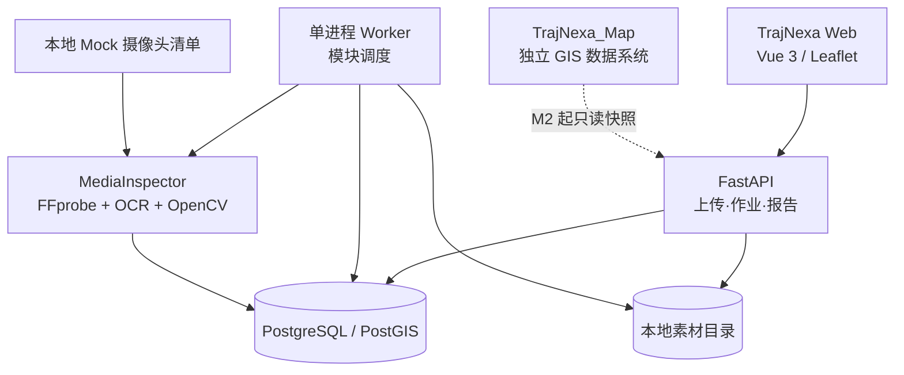
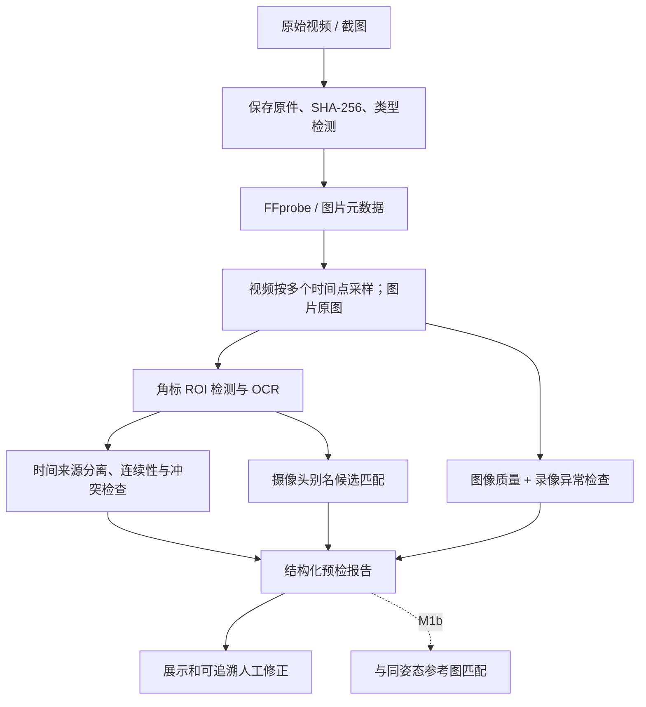

# TrajNexa（迹枢）主系统 Demo 初步技术规划

> **版本**：V0.1（规划草案；不是完成情况报告）  
> **日期**：2026-10-25  
> **适用范围**：TrajNexa 主系统，首轮 **M0 最小框架 + M1 MediaInspector**  
> **建议位置**：`design/01_TrajNexa_Demo_M0-M1_初步技术规划_V0.1.md`  
> **依据**：《TrajNexa（迹枢）总体规划与 TrajNexa_Map 职责边界 V1.0》，以及后续确认的“先最小框架、再逐模块验证”的 Demo 开发策略。  
> **状态**：待实施、待验收；文中的接口、数据表和目录都是拟议设计，**并非已经存在**。

---

## 0. 本轮决策摘要

1. **TrajNexa 是独立主项目**：长远目标是通过多轮视频观测、时空数据和可回溯证据，支持授权的跨镜头研判与轨迹片段还原，提取高质量关键画面。**最终成果不是一份候选摄像头列表**。
2. **TrajNexa_Map 是独立 GIS 维护系统**：只负责摄像头、方位、FOV、道路、建筑等空间数据的编辑、校准及发布；主系统的业务地图需自行实现，并通过数据协议消费 Map 的发布快照。
3. **当前是本地 Demo**：暂不开发用户、角色、权限后台、审批工作流、多租户、分布式微服务、在线大规模实时追踪等生产能力。
4. **先建 M0，再做 M1**：M0 保证“上传 → 创建任务 → 运行模块 → 持久保存 → 展示结果”；M1 保证“图片/视频 → 元数据与角标提取 → 画质/连续性检查 → 摄像头来源核查 → 结构化报告”。
5. **每个模块有独立测试与可替换实现**；不因缺少 Map API、GPU、联网视频或视觉大模型而阻塞 M0/M1。
6. **不确定必须可表达**：OCR 有误、时区未知、相机名称重复、场景参考图缺失、云台姿态未知时，保留原始候选与“不确定”，禁止默认为已确认。

## 1. 产品目标和首轮边界

### 1.1 主系统最终方向（仅作架构约束）

用户提供目标截图或视频后，主系统在合法授权的素材范围内进行多轮视频分析；利用可观察的外观、运动、时间、空间和场景证据辅助研判，保留已核实和待核实的片段与证据，尽可能输出可追溯的时空轨迹及清晰关键画面。视觉线索不足时支持暂停、复核和“无法判断”，不自动把模糊相似性确认为同一人或把无观测空白连接为真实轨迹。

### 1.2 M0 必做

- 单仓库、前后端独立目录、单实例本地运行。
- 图片/视频文件上传，限制允许格式与文件大小（阈值可配置），验证真实文件类型，保存原件和 SHA-256。
- 后台作业创建、查询、失败信息、重新运行；刷新页面后数据不丢失。
- 本地数据库（PostgreSQL；PostGIS 扩展预装供后续空间模块使用）；本地文件存储。
- 最简主界面：首页/素材列表、上传页、作业状态、报告占位页；独立 Leaflet 地图可以仅提供空白地图/模拟数据占位，不接 Map 编辑器。
- 统一 API 错误模型、日志、健康检查和自动化测试基础。

### 1.3 M1 必做 / 扩展

**M1a（首版强制）**
- 图片：格式、尺寸、文件哈希、抽取 EXIF（仅存在时）；角标 OCR（时间、名称/通道），图像质量初筛。
- 视频：FFprobe 容器/流/时长/尺寸/帧率/PTS 信息；多时点抽帧；角标 OCR；时间连续性与冲突标注；黑屏/过曝/过暗/模糊/疑似冻结、解码异常检查。
- 对摄像头角标、设备元数据、预置别名表做候选匹配：区分唯一、多个、找不到、无法读取；允许人工纠正并保留自动结果。
- 页面显示原始画面、识别文字及置信说明、质量异常、缺失数据和可编辑核查项，生成可导出的结构化报告。

**M1b（紧接 M1a 验证，不阻塞首版）**
- 利用同摄像头同姿态的人工确认参考图，做当前画面的静态场景匹配；输出“基本一致 / 疑似变化 / 无法判断”。
- 只有在拥有足够的几何标定或可靠姿态记录时，才进一步估计视角偏移或方位误差；禁止根据单张未知场景图直接填写精确朝向角。
- 发现疑似偏转时，生成“建议核查 Map 数据”的记录；**主系统不得直接修改 TrajNexa_Map**。

### 1.4 明确不做

在 M0/M1 阶段 **不做**：跨镜头自动身份关联、脸部身份识别/特征搜索、人员群体画像、长距离轨迹推断、ReID、实时报流、完整目标检测、动态证据图实现、正式地图数据编辑、生产环境账号管理、自动更新 TrajNexa_Map 的 FOV。

> 不做账号系统不等于可以公开无保护地运行。Demo 仅在受控本地或隔离测试网络运行，只处理合规测试素材；对私人监控视频仍应执行最小化存储和手动清理。

## 2. 成熟开源组件与使用位置

| 层次 | 采用组件 | 在 Demo 中承担的功能 | 首次引入 | 决策 |
|---|---|---|---|---|
| 前端 | **Vue 3 + Vite + TypeScript** | 页面、上传、报告查看、人工修正 | M0 | 采用 |
| 主系统业务地图 | **Leaflet** | 独立 GIS 显示；M0 用模拟数据，后续消费 Map 发布数据 | M0 占位 / M2 正式 | 采用 |
| API | **FastAPI + Pydantic** | 上传、作业/报告 REST API、数据校验 | M0 | 采用 |
| 数据库 | **PostgreSQL + PostGIS** | 作业、媒体、报告；后续地理查询 | M0 | 采用 |
| ORM/迁移 | **SQLAlchemy + Alembic** | 数据访问及可回滚表结构迁移 | M0 | 采用 |
| 文件处理 | **FFmpeg / FFprobe** | 探测、解码、抽帧、关键视频时刻采样 | M1a | 采用 |
| 图像检测工具 | **OpenCV** | 亮度、模糊、黑屏、画面变化、图像几何 | M1a | 采用 |
| 角标识别 | **PaddleOCR** | 中文时间角标/摄像头名称与通道 OCR | M1a | 采用 |
| 场景特征 | **LightGlue（可选）+ OpenCV** | 参考图局部特征匹配与几何一致性验证 | M1b | 先实验后决定；检查配套权重许可 |
| 视觉大模型 | **Qwen3-VL（可选）** | 对少量复杂画面做辅助描述，不替代 OCR 和几何校验 | M3 后 | 暂不引入 |
| 检测/跟踪 | **D-FINE + ByteTrack** | 通用目标检测、单镜头短时跟踪 | M3 | 暂不引入 |
| 视频接入 | **Rebucca / ZLMediaKit** | RTSP / GB28181，多路接入 | 实时视频阶段 | 暂不引入 |
| 分布式与图平台 | Redis、Celery、Kafka、Neo4j、K8s | 暂无首版必要性 | 规模验证后 | 不采用 |

**适配原则**：M0/M1 离线视频处理只选 **FFmpeg + OCR + OpenCV** 一条管线，避免与 Rebucca 重复实现；AI 模型以单独模块接口封装，不将其运行状态耦合到主系统启动。

## 3. 最小系统结构



- **单仓库/模块化单体**：FastAPI 单后端应用，M1 做内部插件。暂不拆成独立网络微服务。
- **非阻塞任务**：大文件和 OCR 不放进 HTTP 请求同步执行；使用一个独立 Python Worker 处理持久化队列作业（PostgreSQL 任务表），避免 FastAPI 进程重启丢作业。并发和重试次数先用配置控制。
- **M0 可在无 GPU 环境启动**；M1 先测 CPU 基线，性能瓶颈明确后才选择 GPU。
- **地图状态**：M0 的地图只验证主系统拥有独立展示能力。若 TrajNexa_Map 还没有发布 API，使用静态样例数据，并在页面标注“示例数据”。

### 3.1 建议目录结构

```text
TrajNexa/
├── README.md
├── .env.example
├── compose.yaml
├── design/
│   └── 01_TrajNexa_Demo_M0-M1_初步技术规划_V0.1.md
├── frontend/
│   ├── package.json
│   └── src/
│       ├── views/                 # 上传 / 素材 / 预检报告 / 地图
│       ├── components/
│       ├── api/                   # API 类型及调用
│       └── map/                   # 独立业务地图，仅展示
├── backend/
│   ├── pyproject.toml
│   ├── alembic/
│   └── app/
│       ├── main.py
│       ├── config.py
│       ├── api/v1/               # health, media, jobs, inspections
│       ├── db/                   # session, models, migration
│       ├── worker/               # 作业轮询、执行、恢复、超时
│       ├── schemas/              # 输入输出模型
│       └── modules/
│           ├── media_inspector/
│           │   ├── pipeline.py
│           │   ├── probe.py
│           │   ├── sampler.py
│           │   ├── overlay_ocr.py
│           │   ├── quality.py
│           │   ├── camera_resolver.py
│           │   └── view_match.py  # M1b 可选
│           └── gis_adapter/       # M0 mock；M2 改为 Map 数据发布契约
├── tests/
│   ├── fixtures/                # 合法/合成测试素材
│   ├── test_media_api.py
│   ├── test_jobs.py
│   └── test_media_inspector.py
└── storage/                      # gitignored: originals/derived/reports/tmp
```

**统一命名**：主系统数据库、模块与接口使用 `TrajNexa` 名称。`TrajNexa_Map` 作为外部数据提供者出现，不在本仓库复制其内部 ORM 模型、编辑界面和数据同步脚本。

## 4. M0 API 契约草案

下列均为**拟开发**的接口。API 路径从 `/api/v1` 开始，统一返回稳定 `id`；错误体含 `code`、`message`、`details`（可选）。

| 方法 | 路径 | 行为 | 典型结果 |
|---|---|---|---|
| `GET` | `/api/v1/health` | 检查 API、DB 基础可用性 | `status: ok/degraded` |
| `POST` | `/api/v1/media` | 多段表单上传单个图片或视频；计算哈希 | `media_id`, `media_type`, `sha256` |
| `GET` | `/api/v1/media` | 列出已上传素材 | 分页列表 |
| `GET` | `/api/v1/media/{media_id}` | 获取素材元数据 | 文件信息、导入时间 |
| `POST` | `/api/v1/media/{media_id}/inspect` | 创建一次 M1 预检作业 | `job_id`, `status: queued` |
| `GET` | `/api/v1/jobs/{job_id}` | 查询状态/进度/异常 | `queued/running/succeeded/failed` |
| `GET` | `/api/v1/inspections/{inspection_id}` | 获取结构化结果 | `InspectionReport` |
| `POST` | `/api/v1/inspections/{inspection_id}/corrections` | 保存人工修正（追加记录） | `correction_id` |
| `GET` | `/api/v1/inspections/{inspection_id}/export` | 导出 JSON 预检报告 | JSON 文件 |

约束：
- 上传接口可以先设定**可配置**文件大小、扩展名/魔数白名单、存储配额；文件名不可直接拼接成磁盘路径；不可信 EXIF/OCR 文本当作数据处理。
- 上传成功只表示文件**已接收并保存**；不表示媒体可解码，解码状态由预检作业提供。
- 作业状态建议：`queued` → `running` → `succeeded | failed`，中断后可重新入队；单作业应有最大运行时间与最大重试次数；重复提交可创建不同 `job_id`，不会覆盖旧报告。
- 第一次只实现作业轮询；不需要 WebSocket、任务消息代理。

## 5. M0 最小数据模型

| 表 | 关键字段 | 说明 |
|---|---|---|
| `media_assets` | `id`, `kind`, `original_name`, `mime_detected`, `sha256`, `storage_relpath`, `size_bytes`, `ingested_at` | 原始素材不可原地改写；文件路径存相对路径 |
| `analysis_jobs` | `id`, `media_id`, `module`, `status`, `attempt`, `progress`, `created_at`, `started_at`, `finished_at`, `error_code`, `error_message` | 持久化任务队列；保留失败原因 |
| `inspection_reports` | `id`, `job_id`, `media_id`, `schema_version`, `result_json`, `module_version`, `created_at` | 原始自动预检结果版本化保存，追加而不覆盖 |
| `inspection_corrections` | `id`, `report_id`, `field_path`, `old_value`, `new_value`, `reason`, `created_at` | 人工纠正独立存储；自动输出不被修改 |
| `camera_alias_snapshot` | `camera_uuid`, `alias`, `snapshot_revision`, `alias_type` | M0 可由本地 JSON 导入；M2 由 Map 发布版本提供 |

首版无需创建完整证据图、跨镜头关联表或大量 `camera` 业务字段。真正引入 M2/M4 时再使用数据库迁移扩展。

### 5.1 视频与时间的基本约定

- 所有内部绝对时间使用**带时区的 ISO 8601**，数据库可用 `timestamptz`；未知绝对时间用 `null`，不要默认“本地当前时间”。
- `pts_ms` 指视频相对时间轴上的帧偏移，不等于真实拍摄时刻；录像被剪辑、导出时需要处理 PTS 不连续、变速、缺失。
- 角标时间、容器元数据时间、外部设备时间要并列存储，标明来源，**不应择一覆盖**。
- 时钟偏差只能在有校准证据时写入；未知时使用 `null`。
- `camera_uuid` 沿用 TrajNexa_Map 的稳定镜头/通道 ID；仅识别到名字时保留 OCR 原文及候选列表，不自动生成可靠映射。

## 6. M1 MediaInspector 输入、输出与处理管线

### 6.1 首版处理流程



OCR 原始框、识别文本和帧位置至少以简化结构保存，以便用户发现错误并进行修改。按需允许手动调整角标区域 ROI；不同设备角标位置可能变化，不能固定取图片左上角。

### 6.2 采样策略（起始策略，后续需实测）

- 视频开始、中间、结束附近取样，加上可配置的周期采样；**先限制总采样帧数**，避免长视频引起无界 OCR 工作量。
- 按已读出时间间隔检查 OCR 时间是否单调；重复帧时间或静止场景不一定是录像冻结，需结合 PTS、图像相似度和码流状态联合标注“疑似”。
- 对 0 长度、损坏、无视频流、特殊编码等输入要返回明确状态，不能让作业一直运行。
- 质量分级为 `ok / degraded / unusable / unknown`，并保存异常标签：`too_dark`, `overexposed`, `blurred`, `black_frame`, `possible_freeze`, `decoding_error`, `occluded` 等。

### 6.3 标准报告最小字段

| 分组 | 示例字段 | 说明 |
|---|---|---|
| 媒体 | `media_id`, `kind`, `sha256`, `container`, `codec`, `width`, `height`, `duration_ms` | 不适用字段为 `null` |
| 时间 | `overlay_time_samples[]`, `container_time`, `pts_range_ms`, `timezone`, `clock_offset_ms`, `time_status` | 保留来源、采样点、OCR 置信；不能暗中校时 |
| 摄像头 | `overlay_name_raw`, `camera_candidates[]`, `camera_uuid`, `match_status` | 多候选不自动选一个 |
| 质量 | `overall_status`, `issues[]`, `frame_samples[]`, `decode_status` | 分别记录可读性和画质 |
| 视角 | `status`, `reference_id`, `spatial_revision`, `notes` | M1a 可为 `not_checked`；M1b 再判断 |
| 人工修正 | `correction_refs[]`, `review_state` | 不覆盖自动报告 |
| 版本 | `schema_version`, `module_version`, `created_at` | 便于对比算法升级前后的输出 |

### 6.4 JSON 输出实例（仅为结构示例）

```json
{
  "schema_version": "0.1.0",
  "inspection_id": "insp-demo-001",
  "media_id": "media-demo-001",
  "module_version": "media-inspector-0.1",
  "media": {
    "kind": "video",
    "sha256": "<computed_sha256>",
    "width": 1920,
    "height": 1080,
    "duration_ms": 62000,
    "codec": "h264"
  },
  "time": {
    "overlay_time_samples": [
      {
        "pts_ms": 1000,
        "raw_text": "2026-10-25 20:15:03",
        "parsed_local_time": "2026-10-25T20:15:03",
        "ocr_confidence": 0.91
      }
    ],
    "container_time": null,
    "timezone": null,
    "clock_offset_ms": null,
    "time_status": "unverified"
  },
  "camera": {
    "overlay_name_raw": "金水路西口-02",
    "camera_candidates": [],
    "camera_uuid": null,
    "match_status": "unresolved"
  },
  "quality": {
    "overall_status": "degraded",
    "issues": ["too_dark", "blurred"],
    "decode_status": "ok"
  },
  "view_check": {
    "status": "not_checked",
    "reference_id": null,
    "spatial_revision": null
  },
  "review_state": "pending"
}
```

**注意**：JSON 中的“金水路西口-02”、分辨率、时间、置信度是虚构示例，绝不代表真实摄像头数据或已经测出的结果。

### 6.5 场景与视角比对（M1b）

- 优先检验固定摄像头、同一历史姿态、同类日夜模式的场景一致性；动态人车不应当作固定场景锚点。
- 使用 OpenCV 特征/几何方法形成基线；若失败样本表明需要，再引入 LightGlue，而非一开始就强制装大模型。
- 输出状态：`consistent`（参考场景吻合）、`suspected_change`（疑似画面变化）、`indeterminate`（证据不足）、`not_checked`（尚未执行）。**一致不等于绝对地理朝向角得到证明**。
- 云台摄像头只有在对应历史 PTZ 状态或参照姿态可用时进行比对；没有可靠数据时标记 `indeterminate`。
- 画面明显不符时保留截图和比对依据，提出人工核查建议；不要直接写回 Map 的方向/FOV。

## 7. TrajNexa_Map 接口边界（当前先 Mock）

M0/M1 暂时只需最小的 `CameraLookup` 抽象：给定摄像头别名，返回零个、一个或多个候选；并可查询相关参考画面的元数据。数据源可以是本地 JSON `camera_fixture.json`。未来 M2 通过只读接口消费 Map 发布的版本，例如：

```text
GET /api/v1/spatial/revisions/latest
GET /api/v1/spatial/cameras?bbox=...&revision=...
GET /api/v1/spatial/cameras/{camera_uuid}?revision=...
```

统一使用 `camera_uuid`、`site_uuid`、`spatial_revision`、明确 `crs` 和 `pose_valid_time`。不要因为角标模糊而建立虚假的唯一绑定；也不要从主系统直接连接 Map 内部数据表或修改其本地编辑数据。Map 原数据仍遵守 OSM / 外部源 / 本地编辑分层保护原则。

## 8. Demo 页面草案

| 页面 | 内容 | M0 / M1 |
|---|---|---|
| 素材列表 | 文件名、类型、导入时间、状态，进入预检 | M0 |
| 上传页 | 拖入视频/截图，上传进度、输入错误反馈 | M0 |
| 作业进度 | 等待/运行/完成/失败、重试入口 | M0 |
| 预检报告 | 画面预览、时间与角标、摄像头候选、画质问题、修改记录 | M1a |
| 业务地图 | 独立 Leaflet 地图，初期只示例数据；可查看模拟设备 | M0 占位 / M2 正式 |
| 视角比对 | 参考图、当前帧、匹配点/差异、是否需要 Map 修正 | M1b |

优先把“同一上传 → 一次作业 → 一份可纠错报告”走通，不开发完整任务仪表盘或复杂页面布局。

## 9. 逐阶段实施及验收（每阶段不通过则不扩展）

### M0 — 最小框架

- [ ] 本地启动前端、API、PostgreSQL、单 Worker；不接 Map、GPU、外网也可运行。
- [ ] 图片/视频上传成功，SHA-256 与原文件一致；刷新浏览器后可找回媒体条目。
- [ ] 创建作业、状态变化、正常失败与重试可见；进程被中断不会静默丢失任务。
- [ ] 报告占位由虚构 JSON 实际写入数据库并展示，不只是静态页面。
- [ ] 健康检查、自动化测试、README 启动步骤通过。

**M0 交付物**：可运行主框架 + 上传/作业/结果的端到端测试；**不要求模型运行**。

### M1a — 预检基础

- [ ] FFprobe 图片/视频元数据提取，损坏输入输出明确错误。
- [ ] OCR 能读出至少部分角标文字，展示原始 OCR 与来源帧，人工可校正。
- [ ] 对时区未知、角标与容器时间冲突、录像时间跳变能标记“待确认”。
- [ ] 画质状态和问题标签可在界面查看；失真/红外画面不被简单判为坏片。
- [ ] 多相机同名映射不自动绑定；摄像头未知也能生成完整预检报告。
- [ ] 结果包含媒体哈希、采样帧位置、检测模块版本；再次运行不覆盖旧报告。

**M1a 交付物**：使用多种授权/合成素材生成 JSON 报告和人工核查界面。

### M1b — 场景核对

- [ ] 对人工确认的固定镜头参考场景，验证一致与显著不同的样本。
- [ ] 没有参考图、夜间画面极端模糊、PTZ 历史未知时返回 `indeterminate`。
- [ ] 比对的视觉依据可回看，算法不能以一个黑箱分数直接写修改到 Map。

**M1b 交付物**：参考场景匹配实验结果、失效样本及是否选用 LightGlue 的决策。

### 最低测试素材矩阵

| 样本类型 | 必须测试的失败/正常场景 |
|---|---|
| 中文角标截图 | 清楚 / 模糊 / 角标被遮挡 / 角标位置不同 |
| 录像 | 正常 MP4 / 损坏文件 / 变帧率 / PTS 不连续 / 部分帧不可解码 |
| 时间 | 带角标 / 无角标 / 与容器时间冲突 / 时区未知 / 秒数跳变 |
| 画质 | 白天正常 / 夜晚低照度 / 红外黑白 / 强光过曝 / 画面静止与疑似冻结 |
| 摄像头 | 唯一别名 / 两台重名 / 改名 / 无法识别 / 参考图缺失 |
| 视角（M1b） | 同场景同姿态 / 明显偏转 / PTZ 未知 / 日夜差异显著 |

评价指标以**时间字段正确提取率、角标文本准确度、设备匹配错误率、异常检出/误报率、无法判断输出是否合理、作业稳定性**为主。先报告分场景测试基线，再依据测试样本冻结实际数字门槛；不虚构现阶段准确率。

## 10. 风险、数据约束和暂缓事项

- **素材真实性**：原始媒体只读保存；增强图像单独存储，不得把生成的视觉细节当作真实观测。
- **OCR 错误**：截图中“20:15”可能被识别成“20:18”，应保存原文、置信说明与采样截图供复核。
- **时钟误差**：不能把角标当作已校准的真实时间；容器时间可能是导出时间。
- **别名冲突**：名称可能重名，历史名称需带版本；无唯一证据时不绑定 `camera_uuid`。
- **视野错误**：固定参考图的相似性不是绝对朝向证明；PTZ、天气、季节、镜头变焦导致同机画面变化。
- **地图不完整**：道路/建筑/遮挡缺失不能解释为“没有通道/障碍”；这一点沿用总体规划 V1.0。
- **演示环境**：首版不开发用户权限系统，但不应在公网上裸露上传/素材接口；测试用数据采用公开许可、合成或明确授权素材，避免积累无关人员数据。
- **许可检查**：使用模型及特征权重时核对具体许可；主系统新项目独立实现，不复制可能受特殊 AI 使用限制的 PanoptiCity 源代码。
- **性能未知**：GPU 型号、样本视频规模、摄像头数量目前未冻结，因此性能指标在 M0/M1 实测后补充，不预先声称实时多路能力。

## 11. 下一步开发入口（严格只做第一步）

1. 建立新的 `TrajNexa` 仓库和 M0 目录骨架，附 `compose.yaml`、`.env.example`、数据库迁移、README；不影响现有 `TrajNexa_Map`。
2. 完成上传/保存/哈希、作业创建、单 Worker、报告读取的最小闭环；以模拟报告验收。
3. 通过 M0 测试后，再接 FFprobe、OpenCV、PaddleOCR，形成第一个真实 M1 预检报告。
4. 用实际授权/合成测试素材评估 M1 后，再决定参考图比对实现与 LightGlue 是否必要。

**阶段准入**：M0 的上传和后台作业稳定前不并行开发目标检测、跨镜头追踪、动态证据图或大模型 UI。

---

**文档关系**：本文件是主系统 Demo 的首轮落地设计，从总体规划 V1.0 继承最终产品定位、GIS 边界与不确定性原则；它只新增 M0/M1 的落地建议，**不改写或取代总体规划 V1.0**。所有技术、API、表结构和验收项均为后续开发计划，不代表已完成。