# TrajNexa M6 小模型能力需求与目标追踪实施规划 V2.0

**副标题：以指定目标的持续追踪为核心，采用成熟开源组件构建可解释的跨镜头轨迹研判能力**  
**项目：** TrajNexa（迹枢）主系统  
**文档属性：** 技术能力需求、初步选型及分阶段实施基线；不是已上线能力清单，也不是模型效果验收报告  
**版本日期：** 2026-11-02  
**评测参考基线：** `TrajNexa_main / feat/m6-target-reid-validation @ bcb8a8b`（此前已核对的评测修正提交；实施前检查分支最新变更）  
**上位规划：** `总体规划文档 V1.0.md`、`design/26_能力地图与复用契约.md`、`design/42_检测引擎移植.md`、`design/43_M6目标特征库_ReID_属性时空匹配与动态更新验证方案.md`  
**入库位置：** `design/44_M6小模型能力需求与目标追踪实施规划_V2.0.md`（已入库，取代早先的 T0–T2 实施计划草案）

> **核心决策。** 先明确模型和算法各自需要提供的能力，再选择成熟开源实现；不从零开发通用多目标跟踪器。首选候选组合为 **YOLO26s（检测）+ ByteTrack（单镜头跟踪）+ OSNet x0.25（人员 ReID）+ 现有视觉大模型（关键帧属性）**。保留已验证的 D-FINE N 作为检测基线；YOLO26s 在完成导出契约、许可证与真实画面兼容检查前不视为已替换成功。第一批只进行 T0–T2 的脚本级验证，G2 通过后才接 UI。

---

## 01｜产品目标、范围与核心技术判断

### 1.1 产品目标

TrajNexa 不是一次性截图检索工具，也不是“推荐下一台摄像头”的系统。用户在依法授权的监控资源内，提供人员或车辆的初始照片、视频片段或已核实观察，系统应持续分析可用录像：在单镜头中建立候选轨迹，跨镜头比较外观、属性与时空约束，逐步还原有证据支持的路径；画面不清、目标缺席或数据不完整时保留不确定性，不强制给出唯一身份结论。

输出包括：可核查的轨迹时间线、关键画面、原始录像来源、支持/冲突/未知证据、人工确认或排除记录。清晰人脸画面可能是有价值的关键帧，但不得承诺必然取得，也不等于自动确认真实身份。

### 1.2 必须区分的五种工作

| 工作 | 系统要回答的问题 | 主要技术 | 边界 |
| --- | --- | --- | --- |
| 目标检测 | 画面中有哪些人、车及其位置？ | YOLO26、D-FINE 等 | 检测到“人”不等于知道“是谁” |
| 单镜头多目标跟踪（MOT） | 连续帧中的哪个框属于同一条临时轨迹？ | ByteTrack、BoT-SORT 等 | `track_id` 只在具体片段内有意义 |
| 指定目标跟踪（SOT/VOS，可选） | 已框选的对象在同一视频中如何移动与遮挡？ | SAM 2.1 等 | 不能自然解决跨镜头重新识别 |
| 重识别（ReID） | 不同画面中哪些人/车外观相似？ | OSNet、车辆 ReID | 外观相似度不是身份概率 |
| 轨迹研判 | 多镜头的候选轨迹是否有合理证据关联？ | TrajNexa 自研编排、属性和时空约束 | 不凭单一高分或地图可达性自动确认 |

**技术判断：** 通用检测与 MOT 优先使用成熟组件；TrajNexa 自研能力应集中于指定目标候选管理、碎片/遮挡证据、轨迹级特征、动态参考档案、人车关系、跨镜头时空关联及审计回退。

---

## 02｜模型能力需求：先定义必须会做什么

### 2.1 P0：基础闭环必须具备的能力

| 能力编号 | 能力名称 | 最低可验收输出 | 责任模块 | 优先级 |
| --- | --- | --- | --- | --- |
| C01 | 人员与车辆检测 | 原图坐标框、类别、置信度、检测模型及版本 | 通用检测器 | 必需 |
| C02 | 单镜头连续轨迹 | `track_id`、帧/时间范围、状态、断轨信息 | MOT 跟踪器 | 必需 |
| C03 | 人员跨帧外观比较 | 归一化 embedding、cosine、Top-K、模型 SHA | Person ReID | 必需 |
| C04 | 多帧关键观测与聚合 | 轨迹级参考、质量和时间分布、冲突/异常帧 | TrajNexa 聚合层 | 必需 |
| C05 | 候选拒识与不确定性 | 候选值得核查、证据不足、无可用观测、分析失败 | TrajNexa 决策层 | 必需 |

**对 C01 的场景要求：** 固定监控画面中的行人通常只有几十至一百多像素高；骑手坐姿、货箱/摊棚遮挡、多人交叠、人与两轮车混行、非人误检及重复碎片框都应被纳入验证。检测器必须允许保留**有价值的低分候选**，不能在入跟踪器前用过高阈值全部过滤。

**对 C02 的场景要求：** 一个目标短暂遮挡、漏检、变向或被分成头肩/全身多个框时，尽量维持正确轨迹；两名相似人员交错时，宁可标记歧义或拆轨，也不把两人错误合并。

**对 C03/C04 的要求：** 单帧得分下降不能立即否定已建立的候选轨迹；单帧高分也不能越过空间、运动和身份冲突约束强制续接。轨迹特征应保留多个高质量、不同时间和视角的参考，而不是无限平均所有裁剪。

**对 C05 的要求：** `no_person_candidate`、`insufficient_evidence`、`analysis_error` 必须不同；不因缺席而强行返回第一名，不因推理故障报告“画面无人”。

### 2.2 P1：复杂监控目标需要的能力

| 能力编号 | 场景 | 解决什么问题 | 初始方案 |
| --- | --- | --- | --- |
| C06 | 人体碎片框、部分遮挡 | 小头肩框和完整框可能 IoU 仅 0.30 | MOT + TrajNexa 轨迹级碎片归属 |
| C07 | 骑乘人员和两轮车 | 人、车关系随时间变化，不可永久绑定 | 人员轨迹 + 车辆轨迹 + 关系窗口 |
| C08 | 外观可见属性 | 衣着、背包、尾箱、挂物、颜色、可见性 | 现有视觉大模型处理关键帧 |
| C09 | 已选目标的困难视频片段 | 严重遮挡、矩形框不完整时辅助精细跟踪 | 按需 SAM 2.1，不默认全量运行 |
| C10 | 人车跨镜头外观比较 | 人员与车辆采用不同特征空间 | Person OSNet；车辆 ReID 另选型 |

### 2.3 P2：按证据需要启用，不纳入第一版必需依赖

人体关键点（骑乘/站立姿态）、实例分割、开放词汇物品检测、小目标切片推理、视频局部增强以及车辆精细品牌/车型判断，均属于可选增强。它们需要明确的失败案例或批量需求再引入，不能为了“模型齐全”而默认每帧运行。

### 2.4 能力验收原则

1. **每项能力有自己的输出契约。** 检测框、轨迹 ID、embedding、属性证据和跨镜头候选是不同的数据类型。
2. **模型说明决定候选资格，不等于项目验证完成。** 正式集成前只做少量关键兼容测试，不重新组织无边界的模型竞赛。
3. **选择证据链稳定性，而非单看 mAP。** 实际场景更关注漏掉真实目标、错合并、身份切换和无目标误接受。
4. **先确保许可可用。** 不能因为可以下载 `.pt` 或导出 `.onnx` 就默认可闭源交付。

---

## 03｜模型与开源组件初步选型

### 3.1 推荐组合与保留策略

| 能力层 | 初步首选 | 保留/备选 | 选择理由 | 当前状态 |
| --- | --- | --- | --- | --- |
| 通用检测 | **YOLO26s** | YOLO26n（资源紧张）；D-FINE N（既有基线）；RF-DETR Small（许可/检测备选） | 人、车等通用类别；成熟导出与跟踪生态 | **候选，尚未完成项目验证** |
| 单镜头 MOT | **ByteTrack（独立实现）** | BoT-SORT/TrackTrack（若 ID Switch 难以接受） | 两阶段高低置信框关联，避免重复自研 MOT | **待适配与验证** |
| 人员 ReID | **OSNet x0.25 MSMT17** | 其他 ReID 仅在缺陷明确时再对照 | 已有真实录像与公开集基线 | **技术可行性初步通过** |
| 关键帧属性 | **现有视觉大模型** | YOLOE-26 按需提供局部物品候选 | 可从少量清晰关键帧提取复杂可见属性 | **复用现有能力，质量需单测** |
| 指定目标精细跟踪 | **SAM 2.1（可选）** | 暂无必选 | 可用提示框/点传播视频目标掩码 | **困难片段备选** |
| 车辆 ReID | **暂不定型** | 先对照能否处理两轮车的专用权重 | 人员 OSNet 不能直接识别车辆 | **留到 T4/T5 决策** |

**首选不是锁定。** 如果 YOLO26s 在现有监控画面产生严重漏检、误框，或许可证不满足交付条件，就继续使用 D-FINE N 或改选 RF-DETR，跟踪、ReID 和轨迹业务接口不变。

### 3.2 不继续“大规模模型排行赛”的原因

TrajNexa 目前缺少的是**轨迹级闭环**，不是公开 COCO 最高 mAP 的排行榜。建议第一轮限定：D-FINE N 与 YOLO26s 做**检测协议正确性 + 小规模真实片段 sanity check**；随后固定一个检测器完成 ByteTrack 轨迹验证。只有可解释的失败证据出现时，才增加另一款模型或跟踪器。

### 3.3 YOLO26 与现有代码的兼容风险（必须处理）

当前 `backend/app/engines/yolo_postprocess.py` 的 YOLO8/11/26 共用解码路径主要按传统 `xywh + class_scores` 输出处理，并附加 NMS。YOLO26 官方支持多种 ONNX 导出路线，尤其 `nms=False` 的端到端输出通常形如 `[batch, max_det, 6]`，字段是 `xyxy / confidence / class_id`，**不能当成传统矩阵再次解析**。

因此必须明确记录：

- 使用的权重名称、来源、版本与 SHA256；导出命令以及 `nms` 的实际取值（`None` 原始输出、`True` 嵌入 NMS、`False` 端到端 NMS-free 头，须以当前官方文档及模型探针为准）。
- 实际 ONNX 输入/输出名称、shape、dtype、类别顺序与坐标语义。
- 预处理：resize/letterbox、RGB/BGR、归一化、填充与坐标回映射；与官方推理对照同图框结果。
- 后处理：不得对已是 `[xyxy, conf, class]` 的结果重复执行错误变换或 NMS。
- 仅当对照图通过坐标、类别、置信度、空图和异常测试后，才注册为可用检测器。

在该兼容检查之前，**“注册表允许 `yolo26`”不等于“YOLO26 已正确支持”。**

### 3.4 为什么首选独立 ByteTrack，而不是绑定 `model.track()`

跟踪器应接收统一检测观测，而不是决定系统必须使用哪个检测模型。独立实现使 D-FINE / YOLO26 / RF-DETR 共享轨迹层；可以复用 Roboflow Trackers 的 Apache-2.0 实现作为工程候选，并核查版本 API。Ultralytics 自带跟踪模式也可以用于外部验证，但不建议把主系统的业务数据契约绑定到特定 YOLO 包。

ByteTrack 主要利用运动与低分候选维持轨迹；**不负责跨镜头 ReID、不保证解决人体部分框，也不凭自身确认身份**。如密集交错产生大量 ID Switch，再考虑具备可选外观关联的 BoT-SORT 或 TrackTrack。

### 3.5 许可证与部署门槛

| 项目 | 官方公开许可方向 | 落地要求 |
| --- | --- | --- |
| Ultralytics YOLO26 / YOLOE-26 | AGPL-3.0 或商业授权 | 若闭源交付，需在集成前完成授权评估；ONNX 导出不自动消除许可义务 |
| ByteTrack 原项目 | MIT | 保留许可与版权声明，并检查选用分发包 |
| Roboflow Trackers | Apache-2.0 | 固定版本并审查实际引入的依赖 |
| RF-DETR 核心与指定权重 | Apache-2.0；部分 Plus 权重另有许可 | 按具体权重逐一核对，不把“RF-DETR”统称为同一许可 |
| SAM 2 代码及官方检查点 | Apache-2.0 | 按需下载和使用，确认权重/依赖许可 |
| OSNet 当前本地权重 | 以所用具体来源及权重许可证记录为准 | 保存来源、原始权重/转换过程及完整 SHA |

许可证评估不替代法律意见；若涉及第三方模型及录像，应在正式试点前一起完成合规审查。

---

## 04｜修正后的整体架构与职责分工

```text
授权视频 / 历史录像 / 用户选定目标
                │
                ▼
     统一视频帧与时间来源契约
                │
                ▼
         可替换目标检测器
       YOLO26s / D-FINE N
                │
                ▼
      原始候选 + 高/低质量分层
                │
                ▼
     ByteTrack 单镜头 MOT 轨迹
                │
          ┌─────┴──────┐
          ▼            ▼
    OSNet 多帧 ReID   关键帧 VLM 属性
          │            │
          └─────┬──────┘
                ▼
       轨迹级特征与质量评估
                │
                ▼
      人员轨迹 + 车辆轨迹关系
                │
                ▼
       分层可信目标特征档案
                │
                ▼
      多摄像头候选轨迹关联
      （视觉、属性、时间、空间）
                │
                ▼
     可核查轨迹与关键证据输出
```

- **成熟开源负责：** 常规检测、单镜头 MOT、可提示视频分割等通用算法。
- **TrajNexa 自研负责：** 统一观测契约、评测真值、碎片/遮挡特殊归属、轨迹级聚合、拒识与候选分支、人车动态关系、目标档案、跨镜头时空推理、证据审计和人工核查。
- **TrajNexa_Map 独立负责：** 摄像头位置/朝向/视野、道路与建筑等空间数据的编辑校准与版本发布；它不是主系统的模型运行器或业务展示地图。

在正式跨镜头关联时，时间、摄像头位置及道路信息缺失均应保留 `unknown`，不把地图不完整当作目标“不可能通过”的证据。

---

## 05｜当前证据基线：选择下一步的客观依据

| 验证项目 | 已记录的结果 | 本次规划采用的结论 |
| --- | --- | --- |
| Market-1501 | OSNet x0.25 跨数据集 Top-1 60.10%、Top-5 77.67% | 说明具备排序能力，不等于现场身份识别准确率 |
| 松山巷路口 | 4 秒稀疏抽帧造成骑手假阴性；0.25 秒抽帧可得到连续正确候选 | 跟踪采样率与外观抽样率必须分开 |
| 检测质量 | 5 帧人工标注：conf 0.30 时 14 TP/49 FP/7 重复；优化组合得到 11 TP/9 FP/0 重复 | 不得只求 precision 而过早丢失真实骑手 |
| 菜市入口图库 | 916 帧、8760 个行人裁剪；画面人数中位数约 10 | 作为密集场景基线，而非全部跟踪 GT |
| 摊主 A/B（**已作废**） | 曾记录同帧去重后 Top-1 92% / 79%、Top-5 100%；2026-11-02 逐帧核对确认这两个框是停放电动车/遮阳棚的误检，**不再作为人员证据** | 去重方向仍有效；该机位静态误检率需单列统计 |
| 行走顾客 | 12 帧人工核验；Top-1 10/12，Top-5 12/12；目标最低分 0.451 | 遮挡造成低分，单帧阈值不稳 |
| 假候选地板 | 松山巷缺席最高约 0.642；菜市入口约 0.726 | 不把 0.72 写成跨机位产品阈值 |
| 局部碎片框 | 29×42 头肩框与 38×87 身体框 IoU≈0.30 | 常规 IoU 0.5 去重不等于碎片归属 |
| 评测口径修正 | `bcb8a8b` 将 `target_similarity` / `best_similarity` 分开，gallery 补 `conf` | 后续继续避免用全帧最高分冒充本人得分 |

**P1-A 当前定位：** 人员 ReID 技术可行性初步验证通过；跨机位泛化和产品阈值未验证。M6 下一阶段先建立可靠的单镜头 Tracklet，再研究轨迹级 ReID，不进入人脸身份确认或无审计自动更新。

---

## 06｜分阶段实施路线：T0–T6

| 阶段 | 名称 | 关键产物 | 通过后进入 |
| --- | --- | --- | --- |
| **T0** | 能力契约与实验基线冻结 | 检测/轨迹输入协议、人工真值、模型记录 | T1 |
| **T1** | 成熟 MOT 接入与单镜头轨迹验证 | ByteTrack adapter、连续 Tracklet、碎片案例报告 | T2 |
| **T2** | 多帧 ReID 聚合与轨迹检索 | 轨迹评分、无目标拒识、对照评测 | **G2 → T3** |
| T3 | 独立模型测试页面集成 | 连续视频检索实验页、轨迹时间线 | T4 |
| T4 | 人车轨迹与时序关系 | PersonTrack ↔ VehicleTrack 时间限定关系 | G3 → T5 |
| T5 | 目标特征库与动态更新 | 初始锚点、确认模板、候选隔离与回滚 | G4 → T6 |
| T6 | 多摄像头候选轨迹与时空研判 | 授权多镜头连续检索、证据路径与审计 | 分阶段试点 |

**当前研发范围只包含 T0–T2。** T3–T6 是已规划的依赖方向，不能作为现有功能宣传。

### 6.1 T0｜冻结能力接口、评测数据和关键兼容条件

**输入资料：** 两台摄像头的已授权测试录像、原始裁剪、当前 `gallery.json` 与人工核查结果。新增人工轨迹真值至少覆盖摊主 A、摊主 B、行走顾客、一名相似干扰人员、一条交错或遮挡轨迹。对于新的 GT，按帧记录稳定目标 ID、可见状态、像素框以及不确定区域。

**区分三种数据：** 原始检测观测、算法轨迹输出、人工真值。旧 IoU 跟踪只能辅助人工标注，不能充当新跟踪算法的唯一真值。评测以全部人工认定可见帧为分母，同时单列“成功检出后排名”的条件指标，避免丢掉困难帧后指标虚高。

**统一输入契约（建议）：**

```json
{
  "video_id": "authorized_video_01",
  "frame_id": "frame_000123",
  "requested_offset_seconds": 12.3,
  "verified_pts_seconds": null,
  "width": 1920,
  "height": 1080,
  "detections": [
    {
      "observation_id": "obs_0001",
      "bbox_xyxy": [609, 291, 649, 381],
      "object_class": "person",
      "detector_confidence": 0.59,
      "embedding_ref": "embedding-store-key",
      "quality_flags": ["partial"]
    }
  ]
}
```

注意：`requested_offset_seconds` 是取帧请求时间，**不等于已核实的 PTS**。记录检测器和 OSNet 的完整权重 SHA、前处理、后处理、参数版本。来源录像保持只读。

**T0 完成条件：** YOLO26 官方/项目同图对照结果一致；检测框正确映射原图；至少 3–5 条人工核验轨迹；固定可复现数据版本；许可证风险有记录；当前 D-FINE 基线仍可重跑。

### 6.2 T1｜接入独立 ByteTrack，并建立单镜头 Tracklet

建议 `backend/app/m6_track.py` 作为**跟踪器适配入口**，不从零实现卡尔曼滤波、匈牙利匹配和完整轨迹生命周期。初期只实现一个 ByteTrack adapter，待必要时再增 BoT-SORT/TrackTrack，不预建无用抽象。

**流程：** 连续解码/抽帧 → D-FINE 或 YOLO26 标准检测输出 → 保留适当低分候选 → ByteTrack → `tentative / active / lost / ended` 轨迹状态 → 轨迹与原始观测映射 → 导出追踪日志与可视化。

**关键约束：**

- `max_gap` 同时参考连续缺失帧数和实际秒数；0.25 秒×3 帧与 2 秒×3 帧不能等同。
- 单镜头轨迹 ID 不是跨镜头身份；出现两人竞争同一轨迹时应保留歧义/分轨，不能只因相似分高而换人。
- 头肩碎片与身体框（IoU≈0.30）由后处理的**轨迹级辅助观测**处理，不可简单把所有 IoU 门限降至 0.30。
- ByteTrack 并非必然解决局部碎片；需记录其对该案例的实际输出。
- 检测引擎异常与正常无候选严格区分，保留既有 `EngineInferenceError` → `DetectorError` 行为。

**T1 输出：** `tracks.json`、`track_events.json`、`errors.json`、轨迹接触表与时间线。评测必须记录 ID Switch、False Merge、Fragmentation、可见帧覆盖与遮挡恢复。

**T1 通过条件：** 在人工真值上生成可检查的稳定轨迹；既有碎片案例有改进路径；不得通过强行延长轨迹掩盖错误合并；相比基线，主要指标不出现明显倒退。

### 6.3 T2｜OSNet 多帧聚合与轨迹级检索

保留 OSNet x0.25，不急于换 x1.0。将特征从孤立 crop 附着到轨迹观测，比较四种方案：单帧最高值、全帧平均、时间分散 Top-k、质量筛选+稳健聚合。**Top-k 不能只取相邻重复照片**；选取多时间点和多视角，并保存低质量/遮挡帧而非用其污染可信参考。

**轨迹级输出建议：** `track_id`、`best_frame_similarity`、`target_matched_similarity`、`track_similarity`、`valid_observations`、`track_duration_seconds`、`gap_seconds`、`quality_summary`、`fragment_count`、`motion_consistency`、`conflicting_evidence`、`decision`。

**三层判断：** 单帧候选、连续轨迹候选、跨镜头目标候选的状态独立。轨迹分数只表示视觉证据强弱，**不能被包装为身份概率**；对有遮挡的 0.451 帧仍保留观测并检验前后连续性；对目标缺席不能因为某人单帧 0.726 就直接关联。

**T2 完成条件：** 与现有单帧 E0 对照，至少在已知遮挡/碎片案例上获得可解释增益；错误合并和目标缺席误接受不得明显恶化；输出每一次关键关联/拒识的证据理由。达到 G2 后才允许 T3 UI 集成。

### 6.4 T3｜独立模型测试页集成（G2 后）

保留现有“05 指定人员相似检索”，增加“06 连续视频目标轨迹实验”：参考 ROI、已授权录像、时间范围、轨迹候选列表、关键帧、轨迹时间线、相似度与缺口、人工核查。参数优先采用可记录版本的预设，高级折叠区用于实验旋钮。不自动写入案件身份或跨摄像头确证。

### 6.5 T4｜人员与车辆的时间限定关系

分别建立 `PersonTrack` 与 `VehicleTrack`，依据相对位置、共同运动、接触/遮挡和持续时间判断 `riding_candidate / nearby / unknown`。关系保存开始/结束时间、来源帧、冲突与人工复核状态；骑手下车或人与车分离后关系必须能够结束。两轮车车辆 ReID 应单独验证合适权重，不能将人用 OSNet 直接用于车辆。

### 6.6 T5｜动态目标特征库

`TargetProfile` 保留不可覆盖的用户初始锚点、经人工核实的多视角模板、待核实候选与人工排除集。模型可以持续提出新特征，但未确认的跨镜头候选不能自动提升为可信参考。属性分 `present / absent_when_visible / occluded_or_unknown / suspected` 等语义，并携带录像、时间、视角与模型版本。需要正式持久化时通过 Alembic 建表，支持审计和撤销。

### 6.7 T6｜跨摄像头时空研判与轨迹还原

主系统结合摄像头录像可用性、镜头方向、时钟可信度、地理范围和不完整路网，多轮分析其他摄像头中的 Tracklet。候选允许多分支，不因单项高分直接确证；地图与时钟未知时降级为不确定证据，不生成假精确轨迹。TrajNexa_Map 只提供版本化 GIS 数据，主系统负责展示、候选任务、人工核查与可审计的路径证据。

---

## 07｜第一批工程交付与文件边界（只实现 T0–T2）

建议的最小目录变化：

```text
backend/
  app/
    m6_track.py                  # 统一跟踪输入/输出和状态映射
    m6_track_features.py         # 轨迹级人员 ReID 聚合
    trackers/
      bytetrack_adapter.py       # 接入成熟 ByteTrack，而非自研 MOT
  scripts/
    reid_track_eval.py           # 评测、对照与报告
    fixtures/
      m6_track_ground_truth.json # 人工标注（禁止算法自举）
  tests/
    test_m6_track.py
    test_m6_track_features.py
```

`m6_track.py` 不包含地图业务、案件身份和正式数据库，也不重复封装 D-FINE/YOLO/OSNet 推理实现。优先复用 `app/detectors.py`、`app/engines/`、`m6_person_reid.py`；正式录像路径遵守既有取帧与时间契约。旧脚本 `reid_cross_frame_eval.py`、`reid_dense_scene_eval.py` 继续保留为对照基线。

### 7.1 计划中的评测命令（并非当前已存在命令）

```bash
python backend/scripts/reid_track_eval.py \
  --gallery /work/market/gallery.json \
  --ground-truth /work/market/gt.json \
  --tracker bytetrack \
  --sample-interval 0.25 \
  --aggregation quality_topk \
  --top-k 3 \
  --output /work/market/track_eval
```

### 7.2 统一评测矩阵

| 实验 | 检测 | 跟踪 | 外观与聚合 | 目的 |
| --- | --- | --- | --- | --- |
| E0 | D-FINE N | 无（单帧） | OSNet 单图 | 旧版对照 |
| E1 | D-FINE N | ByteTrack | 无 | 隔离 MOT 的收益 |
| E2 | YOLO26s | ByteTrack | 无 | 检验新检测器影响 |
| E3 | 选定检测器 | ByteTrack | OSNet 单帧 | 外观是否改善目标检索 |
| E4 | 同 E3 | ByteTrack + 轨迹辅助碎片归属 | OSNet 单帧 | 已知 0.30 IoU 碎片案例 |
| E5 | 同 E4 | ByteTrack | OSNet 时间分散 Top-k | 低分遮挡帧与轨迹级排序 |
| E6 | 同 E4 | ByteTrack | 质量筛选+稳健多帧聚合 | 验证进一步复杂化是否有真实收益 |

如果 E1/E2 已显著失败，先处理检测/采样/关联输入，不直接堆叠 E5/E6。BoT-SORT/TrackTrack 只有在 ByteTrack 身份切换显著且具有代表性时才进入下一轮，不要求所有组合都跑遍。

### 7.3 指标与分母口径

| 指标 | 正确解读 |
| --- | --- |
| 目标可见帧覆盖 | 真值中目标可见且算法形成对应观测的比例；漏检不从分母删除 |
| Track Recall / Precision | 按人工目标 ID 统计轨迹覆盖与污染情况 |
| ID Switch / False Merge | 是否将不同人接入一条轨迹；最高风险指标 |
| Fragmentation | 同一目标被拆成多少轨迹 |
| Occlusion Recovery | 缺口后是否重新真实观察到相同目标；仅保留 `lost` 不算恢复 |
| Track Top-1 / Top-5 | 正确目标轨迹在候选中排名；同时报告全真值分母 |
| False Accept | 真正目标缺席时是否错误关联其他人 |
| 延迟与资源 | 每帧检测/跟踪/ReID 耗时、CPU/GPU/显存；与采样率一起报告 |

必要时对接 TrackEval 等成熟 MOT 指标工具；TrajNexa 专用的碎片归属、拒识和轨迹证据一致性仍需单独统计。

---

## 08｜验收门槛：四道 Go / No-Go

| 验收门 | 进入条件 | 必须通过的验证 | 失败后的回退 |
| --- | --- | --- | --- |
| **G1（T1→T2）** | T0 真值与输入契约就绪 | 单镜头轨迹可解释；主要目标不严重换人；碎片错误有处理方案 | 回到检测、采样或跟踪器输入；保留 E0 |
| **G2（T2→T3）** | G1 通过 | 多帧方案在已知困难案例有增益，False Merge/Accept 不明显恶化 | 停留脚本阶段，保留单帧 ReID |
| **G3（T4→T5）** | 人员和车辆轨迹稳定 | 区分骑乘、附近经过、停车下车；关系可终止 | 仅输出临时关系候选 |
| **G4（T5→T6）** | 可追溯档案与人工审核已具备 | 目标初始锚点不变、候选隔离、冲突保留、审计回滚可用 | 禁止候选自动升级可信参考 |

**现阶段不设置脱离数据的“必须 98% 准确率”数字。** 首先冻结人工标签、失败样本与统计分母，再确定可解释的验收线；轨迹变长但换人增加，判定为失败。

---

## 09｜风险、限制与防漂移原则

| 风险 | 已知诱因 | 必须实施的保护 |
| --- | --- | --- |
| 稀疏抽帧假阴性 | 4 秒间隔跳过了快速骑手 | 将跟踪帧率与 ReID 关键帧抽样分开 |
| 非人检测污染 | 电动车、广告牌误检为 person | 两级候选池、类别质量检查与轨迹上下文 |
| 重复/碎片框 | 完整身体与头肩局部 IoU 低 | 保存原始框，轨迹级辅助归属，不强制合并 |
| 目标遮挡时低分 | 人员本人相似度最低曾到 0.451 | 结合前后连续观测而非单值否定 |
| 目标缺席误接受 | 密集场景最高非目标约 0.726 | 支持证据不足与多分支候选，场景阈值不写死 |
| 人员交错造成错误合并 | 两个相似行人在同一区域交错 | 一对一匹配、冲突拆轨、人工确认边界 |
| 动态特征污染 | 错轨的高分帧被加入参考库 | 初始锚点不可覆盖；待核实模板隔离 |
| 时间与地图来源不确定 | 录像请求偏移非 PTS；路网和 FOV 不完整 | 记录来源/质量，未知不硬排除或补造精确路径 |
| 部署和法律许可 | 第三方 AGPL、权重许可、敏感录像 | 明确许可与授权，最小化存储，权限和审计 |

**严禁把外观相似度、轨迹连续性或地图可达性中的任何单项包装为真实身份确认。** 需要精细人脸画面时，仅保留可核查的原始片段及必要辅助图，不制造原始录像中不存在的信息。

---

## 10｜项目复用契约与不做事项

1. **检测器可替换：** 统一 `bbox_xyxy / object_class / confidence / model_sha256`；不绑定某 YOLO 的 `track()` 结果结构。
2. **轨迹器可替换：** 统一 `track_id / observations / state / gap / association_evidence`，编号是临时观测 ID。
3. **ReID 保持独立：** 人员 OSNet 向量不可与未经验证的车辆向量直接混算；模型版本差异需显式管理。
4. **录像只读：** 复用既有录像扫描、取帧及角标识别；请求偏移、绝对时间、时间源、摄像头绑定质量分开记录。
5. **TrajNexa_Map 与主系统隔离：** GIS 仅提供版本化空间数据，不混入视频推理和目标档案。
6. **实验先于 UI：** T0–T2 输出 JSON、图表和报告；G2 未通过不增加主工作台业务状态。
7. **正式持久化走迁移：** 后续确需建表使用 Alembic，不让脚本验证驱动数据库架构。
8. **证据可撤销：** 自动候选不得覆盖人工确认/排除结论；原始观测和关联理由保留版本。
9. **合规为准入条件：** 仅处理具有明确授权依据的录像与人员目标，最小化与目标无关的数据采集、保留与展示。

**明确延期：** 不训练自有 YOLO、不量化 OSNet x1.0、不把所有模型一起安装、不在 T1 开发跨镜头业务、不把 SAM 2.1 作为全量默认追踪器、不提前创建正式动态目标数据库。

---

## 11｜建议的开发提交与验收顺序

| 提交组 | 计划工作 | 可交付证据 | 允许继续条件 |
| --- | --- | --- | --- |
| A | 选型确认、YOLO26 导出兼容性检查、许可证记录 | 检测协议对照/失败日志 | 检测坐标和类别正确 |
| B | 人工 GT、统一 gallery 适配与可视化样本 | 可复现 GT/数据版本 | 3–5 条轨迹核验完成 |
| C | ByteTrack adapter、轨迹输入输出、状态机 | `tracks.json` + 单元测试 | 无严重错误合并 |
| D | 轨迹碎片归属与遮挡恢复案例 | 已知碎片框对照报告 | G1 通过 |
| E | OSNet 轨迹聚合、E0–E6 对照 | `metrics.json`、失败案例、关键帧图 | G2 通过 |
| F | 独立模型测试 UI（不改主工作台身份语义） | 可视化演示与接口测试 | T3 完成 |
| G | 人车关系及目标特征档案 | 关系样本与防漂移验证 | G3/G4 通过 |
| H | 多摄像头候选轨迹和地图/时间约束 | 经授权的跨镜头证据链 | 分阶段试点验收 |

**立即执行的只有 A–E。** 每个提交都保留模型版本、评测数据和既有基线的回归结果；不将脚本阶段的实验参数直接固化为产品策略。

---

## 12｜阶段状态与最终实施结论

| 模块 | 状态 | 说明 |
| --- | --- | --- |
| P1-A：OSNet 基础与真实录像测试 | 技术可行性初步通过 | 两机位验证，产品阈值与跨机位泛化未证实 |
| P1-A-5：两级候选池与三态拒识 | 已有独立模型测试页实现 | 参数仍是实验值 |
| YOLO26s 检测器接入 | **待开始** | 注册表声明支持不代表 ONNX 全部导出格式正确 |
| ByteTrack 单镜头连续跟踪 | **待开始** | 优先使用成熟开源适配 |
| 轨迹级多帧 ReID | **待开始** | 按脚本、消融与人工 GT 验收 |
| 人车轨迹关系与动态档案 | **规划中** | T4/T5 实施 |
| 跨摄像头时空研判 | **规划中** | T6 实施 |

### 最终技术决策

**选择模型，先看能力；开发系统，先把接口与证据分清。** 第一版核心技术组合建议为 **YOLO26s + 独立 ByteTrack + OSNet x0.25 + 现有视觉大模型**；D-FINE N 保留作为已验证基线和可回退检测器。困难片段才考虑 SAM 2.1，特殊物品批量检测才引入 YOLOE-26，车辆 ReID 在有真实两轮车需求和样本后单独定型。

**下一步：完成 T0 的能力/检测契约和人工真值，接着以 ByteTrack 跑出单镜头 Tracklet，再验证多帧 OSNet 轨迹检索。** 在 G2 之前不修改主工作台，也不开始跨摄像头关联实现。TrajNexa 的核心投入始终是：**围绕指定目标组织、核查和持续更新有证据支持的跨镜头候选轨迹**，不是自研一个通用 YOLO 或 MOT 算法。

---

## 附录 A｜本版相对 V1.0 的主要修订

| V1.0 | V2.0 |
| --- | --- |
| T1 默认自研 `m6_track.py` 轨迹关联算法 | T1 改为成熟 ByteTrack 适配；`m6_track.py` 只做统一契约和业务增强 |
| 先写关联算法，再讨论模型 | 先定义 C01–C10 能力需求，再选组件 |
| 检测以 D-FINE 为默认冻结基线 | 保留 D-FINE 基线，同时将 YOLO26s 列为新增主检测候选 |
| 重点比较 IoU/距离/ReID 自研关联权重 | 优先验证 ByteTrack 与规范数据输入，仅出现问题才扩展比较 |
| T0–T6 主线 | **继续保留**，但 T0 增加模型导出/许可/人工 GT 契约 |
| 轨迹级检索和后续业务 | **继续保留**，更强调源证据、拒识、候选隔离和阶段门槛 |

## 附录 B｜官方资料与适用说明（2026-11-02 核对）

1. Ultralytics YOLO26 模型：<https://docs.ultralytics.com/models/yolo26>（版本、任务类型与模型规模）。
2. Ultralytics ONNX 导出：<https://docs.ultralytics.com/integrations/onnx>（`nms` 参数与导出约定）。
3. Ultralytics NMS-free 检测：<https://docs.ultralytics.com/guides/end2end-detection>（端到端检测输出约定）。
4. Ultralytics 多目标跟踪：<https://docs.ultralytics.com/modes/track>（ByteTrack、BoT-SORT 等）。
5. Roboflow Trackers：<https://github.com/roboflow/trackers>（检测器无关的 Apache-2.0 跟踪实现）。
6. ByteTrack 原项目：<https://github.com/FoundationVision/ByteTrack>（两阶段检测框关联、MIT）。
7. Torchreid / OSNet：<https://github.com/KaiyangZhou/deep-person-reid>（人员重识别技术参考）。
8. Meta SAM 2：<https://github.com/facebookresearch/sam2>（视频提示分割与掩码传播，按需增强）。
9. Ultralytics YOLOE：<https://docs.ultralytics.com/models/yoloe>（开放词汇检测，非跨镜头身份识别）。
10. RF-DETR：<https://github.com/roboflow/rf-detr>（非 YOLO 检测备选与权重许可证差异）。
11. Ultralytics 许可：<https://www.ultralytics.com/license>（AGPL 与商业授权路径）。

**资料使用边界：** 官方介绍用于判断模型是否具备候选能力；没有在 TrajNexa 两台真实录像上运行的新权重，均标为“待验证”，不能据此声称 YOLO26s 已优于 D-FINE N 或者 ByteTrack 已解决碎片/遮挡问题。

---

## 附录 C｜当前落地进度（2026-11-02，入库时补记）

### C.1 T0 部分完成

`backend/scripts/fixtures/m6_track_ground_truth.json`（`m6-track-gt-v1`）已落盘，只收录逐帧看过联系表并确认同一人的帧：

| gt_id | 内容 | 帧数 | 时间 |
| --- | --- | --- | --- |
| `person_001` | 菜市摊主（深色短袖，蹲在摊前） | 24 | 1710–1756 s |
| `person_003` | 行走顾客（粉紫上衣，提橙色袋子） | 12 | 192–214 s |
| `person_004` | 相似外观干扰者（浅色上衣 + 肩包） | 11 | 220–240 s |

**尚未覆盖**：真实静态目标（GT-2）、遮挡/交错轨迹（GT-5）、松山巷运动目标。摊主 A/B 的旧口径已作废（见下）。

### C.2 两条直接来自真值核验的修正

1. **摊主 A/B 是误检物体。** 逐帧核对发现那两个"静态摊主"框实为停放电动车与遮阳棚，
   已从人员结论中撤回，并在 [43 号文档 §13.3](43_M6目标特征库_ReID_属性时空匹配与动态更新验证方案.md) 加勘误。
   人员结论只保留行走顾客（Top-1 10/12、Top-5 12/12）。
   同时暴露：该机位 person 检测里静态误检占比很高，检测精度必须单列统计。
2. **贪心 IoU 在 216 s 换人。** 原目标离场后，相邻位置另一人接管同一条轨迹，
   即 `person_003` → `person_004` 的 `id_switch_evidence`。这就是"自研 IoU 关联不可靠"的直接证据，
   支持 V2.0 改用成熟 ByteTrack 的决定。

### C.3 实施环境结论（本机实测）

| 项 | 结论 |
| --- | --- |
| 容器内 pip | 可用（`pip download trackers` 成功） |
| 已装依赖 | cv2 / numpy / onnxruntime 可用；`scipy` / `lap` / `ultralytics` / `torch` 需另行安装 |
| ByteTrack 落地路径 | 优先 `trackers`（Roboflow，Apache-2.0）适配层；不可用时退回按论文实现的极简适配（两阶段关联 + 卡尔曼 + 匈牙利） |
| YOLO26s | **已接入**：AGPL-3.0 权重已下载并导出为 NMS-free ONNX（[42 号文档 §12](42_检测引擎移植.md)），注册为检测器 `yolo26s`（`yolo_end2end`）；实测本机位 640 输入漏检严重，**T1/T2 仍用 D-FINE N**（E2 结论：漏检严重 → 不替换） |
| 素材 | 菜市入口 0.5 fps 图库（916 帧 / 8760 裁剪）与松山巷素材可直接复用 |

### C.5 Commit C 结果：ByteTrack 适配层（2026-11-02）

**新增文件**

| 文件 | 作用 |
| --- | --- |
| `backend/app/m6_track.py` | ByteTrack 适配层：观测转换、缺口换算、轨迹与事件记录 |
| `backend/scripts/reid_track_eval.py` | 评测 CLI：读逐帧检测（或 gallery）→ 跑轨迹 → 出 `tracks.json` / `track_events.json` / `errors.json` |
| `backend/tests/test_m6_track.py` | 8 条确定性用例（缺口换算、遮挡恢复、交错、时间断档、依赖缺失） |
| `backend/requirements-track.txt` | 实验依赖（`trackers` Apache-2.0 + `supervision`） |

**实现中必须处理的四个坑**

1. **`tracker_id = -1` 不是轨迹。** ByteTrack 用它表示"本帧输出但未归属任何轨迹"。
   不丢弃会把 1484 个观测并成一条横跨 26 分钟的假长轨——第一版正是这么错的。
2. **时间断档要重置跟踪器。** 170s 与 1698s 两段素材相邻喂进去，只按"连续缺失帧数"计数会接成一条轨迹。
   现在按真实时间判断，超过 `max_gap` 就结束轨迹并重建跟踪器。
3. **空帧不要喂空检测。** 没有检测时只推进老化，不调 `update`。
4. **阈值必须按检测器分数分布校准。** D-FINE 的 person 置信度 p10 0.21 / p50 0.29 / p90 0.54，
   套用 ByteTrack 默认的 0.5/0.6 会让大部分真实框连轨迹都建不起来：
   实测覆盖率 74.5%（0.5/0.5）→ 83.0%（0.25/0.20）。默认值因此按 D-FINE 校准，并在 CLI 里保持可调。

**冒烟结果（菜市入口，0.5 fps，GT 47 帧 / 3 条轨迹）**

| 指标 | 值 | 说明 |
| --- | --- | --- |
| 输入帧 | 77（192–250s、1698–1768s 两段） | 每帧约 25 个 person 候选（conf≥0.20） |
| 预测轨迹数 | 38 | 多数是短命轨迹 |
| Track Recall | **39/47 = 83.0%** | 分母=人工标注可见帧 |
| 换轨候选 | 3 | `needs_review` |
| 误合并候选 | 2 | `needs_review` |
| 轨迹断裂 | 3 | 3 条真值都被拆过 |

**这份结果不能当作 T1 验收**，原因有三，已写进 `errors.json` 的 `warnings`：

- 2 秒采样：`max_gap=6s` 只等于 3 帧，短时遮挡与交错根本无法用这份素材判断；
- 失败帧的共性是 **ByteTrack 跟到了头肩碎片框**（IoU 0.30 的那类），而不是漏检——
  检测在所有 GT 帧上都存在（IoU≥0.95），这正是下一步碎片归属要对照的对象；
- ByteTrack 首帧只预测不激活，第一帧的观测不会成轨（库行为，已在用例里注明）。

碎片合并按约定**没有**塞进本次提交，留给 Commit D 做对照。

### C.7 D0：适配器修正（2026-11-02，提交 6d73286）

| 问题 | 修法 |
| --- | --- |
| 断档重置滞后一帧 | `_handle_stream_gap()` 提到 `_ensure_tracker()` **之前**，当帧即换新实例 |
| 重置后轨迹号复用 | 适配器统一分配全局号，输出含 `session_id` + `local_track_id`，分段之间不再撞号 |
| 单条轨迹丢失误伤全局 | 断档只看**输入时间轴**（上一帧与本帧），单条目标丢失交给 `_age`，不重建跟踪器 |
| gallery 时间解析溢出 | 先判空再转 float；缺时间戳的按帧号推算并标注 `gallery_timestamps_inferred` |
| 输入时间无校验 | 新增 `validate_frames()`：空帧集合、帧号重复、时间倒退一律拒绝 |
| CI 未执行跟踪用例 | 新增 `m6-tracking` job，装 `requirements-track.txt` 后**显式**运行，避免 importorskip 整体跳过 |

同时修掉 `test_packaged_detector_config.py` 的 YOLO26s 约定（仍是配置合同测试，不是删校验）。

**修正后的副作用要记录**：原 Commit C 的 83% 覆盖率是被"单条轨迹丢失即重置整段"拖累的假低值。
同一份 0.5 fps 素材重跑为 **46/47 = 97.9%**，但 **track 38 仍然把 person_003（206–214s）与
person_004（220–228s）接成了一条**——错误换人是真实存在的，不是计数 bug。

### C.8 D1：5 fps / 10 fps 连续跟踪对照（同一段菜市入口）

| 实验 | 采样 | 时间窗 | 预测轨迹 | person_003 | person_004 | 错误合并 |
| --- | --- | --- | --- | --- | --- | --- |
| D1-A | 0.5 fps | 190–244s | 119 | 12/12，拆 4 段 | 11/11，拆 2 段 | **有（track 38）** |
| D1-B | 5 fps | 190–244s | 148 | 10/12，拆 3 段 | 11/11，拆 4 段 | 无 |
| D1-C | 10 fps | 208–228s | 73 | 3/3 | 4/4 | 无 |

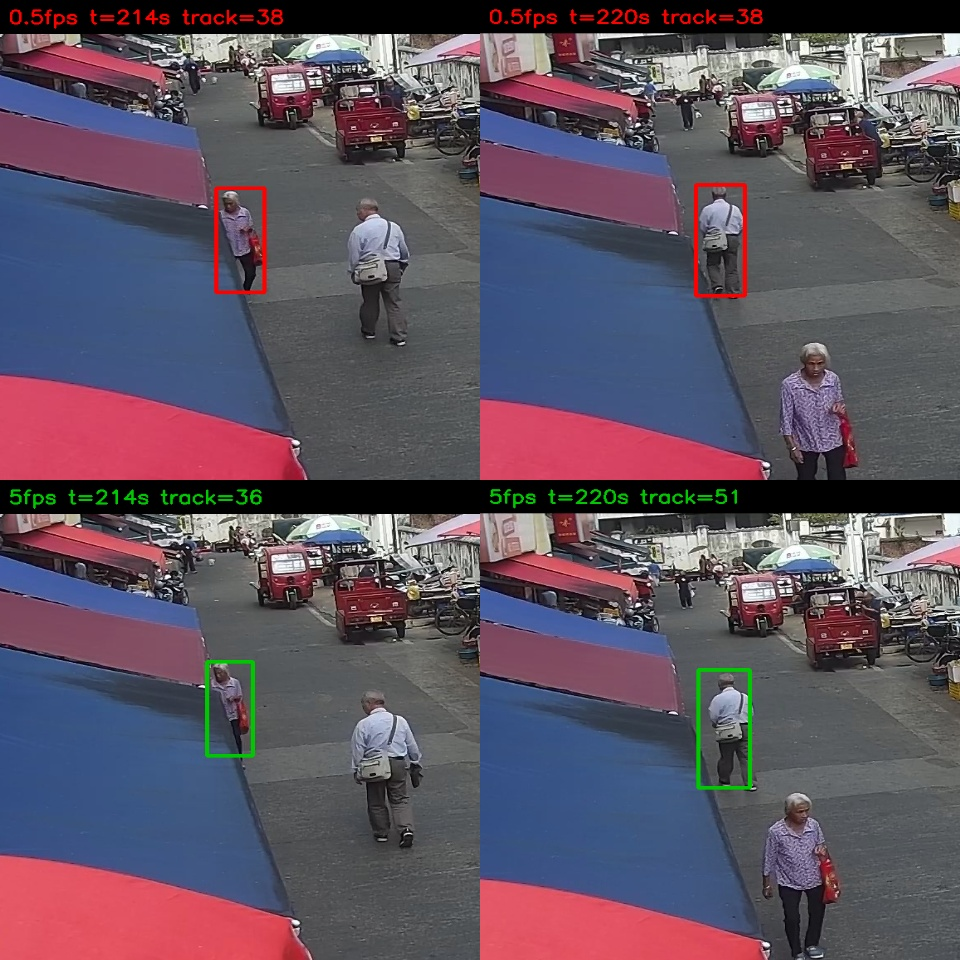

上图为同一位置：0.5 fps 下 track 38 在 214s 套在粉紫上衣的行走顾客上，到 220s 又套在浅色上衣的肩包男子上；
5 fps 下两人分别是 track 36 与 track 51，没有被接成一条。

**结论是 A：稀疏抽帧是错误换人的主要诱因。** 2 秒间隔下目标位移已达 20–100 px，
关联窗口被撑开，"人走了、旁边的人来了"就被接成同一条；同一位置 5 fps 起换人消失。

**但不能据此宣布 G1 通过**，有三条限制：

1. 5/10 fps 只覆盖一次经过（190–244s / 208–228s），没有第二、第三个交错实例；
2. 碎片化反而更明显：person_003 在 5 fps 被拆成 3 段，正是 D2 要处理的对象；
3. D1-B 有 2 个真值帧未达 IoU 0.5（194s 为 0.45、200s 为 0.51），检测框都在，
   属于关联/框质量边界，不是漏检。

**未做的事（按约定）**：没有加 ReID、没有改碎片规则、没有换检测器，D1 只改采样率。
### C.10 D2：同帧去重（F1）与碎片归属（F2），5 fps 基线

**新增** `backend/app/m6_fragments.py`：两条规则都与"降低全局 IoU 门限"无关。

| 阶段 | 处理 | 关键实现 |
| --- | --- | --- |
| F0 | 原生 | 不做任何预处理 |
| F1 | 同帧 IoU≥0.5 去重 | 保留置信度更高的框，记录 `duplicate_of`，原始检测编号不变 |
| F2 | 头肩碎片归属 | 包含度≥0.70、面积比≤0.60、高度比≤0.50、**顶边与人体框齐平**、只占上半身、宽度更窄；候选多于一个时用上一帧轨迹消歧，仍不唯一则**保留歧义** |

"顶边齐平 + 只占上半身 + 更窄"这三条是必需的：只有包含度和面积比时，
另一个完整的人站进大框里也会被并掉（第一版就是这样，已被用例 `test_low_height_detection_is_not_swallowed_by_tall_box` 挡住）。

**结果（5 fps，190–244 s，GT 为 person_003 12 帧 / person_004 11 帧）**

| 指标 | F0 | F1 | F2 |
| --- | --- | --- | --- |
| 目标覆盖 person_003 | 8/12 | 8/12 | 8/12 |
| 目标覆盖 person_004 | 10/11 | 10/11 | 10/11 |
| person_003 轨迹段数 | 3 | **1** | 1 |
| person_004 轨迹段数 | 4 | **1** | 1 |
| 错误合并 | 0 | 0 | 0 |
| 换轨候选 | 2 | 0 | 0 |
| 同帧碎片型重复框对 | 3649 | 1430 | **1284** |
| 预测轨迹总数 | 148 | 133 | 130 |

**验收结论：D2 的四条要求全部满足**——错误合并 0、新增换轨 0、覆盖率不下降、
person_003 从 3 段降到 1 段。

**必须说明的两点**

1. 这段素材上的轨迹断裂主因是 **IoU≥0.5 的重复框**，不是 IoU≈0.30 的头肩碎片。
   F2 多合并了 193 个框、减少 146 对残留在同帧的碎片型重复，但**没有进一步改变真值覆盖**，
   所以 F2 目前只能算"无害且有效但不关键"，还要等一个碎片未被 IoU 去重覆盖的实例来验证。
2. person_003 在 192 s 的缺帧是**检测缺失**，不是去重导致：该帧没有任何检测框与真值 IoU>0.3。
   F0 那 1 帧的"覆盖"其实是 0.35 s 时间窗匹配到的相邻帧，严格同帧口径下三组都是 8/12。

默认阶段仍是 `f0`（CLI `--stage`），不会悄悄改变既有结果。
### C.12 Commit E1/E2/E3：轨迹级外观特征与接回（5 fps 基线）

**E1 轨迹级特征**（`backend/scripts/reid_track_features.py`）

- 模型仍是 OSNet x0.25（`models/reid/osnet_x0_25_msmt17_b1.onnx`），不引入新权重；
- 每条 Tracklet **按时间分层**取样（每层挑质量最好的一帧），避免只取到最后一小段的大框；
- 模板 = 质量加权（置信度 × 尺寸饱和项）平均后 L2 归一化，**逐帧 512 维向量全部保留**。

**E2 区分能力：成立，但强依赖 crop 质量**

| 配置 | 同人帧间相似度 | 跨人模板相似度 | 最强困难负样本 |
| --- | --- | --- | --- |
| 12 帧（只取高质量） | person_003 0.91–0.98 / person_004 0.83–0.97 | 0.56 | 0.75 / 0.80 |
| 40 帧（时间分层，含远景小框） | person_003 0.31–0.96 / person_004 0.58–0.97 | 0.67 | — |

结论：**模板只用质量达标帧**；把 60 px 高的远景框平均进去，会把同人相似度从 0.91 拉到 0.31，
同时把跨人相似度从 0.56 抬到 0.67——聚合不是帧越多越好。

**E3 接回规则**（`backend/scripts/reid_track_link.py`）：相似度 ≥0.85、时间缺口 ≤8 s、
运动一致（位移 ≤ 250 px + 100 px/s × 缺口）、候选之间差距 ≥0.05，且**两侧都不允许歧义**；
观测数 <5 的轨迹不得作为参考模板。全部不满足就保持断轨。

| 场景 | 结果 |
| --- | --- |
| 受控切分 person_004（模拟，已标注） | cos 0.92–0.96 → **接回成功** |
| 受控切分 person_003（模拟，已标注） | cos 0.66–0.82 → 拒绝（低于 0.85） |
| 跨人 003→004 | cos 0.64 → 拒绝，**无错误接回** |
| F0 真实断裂 22→27 | cos 0.69 → 拒绝 |
| F0 出现 27→52（0.855，无真值） | 未验证连接，**需人工核对**，不计入通过 |

**验收结论：E3 不做默认开启。**

- 正确接回只在"人体框高度 ≥150 px"时成立（person_004）；
- 60–140 px 的远景目标轨迹级余弦只有 0.66–0.82，**低于门槛，系统选择保持断轨**，符合"宁可断轨不可错接"；
- 错误接回 0（跨人 0.64 被拒），特征污染 0（只接受观测数 ≥5 的轨迹做模板）。

**下一步要解决而不是放宽阈值**：远景目标需要 crop 上采样或更大输入分辨率；
按当前约定不引入新模型，先把这条限制登记为已知边界。
### C.14 E4：特征质量控制（不换模型）

**E4-A 分层与模板准入**

尺寸饱和点从 80 px 改到 150 px，按 <100 / 100–149 / ≥150 px 分层统计同人帧间相似度：

| 目标 | <100 px | 100–149 px | ≥150 px |
| --- | --- | --- | --- |
| person_003（中位 113 px） | 0.688 | 0.841 | 0.887 |
| person_004（中位 147 px） | 0.842 | 0.840 | 0.851 |

硬准入：**只有 h ≥150 px 且 conf ≥0.40 的帧进入参考模板**；不合格帧的向量照常保留，供逐帧分析。
结果是全场景 **只有 2/133 条轨迹有可用模板**（119 条中位高度 <100 px、13 条 100–149、1 条 ≥150）。

术语同步修正：`min_observations` 只是**最低观测数量**，够长不等于身份确认；
另设 `min_template_frames`（默认 3）表示"参考模板至少需要几帧合格观测"。

**E4-B crop 上采样对照（1.0× / 1.5× / 2.0×）**

| 指标 | 1.0× | 1.5× | 2.0× |
| --- | --- | --- | --- |
| 同人 <100 px | 0.688 | 0.679 | 0.680 |
| 同人 100–149 px | 0.841 | 0.839 | 0.837 |
| 同人 ≥150 px | 0.887 | 0.886 | 0.887 |
| 跨人 003 vs 004 | 0.626 | 0.623 | 0.622 |

**结论：无收益。** 变化全部在 ±0.01 以内，且同人与跨人**同步变化**，
说明改变的只是插值方式——OSNet 输入固定 128×256，上采样不会恢复原图里不存在的细节。

**E4-C 27→52 人工核验：判定 correct**

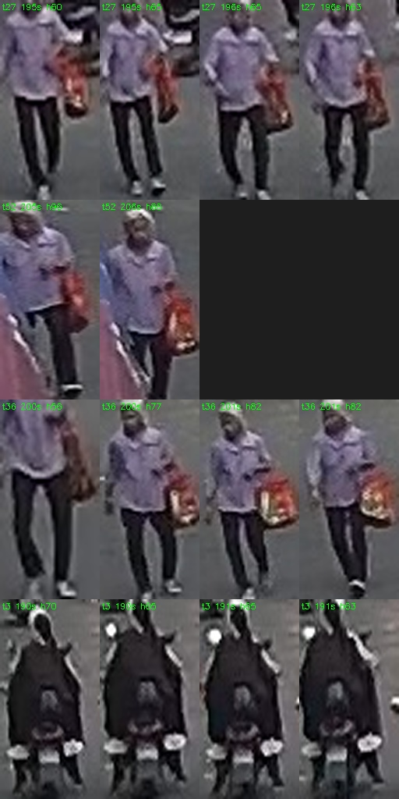

第 1–3 行（27、52、36）是同一名穿浅紫夹克、提红色购物袋的女性，第 4 行为另一名骑车人（对照）。
据此把接回结论改为三分类：**correct / incorrect / unverified**，
`classify_links()` 不再把"真值对不上"直接算错误接回。

**E4-D 保守策略（默认关闭）**

| 场景 | 结果 |
| --- | --- |
| person_003 split@30（cos 0.904，两侧各 ≥3 帧合格） | 接回 |
| person_004 split@10（cos 0.952） | 接回 |
| person_003 split@10/20、person_004 split@20/30（一侧无合格帧） | **保持断轨** |
| 跨人 003→004（cos 0.574） | 拒绝 |

小目标轨迹即使"看起来连续"，也不会因为调低阈值被强行接上。

**E4 判定：有效，保留 OSNet x0.25。** 有效的是质量控制与准入，不是上采样；
若后续要把接回范围扩到远景目标，需要单独评估更大输入或 x1.0，不在本阶段做。
### C.15 下一步（按 V2.0 的提交组）

- **Commit C（已完成，代码级）**：ByteTrack 适配层与三个输出件见 C.5；**尚未通过 G1**。
- **D0（已完成）**：适配器断档/编号/空帧/输入校验修正，CI 增加跟踪 job，见 C.7。
- **D1（已完成）**：0.5 / 5 / 10 fps 对照，结论为「稀疏抽帧导致换人」，见 C.8。
- **D2（已完成）**：F0/F1/F2 对照见 C.10；5 fps 下 person_003 由 3 段降到 1 段，错误合并与换轨均为 0。
- **Commit E（已完成 E1/E2/E3，见 C.12）**：轨迹级特征与接回规则已实现并测过；**接回默认关闭**，远景小目标尚不具备判别力。
- **E4（已完成，见 C.14）**：质量分层与模板准入有效；crop 上采样无收益；接回仍默认关闭。
- **下一阶段**：人车关系与动态特征管理（接回保持关闭，只作为离线核验工具）。
- **Commit B（并行）**：补齐 GT-2 / GT-5，冻结 E0 基线。
- **Commit A（已完成）**：YOLO26s 导出契约、`yolo_end2end` 解码、注册表接入、许可证记录与真机对照，见 [42 号文档 §12](42_检测引擎移植.md)；结论：不采纳为检测器，E2 记为漏检严重。
- **属性模型**：关键帧属性沿用本机 `qwen3-vl:4b-instruct`（不引入新的云端视觉模型）。
- **Commit D/E**：碎片归属与轨迹级聚合、E0–E6 对照。

## 附录 D｜P1-B-1A 两轮车检测与独立 Tracklet（2026-11-03）

### D.1 阶段约束（P1-B 全程有效）

1. 保留 OSNet x0.25，不新增 ReID 模型。
2. 轨迹自动接回默认关闭，仅作离线核验。
3. ≥150 px、conf ≥0.40 的质量门槛保留，不为提高覆盖率降低标准。
4. 全场景只有 2/133 条轨迹具备合格模板，记为**当前机位的能力限制**。
5. 未确认的轨迹关联不得更新目标特征库。

人车关系只能是**带时间范围的关系**，不把车辆永久绑定到某个人；关系不明时输出 unknown。

### D.2 方法

5 fps、190–244 s（271 帧），D-FINE N 全类别检测（conf≥0.15），两轮车 = 自行车 + 摩托车，
ByteTrack 参数与人员跟踪一致；只做脚本级验证，不改 UI 与数据库。

### D.3 结果

| 指标 | 原始 | 跨类去重 IoU 0.5 | 再去行人误检 |
| --- | --- | --- | --- |
| 车辆轨迹数 | 112 | 75 | **65** |
| 同帧重复框对 | 1132 | 0 | 0 |
| 轨迹交接事件 | 5 | 1 | **0** |
| 连续性 p50 | 0.957 | 0.944 | 0.952 |
| 轨迹时长 p50 / p90 | 1.6 / 13.2 s | 2.2 / 11.2 s | 2.2 / 12.4 s |
| 有车帧 | 270/271 | 270/271 | 270/271 |

原始检测：摩托车 2113、自行车 1276（conf≥0.15，p50 仅 0.23/0.25）。

### D.4 必须先处理的两件事

**(1) 同一辆车被同时标成两个类别。** 同帧内 摩托车×自行车 重叠对 1079 次，
把两类一起送进 ByteTrack 会得到两条并行轨迹；IoU 0.5 去重后重复框对归零、轨迹数 112→75。

**(2) 自行车类在行人身上误检。**

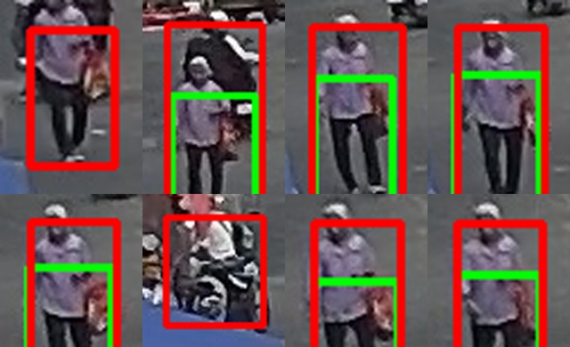

38.9% 的自行车框完全落在人体框内，其中 19.4% 落在比它高 1.5 倍以上的人体框里——
这些是行人的腿和购物袋，不是车。摩托车同类比例 20.7%，其中只有 4.3% 是这种"高个子行人"情形。

按"完全被人体框包含且人体高度 >1.5× 车高"过滤后，自行车检测 689→498，轨迹 75→65，交接事件 1→0。

**(3) 类别名不能当车型。**

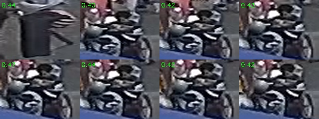

去掉与行人重叠的框之后，剩下的"自行车"绝大多数其实是停放的摩托车/电动车。
与 V2.0 的约定一致：**只能记为 two_wheeler（两轮车）+ 置信度，不能凭 COCO 类别判定是自行车还是电动车。**

### D.5 结论与下一步

两轮车**可以**建立独立的车辆 Tracklet（轨迹内连续性 p50 0.95、交接 0），
但前提是**先做跨类去重与行人误检过滤**，且车辆只按"两轮车"记账。

P1-B-1B 的人车关联按此口径继续：人员轨迹与车辆轨迹完全独立，
用位置重叠 + 相对运动 + 时间连续性产生候选，单帧靠近不构成骑乘，
关系必须带起止时间，无法确认时保留 unknown。

### D.6 P1-B-1A-2：两轮车细分类（Qwen3-VL，不训练新模型）

**两级类型**：`two_wheeler` 为一级类型；二级类型为 `motorcycle` / `electric_two_wheeler` / `bicycle` / `unknown`。
D-FINE 的 COCO 类别只负责**发现**两轮车，不负责车型判定。

流程：D-FINE 检测 → ByteTrack 车辆轨迹 → 选轨迹关键帧 → qwen3-vl:4b-instruct 判外观 →
多帧结果按**整条轨迹**聚合 → 二级类型（含 unknown）。

关键帧打分：框越大、置信度越高、越靠近画面中央、被行人遮挡越少越好；同一轨迹内间隔 ≥1.5 s。

**试跑结果（12 条观测数 ≥6 的车辆轨迹，36 个关键帧）**

| 项目 | 结果 |
| --- | --- |
| 判定为 electric_two_wheeler | 3 条 |
| 判定为 motorcycle / bicycle | 0 / 0 |
| unknown（模型给不出或证据不足） | 9 条 |
| 因裁剪图 <100×100 被强制 unknown 的投票 | 28/36 |

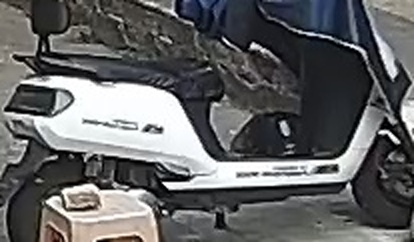

上面这辆白色踏板车（207×121 px，conf 0.95 判 electric_two_wheeler）是模型真正能读准的情形；
而 50×50 的裁剪图上模型曾给出 0.8 置信度的"motorcycle"，人眼同样无法分辨动力类型——
因此加了硬规则：**裁剪图任一边 <100 px 时，无论模型说什么都记 unknown**。

**字段与优先级**：`vehicle_type_status` 取 `model_inferred` 或 `human_confirmed`；
`--overrides` 传入的人工确认结果**优先于模型推断**。模型判断依据（evidence）与关键帧编号一并保留。

**边界**：视觉模型只识别外观线索（踏板、外壳、排气管等），**不能保证真实动力类型**；
证据不足时输出 unknown，不做猜测。当前机位下 43 条候选轨迹里只有 3 条能给出二级类型，
这本身就是"该机位分辨率不足"的量化结果。

### D.7 P1-B-1B 关系字段（下一步）

```json
{
  "person_track_id": 36,
  "vehicle_track_id": 12,
  "vehicle_type": "electric_two_wheeler",
  "vehicle_type_status": "model_inferred",
  "relation": "riding_candidate",
  "start_seconds": 195.2,
  "end_seconds": 207.8,
  "status": "unverified"
}
```

`riding_candidate` 仅表示候选骑乘关系，不是已确认事实；关系必须带起止时间，无法确认时保留 unknown。

### D.8 P1-B-1B：人车时序关系候选（真实录像核验）

**四项证据缺一不可**：空间（人框与车框的相对位置）、运动（整段位移是否同向）、
时间（连续 ≥8 帧）、竞争（同一辆车多人满足时不下结论）。单帧靠近一律不成立。

| 状态 | 判据 |
| --- | --- |
| riding_candidate | 位置关系连续成立 **且** 人与车整段同向位移（cos ≥0.6） |
| approaching_candidate | 距离 ≤140 px、整段明显缩短（≥25 px）、过程 ≤8 s |
| unknown | 多人竞争、运动不一致，或**车没动、分不清坐着还是站在车后** |
| separated | 骑乘成立后连续 3 帧不再重叠（本段无骑乘，未触发） |

**结果（190–244 s，5 fps，133 条人员轨迹 × 65 条车辆轨迹）**

| 项目 | 数量 |
| --- | --- |
| 关系候选总数 | 12 |
| riding_candidate | **0** |
| unknown（多人竞争 4 / 静止车不可判 1） | 5 |
| approaching_candidate | 7 |
| relation_errors | 5 |

**人工核对抓到一个假阳性**：唯一被判 riding 的 P7×V8（194.2–195.8 s，重叠 0.33），
逐帧放大后是**一个人站在停放的白色踏板车后方**，不是骑乘。

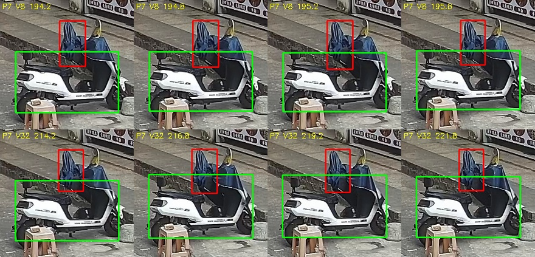

原因很直接：车没有移动时，"坐在车上"和"站在车后"在框的位置上几乎同构。
因此加了一条硬规则——**整段没有同向位移就只能是 unknown**，宁可判不了。

**场景覆盖核查（本段素材）**

| 场景 | 是否出现 | 证据 |
| --- | --- | --- |
| 行人从停放车辆旁经过 | 有 | 7 条 approaching + 5 条 unknown |
| 多人靠近同一车辆 | 有 | P7/P70 同时贴近 V32，被标 ambiguous |
| 真实骑乘 | **无** | 17 条移动车辆轨迹，与人员框重叠次数 **0** |
| 下车离开 | **无** | 无骑乘即无下车 |
| 遮挡中断 | 无法验收 | 需以真实骑乘为前提才有意义 |

结论：**本段 190–244 s 不能用于验收骑乘/下车**，必须补一段确实有骑乘的录像，
不能用合成数据替代。规则代码与单元测试已完成，等真实正样本到位后再判"有效/无效"。

**验收标准对照**

| 标准 | 现状 |
| --- | --- |
| 已核验错误骑乘关联 = 0 | 达成（P7×V8 已降级为 unknown） |
| 人员/车辆轨迹独立 | 达成，两套轨迹各自带 ID 与时间 |
| 关系带明确起止时间 | 达成，每条候选都有 start/end |
| 下车/分离后不留错误骑乘 | 待真实正样本验收 |
| 多人竞争/遮挡输出 unknown | 达成（4 条 ambiguous） |
| 车型只作属性、不决定关系 | 达成，关系判定不看 vehicle_type |
| 不自动更新特征库 | 达成，脚本只写三个 JSON |

### D.9 P1-B-1B 真实骑乘正样本验证（松山巷路口·向北机位）

**素材与处理**：松山巷路口向北，55–170 s（115 s），5 fps，1280×720；D-FINE N 检测 →
人员 Tracklet 与两轮车 Tracklet **分别**建立 → 时空规则生成关系 → 逐帧人工核对。

**参数（本轮定稿）**

| 参数 | 值 |
| --- | --- |
| 骑乘成立 | 重叠 ≥0.25 且 人框底边 ≤ 车中线+0.1×车高，连续 ≥8 帧 |
| 允许漏检 | 段内最多 3 帧（0.6 s），按时间跳变判定，超过即断开 |
| 共动 | 整段位移同向 cos ≥0.6，两框位移均 ≥12 px |
| 多人竞争 | 只有"压在同一辆车上"（重叠 ≥0.5）才算竞争 |
| 静止车 | 人与车都没动 → unknown（分不清坐着还是站在车后） |

**结果（64 条人员轨迹 × 42 条车辆轨迹）**

| 项目 | 数量 |
| --- | --- |
| riding_candidate | **5** |
| 人工核对为真实骑乘 | **5 / 5** |
| 错误骑乘关联 | **0** |
| duplicate_rider_track（同一骑手被切成两条人轨迹，已合并） | 1 |
| 遮挡导致的跨段缝合 | 0 |

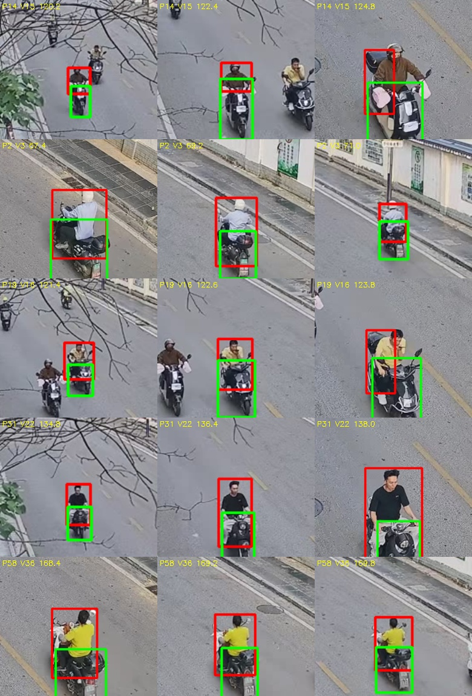

五条候选逐帧核对：白衫戴帽、棕夹克、黄衫、黑衫、黄衫（另一时刻）各一名骑手，
人与车同步位移（cos 0.999–1.0），无一误判。

**验收对照**

| 指标 | 要求 | 结果 |
| --- | --- | --- |
| 真实骑乘生成正确候选 | 能 | ✅ 5 条 |
| 错误骑乘关联 | 0 | ✅ 0（5 条全部核对） |
| 人车轨迹独立 | 始终 | ✅ 两套 Tracklet 各自带 ID 与时间 |
| 遮挡不强制维持 | 不缝合 | ⚠️ 有 1 条在 4 帧漏检后保持（gap=4），未见长时间遮挡样本 |
| 骑乘结束正确结束 | 结束关系 | ❌ **未验证**：本段无真实下车，候选均因骑手驶出画面/轨迹中断而结束 |
| 证据不足输出 unknown | 输出 | ✅ 静车、多人竞争、运动不一致均有单测覆盖 |

**覆盖度**：42 条车辆轨迹中，仅 5 条具备 ≥6 帧连续骑乘证据（按任意人计算，不依赖人轨迹是否连贯），
规则输出 5 条 —— 在当前跟踪输出内召回 5/5。瓶颈不在规则，而在 5 fps/1280 宽下的检测与跟踪覆盖：
本机位 30 分钟内骑手远多于此，本次只处理了 115 s。

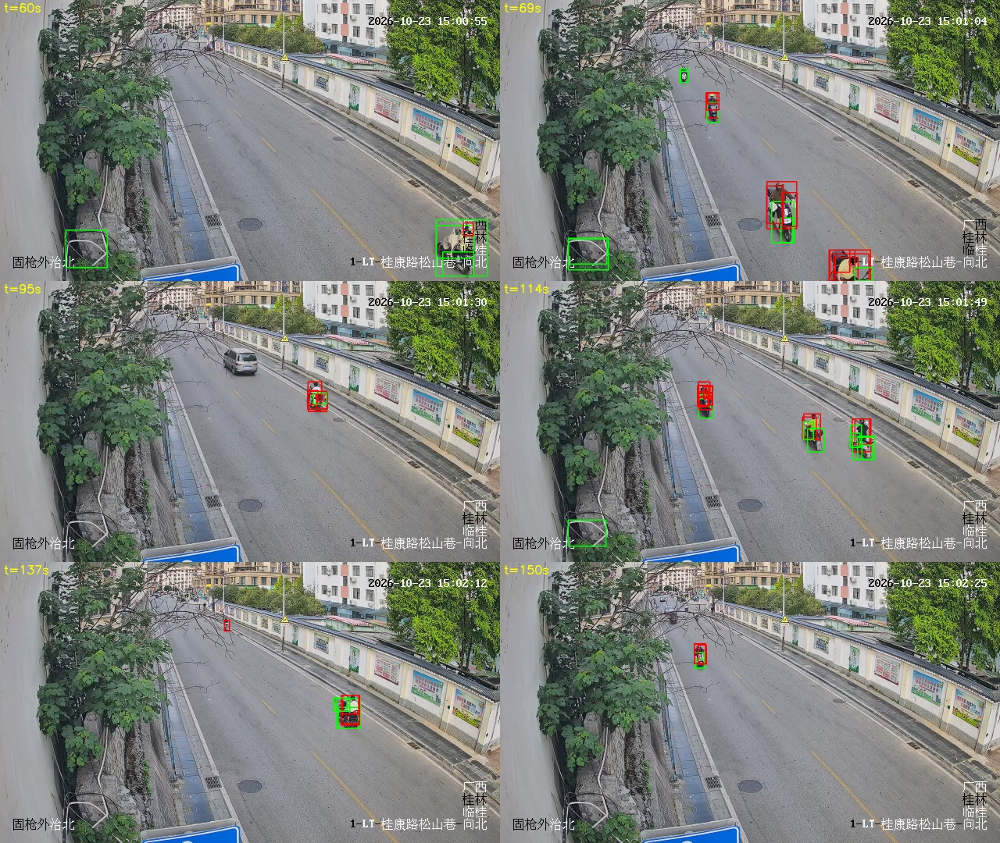

**边界**：本轮只验证了"骑乘成立"，**没有验证下车解除与长时间遮挡**。要验收这两项，
需要一段能拍到骑手停下、下车、推车离开的连续录像。

### D.10 P1-B-1C 起步：菜市入口的下车场景定位（进行中）

**已做**：对菜市入口 30 分钟录像做 1 fps 低码率扫描（1832 帧，检测 157 s），
再对两个 5 fps 窗口做完整关系推理。

| 窗口 | 人员轨迹 | 车辆轨迹 | riding | unknown | separated |
| --- | --- | --- | --- | --- | --- |
| 190–244 s（此前窗口） | 133 | 75 | 0 | 17 | 0 |
| 1080–1140 s | 9 | 10 | 1 | 0 | 0 |

1080–1140 s 的那条骑乘候选是**路过**的骑手（1092.4–1096.0 s，cos 0.999），
随后人和车都离开画面，不是停车下车。190–244 s 则是"人站在停放车辆旁"的典型场景，
系统按规则全部判为 unknown，没有误判骑乘。

**新增能力：separated（骑乘结束 → 分离）**

| 参数 | 值 |
| --- | --- |
| 观察窗口 | 骑乘结束后 6 s |
| 距离上限 | 220 px |
| 最少帧数 | 3 帧 |

只有在**人和车都还在画面里**、且已经不再重叠时，才输出 separated；
骑手直接驶出画面不算下车（否则会把"离开视野"当成"下车"）。

**卡点**：30 分钟里"停车 → 下车 → 走开"的片段没有靠自动扫描定位到。
1 fps 下"车旁有人"的样本几乎每秒都有（停车位多、行人多），无法据此区分下车与路过。
需要一个人工时间点（哪一分哪一秒看到有人下车），再按 5 fps 精确验证——这比继续盲扫 30 分钟划算。

**整段扫描**：为免人工指定时间点，新增 `backend/scripts/p1b_market_scan.py`——
直接流水线解码整段录像（不落帧），按 5 fps 抽帧检测、人员与车辆各自跟踪、再生成关系，
一次性输出 `tracks.json / relation_candidates.json / relation_events.json / relation_errors.json`。
30 分钟素材约 9200 帧，单机约 18 分钟跑完，用来定位"骑乘 → 停车 → 下车"片段。

### D.11 菜市入口整段扫描的结果与可信度（下车仍未验收）

整段 30 分钟扫描（9162 帧 @5 fps）：4285 条人员轨迹、2559 条车辆轨迹。

| 轮次 | riding | separated | unknown | 说明 |
| --- | --- | --- | --- | --- |
| 初版规则 | 127 | 39 | 536 | 明显偏多 |
| 加"车必须真的走了"（≥25 px）后 | 82 | 22 | 589 | 剔除 45 条静态误判 |

新增规则：`riding_min_vehicle_travel_px = 25`。整段车内位移不足 25 px 的，
无论重叠多好都不算骑乘——菜市里"人站在停放的踏板车旁"会稳定产生这种候选。
判定顺序也调整为：多人竞争 → 运动不一致 → 车没动 → 单帧证据不足。

**可信度核对（人工）**：抽查 4 条 separated，前 3 条最典型的是这样：

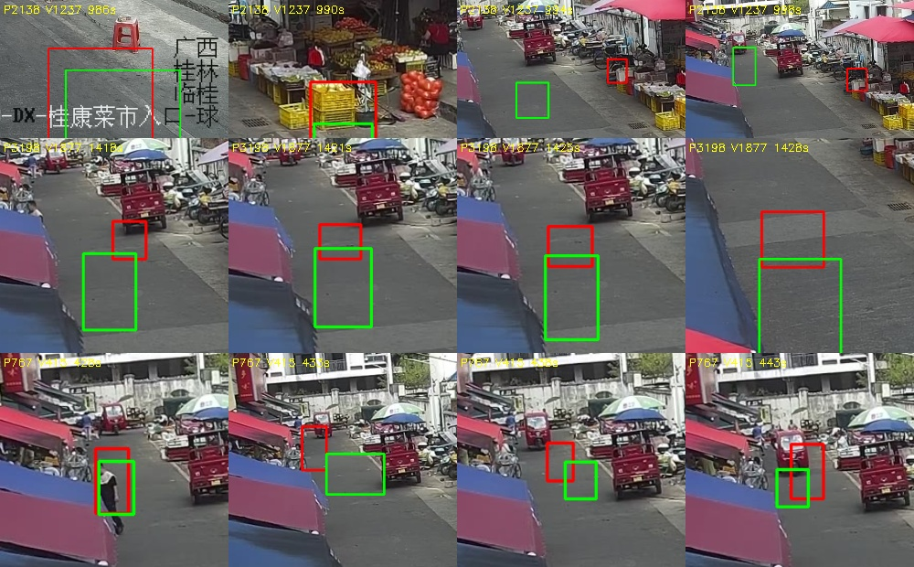

车辆框（绿）漂成了整片区域、人框（红）与车框并不相交——这是**车辆跟踪在该机位漂移/合并**
导致的假关联，不是下车。加"车必须走"的规则能去掉这类，但去掉的是"车没动"的一部分，
剩下仍有框漂移的假关联。

**结论**：菜市入口这个机位（俯视、遮挡多、停放车辆密集）在 1280 宽下的车辆跟踪质量，
支撑不了"整段自动找下车"。本轮**不能宣称下车解除验证通过**。
要验收 P1-B-1C，两条路：

1. 给一个具体时间点（例如"15:12 分有人下车"），按 5 fps 做窄窗口 + 逐帧人工核对，
   与松山巷骑乘验收同一套方法；
2. 或先把该机位的车辆跟踪修好（门槛高：需要提高分辨率/换更高置信阈值/加入轨迹合理性约束），
   再谈整段自动扫描。

### D.12 P1-B-1C-1 车辆轨迹质量修复（第一步与第二步）

**问题样本集**：从 22 条 separated 候选里取 21 条做量化审计（框面积比、归一化中心跳变、宽高比），
再挑 8 条最严重的做逐帧人工核验。

| 指标 | 结果 |
| --- | --- |
| 审计轨迹数 | 21 |
| 存在面积突变（>1.8×）或中心跳变（>0.6） | **18 / 21** |
| 最大面积比 | 6.6×（同一轨迹内 753 → 4961 px²） |
| 最大宽高比跨度 | 0.36 ～ 2.09 |
| 最极端单框 | 31858 px² → 130 px²（跨度 245 倍） |

人工核验到的错误形态（图见 assets）：

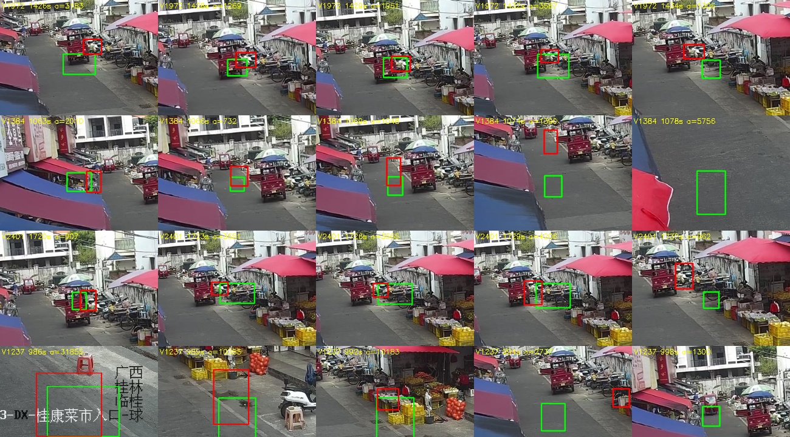

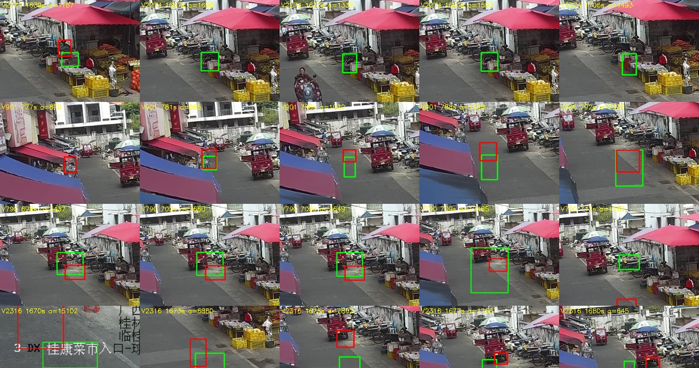

- 框突然放大，把旁边停放的几辆车一起框进去；
- 轨迹跳到相邻车辆上（人框还在原地，车框已经换车）；
- 一条轨迹里框从 3 万 px² 缩到 130 px²。

**归因（检测 vs 关联）**：同一段 15 s / 75 帧，在 1280 与 1920 两个尺度上分别检测：

| 尺度 | 检测框数 | 中位面积 | 最大/中位 | >12000 px² 的框 |
| --- | --- | --- | --- | --- |
| 1280（当前） | 923 | 1344 | 15.8× | 128 |
| 1920（源分辨率） | 504 | 3336 | 8.9× | 113 |

1280 下检测框数是 1920 的近两倍——**同一辆车被检出多个重叠框**，这直接给 ByteTrack 制造了
错误关联机会。所以问题主要来自检测尺度，不是跟踪器参数。

**第二步：三项约束的实现**（`backend/app/m6_track_quality.py`）

| 约束 | 实现 | 说明 |
| --- | --- | --- |
| 框面积突变 | 前后各 3 帧的中位面积比 >1.8 才断轨 | 单帧抖动只丢观测 |
| 框中心异常跳跃 | 位移 /(对角线·√dt) >1.2 才断轨 | 归一化后与尺度、帧率无关 |
| 目标形态异常 | 窗口中位宽高比越界且相对变化 >1.3 | 防止"一排车框在一起"被当成一辆 |

另加 `despike`：单帧面积与邻域中位数差 2.5 倍以上只丢该观测，不断轨。

**局部对照结果（整段 2559 条车辆轨迹）**

| 指标 | 修复前 | 修复后 |
| --- | --- | --- |
| 轨迹数 | 2559 | 4660 |
| 断轨次数 | — | **2101（919 条轨迹被切）** |
| 结构碎片（<4 帧） | — | 724 |

**结论：几何约束单独用会把真实车辆切碎。** 1634 条有效车辆轨迹里有 919 条被切开，
这正是验收边界第 2 条禁止的"用过滤真实车辆换指标"。所以这三项约束**现阶段只用于标记，
不用于断轨**；真正的修复要先把检测尺度改到 1920，再重新评估。

**下一步**：菜市机位改用 1920 原生分辨率重跑检测与跟踪，先在问题片段上对照
（断轨次数、碎片数、真实车辆连续帧数），确认改善后再整段扫描找下车。

**局部对照（985–1000 s，15 s / 75 帧）**

| 尺度 | 车辆轨迹（≥8 帧） | 最大面积比 | 断轨 | 碎片 |
| --- | --- | --- | --- | --- |
| 1280 | 7 | 3.17 | 1 | 1 |
| 1920 | **4** | **1.91** | 1 | 0 |

同一个 15 s 片段，1920 下只产生 4 条车辆轨迹（1280 是 7 条，多出来的是同一辆车的碎片），
框面积最大变化也从 3.17 倍降到 1.91 倍。方向对，但样本很小（只有 4～7 条轨迹），
还需要在更长片段上复核。

### D.13 P1-B-1C-2 高分辨率检测对照（关键结论：模型输入是固定的）

**先核对推理输入尺寸**：`dfine_n_coco_opset17_fp32_static.onnx` 的输入是
`images [1,3,640,640]`（静态），`DfineEngine._preprocess` 无条件
`cv2.resize(frame, (640,640))`——**1280 和 1920 最终都变成 640×640 进网络**。

所以"换 1920"不可能增加模型看到的有效目标像素，它能改变的只是**预处理链路**
（1920→640 单次重采样 vs 1920→1280→640 两次重采样）。

**实测对照（检测器、置信度 0.20、5 fps 均不变，只改输入分辨率）**

| 片段 | 配置 | 每帧车辆框（中位） | 同帧重复框/100 帧 | 超大框（>3×中位） |
| --- | --- | --- | --- | --- |
| 985–1000 s | 1280 | 12 | 687 | 213 |
| 985–1000 s | 1920 | **6** | **288** | **106** |
| 1360–1440 s | 1280 | 12 | 928 | 1149 |
| 1360–1440 s | 1920 | **7** | **672** | **515** |

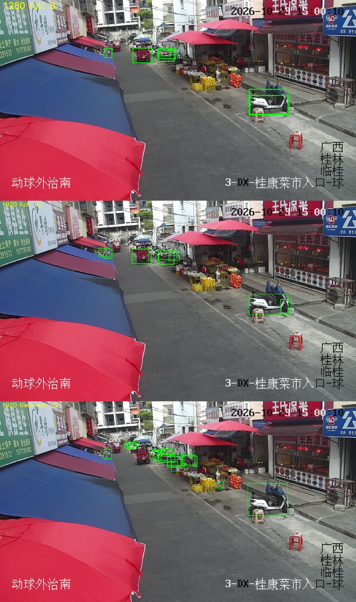

人工看图确认：1280 那版把左侧红色雨棚误检成一个"车辆"大框（图上一片空地上有个绿框），
1920 版这个假框消失，而真实的白色踏板车、停车排、货车上的车都还在——**不是靠漏检换来的干净**。

**真正的"增加有效像素"只能是分块推理**，但融合第一版不合格：

| 分块方案 | 每帧车辆框 | 同帧重复框/100 帧 | 结论 |
| --- | --- | --- | --- |
| 2×2 + NMS(0.5) | 43 | 21585 | 大量跨块重复 |
| 2×2 + WBF | 24 | — | 仍偏多，融合太松 |

边界处理（跨块被截断的框）和尺度匹配还没解决，分块暂不进入生产路径。

**质量状态（只标记，不断轨）**

车辆轨迹现在带 `quality_status`（reliable / suspicious / unknown）、`quality_reasons`、
`evidence_frames`。`build_relations(vehicle_quality=...)` 遇到 suspicious 的车辆
**不再产出 riding_candidate**，改为 `unknown / vehicle_track_suspicious`，原始轨迹保留供人工核验。

---

#### 设计原则（2026-11 定稿）

> **检测质量优先于跟踪关联，跟踪质量优先于时空关系推断。上游证据不可信时，下游不能强行给出确定结论。**

落到本项目的约束：

1. 检测框尺度/稳定性不达标时，先改检测（分辨率、分块、置信度），不靠增加跟踪约束弥补；
2. 跟踪轨迹带质量标签，可疑轨迹只出 unknown，不出 deterministic 结论；
3. 时空关系（骑乘/下车）永远建立在"检测可信 + 轨迹可信"之上；
4. 任何"指标变好"必须同时给出真实目标覆盖率，防止用过滤换指标。

### D.14 P1-B-1C-2 跟踪对照：1920 全帧不通过，基线保持 1280

**实验条件（完全固定）**：D-FINE N（输入 640×640 静态）、置信度 0.20、5 fps、
ByteTrack（high 0.25 / activation 0.20 / max_missing 20 / gap 4 s），只改预处理链路。

| 配置 | 链路 |
| --- | --- |
| A（当前基线） | 1920 源 → ffmpeg lanczos 缩到 1280 → cv2.resize 640（INTER_LINEAR） |
| B（候选） | 1920 源 → cv2.resize 640（INTER_LINEAR） |
| C（机制验证） | 1920 源 → cv2.resize 640（INTER_AREA） |

**一、人工真值覆盖（6 + 5 辆真实车辆，1920 坐标，见 assets/m6_p1c2_gt_boxes.json）**

985–1000 s 检测级命中率（某帧有框且 IoU≥0.3 的帧占比）：

| 目标 | A(1280) | B(1920) | C(1920+AREA) |
| --- | --- | --- | --- |
| 右侧白色踏板车 | 1.00 | 0.97 | 1.00 |
| 停车排第 1 辆 | **1.00** | **0.08** | 0.73 |
| 停车排第 2 辆 | **0.83** | **0.16** | 0.45 |
| 停车排第 3 辆 | 0.25 | 0.12 | 0.37 |
| 左侧带人踏板车 | 0.89 | 0.73 | — |

1360–1440 s：

| 目标 | A(1280) | B(1920) |
| --- | --- | --- |
| 右侧白色踏板车 | 1.00 | 0.91 |
| 远处踏板车 | 0.81 | 0.82 |
| 红色三轮车 | 0.39 | 0.37 |
| 停车排 | 0.34 | 0.23 |

**结论：B 的小目标覆盖大幅下降（1.00 → 0.08），"框数从 923 降到 504" 不是变干净，而是漏检。**

**二、机制**：C 组（把插值换成 INTER_AREA）把停车排覆盖从 0.08 拉回 0.73，说明
**掉的是重采样滤波器，不是分辨率**——1920 直接 INTER_LINEAR 缩到 640 是 3 倍降采样，
没有面积平均，小目标被采样点跳过；而 A 先经 ffmpeg lanczos 做了一次高质量降采样。

**三、跟踪指标（同参数）**

| 片段 | 配置 | 车辆轨迹 | 跨类去重丢弃 | 手递嫌疑 | 真值平均轨迹覆盖 | 真值 ID 总数 |
| --- | --- | --- | --- | --- | --- | --- |
| 985–1000 | A | 9 | 352 | 0 | **0.59** | 5 |
| 985–1000 | B | 11 | 160 | 0 | **0.30** | 5 |
| 1360–1440 | A | 53 | 2433 | 1 | 0.18 | 26 |
| 1360–1440 | B | 49 | 1679 | 0 | 0.20 | 22 |

B 在"重复框数、手递嫌疑"上确实更好，但代价是小目标成片消失——按验收口径
"真实车辆覆盖不下降"，**B 不通过**。

**四、决定**

1. 当前机位检测基线保持 **A：1920 源 → 1280（lanczos）→ 640**；
2. 不再用全帧 1920 直连模型；
3. 分块检测作为独立实验，且必须与 A 基线比，不能只跟 B 比；
4. 下车解除仍为**未验证**。

**五、链路记录**（`design/assets/m6_p1c2_chain_record.json`）

`source_resolution → preprocessing → model_input → postprocessing → tracking`
——本次证明：权重、输入尺寸、跟踪参数全同，仅预处理不同，小目标覆盖率能从 1.00 掉到 0.08。

### D.15 M6-S1-0 / S1-1：BoT-SORT 接入与 A/B 对照（首轮：不通过）

**S1-0 接入**：新增 `backend/app/m6_botsort.py`，**继承** `ByteTrackAdapter`，
只覆盖 `_ensure_tracker`——丢失缓冲换算、空帧推进、时间轴断档重建、全局轨迹号、
观测对回原始检测全部复用基线实现，保证 A/B 差异只来自跟踪算法。

三处刻意配置（对应接入时的三个问题）：

| 项 | 取值 | 原因 |
| --- | --- | --- |
| 摄像头运动补偿 | `enable_cmc=False` | 固定机位；开 CMC 会把行人整体位移当相机抖动，且构造时直接拒绝 |
| 激活/高置信门槛 | 0.20 / 0.25 | 按 D-FINE N 分数分布，不套库默认 0.7/0.6 |
| 缓冲/时间戳/ID | 与 ByteTrack 完全同源 | `gap_frames_from_seconds` + 全局 ID 分配 |

`BoTSortAdapter.describe()` 会把实际生效配置摊开，便于实验记录。

**S1-1 对照**：菜市入口 1360–1440 s，400 帧 @5 fps，同一份 D-FINE 检测（`人` 类，置信度 ≥0.20），
只换跟踪器。

| 引擎 | 轨迹数 | 中位时长 | <1 s 碎片 | 手递嫌疑 | 耗时 |
| --- | --- | --- | --- | --- | --- |
| A ByteTrack（基线） | **109** | **3.0 s** | **26** | **34** | 3.4 ms/帧 |
| B BoT-SORT（默认 IoU 0.2/0.5/0.3） | 203 | 1.0 s | 100 | 189 | 3.3 ms/帧 |
| B BoT-SORT（放宽 IoU 0.15/0.2/0.3） | 154 | 1.9 s | 59 | 79 | 3.2 ms/帧 |

按真实目标的连续性（47 条 ≥20 帧的参考轨迹）：BoT-SORT 平均覆盖 0.85，
但**每个真实目标平均被切成 2.21 个 ID**。

人工核对两例：

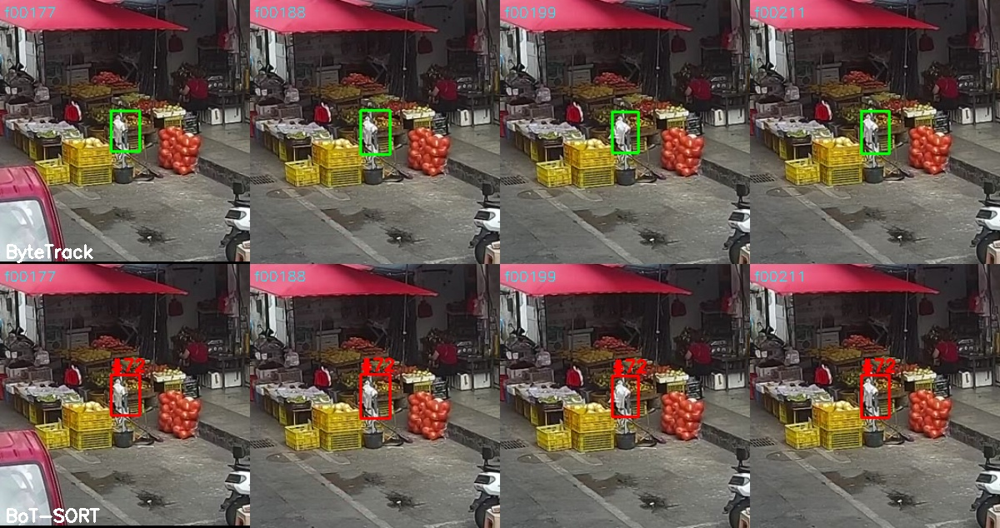

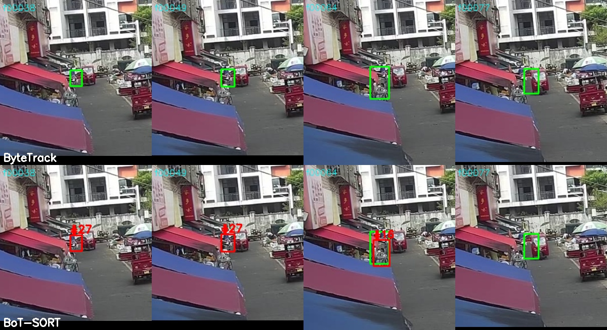

**结论**：不接外观特征时，BoT-SORT 在本机位**没有改善运动关联**——碎片、ID 切换、
手递嫌疑都明显劣于 ByteTrack。按验收口径（ID Switch 不增加、碎片不增加）**B 不通过**。

**C 组门槛结论**：`trackers` 2.6.1 的 `BoTSORTTracker` **没有 ReID 入口**
（签名为 `lost_track_buffer/frame_rate/.../enable_cmc`，全包无 reid 代码）。
现有 OSNet x0.25 ONNX 可用（输入 `[batch,3,256,128]`、输出 512 维、CPU 单框 18.3 ms），
但要接入必须**自己写外观关联层**（丢失轨迹的外观库 + 新轨迹相似度匹配），
这已经是新算法而不是"启用库的 ReID"。

**当前状态**：A/B 已测，C 未启用；单镜头跟踪基线**继续用 ByteTrack**，
外观重关联需要单独立项。

### D.16 M6-S1-1C：外观重关联层（自研，opt-in）

`trackers` 2.6.1 的 `BoTSORTTracker` 没有 ReID 入口，所以 C 组不是"打开库开关"，
而是新增 `backend/app/m6_reid_link.py`：**跟踪结束后**用 OSNet 给每条轨迹算平均外观向量，
再按"时间缺口 + 空间位置 + 余弦相似度"把断开的轨迹接回去。

约束（与验收口径一致）：

- 默认关闭，`link_tracks()` 只在显式调用时生效；
- 只在 gap ≤ 3 s、中心距离 ≤ 3×框对角线、cosine ≥ 0.72 时尝试；
- **有竞争就不接**：同一段轨迹或同一目标存在分数接近的其他候选时直接放弃；
- 每次接回记录 cosine / gap / 位移，供人工核验。

**B 与 C 的对照（同一份检测、同一 ByteTrack 输出）**

| 窗口 | A ByteTrack | B BoT-SORT | C ByteTrack + 外观接回 |
| --- | --- | --- | --- |
| 1360–1440 s（400 帧） | 109 轨 / 26 碎片 | 203 轨 / 100 碎片（放宽后 154 / 59） | **98 轨 / 21 碎片 / 11 次接回** |
| 190–246 s（280 帧） | 80 轨 / 20 碎片 | 142 轨 / 79 碎片 | **70 轨 / 17 碎片 / 10 次接回** |

外观计算开销：OSNet x0.25 单框 18.3 ms，109 条轨迹抽样 5 帧约 10.5 s（离线可接受，实时不可行）。

**人工核对接回结果（每窗口看 8 对）**

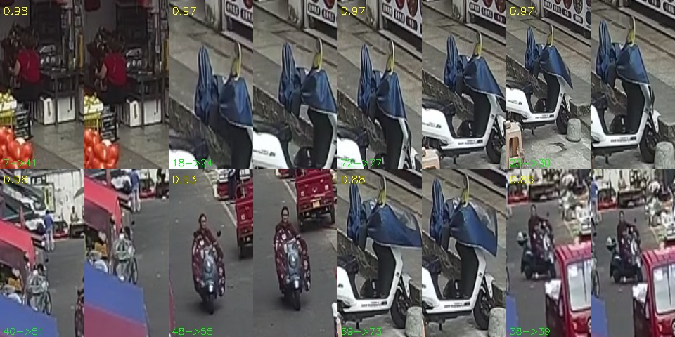

核对结论：**接回本身没接错**（同一对象的两段确实对应同一目标），
但这批接回里大部分是"停放的蓝色车罩摩托被 D-FINE 反复误检为人"——
外观几乎相同，接回自然容易，**并不等于人被人挡住后重新找到**。

**因此 C 组不能判定通过**：它证明了管线可用，但没证明"遮挡恢复"有效，
真正的遮挡素材还没进来。

**GT 对齐问题（必须先解决才能算 S1-3 验收）**

`backend/scripts/fixtures/m6_track_ground_truth.json` 里 person_003/004 的时间戳
（192–240 s）与同段录像 192–240 s 的实际画面**对不上**（最好 IoU 只有 0.77，
且出现在 215 s）。该真值来自更早一次 190–244 s 实验的切片，起点偏移没有记录。
在重新锚定之前，任何"GT 覆盖率"数字都不可信。

### D.17 M6-S2：FastTracker 隔离评测（首轮：不通过）

**来源与许可**：Ultralytics 8.4.198 自带 `ultralytics/trackers/fast_tracker.py`
（遮挡感知 ByteTrack：遮挡判定、卡尔曼回滚、扩大搜索、延长重找回窗口）+ `cfg/trackers/fasttrack.yaml`。
**AGPL-3.0：只做隔离评测**，脚本放在 `backend/scripts/experimental/`，`app/` 下无任何 import；
若证实有效，再评估 MIT 版原项目的集成路径。

**驱动层改造**：Ultralytics 跟踪器要求 `Boxes` 风格输入（属性 + 布尔索引），
脚本用最小替身对象把本项目的 `TrackObservation` 喂进去，并用输出行的 `idx`
（Ultralytics 已映射回"完整检测集"下标）对回原始检测，保证可追溯。

**对照（1360–1440 s，400 帧 @5 fps，同一份 D-FINE 检测）**

| 引擎 | 轨迹总数 | 静止目标（假目标） | 运动目标（真人） |
| --- | --- | --- | --- |
| A ByteTrack（基线） | 109 | 53 条，时长中位 6.0 s | 56 条，时长中位 **2.3 s** |
| B BoT-SORT | 154 | 78 条，2.8 s | 76 条，1.6 s |
| C FastTracker | 46 | 28 条，**19.8 s** | 18 条，**1.7 s** |
| 对照：同驱动 Ultralytics ByteTrack | 50 | 26 条，15.6 s | 24 条，1.4 s |

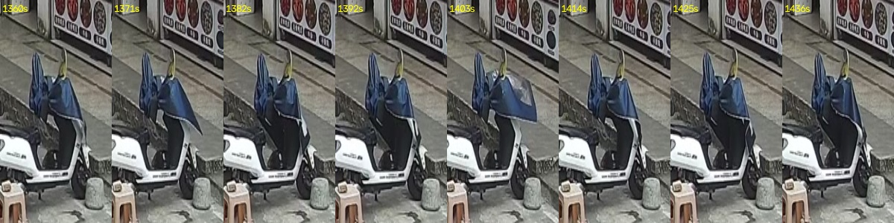

**结论一（关键）**：FastTracker 让轨迹数从 109 降到 46、时长中位 3.0 s 涨到 8.6 s，
但**涨的全是静止假目标**——同一条停放的蓝色车罩摩托被连续跟了 377 帧（占满整段）。
这正是"假目标保持更长时间"的陷阱，不是跟踪能力提高。

**结论二**：只看运动目标（真人），FastTracker 的时长中位 **1.7 s < 基线 2.3 s**，
没有任何"连续性更好"的证据。

**结论三**：我再用同一驱动层跑 Ultralytics 自带 ByteTrack 作对照（50 条 / 1.4 s），
说明"轨迹数少"里有相当一部分来自驱动层差异（我们基线用的 `trackers` 版 ByteTrack
在低分框二次关联上更宽松），不能把差异全算作 FastTracker 的功劳。

**结论四**：遮挡恢复率**仍未测**——本机位自动挖出的"消失-重现"候选几乎全是
静止假目标（停放摩托被反复误检），真正被人/摊位挡住的行人很少，
不足以支撑 5–10 个目标的遮挡真值。这是素材与检测质量问题，不是跟踪器问题。

**判定：FastTracker 不通过**（假目标寿命变长、真人连续性无改善、遮挡恢复无证据）。
基线保持 ByteTrack；**在补齐带绝对时间戳的真实遮挡素材前，不再继续 C 组外观实验**。

### D.18 M6-S4-1：单镜头「远→近」回溯首轮（部分通过）

**S4-0 时间锚定（先做，且必须留痕）**

- 本片 ffprobe：`start_time=5272.258867`、时长 85345.566 s、25 fps、1280×720；
- 本项目所有窗口一律用 `ffmpeg -ss <从录像首帧起的秒数>`，窗口内第 i 帧（0 起）
  = 窗口起点 + i/5；
- 旧 GT（person_003/004）对不上，最可能就是混用了"相对秒"与"容器 PTS"，
  两者相差正是这个 `start_time`；复算时必须带上它；
- 自检：按 1399.8 s 单独取一帧，与窗口第 200 帧比对，平均绝对差 7.7（0–255 标度），
  与相邻帧差异同量级 → 差异来自重新编码，**不存在整段错位**。

**实现**

- `backend/app/m6_target_evidence.py`：质量门槛（人体高 ≥150 px、conf ≥0.40、
  ≥3 帧）、时间分层取样、**逐帧** OSNet 向量（不做平均）、两组向量两两 cosine、候选排序；
- `backend/scripts/p4s1_trackback.py`：在既有 Tracklet 上做"近距锚点 → 更早远距段"比较，
  输出 `tracks / hypotheses / evidence`，每条证据带**绝对秒**与原始帧号；
- 6 个单测，已加入 CI。

**实例结果**（1360–1440 s，410 帧；anchor = track 41，花披风骑电动车的女性）

| 排名 | 候选段 | cosine_max | top3 均值 | 人工核对 |
| --- | --- | --- | --- | --- |
| 1 | track_67_early | 0.969 | 0.947 | 同一个人（并行轨迹） |
| 2 | track_41_early | 0.933 | 0.923 | 同一个人（本体更早段） |
| 3 | track_64_early | 0.898 | 0.892 | 同一个人（并行轨迹） |
| 4 | track_60_early | 0.835 | 0.828 | 同一个人（并行轨迹） |
| 5 | track_50_early | 0.830 | 0.824 | 同一个人（并行轨迹） |

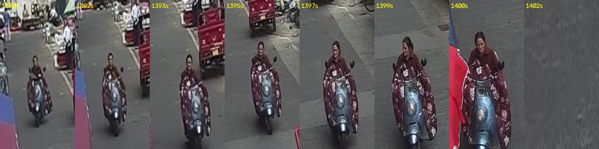

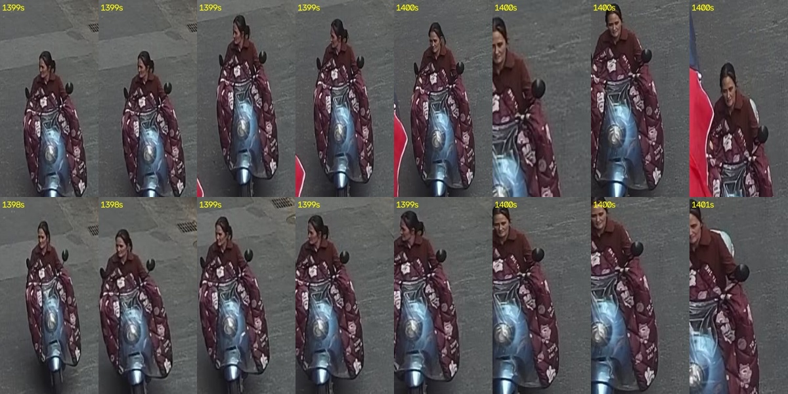

**结论一**：外观比较对**同一个目标**是有效的（她自己各段的 cosine 0.83–0.97 全部高于陌生目标的典型值），
但"锚点自己更早那段"只排第 2——因为同一个她被 D-FINE 出了多个框、
被 ByteTrack 开成了多条并行轨迹（41/50/53/64/67 五条）。

**结论二（更重要）**：本窗口 58 条可嵌入轨迹里，**8 组共 28 条属于"同一目标并行多轨"（48%）**。
并轨不解决，任何"候选数、覆盖率、召回"都会被自己的重复轨迹抬高，
这正是"上游不可信则下游不下结论"要防的情况。

**结论三**：**区分相似他人的能力仍未验证**——本窗口没有外观相近的另一个真人负样本，
前五名全是她自己。不能拿这份结果宣称识别能力。

**判定：S4-1 部分通过**（回溯层可用、证据可追溯；识别判别力与并轨问题待解）。
下一步顺序：① Tracklet 级并轨合并（时空重叠 + 外观 ≥0.90，人工核验后再定阈值）；
② 补一个"相似衣着不同人"的负样本窗口；③ 再进 S4-2 多视角特征。

### D.19 M6-S4-1A/B/C：并轨归组、证据状态与负样本（首轮）

**S4-1A 归组：只分组，不改 Track ID**

`backend/app/m6_track_grouping.py` 把"同一物理目标的多条并行轨迹"并成
`PhysicalObjectCandidate_xxx = {41, 50, 53, 60, 64, 67, ...}`，原始轨迹与观测全部保留，
每一条合并都留证据（重叠帧数、IoU、包含度、中心距、尺寸比、逐帧余弦中位数、运动一致性、冲突帧数）。

判据不是单一阈值，而是多证据组合，并解决两类误判：

1. **整体框 vs 上身/头部框**：尺寸比可达 5 倍，但**包含度**接近 1 —— 用包含度豁免尺寸比；
2. **同帧相距很远**：直接判 `conflict_coexist`，禁止归组（防止"先后出现即同一人"的错误串联）。

本窗口（1360–1440 s，83 条 ≥5 帧轨迹）：进入判定的轨迹对 1213 个，
其中 `same_object` 65 个、`conflict_coexist` 1062 个（同时存在的不同目标）、
`needs_review` 60 个、`not_overlapping` 26 个。

**"判为同一目标"不等于"可以自动并档"**：自动并档额外要求**余弦中位数 ≥0.85、且确实测到外观**
（`cosine_median` 不能为 None）。按此收紧后归成 **72 个候选对象，其中 6 个多轨组、涉及 17 条轨迹**
——用更少的自动合并换"错误合并为 0"。

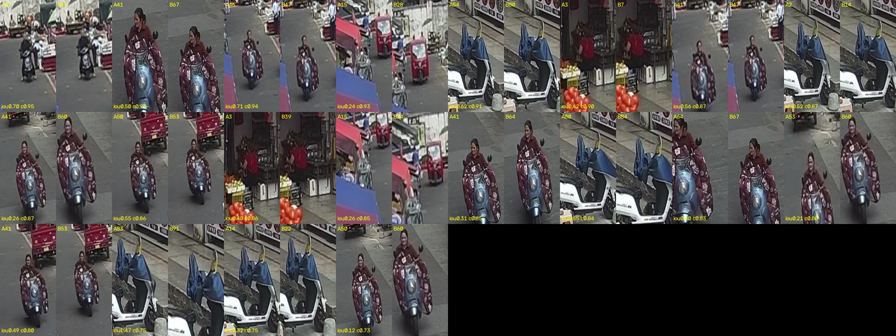

人工核验了余弦最高的 20 对：**17 对确认为同一目标，2 对是不同目标（均被判为 needs_review，未误并），
1 对因画面过小无法确认**（复核时曾把 (3,39) 误判为两人，放大后确认是同一名摊主，已改正）。

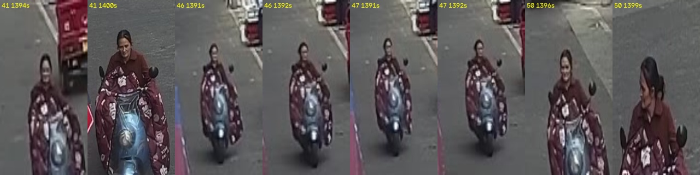

**但 20 对不能代替全量验收。** 把 65 个 `same_object` 关系全部拼图复核后发现了真实风险：
`(15,31)` 两条轨迹的框都太小，外观**根本没测到**（余弦 None），却靠"包含度 0.98、IoU 0.54"被并在一起，
实际是两个不同对象；`(15,18)`、`(9,40)` 是同帧冲突对，本不该判同一目标。
收紧规则后这三对都不再合并，**当前实际生效的 13 个合并关系已逐对放大复核，未发现异人合并**
（`87-89` 是远处极小目标，分辨率不足，标记为"待复核"）。

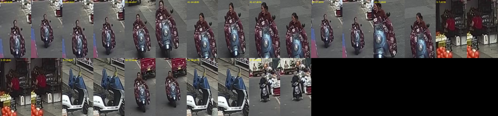

代价也要写明：目标女性的 `[50,53]`（余弦 0.862）没有自动并进主组，所以她仍然对应**两个候选对象**
（`41-46-47-60-64-67` 与 `50-53`），而不是一个。这是"宁可少并、不可错并"的取舍。

**归组不会带来"虚假延长"**：目标主组合并后，观测时间并集只有 1 个 0.6 s 空档
（1394.0→1394.6 s，是检测丢帧），不存在"谁都没看到却接上"的长空白。
该检查已固化为 `coverage_gaps` 字段写进归组结果，任何归组只要出现异常空档都会暴露出来。

**S4-1B 排序与证据状态**

`rank_tracklets` 不再输出 `rejected_by_rank`。状态改为
`candidate / ambiguous / excluded_by_evidence / insufficient_evidence`，
其中 **`excluded_by_evidence` 只能由调用方给出明确冲突证据才会出现**（排名靠后不是证据）。
同时补充多帧一致性指标：`cosine_median`（抗单帧噪声）、`supporting_frames`（有几帧独立支撑）、
`single_frame_share`（最高分相对第 2 名的领先幅度）、`margin_to_next`（与下一候选的差距）。

按**候选对象**重新排序（anchor = track 41 的近距 10 帧）：

| 排名 | 候选对象 | 组合余弦 top3 | 中位数 | 支撑帧 | 与下一名差距 | 状态 |
| --- | --- | --- | --- | --- | --- | --- |
| 1 | 41-46-47-60-64-67（她，主组） | 0.949 | 0.768 | 9 | 0.122 | candidate |
| 2 | 50-53（她，未并入主组的另一组） | 0.827 | 0.748 | 6 | 0.168 | candidate |
| 3 | 35（另一名骑行者） | 0.659 | 0.595 | 2 | 0.031 | candidate |
| 4 | 28（红色三轮车误检） | 0.628 | 0.541 | 1 | 0.025 | ambiguous |
| 5 | 38（红色货车误检） | 0.603 | 0.541 | 3 | 0.019 | ambiguous |

支撑帧 = **候选侧独立原始帧**里达到门槛的数量（不是配对数量）；第 1 名的 `single_frame_share` 为 0.027，
说明不是靠某一帧碰巧高分撑起来的。

并轨前"前五名全是她自己的 5 条重复轨迹"；按收紧后的规则，前两名都是她
（主组 0.949、另一组 0.827），**第 3 名才是真正的其他人（0.659）**，
差距从"和目标自己挤在一起"变成 0.29。重复候选由 5 条降到 2 个候选对象，
剩余的那一个重复是"宁可少并"的直接代价。

**S4-1C 负样本**

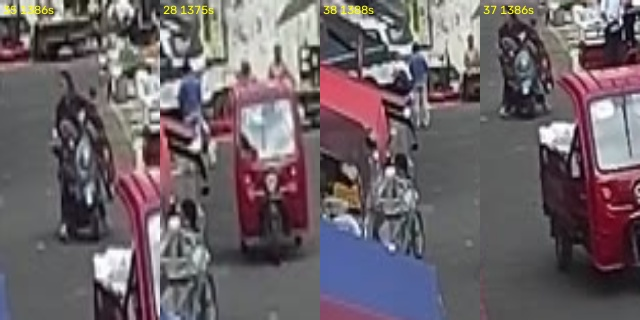

- **不同人员**：同窗另有骑行者（0.659）与红色三轮车/货车（0.628/0.603/0.585），
  均明显低于本人 0.949，**未被误归组、未被排到第一**；
- **衣着相似的不同人员**：整段 30 分钟里用 OSNet 反查相似轨迹（cos 0.83–0.91），
  结果命中的全是**停下不动的红色三轮车/摊位**（静止误检），没有找到第二个"花披风骑行者"。
  这一项**仍未验证**，不能宣称具备"相似衣着区分能力"。

**时间字段（S4-0 的延续）**

`p4s1_trackback.py` 现在同时输出：`frame_id`、`video_relative_seconds`（由帧序号与 5 fps 推算）、
`source_pts_seconds`、`timestamp_source`。本片容器的 PTS 不可靠
（`start_time=5272.259` 与首帧实际 PTS `88785.465` 矛盾，且 ffprobe 对这些区间一律返回同一帧），
因此当前 `source_pts_seconds` 一律为 `null`、`timestamp_source=frame_index_derived`，
**不把相对时间冒充绝对时间**。跨镜头对齐时必须以"解码帧序号 + 已知帧率"或外部校时为准。

**判定：S4-1A 有条件通过**——全量 65 个 `same_object` 复核后收紧了自动并档条件
（余弦 ≥0.85 且外观可测），当前生效的 13 个合并关系逐对复核无误；代价是目标仍留着 1 个重复候选。
**S4-1B 通过**（状态语义修正 + 多帧一致性指标）。**S4-1C 部分通过**
（真实不同人员有对照且区分成功；衣着相似的不同人员缺素材，未验）。

**补：分组整体冲突检查（防传递合并）**

A~B、B~C 成立不等于 A~C 成立。归组现在会在输出前回查**整个组内**是否出现 `conflict_coexist`
（同帧相距过远），一旦出现就拒绝自动归组，把相关轨迹拆回单条并带上 `group_conflict` 与冲突明细；
`coverage_gaps` 继续检查归组是否造成"谁都没看到"的空档。本窗口 34 个候选对象、18 个多轨组，
组内冲突 0 例；对应测试 `test_transitive_merge_is_rejected_by_group_conflict` 用"三条轨迹两两合并但首尾冲突"的构造锁死这条规则。

### D.20 M6-S4-2：多视角特征匹配（A/B/C 对照，材料受限）

**目标**：同一个目标从正面变成侧面、背面后，系统还能不能把他找回来——不是找"同一目标的重复 Track ID"。

**方法**（不新增模型、不改 UI/数据库）

- `backend/app/m6_multiview_match.py`：视角标注 → 质量权重 → 三种比对。
  - **A 聚合**：把一个候选对象的所有采样平均成一个向量，只算一次余弦（原基线）；
  - **B 逐帧**：逐帧两两比较取前 k 名均值，保留不同视角的画面；
  - **C 视角加权**：质量（像素高度、置信度、是否贴边）与视角只用来**挑选证据**，
    前 k 名强制包含至少两个视角，**最终得分仍是原始余弦均值**（否则画面小的候选天然低分，跨候选不可比）。
- `backend/scripts/p4s2_multiview.py` + 人工视角标注 `scripts/fixtures/m6_s4_views_target41.json`。
- **防自评**：锚点与候选帧强制 ≥1 s 时间间隔；锚点所在视角段不进入候选池。

**材料审计（先说清楚能测什么）**

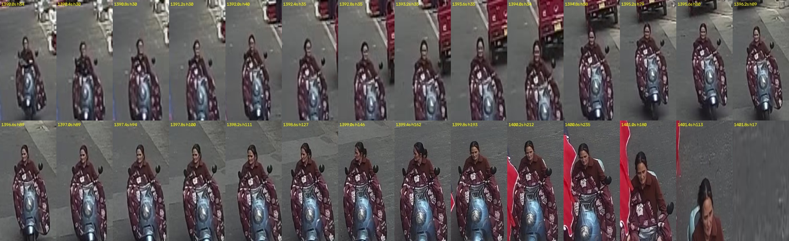

目标 41 全程**正面**：1390 s 时高 34 px，1400.6 s 涨到 235 px，1401.0–1401.4 s 只有约 0.4 s 侧脸
且被画面边缘切断，1401.8 s 仅剩 17 px。**本片没有该目标的背面段。**
为找"正面→背面"素材又做了三次扫描（整段 9162 帧、745–765 s、405–433 s 重跑），
整段里"先靠近再离开"的 79 条候选轨迹放回原帧核对后全是背景、红色三轮车、OSD 文字的误检框，
没有一条是可靠的人。**结论：本机位 + 当前检测基线拿不到可信的跨视角素材，正面→背面无法验证。**

**实测结果**（负样本池 = 同窗其他候选对象，**已排除同一身份的其他 Tracklet**，含 1 名真实骑行者与多辆被误检的红色三轮车）

| 场景 | 组 | 目标分 | 排名 | 与最强负样本差 | 候选支撑帧 | 状态 |
| --- | --- | --- | --- | --- | --- | --- |
| 近距正面 → 远距正面 | A | 0.804 | 1 | +0.131 | 1（平均向量） | aggregate_baseline |
| 近距正面 → 远距正面 | B | 0.884 | 1 | **+0.240** | 3 | candidate |
| 近距正面 → 远距正面 | C | 0.769 | 1 | +0.162 | 3 | candidate |
| 远距正面 → 近距正面 | A | 0.804 | **2** | **-0.023** | 1（平均向量） | aggregate_baseline |
| 远距正面 → 近距正面 | B | 0.884 | 1 | +0.146 | 9 | candidate |
| 远距正面 → 近距正面 | C | 0.769 | 1 | +0.101 | 9 | candidate |
| 近距正面 → 侧脸（2 帧） | A | 0.740 | 1 | +0.067 | 1（平均向量） | aggregate_baseline |
| 近距正面 → 侧脸（2 帧） | B | 0.803 | 1 | +0.158 | **1** | **insufficient_evidence** |
| 近距正面 → 侧脸（2 帧） | C | 0.796 | 1 | +0.189 | **1** | **insufficient_evidence** |

**结论（按"排名是否还靠前、错误候选有没有同步升高"来看，而不是只看余弦）**

1. **B 明显优于 A**：远距锚点场景里，A 把目标排到第 2，最强负样本 0.827 反超目标 0.804；
   B 把目标拉回第 1、负样本压到 0.738。原因是聚合把外观不错的近距帧和模糊远距帧平均掉了。
2. **错误候选确实同步升高**：锚点变成远处小目标时，最强负样本从 0.64 涨到 0.83——
   只看"目标分有没有提高"会漏掉这个风险，A 组就是因此排错的。
3. **C 没有超过 B，而且它在侧脸场景的"优势"不成立**：整体 margin 0.10 vs B 的 0.146；
   侧脸段看似 0.189 最高，但候选侧只有 **1 个支撑帧**，属于"单帧巧合"，已判为 `insufficient_evidence`，
   **不能拿来说 C 更好**（这正是 S4-2R 修正掉的口径问题）。
4. **低质量画面不强制匹配**：出画前 17 px 的尾帧没有产生可用观测，直接不进入匹配，也不参与判定。
5. **特征档案**：本轮只有只读比对，系统里没有任何"把候选写回档案"的路径，
   满足"不允许未经确认的候选自动更新"；后续加写入时必须挂人工确认。

**S4-2R 统计口径修正（本轮完成，结论按修正后重算）**

1. **支撑帧数拆开**：原来 `supporting_frames` 统计的是"配对数"，锚点 5 帧 × 候选 1 帧就能得出 5，
   会被误读成"5 帧证据"。现拆为 `supporting_pairs` / `supporting_anchor_frames` /
   `supporting_candidate_frames`，判定统一看**候选侧独立帧**；S4-1B 的 `single_frame_share`
   也改为按独立候选帧计算（当前第 1 名 0.027，仍然不是单帧驱动）。
   修正后：侧脸场景的 B/C 从 candidate 降为 `insufficient_evidence`。
2. **A/B/C 输入统一**：先按时间间隔筛掉不可用观测，再让三组用同一批数据；
   A 组不再绕开时间过滤。报告里同时给出 `anchor_frames_used` / `candidate_frames_used` 以便核对。
3. **修正了一条没测到余弦分支的测试**：原测试把 `frame_vectors` 构造成了扁平字典，
   实际只验证了"缺外观特征时不合并"。现在用正确结构 `{track_id: {frame_id: vec}}`，
   并断言余弦确实约为 0.80；另补两条：余弦 0.80 不并档、余弦 0.86 但同帧空间冲突仍不并档。

**判定：S4-2 部分通过（按修正后的口径重算，结论不变但更弱）。**
逐帧特征（B）在当前素材上确实优于平均向量（A）：A 把目标排错的场景 B 能救回；
但 C 的视角加权**没有证据支持优于 B**，不再宣称。
"正面→背面、转身后仍保持正确候选"因素材不存在而**未验证**，
S4-1C 的"相似衣着不同人员"同样未验证——两者都是启用自动目标关联前必须补齐的前置项。
下一阶段以 **B（逐帧 OSNet）为实验基线**，暂不启用 C，也不自动合并身份。

**D.21 S4-4A：单镜头关键画面发现（从"翻 100 帧"到"看 6 帧"）**

产品目标不是"找到目标是谁"，而是"从模糊监控里找到能看清的**那几帧**"。
本轮不引入人脸/车牌识别模型，只验证"关键画面筛选"：给一条已知目标轨迹，挑出最值得人工查看的帧。

打分维度（全部在轨迹内归一化，权重可调）：

| 维度 | 含义 | 权重/方式 |
| --- | --- | --- |
| size | 目标框像素高度 / 该轨迹最大高度 | 0.45 |
| sharpness | 裁剪图缩放到统一高度后的拉普拉斯方差排名 | 0.30 |
| crowding | 同帧其他目标框与它的最大 IoU | 0.25（越高越差） |
| edge | 框被画面边界切掉的面积比例 | 扣 0.60 × 比例 |
| orientation | 人工标注朝向，按任务给奖励 | +0.15（找人脸偏好正面） |
| 最小尺寸 | 高度 <60 px 记 `below_min_size`，总分 ×0.4 且排在后面 | 任务下限 |

选帧再按时间间隔（0.4 s）去重，避免挑出 6 帧几乎一样的画面。

**一个必须记下的实现错误**：第一版直接对小框算拉普拉斯方差，结果 55 帧里挑出的 5 帧都是
31–46 px 的远处目标——因为小框边缘像素占比高，"又小又锐"的分数反而更高，
真正清晰的近距帧被挤掉了。修正为"先把裁剪缩放到统一高度再算清晰度"，
并把"低于最小可用尺寸"作为独立门限后，才挑到 127–212 px 的帧。

**实测**（track 41，55 帧，k=6；人脸是否可辨由人工逐帧判定，见
`design/assets/m6_s4_4a_labels.json`）：

（以下为 **S4-4A 口径修正后**重算：size-only 不再被综合分覆盖，各自用自己的排序依据。）

| 策略 | 选中的 6 帧高度 | 可用 | 关键证据（最清晰的两张大脸 201/204） |
| --- | --- | --- | --- |
| A 均匀取样 | 34/36/34/86/111/195 px | **1/6（17%）** | 漏 |
| B 只按框大小 | 235/195/180/162/146/127 px | **4/6（67%）** | 漏 |
| C 综合打分 | 208/213/192/149/127/100 px | **3/6（50%）** | **命中** |

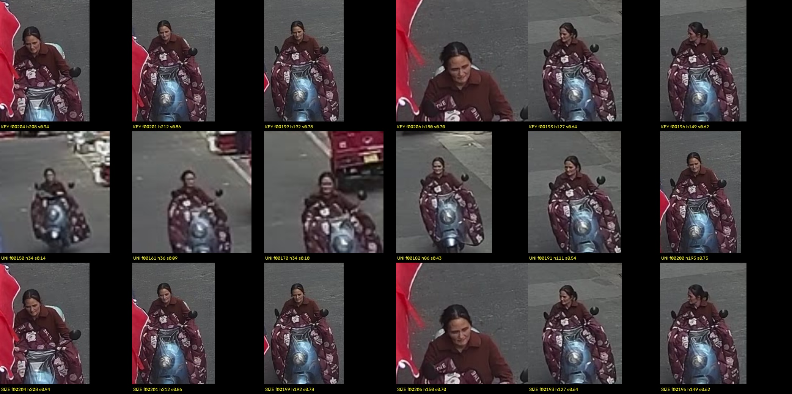

**结论要写清楚边界**：

1. 相对"均匀翻帧"，两种筛选都**明显有效**：可用帧从 1/6 提到 3–4/6，人工只需看 6 帧而不是 55 帧；
2. **可用率上 B 高于 C（4/6 vs 3/6）**：C 为了避开模糊大框，把 100 px 的帧也选进来了，
   同时漏掉了 235/195/180 px 三张"略软但大"的帧——在日常研判里这是净损失；
3. **关键证据上 C 命中、B 漏**：最清晰的两张大脸（201/204）只有 C 选到了。
   这说明"关键证据发现率"和"可用帧数"是两个方向，可能互相牺牲——不能只报一个；
4. 由于本段素材是"越近越清晰"，两类指标都受这一个先验支配，**不足以判定谁更优**；
   按"不为复杂而复杂"的原则，**默认策略仍用 B（尺寸优先）**，C 保留为可选；
5. edge / crowding 分量**只有单元测试**：本窗口 83 条轨迹没有任何一条出现"贴边的大框"，
   缺少真实样例；**框贴边 ≠ 主体被截断**，后者要人工标注（`subject_truncated`），
   本轮已把 `outside_ratio` 与 `border_touch` 拆开记录；
6. **人体框清晰 ≠ 人脸清晰**：本轮的"可用"是我按**原分辨率裁剪**人工判定的，不是模型输出。

**反例（明确不推荐人工查看）**：track 9 共 399 帧，最大框高只有 33 px，
全部低于最小可用尺寸，系统直接标 `no_usable_frame` 并说明"不推荐安排人工查看"，
而不是硬挑 6 张糊图交差。

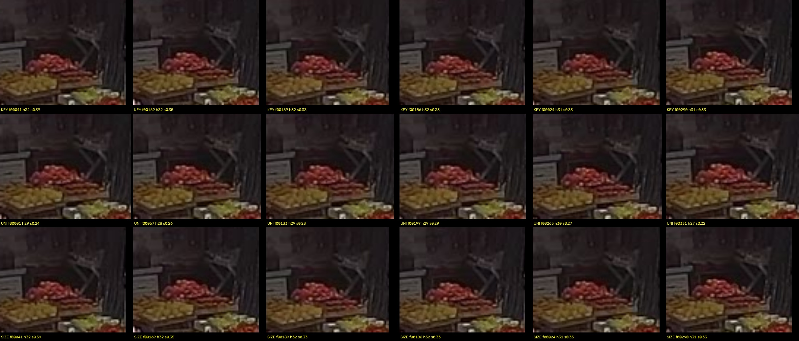

**判定：S4-4A 初步通过（口径修正后）**：筛选相对均匀取样有效；
B 可用率更高、C 关键证据更全，二者各有取舍，**尚无真实困难样本可判定优劣**；
贴边/遮挡分量缺真实样例，人脸可辨性为人工判定。

**D.22 S4-3A：摄像头择优规则（离线，不需要多通道录像）**

规则输入与用途：

| 信息 | 作用 |
| --- | --- |
| 位置 / 朝向 | 判断目标是否落在覆盖区、估计被观察角度（正面/侧面/背面） |
| 预期像素尺寸 | 由焦距与距离估算目标高度，判断是否值得做身份比对 |
| 道路与出入口 | 判断目标是否**可能**经过（不在可能路径上就不查） |
| 录像时间范围 | 避免查询不存在的录像 |
| 用途（全景/人脸/车牌） | 按任务匹配镜头类型 |
| 已有研判结果 | 已有同结论的镜头降低优先级，避免重复分析 |

两条原则落进代码：

1. **按任务择优，不是"第一个找到就停"**：找人脸时"预期像素 + 用途"权重大于"谁先覆盖"；
   覆盖好但只有 40 px 的镜头排在能给出 200 px 的镜头之后，否则"轨迹任务成功、清晰证据任务失败"；
2. **跳过必须给理由**：每个被跳过的镜头都带 `why` 与 `expected_height_px`，
   验收时人工核对"被跳过的镜头里，像素最大的那个是不是被误跳了"——
   这正是"跳过镜头里可能藏着更清晰画面"的检查入口。

7 条单元测试覆盖：正面优于侧面、用途匹配加权、低于任务像素下限被跳过并给理由、
超出覆盖范围被跳过、已有研判降权、以及**"三路都覆盖时不能只选第一路"**。

**判定：S4-3A 规则通过（离线）。** 规则正确不等于"真实路口能选对镜头"：
选对/漏掉更好画面的验收必须在真实多通道录像上做（S4-3B 未开始）。

**S4-3A 待修（S4-3B 之前完成，不阻塞 S4-4B）**：

- `expected_height_px()` 现在统一按 1.7 m 人体估算，**不能直接用于车牌任务**。
  需分别估算 `person_height_px` / `face_height_px` / `plate_height_px`；
- 摄像头朝向与目标运动方向**不能代替实际拍摄夹角**：要用"目标位置—摄像头"的视线方向，
  并且区分人体面向、车辆前后与运动方向。

**D.23 S4-4B：人脸 / 车牌可辨性标注规范与评测工具**

本阶段不新增模型、不改 UI/数据库，只做三件事：**标注规范、评测工具、已有素材的对照验证**。

**1. 人脸与车牌分开评测**（可辨条件不同，不能共用一个 `height_px ≥60` 门槛）：

| 维度 | 人脸画面 | 车牌画面 |
| --- | --- | --- |
| 观察主体 | 人脸区域 | 车牌区域 |
| 关键条件 | 脸部可见、清晰、未被遮挡 | 字符区域可见、清晰、未被遮挡 |
| 视角 | 正面或适当侧面 | 前牌/后牌的有效角度 |
| 尺寸 | 实际人脸像素 | 实际车牌像素 |
| 不可辨原因 | 背面、遮挡、模糊、过小 | 角度、反光、遮挡、模糊、过小 |

**人体高 200 px 不代表人脸清晰；车辆高 200 px 不代表车牌可读。** 最大框只能做候选筛选。

**2. 标注字段（已固化为 `app/m6_evidence_label.py` 的校验规则）**

`frame_id`、`video_relative_seconds`、`track_id`、`task`、`visibility`、`sharpness`、
`occlusion`、`truncated`、`usable`、`unusable_reason`、`annotation_status`，
外加任务专属的 `face_visible`/`face_usable`（或 `plate_visible`/`plate_usable`）。
校验会拒绝：缺字段、`usable=no` 却不写原因、任务专属字段缺失、task 与评测目标不一致、`frame_id` 重复。

**看得见 ≠ 足以比对身份**：`face_visible` 与 `face_usable` 必须分别标注；
标注一律使用**原始分辨率**画面，放大图只用于定位，不得把插值放大的视觉效果当成原始细节。

**3. 两个核心指标**

- **Top-K 可用帧命中率**：推荐 k 帧里，有多少帧可直接用于人工核验（`usable=yes`，`marginal` 单列）；
- **关键证据发现率**：全片段里那张"唯一的清晰正脸/可读车牌"有没有被推荐出来。
  第二项更重要——6 张里 5 张清晰、却漏掉唯一一张正脸，对研判仍是失败。
  因此**人工真值不能只覆盖算法推荐的 6 帧**，必须对完整目标片段标注或用独立抽样建立足够覆盖。

**4. 已有素材的对照验证**（track 41，16 帧人工标注，人脸任务）

| 策略 | 推荐帧 | 可用 | 关键证据（201/204） |
| --- | --- | --- | --- |
| A 均匀取样 | 150/161/170/182/191/200 | 1/6（17%） | 漏 |
| B 只按框大小 | 203/200/205/198/195/193 | **4/6（67%）** | 漏 |
| C 综合打分 | 204/201/199/196/193/190 | 3/6（50%） | **命中** |

**结论：B 的可用率更高，C 的关键证据更全，两者各有取舍。**
本段素材"越近越清晰"这一先验同时支配两类指标，**不足以判定谁更优**。
按"不为复杂而复杂"，**默认仍用 B（尺寸优先）**，C 作为可选策略保留。
要判定优劣，必须有"大框但模糊 / 大框但背对 / 大框但遮挡 / 车牌反光倾斜"的困难样本——目前没有，
不为了造结果去重复扫描菜市场录像。

**5. 关联状态与画面质量必须分开输出**

一张清晰人脸可能来自错误关联的轨迹；一条高可信轨迹也可能没有任何清晰人脸。
`evidence_value(association_status, quality_status)` 因此区分五种结论：

| 关联状态 | 画面质量 | 结论 |
| --- | --- | --- |
| confirmed | usable | `high_value_evidence_verified`（已核实的高价值证据） |
| candidate | usable | `high_value_evidence_pending_review`（高价值**待核验**证据） |
| candidate / confirmed | 不可用 | `trace_ok_but_picture_unusable` |
| ambiguous | usable | `clear_picture_but_identity_unconfirmed` |
| ambiguous | 不可用 | `not_evidence` |

**普通候选（candidate）不等于身份已确认**：它的清晰画面只能算"待核验的高价值证据"，
只有走过核实的 `confirmed` 才能标成"已核实"。

关键证据覆盖同时给三个数：`any_hit`（至少找到一张）、`all_hit`（覆盖全部关键帧）、
`key_recall`（找到占比）。找一张就够用的任务看 any_hit，排查漏检看 all_hit/key_recall；
关键帧集合必须独立标注，不能拿某个策略的推荐结果反推。

**判定：S4-4B 工具与规范通过；三策略对照在现有素材上完成但不能定论**
（缺困难样本，关键证据真值目前只覆盖已标注的 16 帧，全片段真值待补）。
**默认策略 B（尺寸优先），C 作为实验选项。** 另外：无可用画面时 `picked=[]`，
低质量帧只进 `diagnostics_only`，不再作为"推荐人工查看"输出。

**D.24 M6-S5：指定目标离线研判流程（集成验证）**

目的不是继续扩算法，而是确认已经完成的模块**能否组成一条完整流程**：

    参考图 → 参考档案 → 检测+跟踪 → 重复轨迹归组 → 中近距离外观比对
           → 目标候选 → 轨迹回溯（延伸/空档）→ 关联证据检查 → 关键画面 → 证据报告

实现：`app/m6_pipeline.py`（编排，无 IO）+ `scripts/p4s5_pipeline.py`（跑真实数据）。
检测+跟踪直接复用已验证的 ByteTrack 输出（该步骤已有单独门禁），
本阶段**不新增模型、不改 UI、不改数据库**。

**S5 集成收口（本轮五项修正）**

| 问题 | 修正 |
| --- | --- |
| 采样不固定、结果不可复现 | 固定为**时间分层 16 帧/轨迹**（当前实验配置，不证明最优）；`manifest` 记录采样策略、帧数、尺寸/置信度门槛、模型哈希、录像标识、代码 SHA |
| 时间戳按帧号反推 | `_pairs()` 直接取源观测的 `timestamp_seconds`，不再写死 5 fps |
| 参考组自比被当成关联成功 | 参考组**只做锚点**：不参与排名与 margin，不写 `score=1.0` 当候选；关联状态由参考组**之外**的候选决定 |
| 重复候选占满前五 | 新增 `candidate_duplicate_review`：疑似重复单列，带余弦/支撑帧/冲突证据；**不放宽并档阈值、不删除** |
| 选出关键帧即标 usable | 默认 `unverified`，只有人工核验过的帧才标 `usable` |
| 回溯口径过强 | 改名为 `reference_track_coverage_check`，明确只是参考归组的时间覆盖与空档 |

**实跑结果**（track 41 作参考；时间分层 16 帧/轨迹；45 条轨迹通过 40 px / 置信度门槛）：

| 项 | 结果 |
| --- | --- |
| 阶段 | anchor_archive → grouping → reid_match → candidate_duplicate_review → reference_track_coverage_check |
| 参考组 | `[41]`，16 帧 |
| 疑似重复（4） | `64`(0.929, 5 帧) / `50-53`(0.924, 9 帧) / `67`(0.924, 3 帧) / `46-47`(0.895, 9 帧) |
| 独立候选（5） | `49-70`(0.719, candidate) / `24`(0.639) / `12`(0.629) / `92`(0.627) / `15`(0.619) |
| 证据排除（14） | `49-70`(0.719, 冲突 1 帧) / `12`(0.629) / `57`(0.596) … 全部 `excluded_by_evidence` |
| 关联状态 | `unconfirmed`（排除冲突候选后无有效身份候选） |
| 画质状态 | `unverified`（关键帧未人工核验，**不等于不可用**） |
| 联合结论 | `identity_unconfirmed_quality_pending` |
| 参考轨迹覆盖 | 55 个时间点，2 个 0.6 s 空档 |
| 两次运行一致 | **是**（编排级，固定输入向量后逐字段相同） |

**两条证据判定规则（本轮新增）**：

1. **同帧冲突即排除身份**：与参考组存在可靠 `conflict_coexist`（同一时刻出现在不同位置）的轨迹，
   外观相似度再高也不能作为指定目标候选，状态为 `excluded_by_evidence`；
   外观分数与原始证据保留可查，但不参与排名、不触发"关联成立"。
   没有明确冲突、只是证据不足的轨迹仍留在 `ambiguous` / `insufficient_evidence`，不一并排除。
2. **`unverified` ≠ `unusable`**：`unverified` 是"尚未检查画面"，联合结论输出
   `picture_quality_pending_review`；只有检查过并确认不可用才用 `trace_ok_but_picture_unusable`。
   同理，身份未确认 + 画质未核验输出 `identity_unconfirmed_quality_pending`，不下"无证据"的结论。

**阶段验收**（`design/assets/m6_s5_acceptance.json`）：

| 已验证 | 尚未验证 |
| --- | --- |
| 模块编排（5 个阶段全跑通） | 用户真实参考照片的识别 |
| 编排级结果复现（固定输入向量后两次完全一致） | 相似衣着人员区分 |
| 证据字段（关联/画质/联合结论齐全） | 正背面跨视角匹配 |
| 参考组不参与候选评分 | 跨镜头关联 |
| 重复候选显式复核 | 真实人脸/车牌可辨性 |
| 冲突候选按证据排除 | 沿独立候选向前回溯的业务效果 |
| 原始 Track ID 全部保留 | 从原始录像解码到报告的全过程逐字段一致 |

**复现范围必须按实说**：两次一致的是**编排级**结果（固定输入向量与轨迹数据），
没有验证从原始录像解码、抽帧、推理到报告的端到端一致性。

**已知限制**：采样密度仍会影响归组（8 帧 vs 16 帧候选对象数不同）；
冲突帧数取决于两条轨迹的共享帧，共享帧少时可能漏掉本应排除的候选；
重复候选只提示不合并；`reference_track_coverage_check` 不等于完整回溯。

**判定：S5 阶段收口（通过）**——集成链路、可复现性、证据字段与重复复核达到验收线，
但不代表研判结论正确，也不替代真实多镜头准确率验收。

**D.25 M6-S6：三摄像头跨镜头验证（首轮，真实素材）**

素材：桂康路中仁路 T 口三路（2-1 / 2-2 / 1-1），3200×1800、25 fps、约 30 分钟，
起始时间 14:59:59 / 14:59:57 / 15:00:01，机位间距 < 50 m。取 **15:02:00–15:05:30** 共 3.5 分钟。

**流程**：ffmpeg 预抽帧（5 fps、宽 1280）→ D-FINE + ByteTrack（每路一份 tracks）
→ 路内归组 → 以一路某条轨迹为锚点，对其余两路做逐帧 OSNet 比对 + 时空门控。

| 摄像头 | 帧数 | 轨迹数 | 最长轨迹 |
| --- | --- | --- | --- |
| 2-1 | 1045 | 1017 | 721 |
| 2-2 | 1050 | 1401 | 1049 |
| 1-1 | 1050 | 745 | 658 |

**两个采集侧坑（会直接毁掉结果，必须先处理）**：

1. **HEVC 两路不能用快速 seek 抽帧**：`ffmpeg -ss X -i` 跳到 X 秒后 2-2 / 1-1 解出的是几乎纯灰帧
   （12 KB/帧），只有 2-1（H.264）正常。必须给解码器恢复余量：`-ss (X-5) -i … -ss 5`。
2. **三路 OSD 与文件名起始时间差 0~4 s 不等**（2-1≈0 s、2-2≈-1 s、1-1≈-4 s），
   跨镜头时空约束不能用"文件名起始 + 帧号"，要按 OSD 标定。

**结果：找到了真实的跨镜头同一人**

| 项 | 1-1 锚点 | 2-2 命中最优 |
| --- | --- | --- |
| 轨迹 | #271（白 Polo + 草帽 + 深色长裤） | #530 |
| 路径相似度 | — | **0.847**（8 帧支撑），排名 **#1** |
| 人工核对 | 草帽、白 Polo 小 logo、深蓝长裤、白鞋一致 | 同上 |

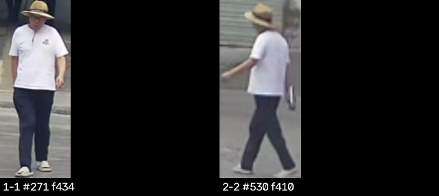

**但当前时空规则把它判成了 `rejected_by_time`**：两条轨迹时间重叠约 11 s。
合理的解释是 **1-1 与 2-2 的视野有重叠**（同一人在两路同时可见），而不是"不可能同时出现"。
现有规则只区分"先后出现"和"时间重叠即需求解"，没有"重叠视野下同刻可见"这一档。

此外同刻校验本身做得不够：每轨迹只采样 12 帧，两路采样时刻很少落在 ±1 s 内
（#530 只对上 2 帧、余弦 0.77），因此同刻证据被低估。

**判定：S6 首轮部分通过**——链路在真实三镜头数据上跑通，且**找到了真实的跨镜头同一对**；
但时间模型需增加"重叠视野"分支（同刻比对要在重叠时段**定向加密采样**），
否则正确答案会被时间门控否决。这条已登记为下一轮 S6-2 的首要修正。

**D.26 M6-S6-2：三态时间模型 + 同刻加密采样**

首轮的两个缺陷已修：

| 缺陷 | 修正 |
| --- | --- |
| `gap_seconds=-11.4` 被当成重叠时长 | 拆成 `overlap_seconds`（实际重叠）与 `transition_gap_seconds`（先后间隔），重叠时后者为 `null` |
| 跨镜头比对沿用单镜头 1 s 间隔过滤 | 不再调用带时间过滤的 `compare()`，改为"候选帧对锚点帧取最大余弦"，时间合理性交给时空层 |
| 时间重叠即判 rejected | 改为五态：`transition_candidate` / `overlap_match_candidate` / `pending_spatial_verification` / `pending_time_calibration` / `excluded_by_spatiotemporal_evidence` |
| 均匀采样碰运气 | 对高分且有重叠的候选做**重叠区间加密**，5 fps 重取裁剪、按墙钟一对一配对 |

**校时记录**（每路一份，不确定度不填就写 null）：

    {"camera_id": "T口2-2", "file_start_seconds": 53997, "clock_source": "osd_manual",
     "offset_seconds": -1.0, "offset_uncertainty_seconds": null,
     "calibration_status": "provisional"}

**A/B/C 对照**（锚点 1-1 #271 草帽男士）：

| 方案 | #530 排名 | 外观分 | 时间关系 | 状态 |
| --- | --- | --- | --- | --- |
| A 旧规则 + 均匀采样 | #1 | 0.847 | 重叠（被当成 -11.4 s） | `rejected_by_time` ❌ |
| B 新规则 + 均匀采样 | #1 | 0.809 | 重叠 4.8 s | `pending_spatial_verification` ✅ 不再误排除 |
| C 新规则 + 加密采样 | #1 | 0.809 | 重叠 4.8 s | 25 对同步帧，余弦中位 **0.738**（0.61–0.81） |

**两条关键发现**：

1. **外观分被"任意配对"高估**：粗筛允许候选帧与任意锚点帧比，得 0.809~0.847；
   按墙钟时间严格一对一配对后只剩 **0.738**。以后跨镜头分必须以同步配对为准。
2. **候选阈值区分力不足**：人工判定"1-1 与 2-2 视野重叠"后，
   #530 / #575 / #617 全部变成 `overlap_match_candidate`（0.809 / 0.777 / 0.675）。
   其中 **#575 经人工核对是同一人的另一段碎片**（草帽、白 Polo、深蓝长裤一致），
   #617 尚未核对——因此"高分候选多"不能直接判为误报，但**当前阈值也不能把不同人挡在外面**。

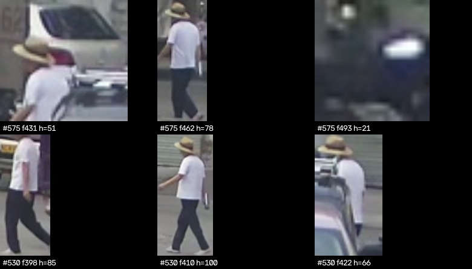

**判定：S6-2 通过（时间模型部分）**——#271→#530 不再被时间规则误排除，
重叠时长与间隔分别报告，加密采样给出可核对的逐帧配对；
但**跨镜头同人阈值仍未校准**，需要在不同人员负样本上标定后才能用于"发现同人"。

**D.27 M6-S6-2 补充：指标分离、真值集与 OSD 校时**

**1. 两个分数正式分开，不再共用一个阈值**

| 指标 | 用途 | 适用条件 | 本轮参考值 |
| --- | --- | --- | --- |
| `retrieval_score` | 粗筛排序，从大量轨迹里挑出值得核验的候选 | 允许不同时间、不同视角 | 同人 0.78–0.81 / 不同人 0.42–0.49 |
| `synchronous_evidence` | 重叠视野下同一时刻的观测一致性 | 必须有时间交集且已配对 | 同人 0.71–0.74 / 不同人 0.37–0.44 |

**2. 真实真值集**（锚点 1-1 #271 草帽白 Polo 男士）

| 候选 | 人工关系 | `retrieval_score` | 同步配对数 | `synchronous_evidence` 中位 |
| --- | --- | --- | --- | --- |
| 2-2 #530 | 同人 | 0.809 | 25 | **0.738** |
| 2-2 #575 | 同人（另一段碎片） | 0.777 | 62 | **0.713** |
| 2-2 #617 | **未核验**（小目标，裁剪仅 37–46 px） | 0.675 | 18 | 0.651 |
| 2-2 #522 | 不同人（蓝 Polo、戴眼镜、骑摩托） | 0.486 | 18 | 0.440 |
| 2-2 #471 | 不同人（橙红衬衫、自行车） | 0.462 | 12 | 0.420 |
| 2-2 #494 | 不同人（深色衣、背身） | 0.419 | 44 | 0.368 |

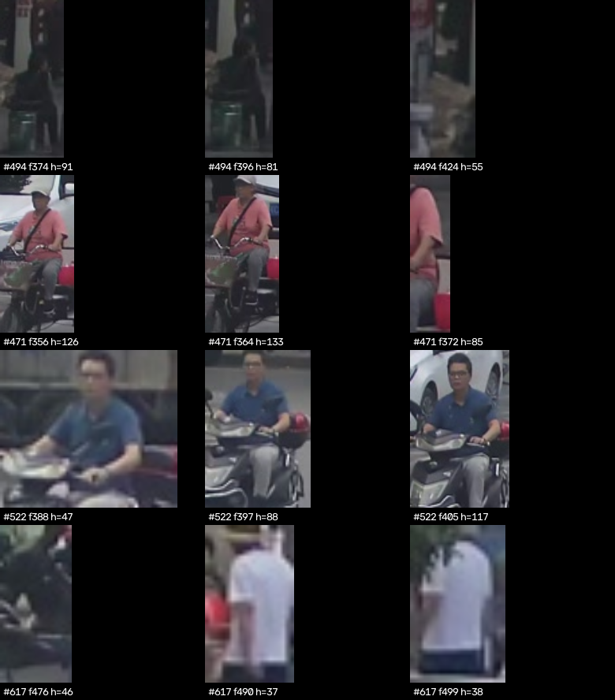

**分布观察**：正样本 0.713–0.738，负样本 0.368–0.440，中间空档 0.27；
但正样本只有 2 条、负样本 3 条，且 #617（0.651）落在空档边缘未定性。
**结论：现象上可分，样本量不足以定阈值**，维持"候选 + 人工核验"。

**3. OSD 校时（逐帧定位秒进位）**

方法：按 25 fps 取 2.4 s、裁剪 OSD 区域，用相邻帧差分定位**秒进位帧**，读出进位后的 OSD 秒值，
与"文件名起始时间 + 帧内时间"比较。精确到一帧（0.04 s），但受文件名秒截断限制，取 ±0.5 s。

| 摄像头 | 进位帧文件时刻 | OSD 读数 | 推算偏移 | 不确定度 | 状态 |
| --- | --- | --- | --- | --- | --- |
| T口1-1 | 149.8 s | 15:02:27（文件名推算 15:02:30.8） | **−3.8 s** | ±0.5 s | `osd_boundary` |
| T口2-2 | 149.8 s | 15:02:26（推算 15:02:29.8） | **−0.8 s** | ±0.5 s | `osd_boundary` |

相对偏移 3.0 ± 0.7 s。加密配对里稳定出现的 0.4 s 残差，量级与 5 fps 抽帧相位差相符，
**不足以认定为时钟偏移**，也不允许反过来用"余弦最高"去凑偏移。

**4. 代码边界修正**

- `time_sufficiency()` 读取两台摄像头的校时记录：`verified_for_sync` / `provisional` / `uncalibrated`；
- 重叠场景下，**provisional 不足以支撑严格同步结论**，状态停在 `pending_time_calibration`；
  本轮所有重叠候选（含 #530）都停在该状态，符合预期；
- 摄像头级"视野重叠"先验**不升级为身份确认**，最高只到 `overlap_match_candidate`；
  反过来，无共同视野也不能单凭此否决，仍需时钟误差与轨迹质量。

**判定：S6-2 补充项通过**——指标分离、真值集、校时方法均落地；
**跨镜头同人阈值仍不启用**，自动确认身份仍不具备验收依据。

**D.28 M6-S6-3：时间基准修正（文件偏差 ≠ 摄像头时钟差）**

**1. 先纠正 D.27 表格里的错误**

D.27 的表格中，T口2-2 一列写"推算 15:02:29.8"，这是错的：2-2 文件名起始 14:59:57，
帧内 149.8 s 对应 **15:02:26.8**，与 OSD 15:02:26 相差 **−0.8 s**，不是 −3.8 s。
该行的 −0.8 s 本身没有算错，**错在"推算"列抄错了基准时间**（误用了 1-1 的 30.8）。
按正确的两列重算，两路文件-OSD 偏差是 −3.8 s / −0.8 s，**相对差 3.0 s；
但这 3.0 s 是"两路文件名偏差之差"，不是摄像头时钟差**——D.27 把它们混为一谈，是更严重的问题。

**2. 用首帧 OSD 独立核对文件偏差**（不经过任何 seek，直接解第一帧）

| 摄像头 | 文件名起始 | 首帧 OSD | 文件-OSD 偏差 |
| --- | --- | --- | --- |
| T口1-1 | 15:00:01 | 14:59:57 | **−4.0 s** |
| T口2-2 | 14:59:57 | 14:59:57 | **0.0 s** |
| T口2-1 | 14:59:59 | 14:59:58 | **−1.0 s** |

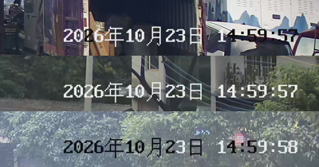

结论：**三路录像的文件名时间都与画面 OSD 有 0~4 s 的偏差，且各不相同**。
以文件名推算跨镜头时间必然引入 1~4 s 的错误，这正是 D.25 中"标签时间对不上"的根源。

**3. 时间分层落地**

| 层 | 字段 | 来源 |
| --- | --- | --- |
| 文件时间 | `file_reference_seconds` | 文件名（仅用于检索定位） |
| 录像观测时间 | `observed_at = osd_anchor + 帧内秒数` | OSD 锚点 + PTS |
| 摄像头同步信息 | `clock_sync_status` / `intercamera_clock_offset_seconds` | 需共同物理事件，**当前为 null** |

两个偏移字段分开存：`file_osd_alignment_offset_seconds`（已测：−4.0 / 0.0 / −1.0 s）
与 `intercamera_clock_offset_seconds`（未测，保持 null）。

**4. 用 OSD 锚点重跑跨镜头比对**

| 候选 | 旧锚点（文件名推算）同步中位 | OSD 锚点同步中位 | 变化 |
| --- | --- | --- | --- |
| 2-2 #530 | 0.738 | **0.741** | +0.003 |
| 2-2 #575 | 0.713 | **0.719** | +0.006 |
| 2-2 #617 | 0.651 | 0.642 | −0.009 |
| 2-2 #522 | 0.440 | 0.464 | +0.024 |
| 2-2 #471 | 0.420 | 0.440 | +0.020 |
| 2-2 #494 | 0.368 | 0.367 | −0.001 |

变化都在 ±0.03 内，**结论不变**：正样本 0.72–0.74、负样本 0.37–0.46。
（旧锚点实际有效值 53997.2 / 53996.2 与 OSD 锚点 53997 / 53997 只差 1 s，
所以此前结论没有因为 3.0 s 的"偏差之差"被推翻——但那是运气，不是方法正确。）

**5. 0.4 s 同步残差的性质**

配对残差全部落在 0 / 0.2 / 0.4 s 上（5 fps 网格的整数倍），且配对逻辑是
"按墙钟找最近且未被占用的帧"（不按相似度挑帧），因此残差是**抽帧网格相位差**，
上界 0.4 s（各 0.2 s 采样间隔），不是摄像头时钟差。
同步配对的容差仍取 0.5 s，任何 >0.5 s 的残差都应视为时间基准有问题。

**6. 回归测试**

`test_alignment_offset_uses_each_camera_own_file_start` 固定了这次的错误：
用 1-1 的基准去算 2-2 会得到 −3.8 s，用各自的基准才是 −0.8 s。

**判定：S6-3 时间基准部分通过**——文件偏差与摄像头时钟差已分开记录，
三路首帧 OSD 已核对，OSD 锚点已替换文件名推算，回归测试已加。
**摄像头之间的真实时钟差仍未测定**，需共同物理事件，状态维持 `pending_time_calibration`。

**D.29 M6-S6-4：抽帧窗口起点偏移的发现（时间映射再修正）**

**1. 发现：抽帧窗口的真实起点 ≠ 请求起点**

三路都用"文件时间 15:02:00 起、5 fps、1050 帧"抽帧，但读首帧 OSD 后发现：

| 摄像头 | 请求起点 | 首帧实得 OSD | 末帧 OSD | 帧数 |
| --- | --- | --- | --- | --- |
| T口1-1 | 15:02:00 | **15:01:56** | 15:05:26 | 1050 |
| T口2-1 | 15:02:00 | 15:02:00 | 15:05:28 | 1045 |
| T口2-2 | 15:02:00 | 15:02:00 | 15:05:29 | 1050 |

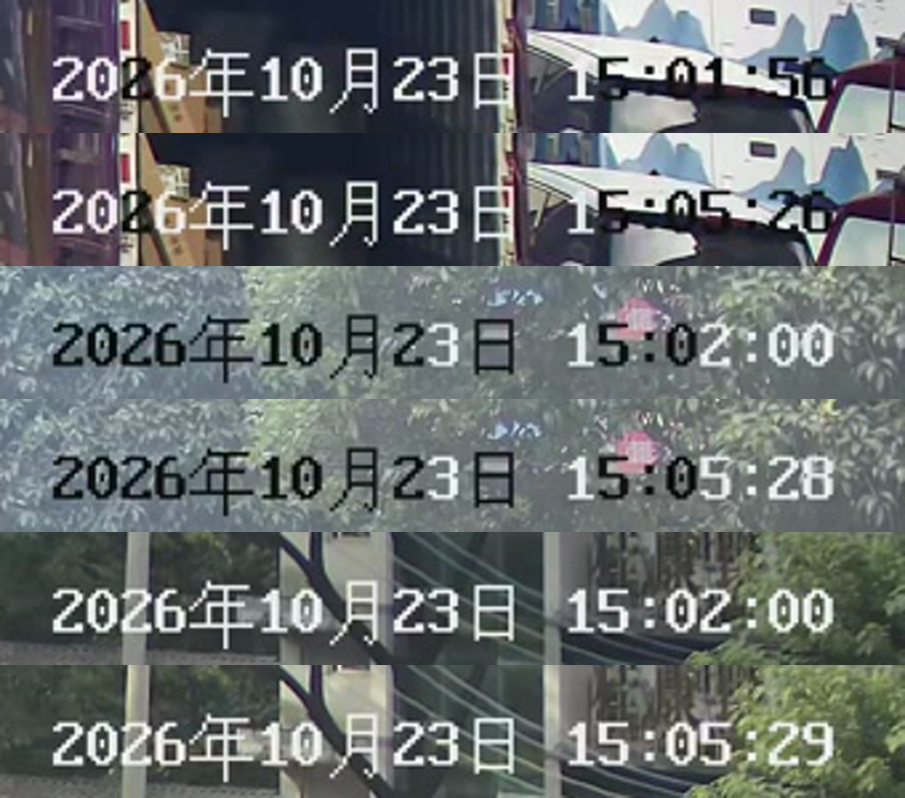

1-1 是 HEVC，预滚后在文件时间轴上提前了 4 s。此前所有跨镜头计算都用"请求起点 + 帧号 / fps"，
于是 1-1 的观测时间整体**早了 4 s**——这才是跨镜头配对里那 0.4 s 残差和 3 s 困惑的真正来源之一。

**2. 正确形式**

    observed_at = osd_first_frame + frame_index / fps          # 锚点取自该序列首帧的 OSD

而不是"请求窗口起点 + 帧号/fps"。已加 `observed_at()` 与回归测试
`test_observed_at_uses_first_frame_osd_not_requested_window_start`。

**3. 用正确锚点重跑真值集**（1-1 锚点 54116 = 15:01:56，2-2 锚点 54120 = 15:02:00）

| 候选 | 旧锚点同步中位 | 正确锚点同步中位 | 变化 |
| --- | --- | --- | --- |
| 2-2 #530（同人） | 0.741 | **0.748** | +0.007 |
| 2-2 #575（同人碎片） | 0.719 | **0.694** | −0.025 |
| 2-2 #617（待核验） | 0.642 | 0.533 | −0.109 |
| 2-2 #522（不同人） | 0.464 | 0.415 | −0.049 |
| 2-2 #471（不同人） | 0.440 | 0.394 | −0.046 |
| 2-2 #494（不同人） | 0.367 | 0.367 | 0.000 |

**正负间隔被拉开**：正样本 0.694–0.748，负样本 0.367–0.415，中间空档 0.28。
时间基准错 4 s 时，负样本被"错配到相邻时刻"而虚高，#617 也因此从 0.533 抬到 0.642。

**4. 这个 4 s 到底是什么，仍不能定**

两种可能：(a) 1-1 的 OSD 比 2-2 慢 4 s；(b) 1-1 的文件名时间标错 4 s。
现有证据无法区分——**必须靠共同物理事件**。在此之前 `intercamera_clock_offset_seconds` 保持 null。

**5. 正样本扩充：本次失败，如实记录**

用 1-1 #714（光头、浅色衬衫、走向画面右下）做锚点，三路全跑：

| 排名 | 候选 | 检索分 | 时间关系 | 状态 |
| --- | --- | --- | --- | --- |
| 1 | 2-2 #530 | 0.675 | 先后，间隔 116.8 s | `transition_candidate` |
| 2 | 2-1 #139-161 | 0.674 | 先后，间隔 180.6 s | `rejected_by_travel_time` |
| 3 | 2-2 #617 | 0.665 | 先后，间隔 101.4 s | `transition_candidate` |

没有找到可人工核实的跨镜头正样本；最高分 0.675，与 #530 的 0.748 明显不同，
且间隔 100 s 以上、方向不明。#714 很可能走出 1-1 视野后未被另两路拍到。

**判定：S6-4 时间映射修正通过（抽帧锚点）**；
共同物理事件校时**未完成**、正样本扩充**未完成**（仍是 1 个身份、2 段轨迹）。
时间基准从"文件名推算"改到"首帧 OSD 锚点"后，正负样本间隔反而更清楚，
说明此前的分数噪声有相当一部分来自时间错位，而不是 OSNet 本身。

**D.30 M6-S6-5：通行时间规律（单镜头停留 vs 跨镜头间隔）**

**1. 两个量必须分开**

| 量 | 定义 | 本轮是否可测 |
| --- | --- | --- |
| 单镜头经过时长 | 同一目标从进入某路画面到离开该路画面的时间 | ✅ 可从轨迹直接量 |
| 跨镜头经过间隔 | 同一目标从 A 路某位置到 B 路对应位置的时间 | ❌ 需要已确认的跨镜头配对 |

**不能用单镜头停留时间推导跨镜头间隔**：前者取决于该路视野大小与目标速度，
后者取决于机位间距与路径。本组机位间距 < 50 m，且 1-1 与 2-2 视野**可能有重叠**（#271/#530 重叠 4.8 s），
跨镜头间隔接近 0 s 也是合理情形。

**2. 实测单镜头停留（3.5 分钟窗口，轨迹 ≥5 观测）**

| 摄像头 | 轨迹数 | 停留中位 | 75 分位 | 90 分位 | 最长 |
| --- | --- | --- | --- | --- | --- |
| T口1-1 | 745 | 2.8 s | — | 9.8 s | 落单长轨迹较多 |
| T口2-1 | 1017 | 2.6 s | — | 14.2 s | — |
| T口2-2 | 1401 | 3.0 s | — | 15.2 s | — |

（全部轨迹含碎片，中位 0.8–1.0 s；上表已过滤 <5 观测的碎片，仍受跟踪断裂影响，**偏低**。）

现场"骑车人 5–15 s 经过"的经验与 90 分位 9.8–15.2 s 吻合——**它对应的是单镜头停留**，
不是三路全过程。

**3. 落地方式：只作优先级，不作阈值**

新增 `transit_priority()` 与 `priority_transit_seconds = 10.0`：
先后出现且间隔 ≤10 s 的候选标 `high`（优先人工核查），其余 `normal`；
**不影响 `cross_status` 的通过/排除**（测试 `test_transit_priority_marks_fast_passes_high_but_never_excludes` 固定这一点）。
步行目标不适用该经验值，需按目标类型给不同参数。

**4. S6-5 待办**

| 优先级 | 任务 | 验收 |
| --- | --- | --- |
| P0 | 1-1 与 2-2 的共同物理事件校时 | 给出真实相对差及误差，或明确"测不出" |
| P1 | 人工记录 5–10 名目标的单镜头进入/离开时间 | 得到按方向的停留分布 |
| P2 | 用正确时间线找跨镜头正样本 | ≥5 条人工确认配对，覆盖多身份 |

三项均不引入新模型，也不启用自动身份确认阈值。

**D.31 M6-S6-5 首个结果：紫衣电动车骑手的跨镜头接力（2-2 → 2-1）**

**1. 现场经验**：骑车人经过三路总时间通常 ≤10 s（14:59–15:00 一名紫色上衣、骑黑色电动车者为例）；
步行慢得多，不能套用同一窗口。

**2. 时间窗扩展**：原先只处理 15:02:00–15:05:30，抓不到 15:00 的事件。
新增 14:59:57–15:01:11（370 帧/路，5 fps），首帧 OSD 实测锚点：

| 摄像头 | 首帧 OSD | 锚点 |
| --- | --- | --- |
| 1-1 | 14:59:57 | 53997 |
| 2-1 | 14:59:58 | 53998 |
| 2-2 | 14:59:57 | 53997 |

**3. 找到同一名骑手（人工核对：紫色 Polo、黑色电动车、同向）**

| 摄像头 | 轨迹 | OSD 出现区间 | 停留 |
| --- | --- | --- | --- |
| 2-2 | #111 | 15:00:06.2 – 15:00:08.6 | 2.4 s |
| 2-1 | #37 | 15:00:12.6 – 15:00:15.6 | 3.0 s |

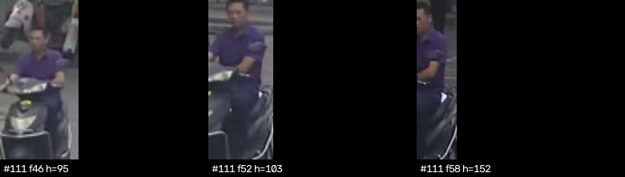
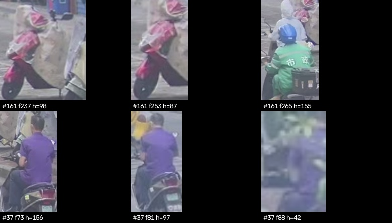

**跨镜头间隔 = 12.6 − 8.6 = 4.0 s**，与现场"≤10 s"经验一致。

**4. 检索结果（2-2 #111 为锚点，2-1 共 306 条轨迹）**

| 排名 | 候选 | 检索分 | 时间关系 | 状态 |
| --- | --- | --- | --- | --- |
| **1** | **2-1 #37** | **0.746** | 先后，间隔 4.0 s | `transition_candidate` |
| 2 | 2-1 #202-221 | 0.667 | 先后，间隔 43.0 s | `transition_candidate` |
| 3 | 2-1 #67 | 0.613 | 先后，间隔 14.8 s | `transition_candidate` |

**首次验证"接力"分支**：此前所有正样本都是"重叠视野同时可见"，
这一次是"离开 A 后 4.0 s 出现在 B"，检索正确排到第 1，且未被时间规则误杀。

**5. 1-1 未找到同一人**

以 2-1 #37 为锚点在 1-1 检索，最高仅 0.610（#68，重叠 0.2 s），其次 0.604（#19，间隔 7.6 s），
均无可核实的外观一致性。可能原因：1-1 视野未覆盖该路段远端，或目标过小/被遮挡。
**结论：三路链路目前只闭合了两路**，不宣称三镜头已验证。

**判定：S6-5 接力正样本通过（2 路）**——得到第一条"先后出现"型人工确认正样本，
间隔 4.0 s 与现场经验吻合；正样本身份数增至 **1 名骑手 + 1 名行人（草帽男）**，
仍不足 5 条，且 1-1 环节缺失。

**D.32 M6-S6-6：1-1 缺失原因定位（原始录像里有，检测漏了）**

**1. 直接看原始录像**

把 1-1 的 74 秒按每秒一帧拼成联系表逐格核对：**15:00:03–15:00:04 之间，
画面下缘出现一名紫色上衣、骑浅色电动车的骑手**，从右下角进入后很快出画。

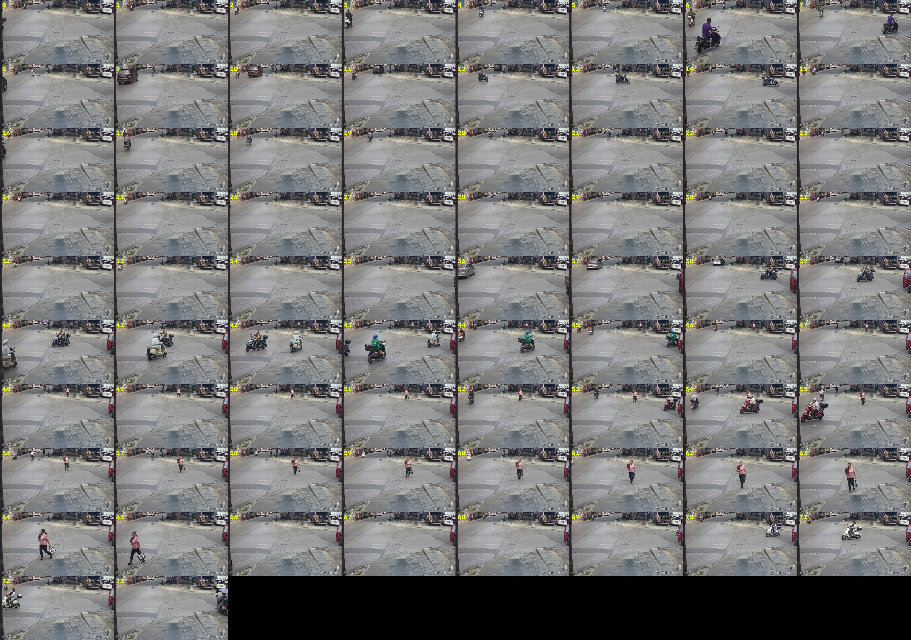
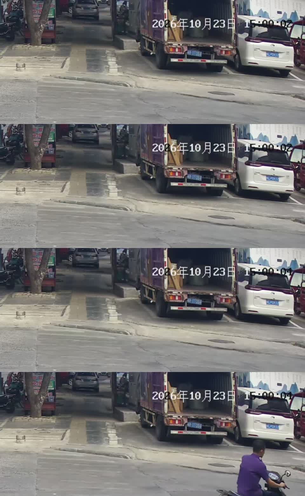

**2. 逐层定位失败环节**

| 层 | 结论 | 依据 |
| --- | --- | --- |
| 视频覆盖 | ✅ 拍到了 | 15:00:03–04 画面下缘可见 |
| 检测 | ❌ **没有产生目标框** | 该时段（t=5.5–9.5 s）画面下半部无任何检测轨迹 |
| 跟踪 | —（无框可跟） | 同上 |
| 特征检索 | —（无轨迹可检索） | 同上 |
| 时间筛选 | —（未进入候选） | 同上 |

因此 1-1 缺失**不是 ReID 排序问题，也不是时间过滤问题，而是检测层漏检**：
目标贴着画面下边缘、部分被裁切、只出现 1–2 秒。

**3. 与 2-2 / 2-1 的时间关系（按当前 OSD 映射）**

| 摄像头 | 轨迹 | OSD 区间 |
| --- | --- | --- |
| 1-1 | 无（漏检） | 15:00:03.8 左右可见 |
| 2-2 | #111 | 15:00:06.2 – 15:00:08.6 |
| 2-1 | #37 | 15:00:12.6 – 15:00:15.6 |

端到端跨度约 **11.8 s**（1-1 出画到 2-1 出画），与"骑车 10 秒左右"的现场经验基本一致。
注意：这仍是 OSD 秒级映射下的**观测间隔**，含跨镜头时钟未知误差，不能当作精确通行时间。

**4. 结论与后续**

- S6-6 任务一**完成**：缺失原因 = 检测层漏检（边缘、小目标、短时出现）；
- 不为此改动算法（当前阶段不新增模型），先登记为已知短板：
  **贴边目标与 1–2 秒短时目标会整条丢失**，这正是"三镜头持续追踪"的真实瓶颈；
- S6-6 任务二（再补 2–3 名骑手接力样本）**未完成**。

**判定：S6-6 部分通过**——失败环节已定位到检测层，三镜头链路缺口的原因有据可查；
正样本仍为 2 名身份，跨镜头时钟仍未独立校准。

**D.33 M6-S6-7：补查检测器原始输出 + 扩充骑手样本**

**1. 紫衣骑手：检测接口在最低允许阈值下未给出 person 框**

对 1-1 的 t=6–8 s（15:00:03–15:00:05）逐帧调用 `detect_flat(img, ["dfine-n"], 0.20)`：

| 帧 | person 预测数（conf ≥ 0.20） | 下半部框数 |
| --- | --- | --- |
| 0030 | **0** | 0 |
| 0033 | **0** | 0 |
| 0036 | **0** | 0 |
| 0039 | **0** | 0 |
| 0042 | **0** | 0 |

（0.20 是检测契约的下限，无法再放宽。）

结论：受检帧**整帧都没拿到 person 框**。失败环节 = **检测输出阶段**。

边界说明（按复核意见修正）：`detect_flat(..., 0.20)` 的返回不等于模型未经任何过滤的
原始张量，接口内部仍可能有阈值/NMS 等处理；且上述只是间隔采样帧。
因此严谨表述是"**在允许的最低接口阈值下，系统没有获得可供跟踪的目标框**"，
不宣称已排除接口内部后处理的影响。工程判断不变：该目标无法进入后续流程。

**2. 用户提供的人工真值清单（15:00–15:02）**

| 时段 | 目标 |
| --- | --- |
| 15:00:05–15:00:25 | 灰衣骑手 |
| 15:00:25–15:00:40 | 棕色衣服骑手 |
| 15:00:40–15:01:00 | 白衣 + 红色电单车骑手 |
| 15:00:50–15:01:15 | 白/青衣、胸前背挂小孩、上白下绿电单车骑手 |
| 15:01:00–15:01:30 | 红色轿车 桂C3321T |
| 15:01:30–15:02:30 | 白色轿车 桂CD98D33 |

（后两条在 15:01:30 之后，超出当前 74 s 抽帧窗口，尚未处理。）

**3. 这些目标在 1-1 的检测情况**

| 时段 | 1-1 检测到的候选（高度 px） |
| --- | --- |
| 灰衣 | #46(h141) #60(h187) #62(h151) #64(h126) |
| 棕衣 | #136(h220) #141(h262) #142(h251) #145(h235) |
| 白衣红车 | #149(h278) #176(h176) #180(h169) #182(h234) |
| 带小孩 | #225(h204) #237(h260) #182(h234) #176(h176) |

这些**都检出了**，高度 120–280 px。对比紫衣骑手（贴边、高约 50–60 px、仅 1–2 s）：
当前证据**支持**"漏检集中在贴边 + 小尺度 + 极短出现"，但样本量不足，
不能断言这是普遍规律。紫衣骑手保留为固定失败样本，供后续检测专项评测使用。

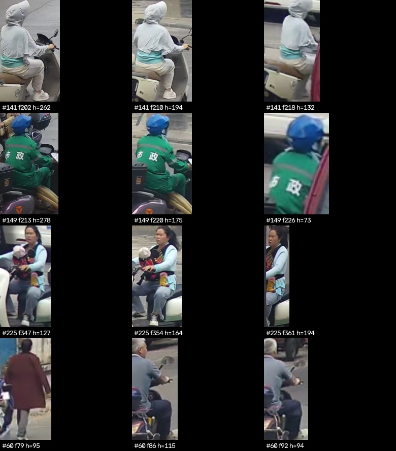

**4. 新正样本尝试：带小孩的骑手（1-1 #225）**

人工核对：青衣女子骑电动车、胸前挂着小孩，出现于 15:01:09–15:01:12（1-1 #225）。

以她为锚点在三路检索（2-1 / 2-2）：

| 排名 | 候选 | 检索分 | 时间关系 | 状态 |
| --- | --- | --- | --- | --- |
| **1** | **2-2 #434** | **0.714** | 先后，间隔 3.0 s | `transition_candidate` |
| 2 | 2-2 #448 | 0.702 | 先后，间隔 1.0 s | `pending_transition_check` |
| 3 | 2-2 #462 | 0.682 | 重叠 0.6 s | `pending_time_calibration` |

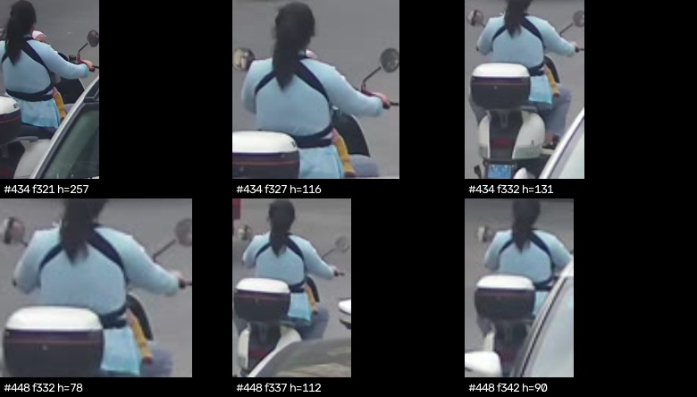

**人工核对结论：高度相似，但不能确认同人**——2-2 只能看到背面（青衣、深色背带），
看不到胸前的小孩；#434 与 #448 也可能是同一人的两段碎片。
按规则记为 **"待确认"**，不计入已确认正样本。

**5. 当前正样本台账**

| # | 身份 | 摄像头链 | 时间关系 | 人工结论 |
| --- | --- | --- | --- | --- |
| 1 | 草帽白 Polo 行人 | 1-1 #271 ↔ 2-2 #530 | 重叠 4.8 s | 已确认同人 |
| 1b | 同人碎片 | 1-1 #271 ↔ 2-2 #575 | 重叠 11.8 s | 已确认同人（不算独立身份） |
| 2 | 紫衣电动车骑手 | 2-2 #111 → 2-1 #37 | 先后 4.0 s | 已确认同人（1-1 漏检） |
| 3? | 青衣带小孩骑手 | 1-1 #225 → 2-2 #434 | 先后 3.0 s | **待确认** |

**判定：S6-7 部分通过**——漏检环节定位到"检测输出阶段"（不宣称已排除接口内部处理）；
新增 1 条待确认的接力候选；已确认独立身份仍为 **2 名**，距 5 名目标还差 3 名。

**D.34 M6-S6-8：核实 #225 / #434 / #448 的关系**

**1. 轨迹连续性（2-2，5 fps，坐标为框中心）**

| 轨迹 | 时间段 | 起点 → 终点 | 方向 |
| --- | --- | --- | --- |
| #434 | 64.2–66.4 s | (73,514) → (483,312) | 向右上 |
| #448 | 66.4–68.4 s | (484,285) → (622,236) | 向右上 |
| #462 | 71.6–73.8 s | (697,189) → (624,168) | **向左** |

**#434 与 #448 在 t=66.4 s 同一帧上 x 完全连续（483 → 484）**，仅 y 跳 27 px，
是**同一次通过的轨迹碎片**（跟踪器在此处断开），不是两个不同的人。
#462 的 x 随时间递减、方向相反，且在远景，属于**另一个目标**。

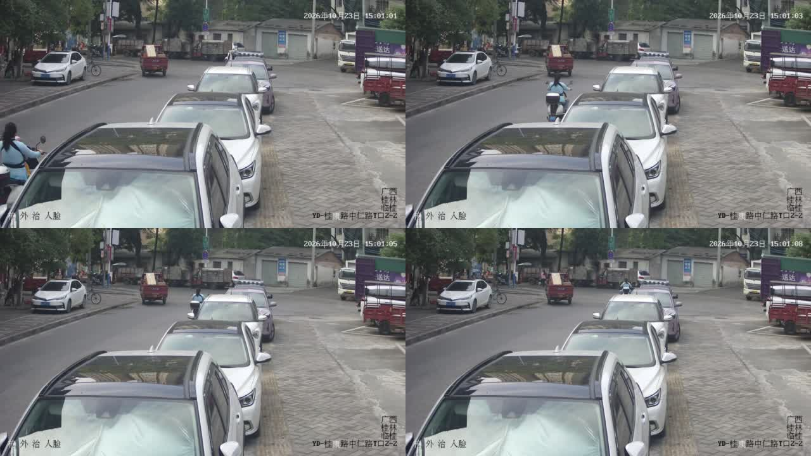

**2. 结论**

- 情况 A 成立：**#434 与 #448 是同一人的两段碎片**，系统实际已把正确目标排到第 1、第 2；
- #462 是不同目标，其 0.682 属于"另一名骑手"的正常候选；
- 因此本样本上**检索与排序是成功的**，短板在**跟踪碎片化**（同一人两段轨迹分别参与排名）。

**3. 但这不证明与 1-1 #225 同人**

#225 能看到胸前挂小孩，2-2 只有背面（青衣、深色背带），缺少可对齐的独立证据。
#225 的跨镜头身份维持 **待核验**，不因排序靠前而升级。

**判定：S6-8 P1 完成**——碎片/同人/异人三种情况已区分；P0（共同事件校时）与
P2（扩充到 5 名独立身份）仍未完成。

**D.35 M6-S6-9：核心逻辑改为"定向连续追踪"（架构判定 + 首个可运行骨架）**

**1. 架构判定**

TrajNexa 不是"在所有摄像头里找外观最像的人"，而是：
**以已确认观测为起点 → 空间关系与通行时间决定下一台摄像头和录像窗口 →
只分析该窗口 → 大模型理解可见属性 + OSNet 比较 + 时间/空间/方向约束 → 形成候选证据 →
更新目标状态 → 继续下一台**。

三条原则：

1. **空间与时间缩小搜索范围**，不再把全库人员当默认检索对象；
2. **大模型理解特征、OSNet 辅助比较**，两者都不单独决定身份；
3. **连续追踪的核心是动态更新目标状态**（位置、时间、方向、可见特征）。

**2. 已落地的最小骨架（`backend/app/m6_directed.py`）**

| 函数 | 职责 |
| --- | --- |
| `camera_link()` | 人工维护的"可能通道"：A 某出口 → B，通行时间范围、置信来源 |
| `target_profile()` | 目标档案，观测带 status（confirmed / candidate） |
| `plan_windows()` | 由最后一条观测 + 通道 + 通行时间 ± 误差，生成下一批摄像头的录像窗口 |
| `candidates_in_window()` | 只保留与窗口有交集的轨迹（定向收缩） |
| `update_profile()` | 并入新观测与特征，未核验特征标 `verified=False`，不得污染已确认档案 |

测试见 `tests/test_m6_directed.py`（4 条，含"方向冲突的通道被跳过""候选观测不升级为已确认"）。

**3. 首次定向实验（紫衣骑手，2-2 #111 于 8.6 s 离开）**

    python scripts/p6s3_directed.py --anchor-camera 2-2 --anchor-track 111 \
        --anchor-enter 9.2 --anchor-exit 8.6 --camera 2-1:tracks_2-1.json --camera 1-1:tracks_1-1.json

| 目标摄像头 | 窗口（OSD 相对秒） | 全量候选 | 窗口内候选 | 收缩 |
| --- | --- | --- | --- | --- |
| 2-1 | 8.6–20.6 s | 306 | **47** | 84.6% |
| 1-1 | 8.6–20.6 s | 237 | **47** | 80.2% |

正确目标 2-1 #37（14.6–17.6 s）落在窗口内。**这正是此前靠 306 条全量检索 + OSNet 排序才能做到的事，
现在由时空约束先把范围压到 47 条**，OSNet 只需在这 47 条里比较。

**4. 尚未实现（下一阶段）**

| 缺口 | 说明 |
| --- | --- |
| 大模型结构化特征 | 尚未接入；需要属性级证据帧、可见度、可信度、未知项 |
| 摄像头视野几何 | 通道表目前人工填写，未有 FOV/朝向数据 |
| 共同事件校时 | 仍缺，窗口误差仍用固定 ±1 s 兜底 |
| 证据合成与撤销 | 只有 status 字段，缺支持/冲突/未知的证据计数 |

**5. 边界声明**

- 通道表人工维护，**缺方向不代表不可能经过**，只降优先级；
- 窗口宽窄来自经验通行时间 + 误差，不是身份排除条件；
- 1-1 漏检案例作为"观测缺失但不得伪造"的标准测试场景保留：
  系统应从 2-2 继续分析，而不是假装 1-1 有目标。

**判定：S6-9 骨架通过**（口径见 D.36 修正）；
大模型特征提取与几何数据尚未接入，端到端流程仍不完整。

**D.36 M6-S6-10：时间基准混用修正（相对秒 vs 绝对 OSD 秒）**

**1. 上一轮的错误**

D.35 的演示把 `--anchor-exit 8.6`（= 15:00:08.6 的**日期秒**）当成轨迹时间，
而 `candidates_in_window()` 比较的是轨迹文件里的**抽帧相对秒**（#37 的 14.6）。
两种口径混用，只是恰好让 #37 落在窗口里，属于**偶然正确**。

若统一按相对秒，2-2 #111 离开应为 11.6 s、2-1 #37 出现为 14.6 s，间隔会算成 **6.0 s**，
与人工核实的 **4.0 s** 不符——这正是复核指出的漏洞。

**2. 修正内容**

| 改动 | 说明 |
| --- | --- |
| `absolute_track(track, osd_anchor)` | 用该路首帧 OSD 锚点把相对秒换成绝对秒，写入 `absolute_seconds` |
| `_require_absolute()` | 小于 30000 的秒数一律拒绝（相对秒不可能超过当天秒数下限），抛 `*_not_absolute` |
| `candidates_in_window()` | 轨迹缺 `absolute_seconds` 直接报错，不再静默比较 |
| `camera_link(direction=)` / `plan_windows()` | 新增 **forward / backward / both**，返回项带 `mode` |

回归测试 `test_relative_seconds_are_rejected_instead_of_silently_mixed` 与
`test_forward_window_keeps_the_real_4s_gap` 固定这两点（共 6 条测试）。

**3. 重跑（绝对 OSD 秒，锚点 2-2=53997 / 2-1=53998 / 1-1=53997）**

锚点 2-2 #111：**15:00:06.20 – 15:00:08.60**

| 方向 | 目标 | 窗口 | 全量 | 窗口内 | 收缩 |
| --- | --- | --- | --- | --- | --- |
| forward | 2-1 | 15:00:08.60–15:00:20.60 | 306 | **48** | 84.3% |
| forward | 1-1 | 15:00:08.60–15:00:20.60 | 237 | 51 | 78.5% |
| backward | 2-1 | 14:59:54.20–15:00:06.20 | 306 | 23 | 92.5% |
| backward | 1-1 | 14:59:54.20–15:00:06.20 | 237 | 41 | 82.7% |

正确目标 2-1 #37 在 forward 窗口内，**间隔恰为 4.0 s**（54012.6 − 54008.6），
与人工核实的 OSD 映射一致。**D.35 的"306 → 47 / 84.6%"作废**，以本表为准。

**4. 前向 / 反向分开的意义**

紫衣骑手在 1-1 的出现时间（15:00:03.8）**早于** 2-2（15:00:06.2），
因此 1-1 是"来的方向"而不是"下一站"。旧版把 1-1 也当成正向下一站，
属于时间方向错误；现在 `plan_windows()` 明确区分两种模式，反向只查最早观测之前。

**5. 边界**

收缩率 84.3% 只说明**比较范围变小**，不等于追踪成功率提升；
收缩是否漏掉真实目标尚未评估，需要独立真值集统计。

**判定：S6-10 时间基准修正通过**——三路窗口计算已全部使用绝对 OSD 秒，
前向/反向已分离并有回归测试。

**D.37 M6-S6-11：目标特征初始化（qwen3-vl 结构化属性，首个闭环实验）**

**1. 目标 A：紫衣骑手（2-2 #111，三帧由远及近）**


模型 `qwen3-vl:8b-instruct`，`format=json`，temperature 0，3 张裁剪图（5× 放大），耗时 45 s：

| 属性 | 值 | 可见度 |
| --- | --- | --- |
| upper_clothing_color | 紫色 | clear |
| vehicle_color | 黑色 | clear |
| vehicle_type | 电动自行车 | clear |

未知项：面部特征、下装颜色、车辆具体型号。

**人工核对：与现场真值一致**（紫色上衣、黑色电动车）。模型没有把看不清的项补全成确定值，
未知项如实列出——这一点符合"不得猜测"的要求。

**2. 候选 B：2-1 #37（三帧背面/侧后方）**

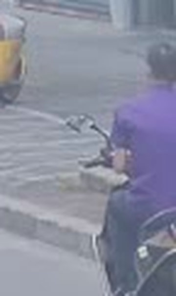

| 属性 | 值 | 可见度 |
| --- | --- | --- |
| upper_clothing_color | 紫色 | clear |
| lower_clothing | 深色裤子 | partial |
| **vehicle_color** | **红色** | partial |
| vehicle_type | 电动自行车 | partial |
| helmet / carried_items | unknown | unknown |

**3. 属性比较（只给证据，不判身份）**

| 属性 | A（2-2 #111） | B（2-1 #37） | 结论 |
| --- | --- | --- | --- |
| upper_clothing_color | 紫色 clear | 紫色 clear | **支持** |
| vehicle_type | 电动自行车 clear | 电动自行车 partial | **支持** |
| vehicle_color | 黑色 clear | 红色 partial | **冲突** |
| lower_clothing | 未报告 | 深色裤子 partial | B 新增 |
| helmet / carried_items | 未报告 | unknown | B 新增（未知） |

汇总：支持 2、冲突 1、B 新增 3，未知 0。

**4. 冲突需要人工裁决，不能自动消解**

复核裁剪图确认：B 画面里骑手所骑车辆为深色（黑色），所谓"红色"来自画面左侧的红色物体
（隔离墩/背景车辆）。**这是模型的一次错误属性，且它自己标了 partial**。

这正好说明为什么"大模型不能直接决定身份"：
- 若把 B 的"红色"当成真值，正确候选会被当作冲突而排除；
- 若忽略可见度直接投票，2 个支持会压过 1 个冲突，造成虚假确信。

正确做法是保留冲突、标注证据帧、交人工核验——本轮结论维持 **待核验**。

**5. 实测成本**

| 项目 | 数值 |
| --- | --- |
| 模型 | qwen3-vl:8b-instruct（6GB 显存部分溢出） |
| 输入 | 3 张裁剪图（5× 放大） |
| 耗时 | 45 s（A）/ 54 s（B） |
| 输出 | 结构化 JSON，含可见度与未知项 |

单次 45–54 s 意味着**只能对少量候选调用**，与"先用时空窗口和 OSNet 粗排，再对大模型精查 Top-N"的分层设计一致。

**判定：S6-11 第一阶段通过**——可输出带可见度与未知项的结构化属性，且不把未知补全；
属性比较能产出支持/冲突/未知三类证据。**未通过的部分**：属性比较尚未接入
`TargetProfile` 更新流程，冲突裁决仍全靠人工。

**D.38 M6-S6-12：目标档案版本化 + 4B/8B 双模型基线**

**1. 模型使用规则（定稿）**

| 场景 | 模型 |
| --- | --- |
| 常规目标属性提取、候选属性比较 | **qwen3-vl:4b-instruct（默认）** |
| 明显矛盾、人车背景混淆、多视角差异大、重要属性无法判断 | **qwen3-vl:8b-instruct（按需复核）** |
| 两者一致 | 仍**不**等于人工确认 |
| 2B | 不再使用 |

S6-11 的 8B 结果保留，但主力基线以 4B 重跑为准。

**2. TargetProfile 版本化（`backend/app/m6_target_profile.py`）**

两条**独立**状态轴：

| 轴 | 取值 |
| --- | --- |
| 属性状态 | `model_proposed` / `human_verified` / `human_rejected` / `unknown` |
| 关联状态 | `candidate` / `human_confirmed` / `rejected` |

关键函数：`attribute()`（含 `evidence_region`）、`compare_attributes()`（支持/冲突/候选未知/候选新增/**rejected_by_human**）、
`attach_candidate()`（候选只进 candidates，属性一律 model_proposed）、`judge_attribute()`（人工裁决单条属性）、
`confirm_association()`（V1→V2，只并入 `human_verified`）、`revoke_association()`（回退到 V1）。

**3. 验收表逐项落实（9 条测试全过）**

| 预期 | 结果 |
| --- | --- |
| A 的已核实特征进入 V1 | ✅ |
| B 的未核实特征加入候选证据 | ✅ |
| B 的红色判断被否决后不进入有效档案 | ✅（记录保留，比较时标 `rejected_by_human`） |
| B 的 unknown 属性不作为新特征 | ✅（`unknown_in_candidate`，不并入） |
| B 候选未确认时不污染已确认档案 | ✅ |
| B 关联人工确认后可形成 V2 | ✅ |
| B 某项属性错误不否决整个关联 | ✅（V2 成立，错误属性不并入） |
| 撤销 B 关联可恢复原状态 | ✅（版本回 V1，观测撤回） |
| 证据区域保留 | ✅（`evidence_region` 随冲突证据保存） |

**4. 4B 基线实测（同一批裁剪图）**

| 场景 | 耗时 | 结果 |
| --- | --- | --- |
| A（2-2 #111） | **17 s** | "紫色上衣，黑色电动车"——正确，但把 7 个属性合并成一条，并写出"无头盔，无携带物品"（把未知当没有） |
| B（2-1 #37）宽松提示 | **10 s** | "紫色上衣，深色裤子，红色电动车，戴红色头盔"——车辆颜色错，且**凭空生成红色头盔** |
| B 严格提示 | 17 s | 逐属性分行，但 vehicle_color=red（region 0.45–0.85）、helmet="red and white"，仍然错 |

**5. 4B 与 8B 一致，但仍然错**

宽幅原图核对：2-1 #37 所骑车辆为**深色（黑色）**，车尾有牌照；
画面右侧另有红色/粉色遮罩的停放车辆，左侧另有黄色电动车。两处干扰都可能被误读。

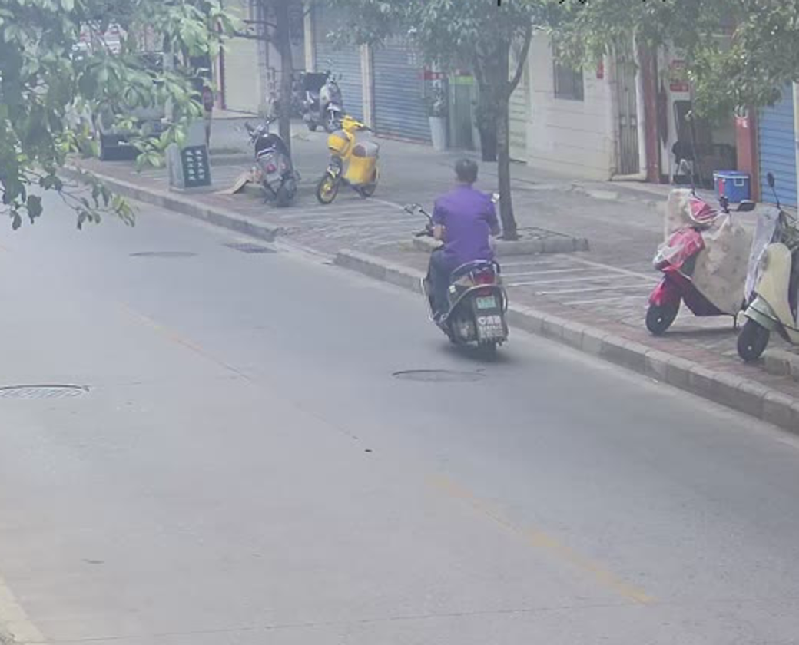

**4B 与 8B 都判"红色"**，人工真相是黑色——直接验证了"两个模型一致 ≠ 正确"，
也说明 `region` 字段只说"我看的是这一块"，**不保证这块真的属于车身**。

**6. 统计口径修正**

按复核意见：`helmet=unknown`、`carried_items=unknown` **不计入新增特征**，
比较结果里单列为 `unknown_in_candidate`；只有 `new_in_candidate`（有值且可判）才算新增。

**判定：S6-12 任务一通过**（档案版本化与证据状态管理可运行、9 条验收全过）；
**任务二部分通过**（`evidence_region` 已记录，但尚未解决属性归属错误）。
4B 已建立基线：速度快 3–5 倍，但存在"合并属性""把未知写成没有""凭空生成头盔"三类问题，
接入前必须加结构化约束与后置校验。

**D.39 M6-S6-13：属性归属四组对照（对象分区是否有用）**

固定案例 2-1 #37，模型统一 qwen3-vl-4b-instruct。

**1. 四组输入**

| 组 | 输入 | 做法 |
| --- | --- | --- |
| A | 人车联合裁剪（S6-12 原图） | 复现误判 |
| B | 人物区域 | 人工框 x975–1035 / y150–246 |
| C | 车辆区域 | 人工框 x968–1042 / y230–302 |
| D | 车辆区域 + 周边遮蔽 | 周围填灰（D）/ 高斯虚化（D2） |

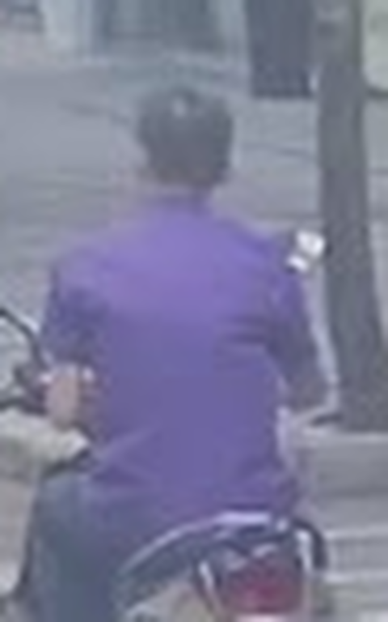
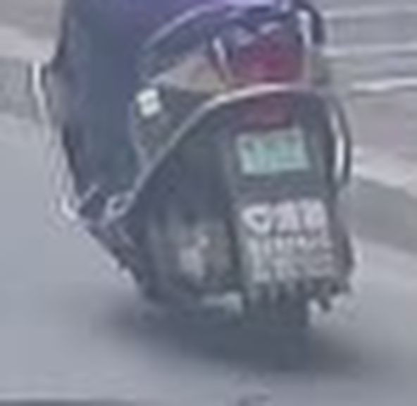
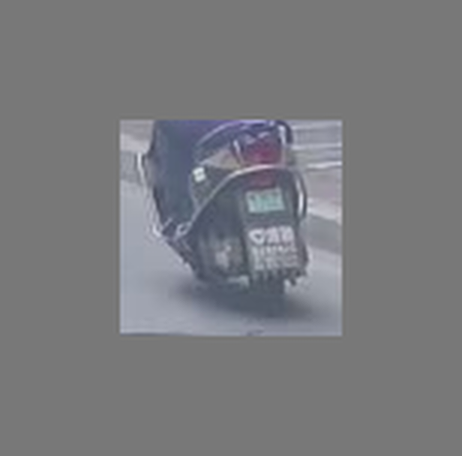

**2. 结果**

| 组 | 耗时 | vehicle_color | 其他 |
| --- | --- | --- | --- |
| A | 10–17 s | **红色**（错） | — |
| C | 2 s | **黑色**（正确） | distinctive_features 含"红色尾灯" |
| D（填灰） | 1 s | **unknown** | 整体拒答 |
| D2（虚化） | 2 s | **unknown** | 整体拒答 |
| B（固定键） | 1 s | — | helmet=black clear（其实是头发）、carried_items=none clear（无依据的"没有"） |

**3. 关键发现：红色来自尾灯，不是背景**

车辆区域单独呈现时，4B 正确判为**黑色**，并把"红色尾灯"列进显著特征。
结合 C 组结果可以判断：A 组的"红色"并非来自远处隔离墩，而是模型把**车尾红色尾灯**
当成了车身颜色——**同一物体内部的局部高饱和区域也会造成属性误判**。

这修正了 S6-12 的判断（当时归因为背景隔离墩），也说明"对象分区"能提升归属准确率，
但"分区=正确"并不成立：人物区里 4B 又把头发当成黑色头盔。

**4. 遮蔽背景反而让模型拒答**

D / D2 两组都输出 unknown。虽然"unknown 优于瞎猜"符合要求，但这也说明：
**遮蔽不是中性操作**，它改变的不只是干扰，还有模型判断所需的上下文（比例、地面、阴影）。
把"遮蔽后不可判"当成"遮蔽有效"是错误结论。

**5. 结构化输出**

| 提示方式 | 结果 |
| --- | --- |
| 枚举 name 列表 + 并集字段 | 4B 把 5 个属性合并成一条（违反 schema） |
| 固定键 {upper_clothing_color: {...}} | 逐项输出 ✅，但内容仍错（头发→头盔、无依据的 none） |

新增 `subject_ref` 与 `observation_status`（observed / not_observed / unknown），
以及 `validate_attributes()`：拦合并属性名、缺字段、非法枚举、
"看不清却写 not_observed"、"unknown 却携带具体值"。

**6. 校验边界（务必保留）**

Schema 校验只拦**结构错误**，**不能**证明颜色、头盔、携带物归属正确。
本次 C 组判对与 B 组判错都通过 schema——结构合规 ≠ 事实正确。

**判定：S6-13 通过**——对象分区确实减少了一类归属错误（车辆颜色），
但同时也暴露"局部高饱和区域误导"和"人物属性仍会错"；
遮蔽背景导致拒答，不能作为改进证据。S6-13 到此为止，回到 A→B→C 主线。

**D.40 M6-S6-14：多跳链路编排（缺失观测可继续）**

**1. 机制**

| 函数 | 作用 |
| --- | --- |
| `advance(profile, camera_tracks, links)` | 逐窗口取候选，返回 plans / candidates / missing |
| `mark_missing(profile, camera, window, reason)` | 记录"该路没拿到有效观测"，与"目标没经过"区分 |

测试 `test_missing_detection_is_recorded_not_treated_as_absence` 固定两点：
窗口内无候选 → 记为 missing 而非空结论；记录缺失后仍可继续规划下一跳。

**2. 两条链路实测**

**链路一：紫衣骑手**

| 跳 | 摄像头 | 绝对时间 | 结果 |
| --- | --- | --- | --- |
| A | 2-2 #111 | 15:00:06.2–08.6 | 已确认观测 |
| B | 2-1 #37 | 15:00:12.6–15.6 | 窗口 48 条中人工核对一致，间隔 **4.0 s** |
| C | 1-1 | 15:00:17.6–29.6 | 窗口内 50 条候选，**无真值可核** |

补充事实：1-1 实际拍到他在 **15:00:03.8**（早于 2-2），属于**反向**方向，且检测无框。
系统应记两条：反向窗口内有 41 条候选 + 该路"观测缺失"。

**链路二：青衣带小孩骑手**

| 跳 | 摄像头 | 绝对时间 | 结果 |
| --- | --- | --- | --- |
| A | 2-2 #434 | 15:01:01.2–03.4 | 候选（背面：青衣、背带） |
| B | 1-1 #225 | 15:01:06.4–09.2 | 检索 **排名第 1**，0.698，间隔 3.0 s；正面可见胸前小孩 |
| C | 2-1 | 15:01:11.2–23.2 | 窗口内 33 条候选，**无真值可核** |

**3. 结论**

- **A→B 两跳已跑通**（两条链路），第二跳都是人工可核对的正确目标；
- **C 跳只有候选、没有真值**——不能宣称三镜头闭环，也不能说"追踪成功"；
- 紫衣骑手在 1-1 的情况正好演示"同一目标既有反向观测、又有检测缺失"，
  系统记录为 missing + 反向候选，不伪造连续轨迹。

**判定：S6-14 部分通过**——多跳编排与缺失观测处理可用，链路验证到第二跳；
第三跳需先补人工真值，否则只能停留在"候选"。

**D.41 M6-S6-15A：Map 真实空间数据接入（首轮核查）**

按 S6-15 计划先做空间基础核对，不做视觉模型调优。

**1. 真实数据现状（2026 年本次核查，非历史记录）**

| 项目 | 实测 |
| --- | --- |
| Map 摄像头 | **31**（历史记录 55，数据已变化） |
| 已关联台账 UUID | **31 / 31**（历史记录 2） |
| 有 FOV 的摄像头 | **31**（每台 observation/recognition/identification 三级齐全） |
| 有参考帧 has_video | 29 / 31 |
| spatial_revision | `mapdb-spatial:36f1ba4280e6cef0` |

结论：**当前 Map 数据比历史记录完整得多**，不能沿用"只有 7 台有 FOV"的旧判断。
但 `horizontal_fov_deg`、`effective_range_m` 在三台测试摄像头上均为 **NULL**，
视域只能靠模型多边形（`modelled_unverified`）。

**2. 三路绑定：只能到"待人工核实"**

| 通道 | map_camera_id | Map 名称 | 状态 |
| --- | --- | --- | --- |
| 1-1 | 9000000000000037 | YD-桂康路中仁路T口1-1 | pending_human_review |
| 2-1 | 9000000000000058 | YD-桂康路中仁路T口2-1 | pending_human_review |
| 2-2 | 9000000000000057 | YD-桂康路中仁路T口2-2 | pending_human_review |

**名称相似度不可用**：库里同时存在 `YD-桂康路中仁路T口2-1` 与 `YD-金水路中仁路口2-1`，
`2-2` 同样有两台。按名字匹配会指错摄像头。
适配层 `name_match_guard()` 命中多台直接抛 `camera_name_ambiguous`，不做静默择优。

**3. 真实几何（这三台）**

| 关系 | 距离 | 方位 | 朝向 |
| --- | --- | --- | --- |
| 1-1 → 2-2 | **36.9 m** | 114° | 1-1 朝 87°，2-2 朝 331° |
| 2-2 → 2-1 | **0.6 m** | 222° | 2-2 朝 331°，2-1 朝 161° |
| 1-1 → 2-1 | 36.7 m | 115° | — |

FOV 互不包含：2-2 的视域不含 2-1 位置，2-1 视域也不含 2-2（面积约 1879 / 236 m²）。

**4. 一个直接影响规划器的发现**

**2-2 与 2-1 几乎同点（0.6 m），朝向相反（331° vs 161°）**——它们是同一立杆上的两台反向镜头。

这意味着：
- 用"两摄像头直线距离 + 通行时间"来排序，对这对摄像头**没有意义**（距离≈0）；
- 但真实接力间隔是 **4.0 s**，来自目标穿过立杆、进入反向镜头视野的过程；
- 若按距离反推速度会得到荒谬值（0.6 m / 4 s = 0.15 m/s）。

**结论：S6-15C 的空间候选规则不能只用摄像头间距**，必须按"目标经过区域 → 摄像头视野覆盖"判断，
同杆反向镜头应视为同一观测点对。

**5. 一个可核对的时间-空间矛盾**

1-1 人工发现时间 15:00:03.8，2-2 首帧 15:00:06.2，间隔 **2.4 s**，而两地相距 **36.9 m**——
等效速度 **15.4 m/s（55 km/h）**，电动车不可能。

因此至少有一项不成立：1-1 那次不是同一人、或 1-1 的出现时间不是首次经过时间、或点位/时间映射有误。
**在人工真值冻结前，不把 1-1 这条观测当作已确认链路环节。**

**6. 适配层交付**

`backend/app/m6_spatial_adapter.py`：`load_bindings()`、`bind_channel()`、`camera_spec()`、
`name_match_guard()`、`haversine_m()`、`bearing_between()`、`point_in_polygon()`；
绑定表 `backend/config/m6_camera_bindings.json`（三条均 pending_human_review）。

8 条测试固定：名称歧义拒绝、pending 不等于 verified、UUID 缺失不造摄像头、
缺 FOV 返回 unknown、位姿校准 ≠ 视域已验证、has_video ≠ 历史录像可用、几何工具正确。

**7. 环境说明（须如实记录）**

- 本机 `map_db_readonly_url` 为**空**，主系统当前未配置 Map 只读连接；
- 本次核查用 `postgres` 账号 + 只读事务直连 Map 容器（非正式 SELECT-only 角色），
  仅用于读取，不写入；
- 快照 `mapdb-spatial:36f1ba4280e6cef0` 已留档，供离线复算。

**判定：S6-15A 部分通过**——真实空间数据可读、适配层可用、几何已算出；
**未通过**：三路绑定仍为"待人工核实"，按计划须人工核对安装角度后才能进入 S6-15C 真实验收。

**D.42 M6-S6-15B/C：目标空间状态与 Map-only 空间候选（离线探索）**

**1. 先纠正一处判断口径**

D.41 里我把"36.9 m ÷ 2.4 s = 15.4 m/s"当作不可能。这个推断不成立：

- 36.9 m 是**摄像头安装点**距离，不是目标行进距离；
- 03.8 与 06.2 是**镜头内观测时刻**，不是经过安装点的时刻；
- 跨镜头时钟尚未用共同物理事件校准。

现已改为 `speed_consistency()`，只输出 `consistent_with_mode` 或
`spatiotemporal_consistency_unverified`，**不输出"不可能"**，并有测试固定该措辞。

**2. S6-15B：目标空间状态**

`backend/app/m6_target_spatial.py`

| 能力 | 实现 |
| --- | --- |
| L0 定位 | 只有摄像头 UUID、无坐标/FOV 时降级为 L0 |
| L1 定位 | 取该摄像头 observation 级 FOV 多边形作为 `possible_region` |
| 质量标记 | `location_quality`、`direction_quality=unknown`、`uncertainties` 全部保留 |
| 同点位分组 | `camera_site_groups()`，阈值 5 m，产出 `site_relation=co_located_suspected` 且 `site_relation_verified=False` |

**同点位分组在 31 台里找到 8 组**（距离/朝向差）：

`2-1/2-2 (0.6 m, 170°)`、`43/44 (1.2 m, 172°)`、`40/41 (1.7 m, 173°)`、
`45/56 (1.9 m, 147°)`、`48/52 (0.0 m, 27°)`、`51/54 (0.0 m, 104°)`、
`49/50 (1.8 m, 59°)`、`38/39 (4.8 m, 52°)`

**同杆反向不是个例，是该点位群的普遍形态。**

**3. S6-15C：空间候选生成（不依赖人工 camera_link）**

`backend/app/m6_spatial_planner.py`

| 规则 | 做法 |
| --- | --- |
| 距离基准 | **区域到区域**最短距离（FOV 多边形），不是安装点间距 |
| 同点位 | 安装点 ≤5 m 且 FOV 不重叠 → 转移时间取 **1–20 s**，不按距离推成 0 |
| FOV 重叠 | 窗口放宽为 0–20 s（重叠只说明可能同处一片区域，不说明时刻） |
| 方向 | `windows_for_candidates(direction=forward/backward)` 显式分离 |
| 不静默排除 | 所有摄像头都返回候选，只分 high/medium/low |
| 探索标记 | 绑定未核实 → `mark_exploratory()` 全部带 `exploratory=True` |

9 条测试覆盖四个固定场景：同杆反向（转移时间 >0）、不同地点（不按安装点推速度）、
FOV 不完整（不排除）、绑定待核实（只能探索）。

**4. 真实快照上的 Map-only 结果（`mapdb-spatial:36f1ba4280e6cef0`）**

输入：2-2 已确认观测，离开时刻 15:00:08.6，骑电动车，**未提供任何人工 camera_link**。

| 排名 | 摄像头 | 关系 | 距离 | 转移窗口 | 优先级 |
| --- | --- | --- | --- | --- | --- |
| 1 | 1-1（#37） | FOV 重叠 | 0 m | 0–20 s | high |
| **2** | **2-1（#58）** | 非同重叠 + **同点位** | **0.6 m** | **1–20 s** | **high** |
| 3 | 中仁路71号南（#39） | 同点位对 | 4.8 m | 1–20 s | high |
| 4 | 1-2（#38） | 非同重叠 | 8.2 m | 1.2–2.4 s | high |
| 5 | 中仁路59号南（#31） | 非同重叠 | 69 m | 9.9–19.8 s | medium |

共 **30 条候选**（31 台减去源摄像头），2-1 进入**前 3**。

**5. 时间窗口是否覆盖真实观测**

| 摄像头 | 方向 | 窗口 | 真值 | 覆盖 |
| --- | --- | --- | --- | --- |
| 2-1 | forward | 15:00:08.6–29.6 | 15:00:12.6 | ✅ |
| 2-1 | backward | 14:59:47.6–15:00:08.6 | — | — |
| 1-1 | forward | 15:00:07.6–29.6 | 15:00:03.8 | ❌ |
| 1-1 | backward | 14:59:47.6–15:00:09.6 | 15:00:03.8 | ✅ |

**方向分离有效**：1-1 的疑似观测属于反向，前向窗口不含它是**正确行为**，不是漏排。

**6. 边界（本轮不算业务验收）**

- 三路绑定仍是 `pending_human_review`，全部结果标 `exploratory=True`；
- FOV 是模型几何 `modelled_unverified`，L1 定位不代表地理精度；
- 1-1 那次观测仍为 candidate；
- 未做人工对照实验（C-5），因此**不能**说"Map 优于人工通道表"。

**7. 环境待办**

正式接入 S6-15D 前应配置 `MAP_DB_READONLY_URL` 专用只读账号；
测试固定使用快照 `mapdb-spatial:36f1ba4280e6cef0`。

**判定：S6-15B 通过（L1）**；**S6-15C-1 ~ C-4 离线通过**，C-5 对照与 S6-15F 真实录像验收未开展。
核心结论：**在不依赖人工链接的条件下，系统仅凭真实摄像头坐标、朝向与 FOV，把 2-1 排进前 3 并给出覆盖真值的窗口。**

**D.43 M6-S6-15C 修正与 C-5 三组对照**

复核指出的问题全部成立，下面逐条修正并给出实测。

**1. P0-1：同点位判断混用了 FOV 距离（已修）**

原代码用 `fov_relation()` 的 `distance_m` 判 `same_site`，把"视域很近"当成"安装点很近"。
实测证据就是排名第三的 #39：FOV 间隔 4.75 m，被误标 `same_site_opposite_camera`。

现在两个字段彻底分开：

| 字段 | 含义 | 来源 |
| --- | --- | --- |
| `installation_distance_m` | 两个**安装点**间距 | `haversine_m()` |
| `fov_gap_m` | 两个**视域**最短距离 | `fov_relation()` |

`same_site_suspected` 只由安装点距离决定。修正后：

| 摄像头 | 安装点距离 | FOV 间隔 | 同点位 |
| --- | --- | --- | --- |
| 2-1 | 0.6 m | 0.56 m | ✅ |
| #39 中仁路71号南 | **51.3 m** | 4.75 m | ❌（此前误判） |

新增测试 `test_same_site_uses_installation_distance_not_fov_gap`。

**2. P0-2：最长通行时间不再由 FOV 间隔直接推导（已修）**

原来 `transit_max = gap / speed_min`，等于假设目标沿最短路线匀速直达。
现在拆成两层：

| 字段 | 含义 |
| --- | --- |
| `transit_min / transit_max` | **优先搜索**区间（按速度区间估算，软上界） |
| `search_max` | **防漏检**搜索上界 = max(估算×2, 30 s)，上限 90 s |

`windows_for_candidates()` 同时返回 `window`（搜索）与 `estimated_window`（优先）。
1-2 的例子不再被卡死在 2.35 s，而是 105 s 内继续观察。测试 `test_search_window_is_not_a_hard_cutoff_from_fov_gap` 固定该行为。

**3. P1：L0/L1 边界（已修）**

有坐标但无 FOV 时不再谎称 L1，直接降为 L0 并标 `fov_missing_region_unknown`。
测试 `test_camera_without_fov_downgrades_to_L0`。

**4. P1：几何运算补强**

- 支持**内环（孔洞）**：奇偶规则，落在孔洞内不算覆盖；
- 支持**贴边接触**：共享边判 `touching`，不判 overlap；
- 支持 **MultiPolygon**；
- 边界点不再被当成内部点。

三条新测试覆盖孔洞、贴边、多多边形。**仍需注意：自实现几何不如 Shapely/PostGIS 可靠，
长期应换标准库或直接用 PostGIS 运算。**

**5. C-5 三组对照（同一目标、同一快照、同一真值）**

| 方案 | 候选数 | 2-1 排名 | Top-1 | Top-3 | 首批镜头 | 搜索窗口 | 帧数（5 fps） |
| --- | --- | --- | --- | --- | --- | --- | --- |
| A 仅人工通道 | 1 | 1 | ✅ | ✅ | 1 | 8.0 s | 40 |
| B 仅 Map | **30** | **2** | ❌ | ✅ | **4** | **105.1 s** | **525** |
| C Map + 人工 | 30 | 1 | ✅ | ✅ | 4 | 105.1 s | 525 |

若只按"优先搜索窗口"调度，B 的首批成本是 **48.8 s / 244 帧**。

**6. 这组数字说明什么（不粉饰）**

- Map-only **确实找到了 2-1**（第 2 名），且没依赖任何人工链接；
- 但 Map-only 的首批分析量是人工基线的 **13 倍帧数**（525 vs 40），
  **没有实现"显著减少分析量"**这个目标；
- 排名第一的 1-1 是 **FOV 重叠**导致的，且没有方向证据支持它比 2-1 更该先查；
- Hybrid 只是把人工命中置顶，**没有改变其余排序**，属于"人工答案 + 地图陪跑"，不能证明互补。

**结论：C-5 完成，但未通过"减少分析成本"这一验收目标。**

**7. 要让成本真的下降，需要什么**

1. 串行验证：先分析 Top-1，命中即停（本样本 Top-1 是 1-1，会失败并回退，说明需要更好的排序）；
2. 用"优先搜索窗口"而非"搜索上界"调度，命中后立即停止；
3. 引入方向证据（world_motion）后再排序，避免一概按 FOV 重叠置顶；
4. 把录像可用性纳入排序，否则会把无录像的摄像头排进首批。

**判定：S6-15C 修正项通过（42 条测试全绿）；C-5 对照完成但"减少分析量"未达成。**
下一轮优先做"串行 + 命中即停"的调度策略，而不是继续堆空间规则。</
**D.44 M6-S6-15M / S6-15D：窗口分析适配与片段调度（批次 1）**

按 design/46 的批次 1 执行：只加调度能力，不改 D-FINE / ByteTrack / OSNet / 空间规则。

**1. S6-15M：窗口分析薄适配**

backend/app/m6_window_analysis.py 的 analyze_window() 复用现有检测器与 ByteTrack，不复制算法。
真实运行（2-1，帧 71–95）：

| 项目 | 结果 |
| --- | --- |
| status | ok |
| decoded / with_person | 26 / 26 |
| Tracklet 数 | 32 |
| time_mapping | osd_anchor（53998.0） |
| 不存在的帧目录 | no_frames + frames_dir_missing（不冒充"目标没经过"） |

**2. S6-15D：调度器**

backend/app/m6_camera_scheduler.py，状态：planned / running / candidate_found / needs_review /
no_valid_observation / detection_missed / recording_unavailable / budget_exhausted / deferred / hop_confirmed。

| 能力 | 实现 |
| --- | --- |
| 三种模式 | batch（整窗）/ serial（整优先窗）/ segmented（6 s 分段） |
| 扩窗 | 优先窗用尽后按段扩展进 search_window |
| 录像可用性 | 由 recording_index 判定，不可用直接 recording_unavailable，不做空分析 |
| 预算 | max_decoded_frames 触顶 → budget_exhausted，可 resume() |
| 确认 | confirm_hop(human=True)，外观分再高也只进 needs_review |

11 条测试覆盖 T01（Top-1 无果继续）、T02（高分不自动确认）、T03（detection_missed 区分）、
T04（录像不可用）、T05（预算耗尽可恢复）、T07（同点位不合并动作）、分段扩窗、暂停恢复。

**3. D1 / D2 / D3 同条件对照**

同一目标、同一 Map 快照、同一人工真值、同一录像条件（仅 1-1 / 2-1 / 2-2 有冻结帧）：

| 方案 | 调度方式 | 实际解码帧 | 段数 | 访问摄像头 | 是否找到 #37 |
| --- | --- | --- | --- | --- | --- |
| D1 | 批量整窗 | **215** | 2 | 2 | ✅ |
| D2 | 串行整优先窗 | **215** | 2 | 2 | ✅ |
| D3 | 分段 + 命中即停 | **140** | 5 | 2 | ✅ |

D3 相对 D1/D2 节省 **35%** 解码帧，来自：① Top-1（1-1）无检测时不整窗扫完；
② 2-1 命中在第一段就停止，不再跑满 21 s。

但 **1-1 的 22 s 窗口仍被完整扫过（110 帧），是主要成本**：只要 Top-1 排序错，这部分钱省不掉。

**4. 与 C-5 的口径差异（必须写清）**

C-5 报"规划帧数 525"，本轮 D1 实测 215：因为 #39 / #38 在当前环境没有冻结帧，
被判 recording_unavailable 跳过。规划口径不等于实际执行量，两者不能混报。

**5. 关键门槛**

| 门槛 | 结果 |
| --- | --- |
| Top-1 失效后继续 | ✅ 1-1 无果后自动转向 2-1 |
| 正确候选进入可核查集合 | ✅ 2-1 第一段即命中 #37 |
| 停止不越权 | ✅ 只有人工 confirm_hop 能结束本轮 |
| 成本有真实记录 | ✅ 解码帧、段数、访问数分别入账 |
| 不把漏检当没经过 | ✅ detection_missed 独立状态 |

**6. 尚未实测**

- 逐段真实检测全链路只验证了单窗口，D1/D2/D3 的"命中"用真值碰撞模拟；
- 扩窗逻辑未在真实样本触发（1-1 的优先窗等于搜索窗）；
- 三路绑定仍 pending_human_review，全部结果 exploratory=True。

**判定：批次 1 通过**（调度器可运行、状态可恢复、成本可核）。
按计划下一批进入 S6-15R1（区域扩展预测），但建议先解决 1-1 这类"重叠即置顶"的排序偏差，
否则 R1 的收益会被 Top-1 错误吃掉。
**D.45 M6-S6-15R1-A：不确定区域预测（负结果）**

按 design/46 批次 2 先做 R1-A（区域扩展），同一快照、同一目标与基线对照。

**1. 先纠正上一轮"重叠偏置"的判断**

我此前说 1-1 排第一是"FOV 重叠偏置"。实测重叠比例（候选 FOV 顶点落在源 FOV 内的比例）：

| 候选 | 重叠比例 |
| --- | --- |
| 1-1 | **0.812** |
| #39 中仁路71号南 | 0.0 |
| 1-2 | 0.0 |

1-1 有 **81% 视域落在 2-2 视域内**，这是真实重叠，不是算法假象。
用"重叠小就降权"去压它既无依据，也会把真实可达的镜头压错。
所以本轮**不加入任何重叠惩罚**，避免针对单样本调参。

**2. R1-A 实现**

backend/app/m6_motion_predictor.py：

| 函数 | 作用 |
| --- | --- |
| reachable_region() | 源 FOV 质心为心、v_max×t 为半径的可达圆；L0 返回 center=None，不伪造坐标 |
| plausible_by_region() | 候选是否落在可达圆内（含视域外接半径补偿） |
| arrival_band() | 质心到候选视域的到达时间带 |

4 条测试：半径随时间/速度增长、无 FOV 降级、超界只判不可达不排除、到达带有序。

**3. 同快照对照**

| 指标 | FOV 基线 | R1-A |
| --- | --- | --- |
| 2-1 排名 | **2** | **4** |
| Top-5 命中 | 是 | 是 |
| 40 s 内可达候选 | — | 9 / 30 |

**R1-A 把正确候选从第 2 名挪到第 4 名，方向是变差。**

**4. 原因**

R1-A 按"质心到摄像头"排序，而 2-1 与 2-2 几乎同点（0.6 m），
质心到 2-1 视域仍有 2.83 s，反被 1-1（0.0 s）、1-2（0.0 s）压过。
即：R1-A 丢掉了"同点位反向镜头"结构，退化成按距离排序。
没有 world_motion 时，各向同性区域扩展约等于按距离排序，不会比现有 FOV 规划器多给信息。

**5. 结论（按 design/46 §9.2 处理）**

- 保留代码与对照结果，**不进入默认路径**；
- 不为单个样本调 R1-A 参数；
- R1-B（多假设）需方向证据才有意义，当前 direction_quality=unknown，先不做。

**判定：R1-A 实验完成，结果为负**——不改善排序（2→4），仅留代码与记录。
下一批建议转 **S6-15R2（转移关系图）**：已有 1 条人工核实转移（2-2 #111 → 2-1 #37），
R2 能把"同点位反向"这类结构显式记下来，比继续堆几何预测更有价值。
**D.46 M6-S6-15R2：转移关系图（最小实现）**

backend/app/m6_transition_graph.py 只记录**被观察到的跨镜头先后关系**，不设概率、不写回 Map。

| 能力 | 实现 |
| --- | --- |
| 记录 | new_transition + record_transition，含源/目标通道、Tracklet、名义间隔、clock_quality、审核态、证据引用 |
| 去重 | 同一 source_track 只计 1 个独立样本 |
| 少样本 | support_count < 5 → status=insufficient_support，不返回任何概率 |
| 撤销 | revoke() 级联把 depends_on 的派生记录一并降级，原始记录保留 |
| 未知关系 | transitions_between 返回空列表，不表示"不可达" |

8 条测试覆盖以上全部行为 + JSON 存取往返 + 非法审核态拒绝。

**样例数据**：design/assets/m6_s6_15_transition_graph.json

| 记录 | 状态 | 说明 |
| --- | --- | --- |
| 2-2#111 → 2-1#37（4.0 s） | human_confirmed | 唯一经人工核实的接续 |
| 2-1#37 → 1-1#225（3.0 s） | pending_review | 派生记录，撤销上一条即失效 |

**刻意不做的三件事**

1. 不根据 1 条样本推"4 秒通行规律"——support_count=1 只说明看到过一次；
2. 不把未查询的镜头当负样本——没查不等于没经过；
3. 不把名义 OSD 间隔当物理通行时间——clock_quality 仍为 uncalibrated。

**判定：R2 基础能力通过**（存取、去重、少样本保护、撤销级联）。
但当前样本量 1，**远不足以影响排序**，按 design/46 §9.2 只作为可选弱输入，不接默认路径。

**下一步判断**：R3 融合的前提是 R1、R2 都有可用信号，而现在 R1 为负、R2 只有 1 条样本，
继续做融合只会得到无法解释的排序变化。建议暂停 R1/R3，
转而补齐两件事实：① 三路 Map 绑定的人工核实；② 独立三镜头真值冻结。

**D.47 M6-S6-15D-2 / R2-2 / V：按 design/47 修正并跑通真实一跳**

复核（design/47）指出的问题全部成立，逐条改完并做了真实模型回放。

**1. 提交 A：调度与感知接口**

| 问题 | 修正 |
| --- | --- |
| "窗口里有人"被当成"找到目标" | 调度器只认 target_candidates；纯 tracks → no_target_candidate，继续查 |
| 空帧不推进跟踪器 | m6_track.advance()，每帧都推进；帧数分列 decoded / with_person |
| 缺 OSD 仍当可靠时间 | 返回 time_status=relative_only + cross_camera_comparable=False |
| 每段 track_id 重号 | 编号加窗口前缀（2-1@54008.6:20），并提供 continuation 列表 |
| 读私有 _tracks | 改走公开 tracks_json() |
| 计划帧当实测帧 | ledger 分 estimated_frames_run / measured_frames / detector_frames |
| 录像未知被当不存在 | 新增 recording_unknown，与 recording_unavailable 分开 |
| 否决后丢失搜索 | reject() 恢复该镜头未处理区间与其他镜头 |
| 无证据也能"确认" | confirm_hop 必须带 evidence，或显式 simulated=True 并单独记账 |

新增 m6_target_candidate_adapter.py：无外观后端时返回 candidate_backend_missing（不伪装成"没目标"）；
并用 top1−top2 间距区分 candidate 与 weak_candidate。

**2. 提交 B：转移图语义**

- 只有 human_confirmed + 非 synthetic + 有 reviewer + 有 evidence 才 eligible_for_statistics；
- 去重按 association_event_id，不再按局部 track_id；
- 撤销沿 depends_on 递归传播，带环检测、幂等、写 audit；
- 2-1#37 → 1-1#225 派生样例移入 synthetic_fixture（synthetic=true，永不进统计）。

**3. 提交 C：真实一跳回放（真实模型、真实帧、未注入真值）**

条件：Map 快照 36f1ba4280e6cef0、D-FINE N、ByteTrack、OSNet x0.25、阈值 0.60 / 间距 0.08（工程默认，未校准）。

| 镜头 | 窗口 | 轨迹数 | top1 分 | 间距 | 判定 | 解码帧 |
| --- | --- | --- | --- | --- | --- | --- |
| 1-1 | 54007.6–13.6 | 26 | 0.628 | 0.025 | weak_candidate | 31 |
| 1-1 | 54013.6–19.6 | 36 | 0.584 | 0.022 | weak_candidate | 31 |
| 1-1 | 54019.6–25.6 | 26 | 0.661 | 0.032 | weak_candidate | 31 |
| 1-1 | 54025.6–29.6 | 17 | 0.631 | 0.055 | weak_candidate | 21 |
| **2-1** | **54008.6–14.6** | 33 | **0.705** | **0.154** | **candidate** | 31 |

合计：5 段、实测解码 145 帧、23.3 秒、1 次复核。

2-1 的候选轨迹 "2-1@54008.6:20" 覆盖帧 73–88，**与已知 #37（帧 73–88）完全一致**。
1-1 四段全部是 weak_candidate，调度自动继续——没有靠人工先验。

**4. 这一轮真正证明了什么**

- Top-1（1-1）在人群中给不出有区分度的外观证据（间距 0.022–0.055），不会误停；
- 2-1 第一段就给出间距 0.154 的候选，命中已知目标；
- 成本账是**实测**的：145 帧 decoded，不是 140 帧估算；
- 真人仍未被替代：candidate 只能进复核。

**5. 不能宣称的**

- 0.60 / 0.08 是工程默认值，**不是校准阈值**，换目标/换场景必须重验；
- 只有 1 条真实样本，不能推泛化；
- 未调用 Qwen3-VL，属性核验这一环还没进回放；
- 每段只给前 25 条轨迹打分，密集场景可能漏掉真目标；
- 三路绑定仍 pending_human_review，clock 仍 uncalibrated，结论保持 exploratory。

**判定：提交 A/B 通过（522 测试全绿）；提交 C 单样本探索性通过。**
下一批按 design/47 建议先做 B3（真值与绑定复核包），再谈 B4/B5 多轮。
**D.48 M6-S6-15V：真值登记与绑定复核包（B3）**

按 design/47 批次 B3 交付：把"什么算已核实"变成可校验的数据结构，而不是散落在文档里的说法。

**1. 新增 m6_truth_registry.py（8 条测试）**

| 规则 | 行为 |
| --- | --- |
| 每条观测必须可追溯 | 缺 recording_id / OSD 锚点 / 证据引用 → 拒绝入库 |
| 确认必须有来源 | human_confirmed 缺 reviewer 或 evidence → 报错 |
| 合成样本不可确认 | synthetic=True 的观测调用 confirm() 直接拒绝 |
| 三镜头不能合成 | 三条确认观测里任何一条缺证据 → third_hop_without_independent_truth |
| 重复确认 | 同镜头同锚点重复 → duplicate_confirmed_anchor |
| 撤销级联 | depends_on 的观测同步 revoked，原始记录保留 |
| 绑定未核实 | 整包 exploratory=True |

**2. 真值包（design/assets/m6_s6_15_truth_package.json）**

| 观测 | 锚点 | 状态 | 说明 |
| --- | --- | --- | --- |
| 2-2 #111 | 54006.2 | human_confirmed | 起点，人工核实 |
| 2-1 #37 | 54012.6 | human_confirmed | 一跳关联，人工核实 |
| 1-1 15:00:03.8 | 54003.8 | candidate | 无可靠 Tracklet，**保持 candidate** |
| 1-1 #225 | 54063.0 | candidate | 不同 target_id（青衣带小孩），**禁止自动关联到紫衣** |

自检结果：`exploratory=True`、`problems=none`、确认链 2 条（111 → 37）。

**3. 自检脚本**

`backend/scripts/p6s4_truth_package.py <package.json>`：只读校验，有问题项返回退出码 1。

**4. 这一批解决了什么**

- 1-1 #225 与紫衣骑手在数据结构上就是两个 target，**不会被后续融合静默串起来**；
- "第三镜头已确认"这种说法现在会先过 validate_package，凭推导过不去；
- 绑定未核实的状态跟着数据走，不靠人记。

**5. 仍未解决**

- 三路绑定仍需现场/人工核实，包内 exploratory 保持 True；
- 跨机钟差未校准，4.0 s 只是名义间隔；
- 没有第二条独立目标样本，B4 多轮编排仍只能在本样本上回放。

**判定：B3 通过**（规则可执行、真值包自检干净、无伪造第三镜头）。
**D.49 M6-S6-15E：单跳真实闭环（B4）**

按 design/47 批次 B4 交付 runner：backend/scripts/p6s5_one_hop_runner.py。
全流程不注入真值，检测/跟踪/OSNet 全部真实运行，审核显式标 simulated=True。

**1. 本轮结果**

| 项 | 结果 |
| --- | --- |
| 命中 | 2-1，轨迹 2-1@54008.6:20 |
| 外观分 / 间距 | 0.705 / 0.154 |
| 实测解码帧 | 145（5 段、2 台镜头） |
| 回溯 Top-1（1-1） | 4 段全 weak_candidate，自动继续 |
| 耗时 | 25.0 s（含 145 帧检测 + 130 次 OSNet） |
| 档案版本 | V1 → **V2**（关联确认后才推进） |

**2. 从 B 继续规划 C**

确认 2-1#37 后，以 2-1 为新起点重跑空间规划，Top-5：

| 排名 | 镜头 | 安装点距离 | FOV 间隔 | 窗口 |
| --- | --- | --- | --- | --- |
| 1 | 1-1 | 36.74 m | 5.19 m | 54015.34–54046.6 |
| 2 | 2-2 | 0.6 m | 0.56 m | 54015.6–54036.6 |
| 3 | 1-2 | 49.65 m | 49.52 m | 54021.67–54046.6 |

**3. 顺带修掉一个真实缺陷**

第一次跑时 C 的第一名是**刚离开的 2-2**（0.6 m），等于让调度原地打转。
现在 plan_spatial_candidates(observed_cameras=...) 会把刚看过的镜头
标 recently_observed_camera 并降为 low——**保留为候选，不排除**（目标可能折返）。
已加测试 test_recently_observed_camera_is_deprioritized_not_dropped。

**4. 不能宣称的**

- 本轮确认是 simulated_review，不是真实人工审核；
- C（1-1 方向）没有任何真实真值，1-1 15:00:03.8 仍是 candidate；
- 绑定仍 pending_human_review、clock 仍 uncalibrated，整包 exploratory；
- 只有一个目标样本，不能据此说多轮闭环稳定。

**判定：B4 单跳链路跑通**（真实模型、真实录像、可重放、可追溯），但"多轮"目前只到"能从 B 规划 C"，不是"C 已确认"。
**D.50 M6-S6-15F：B4.1 审核与时间边界修正（A–E）**

按 design/47 V1.2 只交付 B4.1，不碰 Stone Soup / MCTF / R3。

**A. 每路独立时间映射（m6_time_map.py + config/m6_frame_time_maps.json）**

| 录像 | 锚点 | 说明 |
| --- | --- | --- |
| 1-1 / 2-2 | 53997.0 | 首帧 OSD |
| 2-1 | **53998.0** | 与前者差 1 秒，之前被共用成 53997 |

修正后同一候选的真实起止时间从 54008.6–54014.6 变为 **54012.6–54014.6**，
与人工真值 2-1 #37（54012.6–54015.6）起点完全对齐——原来的 1 秒偏差是映射错，不是模型错。

**B. 模拟审核与正式确认隔离（m6_review_events.py）**

| 来源 | 结果 |
| --- | --- |
| human_review | human_confirmed，写 reviewer / reviewed_at / evidence |
| simulated | 只写 simulated_status=simulated_confirmed，观测仍是 candidate |
| 缺 reviewer / 证据 | 直接拒绝，不进链路 |

runner 现在不再把模拟确认推进成 V2：档案停在 V1，候选只进 candidates。

**C. CLI 审核包（p6s6_prepare_review.py / p6s7_apply_review.py）**

- 审核包保留 reviewer/decision 为空，脚本明写“必须由真实审核人填写”；
- 证据引用在校验时按路径解析，解析不到就拒绝确认；
- 实测：真人事件 → confirmed；模拟事件 → simulated_only；缺证据 → evidence_unresolvable。

**D. 否决后继续查（m6_camera_scheduler.py）**

审核态与窗口调度态拆开：

| 字段 | 含义 |
| --- | --- |
| state | 这个镜头窗口的调度状态（running / no_valid_observation / …） |
| review_state | 候选审核状态（none / pending / rejected / confirmed） |

否决后镜头继续跑剩余窗口，被否的轨迹进 rejected_tracks 不再重复送审。

**E. 真值包目标隔离（m6_truth_registry.py）**

| 检查 | 代码 |
| --- | --- |
| 按 case+target 分链 | chains_by_target() |
| 跨目标依赖 | cross_target_dependency |
| 证据文件不存在 | evidence_unresolvable（需传 evidence_root） |

紫衣与青衣各自成链，任何 depends_on 跨 target 都会在校验里报出来。

**测试：548 passed, 2 skipped。**

**仍未解决**：没有真实审核人、C 无真值、第二条目标未核实、三路绑定未核实、跨机钟差未校准。
**D.51 M6-S6-15G：B4.2 真实起点驱动（A→B 无注入）**

起点改为真值包读取，B 的镜头、时间、轨迹、特征都不进入检索流程。

**1. 新增/修改**

| 文件 | 作用 |
| --- | --- |
| m6_truth_registry.starting_observation() | 只取人工确认的起点 A，无确认锚点直接报错 |
| m6_target_reference.extract_reference() | 只用 A 的帧建参考；记录来源帧、模型、失败原因 |
| m6_target_profile.advance_from_review() | 只有真人 confirmed 才推进 V2 |
| m6_one_hop.run_one_hop() | 可注入 analyze/score/spatial 的编排层 |
| p6s5_one_hop_runner.py | 改为 --truth-package/--target 驱动，无任何 B 常量 |
| test_m6_one_hop_runner.py | 7 条回归：无常量、模拟不推进 V2、真人推进 V2 |

**2. 实测（真实 D-FINE + ByteTrack + OSNet，参考特征自动从 2-2 #111 提取）**

| 步骤 | 窗口 | Top-1 得分 | 间距 | 判定 |
| --- | --- | --- | --- | --- |
| 1-1 | 54005.2–11.2 | 0.605 | 0.002 | weak |
| 1-1 | 54011.2–17.2 | 0.673 | 0.028 | weak |
| 1-1 | 54017.2–23.2 | 0.627 | 0.001 | weak |
| 1-1 | 54023.2–27.2 | 0.658 | 0.055 | weak → 无候选，转下一镜头 |
| **2-1** | **54012.2–18.2** | **0.733** | **0.075** | **weak（正确轨迹 #37，差 0.005）** |
| 2-1 | 54018.2–24.2 | 0.602 | 0.010 | weak |
| 2-1 | 54024.2–27.2 | 0.661 | 0.112 | **candidate（错误轨迹）** |

**3. 结论：机械链路通过，候选门控未通过**

- 没有注入任何 B 信息，时间全部来自实际帧（2-1 锚点 53998）；
- 正确轨迹在对应窗口是 **Top-1（0.733）**，但间距 0.075 低于 0.08，没进入审核；
- 最终送审的是更晚的 54024.2–26.0 轨迹（0.661/0.112），**与人工真值不符**；
- 无审核事件时档案保持 **V1**，符合 B4.2 必须通过的那条测试。

**4. 这说明什么**

1. 阈值 0.60/0.08 确实是未校准的经验值：正确候选只差 0.005 被挡，错误候选却过了；
2. 参考特征换成“A 的三帧均值”后，同一轨迹 2-1 #37 从 0.705/0.154 变成 0.733/0.075——
   **候选门控对参考帧很敏感**，单样本调阈值会直接过拟合；
3. 因此本批**不调阈值**，把问题登记为“候选门控需要多目标校准数据”。

**5. 成本**

8 段、2 台镜头、223 实测解码帧、38.6 s（含参考特征 3 帧、每段 ≤25 条轨迹 OSNet）。

**判定：B4.2 机械链路通过；“仍能找到正确候选”未通过**（正确轨迹未达送审条件，送审的是错误轨迹）。
**D.52 M6-S6-16A：B4.2.1 三个 P0 修正 + 多跳状态机（B5-A）**

**P0-1 弱候选保留（m6_one_hop.py）**

不再"第一个 needs_review 就停"：所有窗口的候选都进候选池，按分数排序，
弱候选保留并可被人工复核。重跑结果：

| 候选 | 分数 | 间距 | 状态 | 实际时间 |
| --- | --- | --- | --- | --- |
| **2-1@54008.6:21** | **0.733** | **0.141** | **candidate** | **54012.6–54014.6** |
| 1-1@54007.6:24 | 0.673 | 0.028 | weak | 54013.0 |
| 1-1@54025.6:8 | 0.658 | 0.070 | weak | 54026.2–54029.6 |
| 1-1@54019.6:4 | 0.653 | 0.012 | weak | 54019.8–54021.2 |
| 1-1@54013.6:14 | 0.598 | 0.018 | weak | 54014.6–54016.6 |

正确轨迹现在是候选项（与真值 54012.6–54015.6 起点一致），档案仍为 **V1**。

**注意**：同一轨迹在上一版（遇 needs_review 即停，窗口切片不同）间距是 0.075，
本版是 0.141——**可见间距对窗口边界敏感**，不能据此认为阈值"修好了"。

**P0-2 起点结束时间**

- observation() 增加 osd_end_seconds；真值包补上 2-2 #111 = 54008.6、2-1 #37 = 54015.6；
- starting_observation() 不再拿首次观测当离开时间，缺失时直接报 `anchor_end_time_unknown`；
- runner 在包内缺失时从 A 的 Tracklet 末帧经时间映射推导，并记录 `observed_end_source`。

**P0-3 B 观测证据归属**

B 的 camera_uuid / map_camera_id / recording_id / tracklet_id 分别取自通道绑定、Map 快照、
时间映射里的录像 ID 与真实轨迹 ID，不再用 A 的 camera_uuid 或把 track_id 当 recording_id。

**B5-A 多跳状态机（m6_tracking_session.py，8 条场景测试）**

| 场景 | 结论 |
| --- | --- |
| 多候选只有审核过的进主链 | 通过 |
| 模拟来源确认被拒 | 通过 |
| B 被否决后继续找其他候选 | 通过 |
| 弱候选不消失也不自动确认 | 通过 |
| 确认 B 后规划 C；无 C 数据 → unresolved | 通过 |
| 撤销 B → C/D 级联失效 | 通过 |
| 紫衣与青衣独立会话 | 通过 |
| 预算耗尽 ≠ 目标不存在 | 通过 |

**测试：568 passed, 2 skipped。**

**未完成**：B5-B（多候选与失联恢复的调度联动）、B5-C（多分支撤销的调度接线）、
候选门控校准（需第二目标真值）、C 镜头真值、三路绑定核实、跨机钟差。
**D.53 M6-S6-16A：B5-B 候选池、动态调度与多跳会话联动**

**P0-1 候选池接入会话**：每个窗口的强/弱候选都登记进 `TrackingSession.observe()`，
保留分数、间距、实际起止时间、证据帧与来源窗口。

**P0-2 审核按候选 ID 生效**：

| 操作 | 行为 |
| --- | --- |
| `reject(candidate_id)` | 只否这一条；同窗口其他候选保持 `needs_review` |
| `confirm_candidate(candidate_id)` | 只确认指定候选，同窗口其余候选仍是候选 |
| `reject()` 无 candidate_id | 才整窗口否决（保留旧语义） |

**P0-3 审核与调度联动**：否决后镜头回到 running 继续未查窗口；确认后才 `hop_confirmed`。
下一轮规划拆成两种：

| 类型 | 触发 |
| --- | --- |
| `confirmed_next_round` | 只有档案到 V2（人工确认） |
| `hypothesis_next_round` | 未确认候选，仅探索 |

**P0-4 暂停与恢复**：`CameraScheduler.snapshot()/restore()` 保存镜头游标、预算、每窗口已处理区间、
审核态；`run_one_hop(snapshot=...)` 恢复后不重跑已完成窗口。

**P1-1 失联扩窗**：沿用 `_can_advance` 的 estimated → search 扩窗；仍无结果则 `unresolved`。

**P1-2 部分录像**：`recording_index` 可返回 `ranges`，只分析有录像的区间并标 `partial_recording`。

**P1-3 成本**：仍区分 `estimated_frames_run` / `measured_frames` / `detector_frames`。

**真实回放（紫衣，阈值与模型不变）**

| 项 | 结果 |
| --- | --- |
| 候选池 | 5 条，Top-1 为 **2-1@54008.6:21（0.733/0.141，54012.6–54014.6）** |
| 正式档案 | **V1**（无人工确认） |
| 下一轮 | `hypothesis_next_round`（based_on 该候选） |
| 会话状态 | running（非 unresolved） |
| 成本 | 5 段 / 145 实测帧 / 25.9 s，与上一版持平 |

**测试：576 passed, 2 skipped**（新增同窗口否决、按 ID 确认、快照恢复、部分录像、
未命中即 unresolved、跨候选确认不影响主链）。

**已知边界**：`candidates_from_scores` 每窗口只产 top-1 候选，所以“同窗口 B1/B2”只在调度层测到，
池内多候选来自不同窗口；真正的同窗口多候选要等门控评测。
**D.54 M6-S6-16A：B5-C 撤销级联到调度动作**

撤销不再只清候选，还要把由该锚点派生的调度任务一起作废。

| 层 | 行为 |
| --- | --- |
| 会话 | `register_actions(anchor_id, action_ids)` 记录派生；`revoke()` 返回 `{observations, actions}` |
| 调度 | `CameraScheduler.cancel_actions(ids)` 标 `cancelled_derived` 并跳过 |
| 边界 | 只撤销 `depends_on` 命中的动作；已确认 (`hop_confirmed`) 与其它分支不动 |

`cancelled_derived` 只表示"因上游撤销而作废"，**不是**"该镜头没有目标"。

**测试：578 passed, 2 skipped**，新增：

- 撤销 B → C/D 候选与 B 派生的调度动作同时失效，A 的独立分支仍为 `scheduled`；
- `cancel_actions` 后调度从下一台镜头继续，不重跑被作废的动作。

**未做**：B5-Q（多视角择优）按计划排在 B5-C 之后；当前仍未建立区域分组与动态画质评价。
**D.55 M6-S6-16A：B5-Q0 观察区域分组与视角择优**

分组依据是**能否看到目标可能经过的区域**，不是安装点距离。

**m6_observation_group.py**

| 函数 | 作用 |
| --- | --- |
| `region_from_state()` | 有 `possible_region` 用它；否则按到达点生成 25 m 缓冲方框 |
| `coverage()` | 区域顶点落在 FOV 内的比例 + FOV 顶点落在区域内的比例 |
| `group_observers()` | 只把真正覆盖该区域的镜头合组，按覆盖度排序取前 N |

覆盖关系分四档：`contains_region` / `partial_overlap` / `inside_region` / `disjoint`；
FOV 缺失返回 `covers=None` 且 `reason=fov_missing`，**绝不按距离并入任何组**。

**真实 Map 快照验证（2-2 起点、30 m 区域）**

| 镜头 | 关系 | 区域顶点命中率 | 判定 |
| --- | --- | --- | --- |
| 2-2（57） | partial_overlap | 0.765 | 入组 |
| 1-1（37） | partial_overlap | 0.0（FOV 83% 在区域内） | 入组 |
| **2-1（58）** | — | — | **不入组**：相距 0.6 m 但朝向相反 |

剩下的 29 台不覆盖该区域。这条结果正好验证了两个方向：
**近距离不合并**（2-1 与 2-2），**远距离可合并**（1-1 与 2-2）。

**测试：6 条**（覆盖即入组、相邻反向不入组、远距同区域入组、FOV 缺失不合并、
上限与排序、区域缓冲生成）。

**未做**：动态画质评价（B5-Q1）、同批次多路调度（B5-Q2）；当前 `static_prior` 只是占位，
不参与事实判断。
**D.56 M6-S6-16A：B5-Q1 可开关的目标视角质量评价**

模块：`m6_view_quality.py`；不训练新模型，只用可解释指标。

**开关与档位**

| 模式 | 行为 |
| --- | --- |
| `off` / `enabled=False` | 完全不参与，返回 `basis=disabled` |
| `observe_only` | 计算并展示，不改排序 |
| `prioritize` | 按实测画质重排，**低分镜头仍留在列表里** |
| `verify_all` | 只排序不裁剪，忽略 `max_observers`，覆盖到的摄像头全部核验 |

**指标（全部可在报告里复算）**

| 指标 | 含义 |
| --- | --- |
| `height_px` / `area_px` | 目标在画面里的实际像素大小 |
| `sharpness` | 裁剪图拉普拉斯方差（运动模糊/失焦） |
| `contrast` | 灰度标准差 |
| `edge_cut` | 贴画面边界，说明只有部分可见 |

**真实数据实测（2-1，同一镜头）**

| 轨迹 | 目标高度中位数 | 清晰度 | 档位 |
| --- | --- | --- | --- |
| 目标候选 #21 | **33.2 px** | 2282.7 | **medium** |
| 另一条更近的轨迹 | 52.9 px | 2079.4 | high |

同一台镜头、同一段录像：目标只有 33 px，即使画面本身很锐也只能算 medium。
这正是"摄像头整体清晰 ≠ 目标经过时清晰"的实测例证。

**必须记住的边界**：画质只回答"这个视角能不能看清"，**不回答"是不是同一个人"**。
上表里非目标轨迹画质更高就是直接证据——画质绝不可当身份证据用。

**测试：8 条**（清晰/模糊分档、关闭、动态优先于静态先验、observe_only 不重排、
verify_all 全量、低分不丢弃、无样本回退到未核实先验、锐度判别）。

**未做**：同批次多路调度（B5-Q2）；目前画质尚未接入 `CameraScheduler` 的实际窗口排序。
**D.57 M6-S6-16A：B5-Q2 同区域多路联合调度**

新模块 `m6_observer_batch.py`（薄层，复用 group / view_quality / camera_scheduler，
不重写检测、跟踪、ReID）。

**防未来数据泄漏的两阶段**

| 阶段 | 依据 |
| --- | --- |
| 初选 | 区域覆盖、时间窗、录像可用性、**已有**画质记录 |
| 调整 | 先分析首批，再按**该批实测**画质调整后续优先级 |

画质只在该镜头窗口分析完成之后计算，绝不参与它自己的排序。

**Q2-0 紫衣骑手 observe_only 对照**

| 项 | 基线（off） | observe_only |
| --- | --- | --- |
| 调度顺序 | 5 段：1-1×4 → 2-1×1 | **完全一致** |
| 实测帧 | 145 | 145 |
| 耗时 | 25.9 s | 26.4 s（画质计算 +432.8 ms，约 87 ms/窗口） |
| 档案 | V1 | V1 |

画质档位：1-1 high（中位 57 px）、2-1 high（中位 128 px）。

**Q2-1 批次编组**：`select_batch(members, batch_size)`，每路保留独立窗口；
真实回放形成 5 个批次，每批 2 路（1-1 + 2-1），`--batch-size 3` 可选 3 路。

**Q2-2 画质反馈**：`quality_feedback()` → `CameraScheduler.boost_cameras()` 只前移互补镜头，
不删任何动作。**本轮样本两路都是 high，反馈分支未被真实数据触发**，仅由单元测试覆盖。

**Q2-3 多路证据**：`batch_evidence()` 逐路保存 Tracklet 与候选，
显式标注 `cross_camera_identity_merged=False`；身份关联仍必须经审核事件。

**Q2-4 四模式回归**

| 模式 | 顺序 | 帧 | 耗时 | 画质开销 | 档案 |
| --- | --- | --- | --- | --- | --- |
| off | 基线 | 145 | 25.9 s | 0 | V1 |
| observe_only | 同 | 145 | 26.4 s | 432.8 ms | V1 |
| prioritize | 同 | 145 | 26.6 s | 424.5 ms | V1 |
| verify_all | 同 | 145 | 26.1 s | 418.7 ms | V1 |

**测试：599 passed, 2 skipped**（新增批次选择、反馈、证据隔离、boost 不删除、
observe_only 不重排、verify_all 全量）。

**必须承认的边界**：本轮真实数据只有 2-1/1-1 两路且都是 high，
因此**不能**宣称"多视角择优比单路更准或更省"；这轮只验证了机制可运行、顺序稳定、开销可控。
**D.58 M6-S6-16B：B6-A 真实核验包 + B6-B 批次执行**

规划细节见 `design/48_M6多视角择优与真实多镜头验收规划.md`。

**B6-A 交付物**

| 文件 | 内容 |
| --- | --- |
| `m6_s6_16b_cyan_candidate.json` | 青衣目标 2-2#434 → 1-1#225，**全部 candidate** |
| `m6_s6_16b_binding_check.json` | 三路绑定 `pending_human_review` 及缺失证据 |
| `m6_s6_16b_time_check.json` | 锚点 53997/53998，钟差 `uncalibrated`、跨机不可比 |
| `m6_s6_16b_low_quality.json` | 42 条 <30 px 轨迹，供 B6-C 使用 |

青衣外观余弦 0.646（对照紫衣 0.456/0.567），时间差 3.0 s、距离 36.9 m；
但钟差未校准，且 0.646 与已确认样本同属单次外观相似级别 —— **保持 candidate**，
`starting_observation()` 正确报 `no_confirmed_anchor`。

**B6-B 批次执行（真实回放）**

| 项 | 串行 | 批次（size=2） |
| --- | --- | --- |
| 段数 | 5 | 2（一批：1-1 + 2-1） |
| 实测帧 | 145 | 62 |
| 耗时 | 25.9 s | 12.1 s |
| 候选 | 2-1@54008.6:21 | 同一条 |
| 档案 | V1 | V1 |

`CameraScheduler.run_batch()` 是真正的调度单元：时间窗重叠的多路动作逐路执行、
逐路结算，预算不足保留剩余动作并可续跑。

**测试：602 passed, 2 skipped**（新增批次执行、预算中断续跑、one-hop 批次模式多路分析）。

**未达成**：B6-C 模糊触发无真实执行记录；B6-D 阻塞于青衣锚点人工确认；
B6-E 缺第三镜头真值。
**D.59 M6-S6-16B：B6-C 候选级画质归属与模糊触发**

三级归属：`tracklet` / `candidate` / `confirmed_target`；后两者不混用，
`confirmed_target_quality` 无人工证据时直接 `refused`。

真实样本 2-2 #403（17.8 px）判 low，`too_small_for_identity=true`；
同镜头 #23（61.3 px）high 但归属 `tracklet`，**不得**作为目标清晰证据。

修正：目标高度 <24 px 直接 low，避免小目标因裁剪边缘锐利被误判 medium。

调度验证：互补镜头可提权、模糊镜头不删除、预算可恢复——这部分是合成调度测试；
真实录像只证明了"低画质能被识别"，**没有**证明"补查拿到了更清晰的目标证据"。

**测试：608 passed, 2 skipped**。
**D.60 M6-S6-16B：B6-E0 多跳未解决状态与证据校验**

三态收敛：`awaiting_review` / `budget_exhausted` / `unresolved`（`settle()`）。
预算不足优先于待审；缺 C 真值不等于 C 未经过。

真实回放（从已确认 B 出发搜 C）：10 段 / 271 帧，得到 C 候选
`1-1@54042.1:1`（0.618，54042.1–54046.6）与 4 条弱候选，状态 `awaiting_review`，
主链未写入 C，档案 V1。**不宣称完成 A→B→C。**

预算中断：120 帧 → 5 段、剩 1 段、`budget_exhausted_with_pending_review`；
快照恢复后补跑 5 段、**0 重复窗口**、候选全部保留；
修复了快照恢复后被 `stopped` 卡死的缺陷。

证据校验：`confirmed_target_quality()` 必须有有效 human confirm 事件；
仅字符串证据、已撤销、simulated 一律 `refused`。

**测试：614 passed, 2 skipped**。
**D.61 M6-S6-16B：B6-F 完整会话持久化与审核一致性**

**P0-A**：`TrackingSession.snapshot()/restore()` 保存主链、候选及审核状态、分支依赖、
派生动作、预算标记；`run_one_hop(snapshot=...)` 恢复会话/候选池/步骤/档案/审核；
Runner 支持 `--snapshot-in/--snapshot-out`。

真实回放：预算 5 段/123 帧 → `budget_exhausted`；恢复后新增 5 段、**与历史重叠 0**、
候选 5→10（旧候选全保留）、帧数 +148、主链 A、档案 V1。

**P0-B**：审核事件严格校验 `case_id`/`target_id`/`candidate_id`，
撤销或已确认候选不得重复推进（`cross_case_review` 等 6 个错误码）。

**P1-A**：`settle(stop_reason=...)` 区分 `budget_exhausted` 与 `paused`（`search_incomplete:<原因>`）。

**测试：621 passed, 2 skipped**。P1-B（与 Truth Registry 同源核验）仍待下一批。
**D.62 M6-S6-16B：B6-F2 Truth Registry 同源核验**

`verify_confirmation()` 把「登记器状态 + 人工审核事件 + 证据可解析」三源统一：

- 观测必须 `human_confirmed` 且有 reviewer；
- `case_id` / `target_id` 必须与观测记录一致；
- `synthetic`、`revoked`、无证据、证据文件缺失一律拒绝；
- `confirmed_target_quality()` 先过校验再评画质，无样本直接拒绝。

真实核验：紫衣 B（2-1 #37）真实帧 127.6 px → `high` 且可用；
青衣候选 → `observation_not_human_confirmed`；撤销 → `confirmation_revoked`；
跨目标 → `cross_target_review`；证据目录为空 → `evidence_unresolvable`。

注意：真值包 `case_id` 是场景编号，观测 `case_id` 是案件编号，校验用后者。

**测试：628 passed, 2 skipped**。工程基线冻结。
**D.63 M6-S6-16B：B6-G 窗口裁剪修复 + 青衣盲搜第一轮**

冻结版在青衣起点盲搜时，搜索窗结尾超过录像末尾被整段丢弃（0 段 0 帧）。
修复：窗口裁剪到可用帧范围；游标到末尾时标记不可用，避免扩窗后死循环。631 passed。

青衣起点已人工确认（张三，2026-11-05 14:30；2-2 #434，54061.2–54063.4；
证据 0322/0327/0333；源视频 YD-桂康路中仁路T口2-2_20261023_145957.mp4），
真值包校验 0 问题，1-1 #225 仍为 candidate（时间已更正为 54066.4–54069.2）。

盲搜结果：4 段 / 88 帧，4 条弱候选，最高 0.759（单帧），状态 `awaiting_review`，主链 A，V1。
窗口内有一条 0.613 的轨迹时间与 #225 起点吻合，但 margin 仅 0.004，不能升级。
结论只能是“有候选，等待审核”。
**D.64 M6-S6-16B：青衣 A→B 确认与 B→C 素材不足**

1-1 #225 经人工确认（张三，2026-11-05 14:30；证据 0348/0355/0362），
真值包确认链 2-2 → 1-1，校验 0 问题。注意该确认为“看过候选后”的 informed confirmation。

从 B 搜 C：只有 2 段、28 帧（2-2 54068.2–54070.8；2-1 54068.94–54071.68），
两条弱候选 0.608 / 0.527，其余动作因录像结束被截断。

结论：A→B 可核实；B→C 受素材长度限制，不能作为三镜头证据；需录像延长 ≥30 s。
**D.65 M6-S6-16B：B6-G2 扩窗可用性修复与青衣 C 第二轮**

扩窗后旧裁剪范围不更新 → 动作卡死或直接跳过；修复为扩窗清空范围并重新核对。632 passed。
素材从 370 帧延长到 765 帧（152.8 s），帧时间映射 revision=2；新旧帧相关 0.9997。

青衣 B→C 第二轮：10 段 / 276 帧，10 条弱候选，最高 0.687（2-2@54086.2 单帧），
无强候选，状态 awaiting_review，主链 A，V1。
**D.66 M6-S6-16E：青衣三镜头真值与 B6-E 结论**

人工指认三处：2-1 #232（54054.6–54056.4）、2-2 #434（54061.2–54063.4）、1-1 #225（54066.4–54069.2），
间隔均为 5.2 s。真值包三条 human_confirmed，uuid 与绑定表对齐，校验 0 问题。

从 2-1 正推：271 帧、10 条弱候选；2-2 最高 0.652、1-1 最高 0.659，均在真值时段，margin 0.029 →
不自动确认。

发现：打分只看人像向量，未融合车辆/载人属性，导致真值轨迹 margin 偏低（登记，不在本轮改）。
**D.67 M6-S6-17A：B7-A 统一模型能力层**

新增 `app/model_capabilities.py` 与 `config/model_capabilities.json`：四类能力
（检测 / ReID / 属性 / 定位）统一输入输出，任务级选择，回退链与 `model_provenance` 版本记录。
检测器与 ReID 权重改为从能力层取，追踪流程不再写死模型。

验收：改配置切到 yolo11n 后流程照常跑完，provenance 随配置变化；
同配置重放青衣 2-1 正推，steps/pool/session 与 93651fd 完全一致。642 passed。

属性与定位仅接口占位（`capability_not_wired`），等 B7-B/B7-C 接入。
**D.68 M6-S6-17B：B7-B 调度与 VLM 属性抽取**

三个执行层 P0 修复：检测走 `invoke`（回退生效）、task 透传到检测与 ReID、
`provenance.executed` 记录真实执行模型与回退来源；ReID 改为按权重路径缓存多引擎。

五策略 `small_only / large_only / cascade / parallel / observe_only` 落地，
`m6_attributes.py` 接 Qwen3-VL（Ollama），字段带 `visible` 证据位，外部上传默认拒绝。

实测：cascade 10 窗口只调 2B（1.2–1.9 s/次）；parallel 2B 6.6 s、4B 8.4–8.7 s；
默认配置重放 steps/pool/session 与上一提交完全一致。655 passed。

注意：4B 在 2-2 首窗口判上衣不可见，2B 判浅蓝——大模型不必然更准，unknown≠absent。