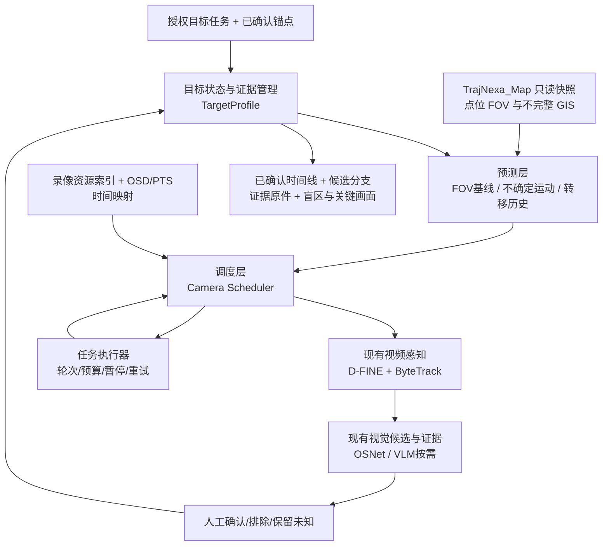

# TrajNexa（迹枢）模块化研发与后续实施计划 V1.0

> **文档类型**：研发阶段工作规划 / 模块职责 / 实验顺序 / 阶段验收
>
> **日期**：2026-11-03
>
> **适用范围**：TrajNexa 主系统的指定目标跨镜头连续研判；TrajNexa_Map 作为独立空间数据生产、编辑与发布系统
>
> **建议存放位置**：`design/46_S6-15M至S6-16_模块化研发与后续实施计划_V1.0.md`（文档编号仅为建议，提交前以仓库实际编号为准）
>
> **依据**：《总体规划文档 V1.0》；《指定目标轨迹还原、清晰证据主动发现与多摄像头择优规划 V1.1》；主系统 `design/44` 中 S6-12～S6-15C / C-5 实验记录；已核查的 `feat/m6-target-reid-validation` 分支相关代码。本文不表示新模块已实现，也不替代原始录像真值核验。
>
> **研发原则**：**模块边界相对清晰，模块接口随实测演进；先模块内可运行，再小步集成；不预先冻结最终 API/数据库/微服务设计。**

---

## 0. 本轮研发决定（摘要）

1. **采用模块化单体（modular monolith）**，继续使用主系统现有 Python 后端及项目目录；当前不拆微服务、不引入任务消息总线、不为了接口统一而重写已可用的检测和跟踪算法。
2. **复用现有视觉感知链路**：D-FINE N 检测、ByteTrack 跟踪、OSNet x0.25 外观检索排序、Qwen3-VL-4B 默认属性提取 / 8B 按需复核；当前不开展新模型选型、识别阈值调整或自动跨镜头身份确认。
3. **近期核心任务只新增两种能力**：① 以低成本、可恢复的方式调度摄像头录像时间窗；② 不依赖完整道路、建筑或围墙的空间去向预测。摄像头历史转移关系图随后建设。
4. **预测不等于事实**：候选摄像头、可能路线、目标出现时间、外观相似得分只形成待核实假设。可靠轨迹只能由可追溯观测和符合当前核验制度的确认关系组成。
5. **GIS 是软先验**：地图缺路不等于不可达；建筑和围墙存在不等于通道绝对封闭；模型 FOV 不等于现场实测覆盖。人工核实的真实观察具有独立证据价值。
6. **接口在研发期可改**：以简明的数据对象、适配函数和回归测试约束关键语义，不冻结字段全集、固定复杂 API、预设正式数据库表结构；每次接口变化同步修改调用方、样例和测试，并记录原因。
7. **先做离线评估，再接真实录像**：任何一阶段必须保留可复算输入、参数、Map 版本和结果，不用单条样本宣称泛化成功。
8. **优先级顺序**：`S6-15M（轻量接口梳理）→ S6-15D（调度）→ S6-15R1（不确定区域预测）→ S6-15R2（转移图）→ S6-15R3（融合）→ S6-16（多轮真实闭环）`。其中 S6-15M 作为 D 阶段的准备工作，**不是单独持续数轮的“接口规范工程”**。

## 1. 项目目标与本阶段定位

### 1.1 业务目标

以用户给出的、经授权且已核实的目标观测作为起点，在已有摄像头网络与合规录像资源中连续推进：

`已确认目标 A → 预测可能出现的镜头/区域/时间 → 分阶段分析录像 → 产生 B 候选 → 视觉与时空证据核验 → 确认后更新状态 → 继续预测 C → …`

最终输出有证据支持的观测时间线、可核查轨迹片段、盲区和不确定连接，以及必要时发现的更清晰原始关键画面；**不是单次“推荐下一台摄像头”的列表**。

### 1.2 本轮需要解决的工程问题

- **已有模型能分析录像，但还没有统一的低成本调度**：目前 Map-only 能生成空间候选，但简单批量分析的成本明显偏高。
- **已有空间候选规则，但未掌握真实去向**：当缺少地面标定和可靠运动方向时，FOV 重叠容易造成排序偏置。
- **真实地图不可假定完整**：OSM 路网、围墙、建筑、通道与相机理论 FOV 可能缺失、过期或存在错误。
- **跨镜头证据必须可撤销**：未确认 B 不能成为已确认主链的最后位置；可以沿 B 建立明确标记、可停止和撤销的探索分支。

### 1.3 非目标

- 不从零自研新的目标检测器、MOT 或 ReID 模型。
- 不在本阶段训练 MCTF / Trajectory Tensors、Trajectron++ 或端到端学习型路线预测网络。
- 不要求先补全道路、建筑、围墙才能运行；不利用路线推测填补无证据的轨迹间隔。
- 不提前建设完整微服务体系、最终 OpenAPI 规范、复杂事件总线或为尚未使用的预测算法预造数据库。
- 不把“相似候选命中”直接当作身份确认，也不根据一个样本自动设置统一确认阈值。

## 2. 已有代码与实验基线（截至本规划编写时）

### 2.1 可复用部分

| 能力 | 已有模块 / 代码 | 本轮策略 |
|---|---|---|
| D-FINE 目标检测 | 现有检测/模型引擎，`detectors.py` 等 | 原样复用；通过轻适配被调度器调用 |
| 单镜头 ByteTrack | `backend/app/m6_track.py` | 继续生成 Tracklet；不重写跟踪算法 |
| Person ReID / OSNet | `backend/app/m6_person_reid.py`、既有检索比较代码 | 只负责已选窗口内候选排序，不决定摄像头去向 |
| Qwen3-VL 属性提取 | 现有视觉模型入口与 `m6_target_profile.py` 属性校验 | 4B 默认、8B 按需；只对少量模糊候选调用 |
| 目标档案 | `backend/app/m6_target_profile.py` | 保留属性与关联双状态轴、核验与撤销 |
| 多轮定向基础 | `backend/app/m6_directed.py` | 保留时间窗、缺失及推进逻辑；后续做编排适配 |
| Map 只读数据 | `map_db_spatial.py`、`map_db_gis.py`、`m6_spatial_adapter.py` | 继续只读消费真实 Map 数据，保留空间来源与质量 |
| 目标空间状态 | `m6_target_spatial.py` | 继续支持 L0/L1，未知地理方向不得猜测 |
| 摄像头空间候选 | `m6_spatial_planner.py` | 作为预测基线，不继续围绕单个样本堆固定排序规则 |

> 状态说明：以上为已有实现或已核查代码基础，**不等于已通过所有端到端生产验收**。例如 ReID 的实验入口和真正的任务执行接口仍需要局部适配。

### 2.2 真实 Map 快照

- 当前离线基线：`mapdb-spatial:36f1ba4280e6cef0`。
- 记录中的实际 Map 数据：31 台摄像头；31/31 关联台账 UUID；31 台有三级模型 FOV；29/31 有参考视频帧标记。
- `has_video` 仅说明有参考帧，**不能证明指定历史时间段的录像可用**。
- 三路录像与地图的绑定仍为 `pending_human_review`：
  - `1-1 → map_camera_id 9000000000000037`
  - `2-1 → map_camera_id 9000000000000058`
  - `2-2 → map_camera_id 9000000000000057`
- 三路 FOV 属 `modelled_unverified`，且 `horizontal_fov_deg` / `effective_range_m` 在该三路为空；不得视为精确地面定位或真实遮挡校准。
- 2-2 与 2-1 安装点距约 0.6 m，朝向相差约 170°，属于**疑似同点位的反向视角**；四秒观测差不可按安装点距计算速度。

### 2.3 跨镜头样本与不能升级的结论

- 紫衣骑手已核实观测接续：`2-2 #111（15:00:06.2–08.6）→ 2-1 #37（15:00:12.6–15.6）`，两段首末观测的 OSD 名义间隔为 4.0 秒；跨相机钟差尚未独立校准。
- 1-1 约 `15:00:03.8` 的疑似观测：**维持 candidate**，未形成可靠自动检测 Tracklet，不能作为第三个已确认镜头。
- 青衣带小孩骑手的历史镜头先后和时间记录需要统一核查；在原始真值未冻结前只作探索案例。
- 不能由摄像头安装点距离除以镜头内观察时差得出“速度不可能”；只能输出 `spatiotemporal_consistency_unverified` 等保守状态。

### 2.4 C-5 成本基线（规划帧数，不是实际模型耗时）

| 方案 | 候选摄像头 | 2-1 排名 | 首批镜头 | 规划搜索时长 | 规划帧数（5fps） |
|---|---:|---:|---:|---:|---:|
| 仅人工通道 | 1 | 1 | 1 | 8.0 s | 40 |
| 仅 Map | 30 | 2 | 4 | 105.1 s | 525 |
| Map + 人工 | 30 | 1 | 4 | 105.1 s | 525 |

Map-only 按优先时间窗调度时，首批规划成本约 `48.8 s / 244 帧`；尚未证明低成本。Hybrid 目前主要是人工命中置顶，不能据此证明两类先验已经有效互补。人工通道基线含有“已知正确 B”的先验信息，不能当作自动模型的公平性能上限。

## 3. 模块化架构：按职责分层，不按技术名堆服务

### 3.1 模块清单及依赖边界

| 逻辑模块 | 唯一核心职责 | 继续复用/拟改动 | 严格不承担 |
|---|---|---|---|
| **视频资源与时间** | 找录像、读准确片段、记录 OSD/PTS 与跨机钟差 | 沿用现有录像索引、时间适配 | 不作身份判断、不给出路径“事实” |
| **视频感知** | 从被选定片段输出检测和单镜头 Tracklet | D-FINE / ByteTrack | 不替预测器选择下一镜头 |
| **视觉证据** | 对局部 Tracklet 做 OSNet 排序、VLM 按需观察 | 现有 ReID/VLM 与比较代码 | 不自动确认同一人；不更改地图 |
| **目标与证据状态** | 保存已确认主链、候选分支、原始证据与核验版本 | TargetProfile | 不把模型候选提升为核实事实 |
| **空间与去向预测** | 给出哪些 Site/Channel/时间可能值得核查及依据 | 现有 FOV 规划器，后续可选预测器 | 不运行视频模型、不确认关联 |
| **Camera Scheduler** | 控制检查顺序、时间分段、录像可用性、资源预算、增量缓存 | 新增 | 不负责外观相似度、不写确认档案 |
| **任务编排** | 驱动 A→B→C 循环、分支推进、暂停/重试/停止 | 逐步改造 `m6_directed.py` 上层 | 不复制各模块算法或自行构造证据 |
| **Map 空间数据** | 编辑、修正、校准与发布 GIS 快照 | 独立 TrajNexa_Map | 不做目标级推理和主系统业务展示 |

**职责分配原则：** 模块化是为了减少改动范围、能单独测试与替换预测算法，不是提前形成八个独立服务。第一轮继续采用 `backend/app/` 内独立 Python 文件即可。

### 3.2 站点与镜头分开

预测可先选择可能观察到目标的 **Site/地理区域**，再由调度器在同点位多个 Channel 中选择具体录像通道。即便两个通道安装点相距 0.6m，也不能合并 Tracklet；同站点多通道可能互补，其中一个擅长连续跟踪，另一个可能拍到清晰脸部或车牌。

## 4. 研发期接口策略：**轻量约定、允许修改**

### 4.1 不做最终协议冻结

当前不要求编写覆盖全部字段的正式接口规范、不要求马上生成 OpenAPI、不要求跨模块 RPC 兼容、不要求提前建齐数据库模型。优先以 Python 函数输入输出、少量 `TypedDict`/`dataclass`（需要时才用）和固定测试样例形成可用的**研发期数据约定**。

允许做的改变：重命名字段、合并/拆分结构、增加质量状态、替换算法内部表示、变更调用顺序。改变时同步更新本阶段消费方、实验脚本、样例数据和测试；在记录中说明为什么改、对旧实验有何影响。

### 4.2 只保留少数不应被破坏的语义约束

1. **时间**：跨摄像头比较使用明确可追溯的 OSD/PTS 映射和误差来源，不用文件名时间冒充精确观测时间；未知跨机钟差保持未知。
2. **身份与证据**：`candidate` 不等于 `human_confirmed`；候选探索不能静默推进已确认主链；人工核验和撤销有来源。
3. **空间来源**：保留 `camera_uuid` 与 `map_camera_id` 的区别；记录 `spatial_revision`、数据质量和绑定状态。
4. **未知与缺失**：无候选、检测漏检、无可用录像、人工未确认、预算耗尽分别表示；均不等于“目标没有经过”。
5. **地图不完整**：道路、围墙、建筑和模型 FOV 是带质量的参考，不因缺少数据排除目标；确有已核实矛盾时才考虑强限制。
6. **合规与审计**：任务有合法授权、限定时间与空间范围；不自动生成无关主体的长期身份档案。

### 4.3 当前可运行所需的最小对象（示意，非最终 schema）

| 数据对象 | 生产模块 | 最小需要知道的信息 | 可变部分 |
|---|---|---|---|
| `TargetState` | 证据/空间状态层 | 最近**已确认**观测、时间及误差、可能区域、模式、质量与来源 | 运动假设内部表示、额外特征 |
| `CameraPrediction` | 预测层 | 候选通道/站点、预计窗与可扩展窗、排序依据、未知项 | 排名方法、概率/非概率表达、路线假设 |
| `SearchAction` | 调度层 | 摄像头、历史录像时间段、分析方式、预算/续跑标识 | 调度批次策略、缓存引用 |
| `TrackletResult` | 视频感知层 | 原始帧来源、相对/绝对时间映射、检测框与轨迹、运行状态 | 检测器内部参数、细粒度跟踪字段 |
| `CandidateEvidence` | 视觉证据层 | 候选轨迹、OSNet 支撑、属性观察、支持/冲突/未知 | 特征表示、VLM 提示、排序指标 |
| `ReviewEvent` | 证据状态层 | 核验对象、审核动作、证据引用、版本/撤销来源 | 审核 UI、附加备注 |

建议先在 `backend/app/` 中直接共享小型 Python 数据结构，不必现在单独建立跨所有模块的大型 `contracts/` 包。只有重复字段与适配成本明显上升时，再抽取共用协议文件。

### 4.4 唯一需要明确的协作方式

- 预测器输出“**建议检查哪里、何时、依据和不确定性**”，不返回已证实路线。
- 调度器返回“**下一次处理动作**”，不需要知道轨迹模型内部细节。
- 感知层返回“**实际观察到了什么**”，包括失败状态与成本，不擅自把候选归为已确认目标。
- 审核层才改变“**哪些跨镜头观测可以作为已确认主链**”。

## 5. S6-15M：轻量接口梳理（仅作为 S6-15D 的准备步骤）

**目标**：让已有视觉处理代码能被独立调度器调用；不搞大型重构。

### 工作项

1. 梳理 D-FINE、ByteTrack 的现有输入、Tracklet 输出与时间映射；标记现有函数是否仅供离线实验，避免把“代码存在”误认为正式任务入口。
2. 形成一个最小 `analyze_window(camera, recording, start, end, options)` 适配入口；内部调用已有解码、检测和 ByteTrack，**不复制算法**。
3. 明确调度器从录像索引判断某个历史时段可否回放，而不是拿 Map 的 `has_video` 作为可用性判据。
4. 明确 TargetProfile 已确认主链的读取函数、候选核验入口；预测器和调度器对已确认属性只读。
5. 保留原有测试；增加少量模块边界回归测试即可。无需在本步骤整理所有历史实验脚本。

**交付物**：可供调度器调用的窗口分析适配函数、一份不超过数页的输入输出样例、边界单元测试。**接口允许在后续 D/R1 集成中调整。**

**通过门槛**：用一段既有录像窗口调用原检测+跟踪，能够回传 Tracklet、原始录像/时间引用和执行状态；对无录像、时间映射缺失返回独立错误，不用空列表冒充“目标没经过”。

## 6. S6-15D：动态视频调度（本轮主要开发工作）

### 6.1 新增文件与功能

建议新增：`backend/app/m6_camera_scheduler.py`；测试：`backend/tests/test_m6_camera_scheduler.py`。

采用**可恢复的串行或小批次窗口分析**：先按照现有空间排名分析少量候选的优先时间窗，证据不充分时扩窗/转移镜头，避免一开始将全部高优先级镜头的最大窗口都提交给检测器。

**最小可执行能力：**

- 根据 `CameraPrediction` 构造本轮摄像头队列；独立检查历史录像可用性及任务授权范围。
- 先查 `estimated_window`，按配置的短片段增量处理；`search_window` 是后续扩展预算，不是立即全部执行的工作量。
- 对不同摄像头分别记录 `planned / running / deferred / candidate_found / needs_review / no_valid_observation / recording_unavailable / budget_exhausted / hop_confirmed` 等状态；必要时细分漏检。
- 已处理帧、检测结果、Tracklet 与分析元数据可复用，扩窗时不重复计算；重叠段要保持 Tracklet 边界可复核。
- 第一镜头没有可靠结果时继续下一摄像头；OSNet 高分或 VLM 一致也**不得自动命中即停**。
- 本轮跨镜头关系得到人工确认后，可结束常规接续搜索，并更新主链进入下一轮；若任务还需找清晰脸/车牌，应允许另一条证据搜索继续。
- 当前候选都不足以确认、录像缺失或预算耗尽时，保留未决状态并支持以后恢复。

### 6.2 同点位与重叠镜头窗口策略

当前 `transit_window()` 对同点位或重叠 FOV 的初始 `search_max` 仍是固定 20 秒。应将其理解为**可扩展的初始探索预算**，而不是 20 秒之后目标不可能到达。调度层负责按需扩展，扩展范围受授权、录像覆盖和资源预算约束。不要为降低成本直接丢弃可能的晚到目标。

### 6.3 三种离线对照（固定 Map-only 排名）

| 对照 | 调度方式 | 作用 |
|---|---|---|
| D1 | 高优先级镜头批量分析完整计划窗口 | 当前成本基线 |
| D2 | 按排名串行分析各自完整优先窗口 | 测试镜头顺序的价值 |
| D3 | 按排名分段分析、候选未决可扩窗/换镜头、确认后本轮停止 | 推荐候选策略 |

**必须使用同样的目标、摄像头排序、Map 快照、录像条件和人工真值。** 对照评测中人工标签只能作为核验结果模拟器，不得提前泄漏给预测器或调度排序函数。

#### 成本指标

- `planned_frame_count`：按窗口×采样率估计的帧数。
- `decoded_frame_count` / `detected_frame_count`：实际处理帧数。
- `reid_comparisons` / `vlm_calls`：下游分析调用量。
- `inference_elapsed_ms`：真实执行耗时（区分纯离线预计算评测）。
- `review_count`：人工需要复核的候选数。
- `confirmed_transition_found`、`time_window_hit`、`false_exclusion`、`premature_stop`：不得只报告成本。

### 6.4 单独验收

**通过条件**：在紫衣骑手 `2-2 #111 → 2-1 #37` 的**探索性离线回放**中，Map-only 排名第一的 1-1 不确认时仍能继续到 2-1；正确候选进入处理结果；允许人工确认后完成该轮并从 B 继续规划。完成 D1/D2/D3 同条件成本对照，清楚说明是否真正节省了实际处理量。

**不能宣布通过的条件**：只是把批量 525 规划帧改写成更小“计划窗口”，却没实测实际处理量；或者让调度器提前知道 #37 是正确答案；或者把查不到检测框当成目标没有经过。

## 7. S6-15R1：无完整地图的空间不确定性预测

### 7.1 模块职责

新增候选：`backend/app/m6_motion_predictor.py`；必要时新增独立 `tests/test_m6_motion_predictor.py`。

目标是“**未来可能在哪里**”，而不是绘制唯一道路轨迹。输入是 L0/L1 目标观测、运动方式、有限时间、时钟与地理精度；输出多种可能区域及其不确定性，由已有摄像头 FOV 规划器判断哪些镜头能提供观测机会。

### 7.2 两种最小基线

- **R1-A：区域扩展**：从 L1 FOV 可能区域出发，结合移动方式、时间与速度上下界生成随时间扩大的候选活动区域。L0 降级为更粗状态，不伪造地面坐标。
- **R1-B：多运动假设**：维持直行、转向、减速/停止、未知离开方向等多个假设。若使用粒子表示，要承认初始位置和方向分布是经验假设，**未经校准的数值不宣称为真实发生概率**。

Stone Soup 只作为 R1-B 的可选对照框架；先能用轻量代码复算，再决定是否值得引入依赖。MCTF/Trajectory Tensors 暂不移植。

### 7.3 GIS 参与方式与错误扰动

- 摄像头位置/FOV、已知出入口提供观测先验；路网、建筑、围墙只作为**来源和质量可解释的软先验**。
- 缺道路、缺建筑、没有围墙数据时仍能给候选；错误围墙/错误建筑不应静默清空真实可能区域。
- 保留 `outside_observed_network` / `unknown_destination`：不能强制目标必在某台摄像头出现。
- 在缺乏足够证据时，预测区会变宽，摄像头选择可能失去区分能力；必须记录，不允许“全覆盖”冒充高精度预测。

### 7.4 独立验收

在固定 31 摄像头快照上，比较现有 FOV 排序、R1-A、R1-B：Camera Recall@K、真实时间窗口覆盖、实际调度成本、地图信息扰动后的漏排、预测区域的膨胀程度。少量已知样本只作可行性验证，不预设准确率达标数字、不对单例排序反复调参。

## 8. S6-15R2：基于可靠观测的摄像头转移关系图

### 8.1 模块职责

建议新增：`backend/app/m6_transition_graph.py`；测试：`backend/tests/test_m6_transition_graph.py`。

转移图记录**被观察到的跨镜头先后关系**，不等同道路拓扑，不要求知道目标在镜头盲区中走过的实际线路。该图属于主系统，不写回 Map 数据库。

### 8.2 最小转移记录

研发初期允许使用简单 Python 对象或 JSON 文件进行离线实验；达到需要并发编辑、审计与持续保存时再建立数据库表。

每条记录至少可关联：源/目标通道、原始 Tracklet 与片段证据、对应出入画区域（如已知）、观测时间与时钟校准质量、移动方式（如有依据）、跨镜头关联审核状态、Map/绑定状态、事件版本与撤销来源。

记录 `2-2 #111 → 2-1 #37` 这一**单条经人工核实的观测接续**，但不凭这一个样本推出精确的 4 秒通行规律。未确认 1-1 不参与可靠转移统计。

### 8.3 学习时必须防的偏差

- **少样本**：`support_count=1` 只能说明有一次观察，不代表高概率连接。
- **时钟误差**：名义 OSD 时间间隔不等于精确物理通行时间。
- **采样偏差**：系统优先分析过某镜头，就更容易观察到其转移；不能把没查的镜头当负例。
- **同目标重复**：同一人多帧、多段不能重复计作独立转移样本。
- **身份撤销**：人工撤销关联后，依赖它的转移记录必须失效或降级；原始审计记录保留。

### 8.4 独立验收

正确保存与读取单条转移；未知关系不判不可达；撤销后统计不再使用失效样本；少样本不会返回伪精确概率。后续累计足够不同目标、不同条件的样本，再讨论转移时间分布估计。

## 9. S6-15R3：预测融合（最小、可替换）

只有 D、R1、R2 有独立结果后再启动。可新增 `backend/app/m6_prediction_fusion.py`，也可以先在现有预测器入口使用简单组合函数，**不为尚不存在的模型建立复杂插件框架**。

### 9.1 输入与输出

输入：FOV 空间候选、R1 未来活动区域、R2 已核实转移支持、录像可用性、时间误差、任务模式；输出仍是 `CameraPrediction` 序列与可解释理由，不直接给身份概率和已证实路线。

### 9.2 先比较，后融合

| 组别 | 依据 |
|---|---|
| A | 现有 FOV/距离规则 |
| B | FOV + R1 不确定区域 |
| C | FOV + R2 转移记录（样本不足时仅作为弱参考） |
| D | FOV + R1 + R2 + GIS 软先验 |

固定相同 Camera Scheduler，比较正确目标窗口覆盖、录像处理成本和错排/错误提前停止。**若加入新预测方法没有改善或增加漏排，保留实验结果但不进入默认路径。**

## 10. S6-16：主线 A→B→C 多轮集成与业务验收

### 10.1 集成最短路径

1. 用户选择授权范围内已确认的 A，冻结原始帧、Tracklet、OSD/PTS、核验信息与 TargetProfile V1。
2. 预测层输出候选 Site/Channel 及时间窗，附快照与未知信息。
3. Scheduler 选择可用录像并执行局部分析；现有 D-FINE/ByteTrack 输出观测，OSNet 仅做候选排序，Qwen3-VL 仅用于必要的属性观察。
4. B 未确认时保留候选与独立探索分支；**不得推进已确认主链**。
5. B 关联人工确认后更新 TargetProfile V2；只有单独核实的 B 属性可以作为已确认属性加入，不因关联确认而一键“核实”所有模型属性。
6. 以 B 的最新可靠时空状态重新预测 C；若没有可信 C，记录 `unresolved` / `outside_observed_network_possible`，不拼假轨迹。
7. 关联被撤销时，依赖该关联的分支、预测和转移统计同步失效；审计历史保留。
8. 任务如果同时追求清晰人脸/牌照，当前一跳已确认不代表清晰证据任务完成；调度策略按任务目标调整。

### 10.2 当前数据能够证明什么

- 紫衣骑手只能用于 `2-2 → 2-1` 的已核实接续实验；1-1 未确认，不作为第三跳。
- `camera_uuid ↔ 录像通道` 三路绑定仍 `pending_human_review`，因此含 Map 空间判断的真实业务验收只能标 `exploratory`。
- 要宣称三镜头连续接续，需要先取得**独立人工冻结**的 A、B、C 三路真值，且正确区分预测阶段和后见之明。

### 10.3 验收指标

| 指标 | 要回答的问题 |
|---|---|
| Camera Recall@K | 正确摄像头是否进入优先队列 |
| Window Recall | 真实首见时间是否落入已实际执行的时间范围 |
| Cost to Confirm | 为获得一条确认接续实际处理多少帧、多少模型调用与人工复核 |
| Wrong Stop / Wrong Exclusion | 是否因高分候选、地图缺失、漏检或错误时间窗而提前停错 |
| Degradation | Map/FOV/路网/转移历史缺失时能否明确降级 |
| Version/Rollback | 时间、Map 版本、模型、审核撤销是否能复算 |
| Multi-hop Continuity | B 确认后 C 的计划是否确实由 B 的新状态生成 |
| Evidence Value | 是否找到了更清晰、可人工核验的**原始**片段，且归属证据独立有效 |

## 11. 必须通过的故障与扰动用例

| 编号 | 场景 | 必须保留的行为 |
|---|---|---|
| T01 | Top-1 镜头没有可靠候选 | 继续后续镜头，不判目标未经过 |
| T02 | OSNet 高分但未经确认 | 不自动更新主链、不命中即停 |
| T03 | 检测器未形成框 | 单列 `detection_missed` 或观测不足，允许回查/扩窗 |
| T04 | 历史录像不可用 | 不执行空分析，保留 `recording_unavailable` |
| T05 | 超出本轮计算预算 | `budget_exhausted`，保留状态并可恢复 |
| T06 | 候选 B 被人工撤销 | 主链及依赖 B 的转移与预测正确回退 |
| T07 | 同点位反向镜头 | 不按 0.6m 安装距强制零转移时间，不合并 Tracklet |
| T08 | FOV 重叠但方向未知 | 不强制排第一，也不以重叠宣称同一时间同一目标 |
| T09 | 删道路/新增不可靠围墙 | 不据此硬排除真实观察可能性 |
| T10 | 缺 FOV、有摄像头坐标 | 降 L0，不虚构目标精准地理区域 |
| T11 | OSD/PTS 或跨机时钟未知 | 不把原始录像偏移当作精确时间证明 |
| T12 | 三路绑定未核实 | 结果保留 `exploratory=True`，不能宣称正式业务通过 |
| T13 | 发现清晰但无关的脸/车牌 | 不计作指定目标证据成果 |
| T14 | 历史 Map 更新 | 旧任务仍引用旧 `spatial_revision`，不被新快照改写结论 |

## 12. 研发计划与交付顺序（按依赖关系，不预设日期）

### 批次 1｜现在就做：S6-15M + S6-15D

**建议下一次提交范围**：

- 新增 `m6_camera_scheduler.py` 与对应测试；
- 仅针对已有视觉检测/跟踪入口增加必要的薄适配；
- 支持 `plan → dispatch → result → expand/defer/stop → resume`；
- 实现固定排序下 D1/D2/D3 离线对照与成本账本；
- 将 Map-only Top-1 错排后的失败回退作为强制测试；
- 不修改视觉模型和 OSNet 排序规则，不增加新空间奖励权重。

**本批交付报告**：

1. 实际使用的预测候选排名及版本。
2. 三组计划/实际分析量及是否覆盖 #37。
3. 调度状态机、扩窗和暂停恢复测试。
4. 失败类型与尚未实测的内容。
5. 明确下一批是否值得开展 R1。

**阶段门槛**：调度器在 Top-1 失效时能继续并成功将 #37 列入可核查候选；停止不越权、成本有真实记录；不要求本批直接达到比人工真值基线更低的分析成本。

### 批次 2｜S6-15R1：空间预测实验

先做区域扩展（R1-A），再做多假设（R1-B）；使用固定快照与 GIS 错误扰动对照。输出统一候选供现有调度器评估；只有独立指标改善才接默认流程。不要把训练深度模型当作依赖。

### 批次 3｜S6-15R2：转移关系与证据来源

建立主系统内的转移记录、撤销依赖、样本去重、观察偏差记录；先只保存事实和质量，不估计貌似精确的转移概率。让该数据成为预测器的**可选输入**。

### 批次 4｜S6-15R3：融合验证

固定 Scheduler，比较纯 FOV、区域预测、观测转移及 GIS 软先验；说明新信息具体提升了什么、失败了什么、耗费多少处理成本。

### 批次 5｜S6-16：完整多轮业务验证

在 2-2→2-1 正样本上先验证 B 后继续规划，之后寻找或制作独立三镜头人工真值；核实三路 Map 绑定，完成真实 A→B→C 接续评估。不能以第三跳仅有候选冒充验收完成。

### 每批提交的最小工件

`代码差异 + 单元/回归测试 + 可复算输入/配置 + 对照结果 + 已知限制 + 下一批决策`

优先在 `design/44` 追加 D.xx 实验记录，本规划作为方向性说明。实验发现改变思路时，直接更新规划版本或写变更记录，不为保持 V1.0 字面一致而回避修正。

## 13. 资源与依赖的工程边界

- **Map 数据连接**：正式接入时使用专用 `MAP_DB_READONLY_URL` SELECT-only 账户；未接通时可对已冻结快照离线运行，必须标记数据来源、版本和是否过期；不使用管理员连接作为长期方案。
- **几何能力**：现有自实现 FOV 运算可维持短期回归实验，出现复杂拓扑问题或正式集成时优先替换为 Shapely/PostGIS，避免继续扩张自维护几何算法。
- **录像索引**：实际历史录像可用性必须由主系统资源索引验证，Map `has_video` 不能代替。
- **处理成本**：按实际解码、检测、ReID、VLM、缓存命中和人工复核分别核算，不用“计划帧数下降”伪装推理成本下降。
- **实验与部署**：先单进程/离线批处理，确有实际资源瓶颈时再考虑异步任务或队列；不在当前阶段进行服务拆分。
- **许可与模型**：Stone Soup、MCTF 等为可选研究方向；要引入具体仓库前再核对许可证、维护状态、依赖与模型数据授权，不预设商业可用。
- **权限与数据最小化**：限定授权通道、时段和目标；不因摄像头转移学习而建立无关人员的长期身份档案。

## 14. 研发过程中的接口变更规则（务实版）

接口不是越早固定越好。当前只要求：

1. **一次改动解决一个当前真实问题**：例如窗口时间含糊，就改 `estimated_window/search_window`；不要顺手把全部模块改成新框架。
2. **模块内部自由调整**：只要有适配层和测试，函数名、字段名、内部算法可以变；不需要引入正式迁移兼容机制。
3. **跨模块变化同步改完**：调用方、测试、实验记录与必要数据样例在同一提交更新，避免文档和代码对不上。
4. **明确语义不可回退**：候选不等于已确认、未知不等于否定、时间不能混算、地图来源不可丢，这些不是接口风格偏好，而是已有实验验证出的正确性底线。
5. **稳定后再正式化**：当连续多轮真实实验都使用某一对象，且字段反复变化已明显增加成本时，再把它提炼成正式 schema / API 或持久化模型。

## 15. 下一步行动（直接给开发执行）

**第一件事不是新建一个大型“接口规范项目”，而是完成 S6-15D 可运行调度器。**

建议开发任务描述：

> 以当前 `m6_spatial_planner.py` Map-only 预测候选为输入，在不修改 D-FINE、ByteTrack、OSNet 或空间规则的前提下，新增 `m6_camera_scheduler.py`，实现逐摄像头、逐时间分段的录像分析调度与扩窗、切换、暂停恢复。调度器必须区分预测、候选、核验和完成状态，不将 OSNet 第一名当作确认命中。使用冻结 Map 快照及紫衣骑手 2-2 #111 → 2-1 #37 的既有观测做 D1/D2/D3 离线对照，记录**实际执行的帧数与调用成本**，验证 Top-1 未确认时能够继续到 Top-2，且确认 B 后能够发起下一轮预测。三路通道绑定未审核时结果保持 exploratory；1-1 疑似观测不得作为确认真值。输出代码、测试、实验文件及 `design/44` 新章节。

**本阶段通过后，再启动 R1 预测实验；没有必要现在同时引入 Stone Soup、路由引擎和学习型轨迹网络。**

---

### 文档状态声明

本文件为研发路线与实施约束，不是已实现功能清单。既有测试结果来自项目记录或已核查的代码；新阶段的性能、正确性、实际节省成本及三镜头完成情况均需独立执行后填写。开发时可以修改接口与任务切分，保留变更原因、实验对照和原始证据即可。
