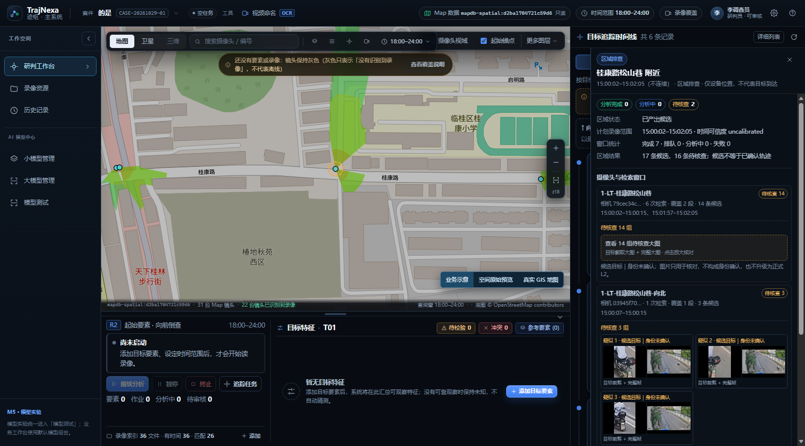
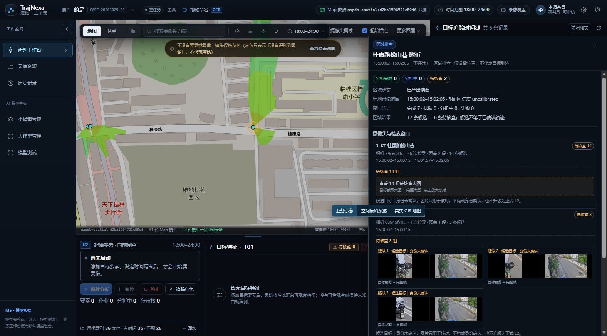

# 时间轴区域详情：只读证据面板

> 依据：用户 2026-11-06 对区域详情抽屉的交互要求（m03788）。
> 定位：只读展示既有候选证据，不新增算法、不改 TrajNexa_Map、不写事实表。

## 一、范围与底线

| 项目 | 决定 |
| --- | --- |
| 数据写入 | 不写 `target_spatial_observations`，不改变 `identity_status`、`review_status` |
| 身份 | 所有待核查目标仍为 `candidate_unverified`，界面明确“候选目标｜身份未确认” |
| 空间 | 证据帧只用于核对来源，不产生新的 L2；区域详情中的空间表述仍为实验估计 |
| 图片 | 后端按案件、run、candidate 三重校验后返回 JPEG；不向前端暴露服务器路径 |
| 裁剪 | 只有存在可复现 bbox 时才裁剪；缺失时返回 409 并提示查看完整帧，不伪造目标框 |

## 二、后端：候选证据图

新增只读接口：

```text
GET /api/v1/cases/{case_id}/tracking-runs/{run_id}/candidates/{candidate_id}/evidence/image
    ?authorized=true&kind=full|crop
```

- `authorized=true` 是使用者的授权确认，不替代案件权限；缺省返回 422 `evidence-authorization-required`。
- `kind=full` 返回保存的整帧；`kind=crop` 按目标框外扩 8% 裁剪，JPEG 质量 88。
- bbox 优先级：`details_json.bbox_pixels` → `details_json.bbox` → 最新 `tracking_candidate_reviews.review_json.bbox_pixels/target_bbox_pixels`。
- 帧定位：优先 `frame_no`（兼容 0-based/1-based 命名），其次 `evidence_refs`；旧记录的 ref 缺少 `w_<camera>_<start>` 子目录时，在 run 目录内按 basename 唯一定位。
- 所有路径均校验位于 `settings.storage_root` 内；找不到帧返回 404 `candidate-evidence-missing`。
- 响应头带 `X-Evidence-Kind`、`X-Evidence-Frame`，裁剪时带 `X-Evidence-Bbox`，便于复现。

配套修正：

- `m6_run_worker._store_candidate` 持久化 `frame_no`、`bbox_pixels`；新任务的 `evidence_refs` 写入完整的 `tracking_runs/<run>/<window_dir>/0001.jpg`。
- `timeline_projection._segment_card` 的 `evidence` 增加 `candidateId`、`runId`、`frameNo`、`bboxPixels`；`_region_card` 的 cameraTask 增加 `offsetSeconds`（窗口起点在片段内的偏移）。
- 旧数据没有 bbox 时回退到最新人工/AI 复核 JSON；两者都没有则只能看完整帧。

## 三、前端：抽屉与摄像头行

### 3.1 可调宽并记忆

- 范围 360–760px，默认 420px；localStorage 键 `trajnexa.timeline.drawerWidth`。
- 左边缘 7px 拖拽；键盘左右键每次 24px；双击恢复 420px。
- 抽屉可越过右栏覆盖地图：`.tm { overflow: visible }`，`.tm-drawer { max-width: calc(100vw - 24px) }`。
- 修复默认宽度 bug：`localStorage.getItem` 无值返回 `null`，不能直接 `Number(null)`（会得到 0 并被压到 360）。

### 3.2 状态计数

顶部按摄像头行统计：`分析完成 N · 分析中 N · 待核查 N`。

判定顺序：

1. 该摄像头有任一带图待核查组，或 `pendingCandidateCount > 0` → `待核查`；
2. `phase` 为 `running/queued` → `分析中`；
3. 其余 → `分析完成`。

### 3.3 摄像头行

- 分析完成：显示摄像头截图（`keyframeUrl`，取该窗口 `clipId + offsetSeconds`）。
- 分析中：显示窗口范围、`分析时长 +5 分钟` 标记和摄像头截图；偏移未解析时明确提示暂不能取图。
- 待核查：显示“待核查 N 组”，不再显示摄像头截图，避免与目标大图重复。
- 截图标注“片段内偏移 x.x s · 容器 PTS 未核对”，不称精确时刻。

### 3.4 待核查组

- 组来源：该区域下 `track_segment` 技术卡，按 `cameraLabel` 过滤。
- 去重优先 `evidence.trackId`：同一轨迹会被多轮检索重复产出，不能把重复检索当成多个目标；无 trackId 才退回 `candidateId`。
- 每组显示“目标截取大图 + 完整大图”；无 bbox 时只显示完整帧并标注“无目标框”。
- 少于 5 组直接内联；≥5 组显示入口，点击打开大窗，**一次展示全部组**，可滚动。
- 大窗标题显示“共 N 组”；多组时单图 `max-height:32vh`，单组 68vh，避免一屏只看到第一组。
- 身份文案统一为“候选目标｜身份未确认”；底部再次说明“图片只用于核对，不构成身份确认，也不升级为正式 L2”。

## 四、实测（2026-11-06，案件 `CASE-20261029-01`）

- 区域“桂康路松山巷 附近”：顶部 `分析完成 0 / 分析中 0 / 待核查 2`；松山巷 `待核查 14`，向北 `待核查 3`。
- 松山巷 14 组大窗：28 张图全部加载成功，0 broken；`共 14 组`，可滚动。
- 向北 3 组内联：6 张图全部加载成功；完整帧 2560×1440，裁剪图按目标框生成。
- 拖拽：420 → 620（left 956）→ 720（left 856），`localStorage` 同步；双击恢复 420；刷新后按保存值恢复。
- 后端全量：**833 passed, 2 skipped**；前端 `vue-tsc --noEmit` 通过。

## 五、截图






## 六、未做与后续

- 未做候选身份确认、未做人工审核写回、未做跨镜头关联。
- 未改 TrajNexa_Map 台账；摄像头坐标仍来自只读 Map 库。
- 旧候选若既无 `details_json` bbox 也无复核 JSON bbox，只能查看完整帧；后续新任务会持久化 bbox。