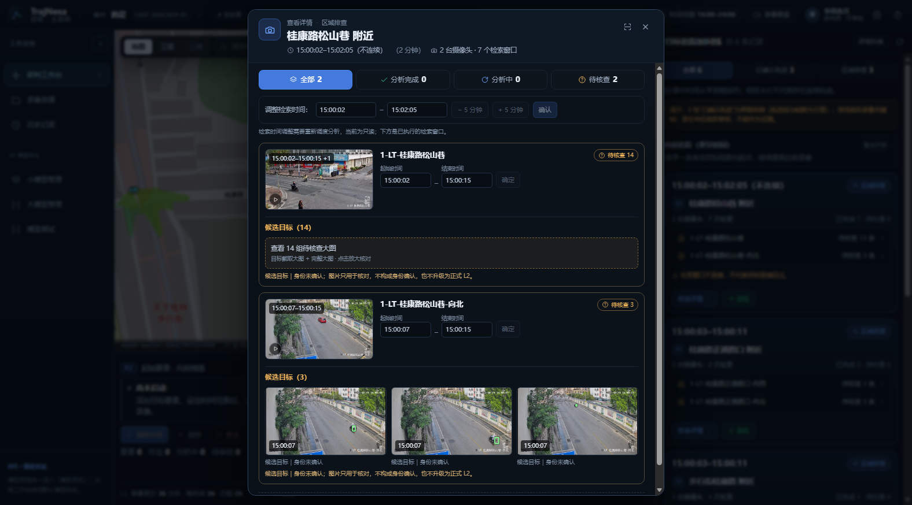
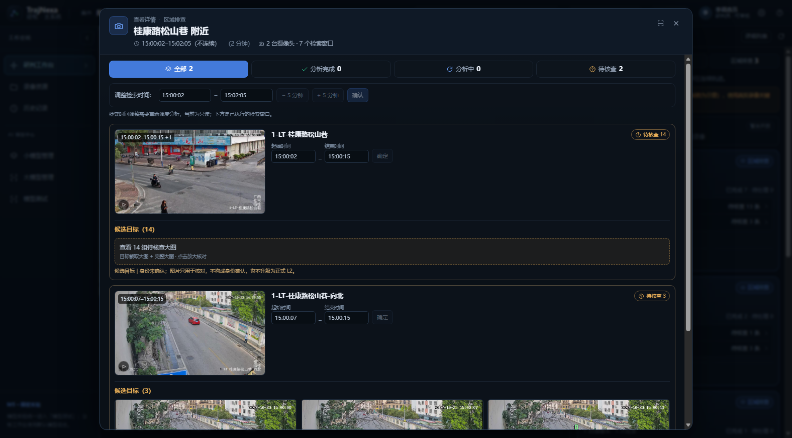
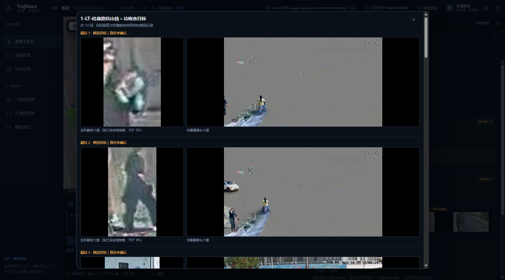

# 时间轴区域详情：居中只读弹窗

> 依据：用户 2026-11-06 对区域详情的两次交互要求（m03788 抽屉、m04539 居中弹窗）。
> 定位：只读展示既有候选证据，不新增算法、不改 TrajNexa_Map、不写事实表。
> 当前实现：居中弹窗，右边缘可拖动加宽并记忆；最大高度受视口约束，内容在弹窗内滚动。

## 一、范围与底线

| 项目 | 决定 |
| --- | --- |
| 数据写入 | 不写 `target_spatial_observations`，不改变 `identity_status`、`review_status` |
| 身份 | 所有待核查目标仍为 `candidate_unverified`，界面明确“候选目标｜身份未确认” |
| 空间 | 证据帧只用于核对来源，不产生新的 L2；区域详情中的空间表述仍为实验估计 |
| 图片 | 后端按案件、run、candidate 三重校验后返回 JPEG；不向前端暴露服务器路径 |
| 裁剪 | 只有存在可复现 bbox 时才裁剪；缺失时返回 409 并提示查看完整帧，不伪造目标框 |

## 二、后端：候选证据图

新增只读接口：

```text
GET /api/v1/cases/{case_id}/tracking-runs/{run_id}/candidates/{candidate_id}/evidence/image
    ?authorized=true&kind=full|crop
```

- `authorized=true` 是使用者的授权确认，不替代案件权限；缺省返回 422 `evidence-authorization-required`。
- `kind=full` 返回保存的整帧；`kind=crop` 按目标框外扩 8% 裁剪，JPEG 质量 88。
- bbox 优先级：`details_json.bbox_pixels` → `details_json.bbox` → 最新 `tracking_candidate_reviews.review_json.bbox_pixels/target_bbox_pixels`。
- 帧定位：优先 `frame_no`（兼容 0-based/1-based 命名），其次 `evidence_refs`；旧记录的 ref 缺少 `w_<camera>_<start>` 子目录时，在 run 目录内按 basename 唯一定位。
- 所有路径均校验位于 `settings.storage_root` 内；找不到帧返回 404 `candidate-evidence-missing`。
- 响应头带 `X-Evidence-Kind`、`X-Evidence-Frame`，裁剪时带 `X-Evidence-Bbox`，便于复现。

配套修正：

- `m6_run_worker._store_candidate` 持久化 `frame_no`、`bbox_pixels`；新任务的 `evidence_refs` 写入完整的 `tracking_runs/<run>/<window_dir>/0001.jpg`。
- `timeline_projection._segment_card` 的 `evidence` 增加 `candidateId`、`runId`、`frameNo`、`bboxPixels`；`_region_card` 的 cameraTask 增加 `offsetSeconds`（窗口起点在片段内的偏移）。
- 旧数据没有 bbox 时回退到最新人工/AI 复核 JSON；两者都没有则只能看完整帧。

## 三、前端：抽屉与摄像头行

### 3.1 居中弹窗：可调宽并记忆

- 区域卡（`region_investigation`）点击“查看详情”打开居中弹窗，不再使用右侧抽屉；其他卡片仍走抽屉。
- 宽度范围 560–1180px，默认 720px；localStorage 键 `trajnexa.regionDetail.width`。
- 弹窗右边缘 8px 拖动改宽，宽度写入 inline style；键盘左右键每次 24px；双击恢复 720px；头部 `scan` 按钮在“上次宽度”和 1180px 之间切换。
- 弹窗与遮罩都 `Teleport` 到 `body`，`.rd-backdrop` 固定定位、z-index 950，弹窗在遮罩内居中。
- 最大高度 `calc(100vh - 32px)`，内容区 `overflow-y: auto`；截图用 `aspect-ratio: 16/9` + `max-height`，窗口变宽时图变大但不会把弹窗撑出视口。
- 拖动结束的 `pointerup` 可能落在遮罩上；300ms 内忽略遮罩 click，避免“拖宽即关闭”。
- 打开时 `body` 加 `tm-drawer-open`，禁用时间线栏宽把手，避免弹层下误拉栏宽。

### 3.2 状态计数

顶部按摄像头行统计：`分析完成 N · 分析中 N · 待核查 N`。

判定顺序：

1. 该摄像头有任一带图待核查组，或 `pendingCandidateCount > 0` → `待核查`；
2. `phase` 为 `running/queued` → `分析中`；
3. 其余 → `分析完成`。

### 3.3 摄像头行

- 每行左侧固定显示该设备在本检索窗口的截图，右侧是设备名、状态 pill、起止时间和“确定”按钮。
- 截图取“片段起点 + 半个窗口”的关键帧：窗口起点常是解码脏帧/空镜（实测 2s 处整帧发灰），中点更能代表本窗口实际画面。
- `windowRanges` 是当天秒数，`keyframeUrl` 需要片段内偏移；必须用 `camera.offsetSeconds + (end - start) / 2` 换算，不能把当天秒数直接传给关键帧接口。
- 截图叠“窗口起止 + 额外窗口数”和播放角标；偏移未解析时不伪造截图。
- 行内时间输入只读，避免让人以为改时间会立即生效。
- 状态 pill：`分析完成` / `分析中` / `待核查 N`；待核查行下方内联候选目标。

### 3.4 待核查组

- 组来源：该区域下 `track_segment` 技术卡，按 `cameraLabel` 过滤。
- 去重优先 `evidence.trackId`：同一轨迹会被多轮检索重复产出，不能把重复检索当成多个目标；无 trackId 才退回 `candidateId`。
- 少于 5 组：内联展示完整证据帧，按自然尺寸把 `bboxPixels` 换算成百分比叠加绿色目标框；画面变宽时框仍贴合目标。
- ≥5 组：显示“查看 N 组待核查大图”，点击打开既有证据大窗（目标裁剪 + 完整帧），不把 14 张图硬塞进行内。
- 图片尺寸未加载或没有 bbox 时不画框，不伪造目标位置。
- 身份文案统一为“候选目标｜身份未确认”；底部再次说明“图片只用于核对，不构成身份确认，也不升级为正式 L2”。

### 3.5 检索时间调整（只读）

弹窗顶部展示本区域的起止时间，以及 `−5 分钟 / +5 分钟 / 确认` 按钮。当前后端没有“改窗口并重新调度”的接口，三个按钮均 disabled，并用 title 与说明文字写明“检索时间调整需要重新调度分析，当前为只读”，避免做成看似可用的假交互。

## 四、实测（2026-11-06，案件 `CASE-20261029-01`）

- 区域“桂康路松山巷 附近”：顶部 `全部 2 / 分析完成 0 / 分析中 0 / 待核查 2`；松山巷 `待核查 14`，向北 `待核查 3`。
- 弹窗默认 720×842，视口 1576×874；高度被 `calc(100vh - 32px)` 限制，内容在弹窗内滚动，不把页面撑高。
- 右边缘拖拽 720 → 1000，弹窗保持打开（拖动后的 click 没有误触遮罩关闭），`localStorage` 写入 1000；HMR/重开后按 1000 恢复。
- 双击右边缘恢复 720；头部 `scan` 展开到 1180，再点恢复 720。
- 摄像头截图：松山巷 `offset_seconds=8.5`、向北 `offset_seconds=16`，均 1280×720 加载成功；此前直接把当天秒数（54008.5）传给关键帧接口导致 404/0 宽，已改为片段内偏移。
- 松山巷 14 组显示入口；向北 3 组内联完整帧，绿色目标框按 bbox 百分比叠加。
- 检索时间三个按钮为 `disabled`，输入只读。
- 前端 `vue-tsc --noEmit` 通过；本次只改 `TimelineMain.vue` 与本文档，不动后端。

## 五、截图







## 六、未做与后续

- 未做候选身份确认、未做人工审核写回、未做跨镜头关联。
- 未改 TrajNexa_Map 台账；摄像头坐标仍来自只读 Map 库。
- 旧候选若既无 `details_json` bbox 也无复核 JSON bbox，只能查看完整帧；后续新任务会持久化 bbox。