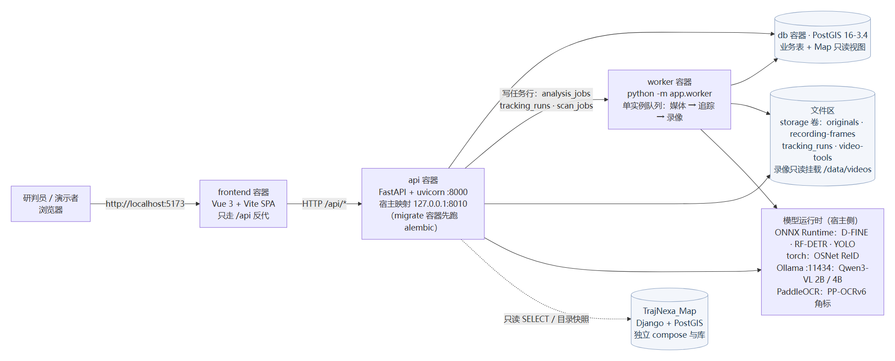
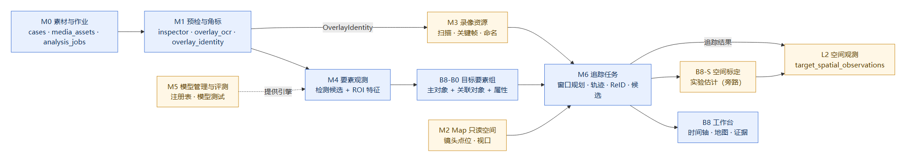
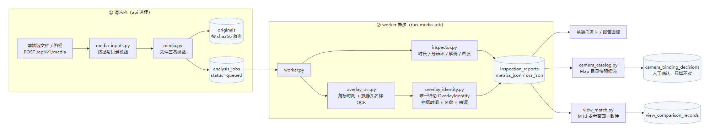
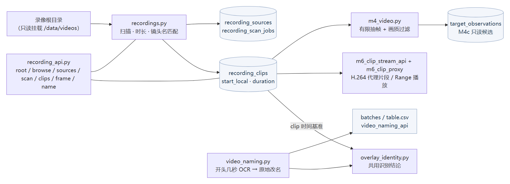
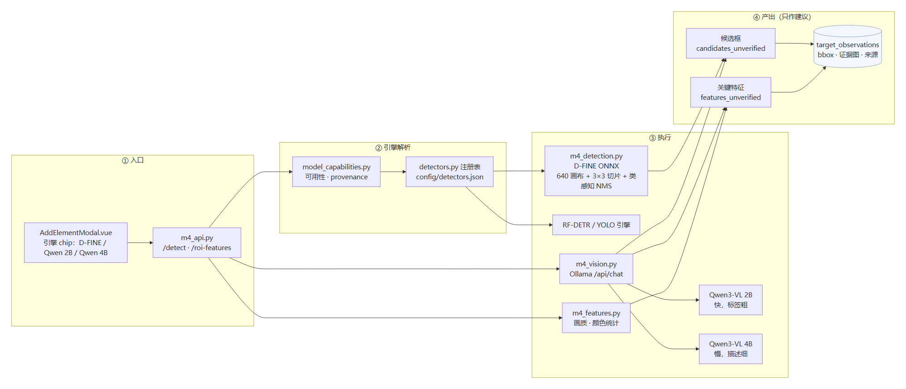
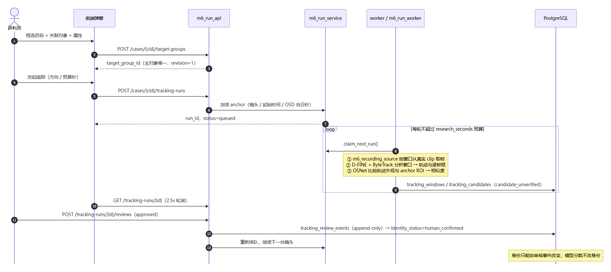
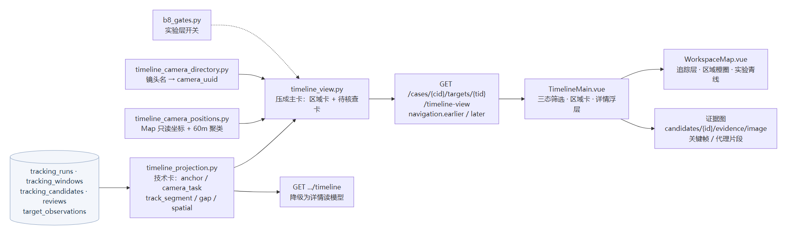
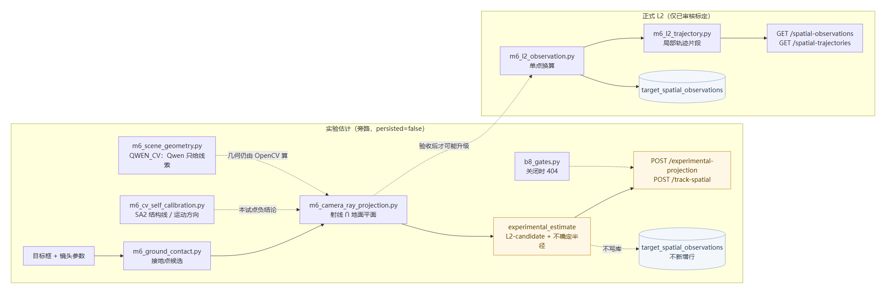

# 76 系统架构与模块说明

> 本文回答两个问题：**这套系统由哪些部分组成**，以及**每个模块负责什么、边界在哪里**。
> 全部配图位于 `assets/arch/`，源文件是同目录 `src/*.mmd`（mermaid），可用 `assets/arch/render.ps1` 重新生成。
>
> 与其它文档的关系：
> - 目标与总体设计看 [`00`](00_总体规划与Map职责边界_V1.0.md)；
> - 技术验证 Demo 的优先级约束、能力地图与 12 条契约看 [`26`](26_能力地图与复用契约.md)（**约束 0 优先于本文任何"完整性"要求**）；
> - 已知缺陷与代码审核记录看 [`33`](33_M3代码审核与修复记录.md)、[`19`](19_主系统代码审核_死代码与OCR版本核查.md)；
> - 各能力的实现细节与实测数据看对应专题（M1/M3/M4/M5/M6/B8 各篇）。

---

## 1. 系统全景

### 1.1 运行拓扑



系统由**两个独立可运行的系统**组成，通过 PostgreSQL 只读视图与目录快照解耦：

| 系统 | 职责 | 不做什么 |
| --- | --- | --- |
| `TrajNexa_main`（本文主体） | 案件素材接入、识别与要素观测、跨镜头追踪、时间轴与证据、空间投影实验 | 不做地图编辑与空间数据生产 |
| `TrajNexa_Map` | 地图/GIS 编辑、镜头点位校准、空间修订发布 | 不做视频推理与目标追踪 |

主系统对 Map **只读**（`camera_uuid` / `site_uuid` / `source_ref` / `spatial_revision` 四个标识对齐），需要反向修正时走"修正工单"回传，不直接写 Map 库。

### 1.2 容器、端口与卷

部署定义在 `compose.yaml`，本机差异放在 `compose.override.yaml`（**不提交**）。

| 服务 | 镜像/构建 | 端口 | 说明 |
| --- | --- | --- | --- |
| `db` | `postgis/postgis:16-3.4` | 5432（内网） | 业务库；Map 通过视图只读暴露 |
| `migrate` | 同 `api` 镜像 | — | `alembic upgrade head`，`completed` 后才启动 api/worker |
| `api` | `backend/Dockerfile`（本机 `backend/Dockerfile.rfdetr`） | 8000 → 宿主 **8010** | `uvicorn app.main:app` |
| `worker` | `backend/Dockerfile`（本机 `backend/Dockerfile.ocr-rfdetr`） | — | `python -m app.worker`，单实例 DB 队列 |
| `frontend` | `frontend/Dockerfile` + `npm run dev` | 5173 | Vue 3 SPA，`./frontend` 挂载，HMR 生效 |

挂载（api/worker 共用）：

| 宿主 | 容器 | 用途 |
| --- | --- | --- |
| `./storage` | `/data/storage` | 原图、抽帧、追踪运行产物、视频工具输出 |
| `./backend/config` | `/srv/config` | `detectors.json` 等模型注册表 |
| `./backend/models` | `/srv/models` | 本地 ONNX / `.pth` 权重 |
| `G:/测试数据/视频` | `/data/videos`、`/data/video-library` | **录像只读**（M3 扫描与取帧） |

叠加用的 overlay：`compose.ocr.yaml`（worker 换 OCR 镜像）、`compose.rfdetr.yaml`（api+worker 换 RF-DETR 镜像）、`compose.worker-rfdetr.yaml`（worker 回 OCR+RF-DETR）、`compose.m4c.yaml`（`RECORDINGS_HOST_ROOT` 只读挂载录像）、`compose.map-db.yaml`（接入 Map 的网络）。
换装规则：四个镜像只有依赖差别，**谁需要谁背**——
`Dockerfile`（默认）= ONNX only；`Dockerfile.rfdetr` = CPU torch + RF-DETR，不含 PaddleOCR；`Dockerfile.ocr` = PaddleOCR，不含 torch；`Dockerfile.ocr-rfdetr` = 两者都要。
所以本机 api 用 rfdetr 镜像、worker 用 ocr-rfdetr 镜像，互不拖累。

### 1.3 模型运行时

| 能力 | 引擎 | 权重位置 | 调用点 |
| --- | --- | --- | --- |
| 通用目标检测 | ONNX Runtime（D-FINE n/s）、RF-DETR、YOLO 系列 | `/srv/models`，注册表 `backend/config/detectors.json` | `detectors.py`、`m4_detection.py` |
| 视觉语言（检测提议 / ROI 属性） | Ollama `qwen3-vl:2b-instruct`、`qwen3-vl:4b-instruct` | 宿主 `G:\tools\ollama\models`，`http://host.docker.internal:11434` | `m4_vision.py`、`m5_vision_transport.py` |
| 行人重识别 | OSNet（torch） | `.pth` | `m6_person_reid.py` |
| 多目标跟踪 | ByteTrack / BoT-SORT（纯 numpy） | — | `m6_track.py`、`m6_botsort.py` |
| 角标 OCR | PaddleOCR PP-OCRv6 | worker 卷 `trajnexa_ocr_models` | `overlay_ocr.py` |

模型注册表支持热加载：`POST /api/v1/ai/image-models/reload`，`GET /api/v1/ai/image-models` 返回引擎列表与可用性。
**D-FINE/YOLO 与 RF-DETR 是两条不同的引擎分支**（ONNX vs `.pth`），输入输出契约不同，不要互相套用后处理（见 [`32`](32_M4d_Rebucca模块依赖与风险审计.md)）。

---

## 2. 能力分层



| 层 | 代号 | 落地内容 | 主要表/模块 | 状态 |
| --- | --- | --- | --- | --- |
| 素材与作业 | M0 | 案件、素材上传/路径接入、作业队列 | `cases`、`media_assets`、`analysis_jobs`、`worker.py` | 完成 |
| 预检与角标 | M1 | 时长/分辨率/解码/画质预检 + 角标 OCR 的"时间+名称+来源" | `inspect*.py`、`overlay_ocr.py`、`overlay_identity.py` | 完成 |
| Map 只读接入 | M2 | 镜头目录、点位、视口、锚点 | `camera_catalog`、`timeline_camera_*`、`gis/*` | 完成（只读） |
| 录像资源 | M3 | 只读扫描、镜头名匹配、关键帧、批量改名 | `recordings.py`、`video_naming.py` | 完成 |
| 要素观测 | M4 | 检测候选、ROI 关键特征、人工确认的观测 | `m4_api.py`、`m4_detection.py`、`m4_vision.py` | 完成（Demo 口径） |
| 模型管理 | M5 | 模型注册、可用性探测、无落库的实验测试台 | `model_capabilities.py`、`m5_test_api.py` | 完成 |
| 目标要素组 | B8-B0 | 主对象 + 关联对象 + 属性 + 修订 | `target_group_api.py`、`m6_target_*` | 完成（车辆主演示未做） |
| 追踪 | M6 | 窗口规划、轨迹、ReID 候选、人工复核 | `m6_run_api.py`、`m6_run_worker.py` | 完成（预算制） |
| 空间标定 | B8-S | 实验性地面投影与 L2 候选估计 | `m6_experimental_api.py`、`b8_gates.py` | 归档，分支已收 |
| 空间观测 | L2 | 已审核的空间点与轨迹片段 | `m6_l2_api.py`、`target_spatial_observations` | 完成 |
| 工作台 | B8 | 时间轴视图、地图层、证据图 | `timeline_view.py`、`TimelineMain.vue` | 完成 |

分层是**能力归属**，不是部署单元：M0–M6 与 B8 全部跑在同一个 `api` / `worker` 里，只有模型运行时在宿主侧。

---

## 3. 后端模块地图

代码根 `backend/app/`，约 100 个模块。按"入口 → 领域服务 → 平台"三层阅读。

### 3.1 入口层（HTTP 路由）

| 模块 | 前缀 | 主要端点 | 职责 |
| --- | --- | --- | --- |
| `main.py` | `/api/v1` | `health`、`cases*`、`media*`、`jobs/*`、`inspections/*`、`cameras/catalog`、`camera-bindings`、`view-references`、`view-checks`、`spatial/cameras`、`gis/viewport`、`gis/anchor` | 案件与素材主入口、M1 预检结论、Map 只读代理 |
| `m4_api.py` | `/api/v1` | `observations*`、`detections/preview`、`ai/vision-models`、`ai/image-models(+weights)`、`media/{id}/detect`、`media/{id}/roi-features` | 要素观测与识别入口；`/detect` 支持 `dfine`/`qwen3vl`/`qwen3vl4b` |
| `m5_test_api.py` | `/api/v1/ai/model-test` | `detect`、`prompts`、`roi`、`reid-search` | 模型实验台，**不写案件数据** |
| `m6_run_api.py` | `/api/v1` | `cases/{id}/tracking-cameras`、`tracking-runs`（创建/延长/取消/候选/窗口/复核/证据图） | 追踪任务全生命周期 |
| `timeline_api.py` | `/api/v1` | `targets/{id}/timeline`、`targets/{id}/timeline-view`、`tracking-runs/{id}/events` | 时间轴（技术卡视图 + 详情读模型） |
| `recording_api.py` | `/api/v1/recordings` | `root`、`browse`、`sources`、`scan`、`clips`、`frame`、`name`、`rematch`、`summary` | 录像资源浏览、扫描、命名 |
| `video_naming_api.py` | `/api/v1/video-tools/naming` | `batches`、`table.csv`、`download`、`frame`、`rename` | 批量改名工具 |
| `m4_video_api.py` | `/api/v1` | `clips/{id}/keyframes/preview`、`/image` | 录像片段关键帧 |
| `target_group_api.py` | `/api/v1` | `target-groups*`、`revisions` | B8-B0 目标要素组 |
| `m6_l2_api.py` | `/api/v1` | `observations/{id}/ground-projection`、`spatial-observations`、`spatial-trajectories` | 已审核空间观测 |
| `m6_experimental_api.py` | `/api/v1` | `experimental-projection` | B8-S 实验投影（受闸门控制） |
| `m6_track_spatial_api.py` / `m6_target_track_api.py` | `/api/v1` | `track-spatial`、`target-track`（含 `/sample`） | 追踪结果 → 空间观测（不落库） |
| `m6_clip_stream_api.py` | `/api/v1` | `clips/{id}/video`、`clips/{id}/proxy-video` | 视频播放（HTTP Range + 代理片段） |

错误响应统一 `{"error": {code, message, details}}`（契约 C10），前端只认这一个形状。

### 3.2 领域服务（按能力）

| 域 | 模块 | 一句话职责 |
| --- | --- | --- |
| 素材 | `case_service.py` | 案件创建/删除边界（删案件时的素材与产物清理） |
| 素材 | `media_inputs.py` | 上传路径与目录校验 |
| 素材 | `media.py` | 文件名与 sha256 校验、落盘 |
| 预检 | `inspector.py` | 时长、分辨率、解码可用性、画质指标 |
| 角标 | `overlay_ocr.py` | 角标区域 OCR（时间 + 摄像头名） |
| 角标 | `overlay_identity.py` | **唯一识别结论** `OverlayIdentity`；`grab_evidence_frame()` 是取帧唯一入口 |
| 录像 | `recordings.py` | 只读扫描、时长、镜头名匹配、扫描任务 |
| 录像 | `video_naming.py` | 开头几秒 OCR → 原地改名（只进不退） |
| 识别 | `m4_detection.py` | D-FINE ONNX：640 画布、切片推理、类感知 NMS |
| 识别 | `m4_vision.py` | Qwen3-VL 检测提议与 ROI 关键特征（容错 JSON 解析） |
| 识别 | `m4_features.py` | ROI 画质（亮度/清晰度）与主色统计（不依赖模型） |
| 识别 | `detectors.py` | 多引擎注册表与统一 `detect()` / `detect_flat()` |
| 识别 | `model_capabilities.py` | 能力层：可用性探测、引擎解析、降级计划、provenance |
| 视觉 | `m5_vision_registry.py` | 视觉模型白名单 |
| 视觉 | `m5_vision_transport.py` | Ollama / 远程 OpenAI 兼容传输 |
| 追踪 | `m6_directed.py` | 定向追踪骨架（镜头链、窗口规划、候选筛选、档案更新） |
| 追踪 | `m6_run_service.py` | 任务持久化与状态机 |
| 追踪 | `m6_run_worker.py` | 真实录像执行：取帧、分析、评分、抢占任务 |
| 追踪 | `m6_camera_scheduler.py` | 可恢复的窗口调度（中断后可续） |
| 追踪 | `m6_track.py` / `m6_botsort.py` | ByteTrack / BoT-SORT |
| 追踪 | `m6_person_reid.py` | OSNet 外观比较 |
| 追踪 | `m6_attributes.py` | VLM 属性抽取 |
| 追踪 | `m6_target_profile.py` / `m6_target_binding.py` | 目标档案版本、绑定单镜头轨迹 |
| 追踪 | `m6_track_quality.py` / `m6_track_grouping.py` / `m6_multiview_match.py` | 轨迹质量、分组、多视角匹配 |
| 追踪 | `m6_keyframe.py` / `m6_one_hop.py` | 关键帧、一跳到下一镜头 |
| 空间 | `m6_spatial_planner.py` / `m6_spatial_adapter.py` | 空间候选规划、Map 空间绑定 |
| 空间 | `m6_ground_projection.py` / `m6_camera_ray_projection.py` / `m6_cv_self_calibration.py` | 接地点候选、射线∩地面、自标定 |
| 空间 | `m6_scene_geometry.py` / `m6_ground_contact.py` | QWEN_CV 几何、接地点候选 |
| 空间 | `m6_l2_observation.py` / `m6_l2_trajectory.py` / `m6_track_spatial.py` | L2 观测、轨迹片段、追踪→空间 |
| 空间 | `m6_transition_graph.py` / `m6_truth_registry.py` | 镜头转移图、真值登记 |
| 时间轴 | `timeline_projection.py` | 技术卡：anchor / camera_task / track_segment / gap / spatial |
| 时间轴 | `timeline_view.py` | 视图压缩：区域卡 + 待核查卡（60m haversine 聚类） |
| 时间轴 | `timeline_camera_directory.py` / `timeline_camera_positions.py` | 镜头名 → `camera_uuid`、Map 坐标 |
| 实验闸门 | `b8_gates.py` | B8 实验层开关（关闭时返回 404 `experimental_geo_display_disabled`） |
| 证据 | `m6_clip_proxy.py` | H.264 代理片段与 Range 播放 |

### 3.3 平台层

| 模块 | 职责 | 注意点 |
| --- | --- | --- |
| `config.py` | pydantic-settings，全部开关与路径 | 开关即文档：`M4A_ENABLED`、`M4B_ENABLED`、`M4B_TILING`、`VISION_*`、`OCR_ENABLED`、`B8_GATES` |
| `db.py` | SQLAlchemy engine/session | 迁移只走 alembic（契约 C11） |
| `models.py` | ORM（386 行，23 张表） | 见第 5 节 |
| `worker.py` | 单实例队列 worker | 顺序：`run_media_job` → `run_tracking_job` → `run_recording_job`；启动 `recover_interrupted_jobs` 把 `running` 复位 `queued` |
| `schemas.py` / `errors.py` | 出参契约与错误封装 | 只有 `HTTPException` 一种错误通道 |
| `tests/test_architecture_contracts.py` | 契约守卫 | C1/C2/C3/C9/C10 等自动检查 |

`worker.py` 的主循环每轮先 `recordings.enqueue_auto_scans()`，再依次处理三类作业。**三条队列是三张不同的表**，不要混用：

| 队列 | 表 | 领取逻辑 |
| --- | --- | --- |
| 媒体预检 | `analysis_jobs`（按 `module` 区分处理模块） | `status=queued` 且按 `created_at` 顺序 |
| 追踪任务 | `tracking_runs` | `m6_run_worker.claim_next_run()` |
| 录像扫描 | `recording_scan_jobs` | worker 自动入队或 API 手动触发 |

单实例语义：worker 只有一个进程，靠 DB 行状态（`queued/running`）+ 启动时 `recover_interrupted_jobs` 保证不丢任务，**不是**多副本安全的分布式队列。

---

## 4. 前端模块地图

`frontend/src/`，Vue 3.5 + TS strict + Vite 6，无路由库。

### 4.1 页面（`App.vue`）

| 页面 | 组件 | 说明 |
| --- | --- | --- |
| `workspace` | `TimelineMain.vue` + `WorkspaceMap.vue` + `BottomDock.vue` | 工作台：时间轴 + 地图 + 底部停靠 |
| `recordings` | `RecordingResources.vue` | 录像资源浏览、扫描、命名 |
| `history` | `HistoryPage.vue` | 历史案件 |
| `small-models` / `vision-models` | `ModelHub.vue` | 引擎注册与权重管理 |
| `model-test` | `ModelTestLab.vue` | 模型实验台（对应 M5 接口） |

工作台切页**只隐藏不销毁**（地图实例与视频播放状态需要保留）；地图视图有 `demo` / `preview` / `gis` 三种。

### 4.2 关键组件

| 组件 | 行数级 | 职责 |
| --- | --- | --- |
| `TimelineMain.vue` | 2300+ | 时间轴主视图、三态筛选、区域卡、详情浮层 |
| `WorkspaceMap.vue` | 2300 | 地图、追踪层、区域圈、实验青线 |
| `ObservationTimeline.vue` | 1000 | 观测条目时间轴 |
| `TargetFeatureBar.vue` | 590 | 目标特征条（属性筛选） |
| `BottomDock.vue` | 420 | 底部停靠容器（可拖动模态） |
| `ModelHub.vue` / `ModelTestLab.vue` | 760 / 730 | 模型管理与测试 |
| `RecordingResources.vue` | 600 | 录像资源 |
| modals | — | `AddElementModal`（添加要素，含 D-FINE / Qwen3-VL 选框）、`CaseManageModal`、`ClipReviewModal`、`RecordingClipNameModal`（**唯一**核对窗，契约 C9）、`RecordingDirModal`、`RecordingKeyframesPanel`、`TrackingRunModal`、`VideoNamingModal`、`FeatureDetailSheet`、`ElementsDrawer`、`CoverageModal`、`CorrectionDialog` |
| ui | — | `AppIcon`、`BaseModal`、`SideDrawer`、`StatusChip`、`ToastStack`、`MockFrame` |

### 4.3 状态与 API

| 文件 | 职责 |
| --- | --- |
| `store/workbench.ts`（1700+ 行） | **唯一全局状态**：`wb/layers/ui/elementList/featureList/observationList/jobList/recording*/caseObservations/tracking*/timeline*` + actions |
| `store/modelChoices.ts` | 记住用户选的模型 |
| `services/mainApi.ts`（1400 行） | 全部 REST 与文件 URL 封装 |
| `services/basemapTiles.ts` / `mapSnapshot.ts` / `videoNaming.ts` | 底图瓦片、地图快照、改名工具 |

前端**只走 `/api` 反代**（契约 C12），不硬编码后端域名；`jobList` 目前不会被填充（缺 `GET /jobs` 列表接口，见 `33`）。

---

## 5. 数据模型

`models.py` 23 张表，按能力分组：

| 组 | 表 |
| --- | --- |
| M0 素材与作业 | `cases`、`media_assets`、`analysis_jobs` |
| M1 预检与角标 | `inspection_reports`、`camera_binding_decisions`、`camera_view_references`、`view_comparison_records` |
| M3 录像 | `recording_sources`、`recording_scan_jobs`、`recording_clips` |
| M4 观测 | `target_observations`、`ai_prompt_settings` |
| B8-B0 要素组 | `target_element_groups`、`target_element_objects`、`target_object_relations`、`target_object_attributes`、`target_attribute_revisions` |
| M6 追踪 | `tracking_runs`、`tracking_windows`、`tracking_candidates`、`tracking_candidate_reviews`、`tracking_review_events` |
| L2 空间 | `target_spatial_observations` |

设计要点：

- **证据分层落在字段上**：`target_observations.details_json` 保存 ROI 分析结果（`bbox`、画质、主色、`semantic_status` 等），旁边另存 `source_context`：`inspection_id`、`time_candidate`、`time_source`、`time_verified=false`、`camera_verified=false`。**OCR 读出的时间和镜头名只是候选，不会被提升为"已验证的身份/位置"**。
- **人工结论只进不退**（C6）：`tracking_review_events` append-only，`identity_status` 只能由复核事件改成 `human_confirmed`，模型分数不改身份。
- **修订乐观锁**：`target_element_groups.revision` + `target_attribute_revisions` 保留每次变更。
- 迁移共 14 个版本，最新 `0014_target_spatial_observations.py`。

---

## 6. 五条主流程

### 6.1 素材接入与预检



请求内只做落盘与入队；worker 异步做预检 + 角标 OCR，结论写 `inspection_reports.metrics_json/orc_json`，再由 `camera_catalog` 比对 Map 目录生成候选，人工确认写 `camera_binding_decisions`。

### 6.2 录像资源与命名



录像目录**只读**（C7）。`recordings.py` 扫描出 `recording_clips`（含 `start_local`、`duration`），`video_naming.py` 用开头几秒做 OCR 后原地改名，`overlay_identity.py` 提供与截图路径**同一个**识别结论，避免两套口径。

### 6.3 识别与要素观测



两条入口共用一套引擎解析：`AddElementModal` 的引擎 chip → `m4_api` → `model_capabilities` → `detectors`（D-FINE）或 `m4_vision`（Ollama）。
产出永远是**建议**：`candidates_unverified` / `features_unverified`，用户点选后才写 `target_observations`。

关键实现约束（踩过的坑，别再改回去）：

- D-FINE 整幅缩放到 640 会把 3200×1800 里的目标压成 6–10 px → 大图必须切片（`_grid_for`：≤1280 一宫格、≤2600 两宫格、否则三宫格），实测平均候选 0.6 → 4.4。
- 去重必须**类感知**：同类 IoU>0.5 或近邻才合并，异类只有 IoU>0.75 才合并，否则"骑车的人"会被车框吞掉。
- `qwen3-vl:2b` 是 thinking 变体（`content` 为空、全在 `thinking`），必须用 `-instruct` 变体 + `num_predict` 上限，否则会陷入重复生成。
- 选框与关键特征分工：**框用 D-FINE，特征默认 4B**，缺 4B 时回落 2B（会记录 `semantic_model`）。

### 6.4 追踪



创建 `tracking-runs` 时冻结 anchor（镜头 / 起始时间 / OSD 当日秒），worker 每轮 `claim_next_run()` 后按窗口取真实帧，跑 D-FINE + ByteTrack，再用 OSNet 与 anchor ROI 比外观，写 `tracking_windows` / `tracking_candidates`。
状态机：`queued → running → awaiting_review / unresolved / budget_exhausted / failed / completed`。
"延长时间"只作用于**预算**，不改变时间基准（这是设计限制，不是缺陷）。

### 6.5 时间轴



`timeline_projection.py` 把追踪产物压成技术卡（`anchor` / `camera_task` / `track_segment` / `gap` / `spatial`），`timeline_view.py` 再压成**区域卡 + 待核查卡**（60 m haversine 聚类，实测把 74 张压成 6 张主卡），前端 `TimelineMain.vue` 用 `navigation.earlier/later` 翻页。
时间轴是**读模型，不落表**：任何"给时间轴加字段"的需求都要先改投影，不要新建表。

### 6.6 空间投影



两条路径必须分清：

- **实验估计**（B8-S，已归档）：`experimental_estimate` + 不确定半径，`persisted=false`，`b8_gates.py` 关闭时 404。
- **正式 L2**：只有经人工审核的标定才写 `target_spatial_observations`，`GET /spatial-observations`、`/spatial-trajectories` 读它。

`m6_track_spatial.py` 实测 33 帧 `projected=33 / degraded=0 / reliable_contact=28`，且**不写库**。

---

## 7. 契约与约束

### 7.1 约束 0（最高优先级）

本项目当前是**技术验证 Demo**，不是生产系统。取舍顺序：
**演示可见 → 实测证据 → 不中断 → 最后才是代码质量**。
已知缺陷登记在 `33`，不要求提前修完；不做 RBAC、不做数据迁移、不做并发优化（除非它直接挡住演示）。

### 7.2 12 条架构契约（摘要）

| 契约 | 内容 |
| --- | --- |
| C1 | 取帧唯一入口 `overlay_identity.grab_evidence_frame` |
| C2 | 识别结论唯一结构 `OverlayIdentity`（名称/来源/状态/拍摄时间/时间来源/警告） |
| C3 | 名称匹配唯一口径 `recordings.match_camera` |
| C4/C5 | 来源与匹配状态词表固定 |
| C6 | 人工结论只进不退 |
| C7 | 录像只读 |
| C8 | 截图过滤坏帧 |
| C9 | 核对窗只有 `RecordingClipNameModal.vue` |
| C10 | 错误统一 `{"error":{code,message,details}}` |
| C11 | 迁移只走 alembic |
| C12 | 前端只走 `/api` 代理 |

自动守卫：`backend/tests/test_architecture_contracts.py`。

### 7.3 八条架构限制（写进设计、不能靠加班解决）

1. 追踪候选**不存逐帧框**，只有窗口级结论；
2. 时间基准 `uncalibrated_osd_ocr` 尚未闭环（跨镜头时间对齐有残差）；
3. 空间层没有独立地理真值，只能做相对估计；
4. 证据图依赖 `details_json.bbox`，框丢失则证据降级；
5. 单一 `case_id` **不是授权凭证**（Demo 明确不校验授权）；
6. 时间轴是读模型，不落表；
7. 两类"延长时间"只落地为预算，不改变时间基准；
8. 身份判定与空间判定正交，不能互相升级。

---

## 8. 现状：做完的与没做的

**可演示的闭环**

1. 上传案件素材 → 预检 + 角标 OCR → 镜头名候选；
2. 录像资源扫描 → 关键帧 → 批量改名 → 证据截图；
3. 「添加要素」点选目标 → D-FINE / Qwen3-VL 自动框选 → 关键特征（4B）；
4. 目标要素组（主对象 + 关联对象 + 属性 + 修订）；
5. 发起追踪 → 窗口分析 → 候选与轨迹 → 人工复核；
6. 时间轴区域卡 → 地图图层 → 证据图；
7. 空间投影实验（闸门控制）与已审核 L2 观测。

**明确没做（不是遗漏，是排期）**

- 车辆为主的完整演示链路；Qwen 属性提议入口与属性修订 UI；框的手动编辑/删除；
- 区域卡的"扩大检索"（R2-3）；TB4 的多路线绑定（TB4-4/5/6）；
- `GET /api/v1/jobs` 列表接口（前端 `jobList` 因此为空）；
- 授权、RBAC、多用户并发——Demo 阶段不做。

---

## 9. 复跑与验证

```bash
# 起栈（本机端口 8010）
docker compose -f compose.yaml -f compose.override.yaml up -d --build

# 迁移
docker compose run --rm migrate

# 后端测试（工作区挂载，避免重装镜像）
docker compose run --rm --no-deps -v "<repo>/backend:/srv" api \
  sh -lc "pip install -q -r requirements-dev.txt && python -m pytest -q"
```

- 前端类型检查：`docker compose exec frontend npx vue-tsc --noEmit`。
- 离线识别对比：`python backend/scripts/detect_eval.py <图片目录> --tiling 1,2,3`。
- 单图冒烟：`python backend/scripts/detect_smoke.py <图片> --tiling auto`。
- 重新生成配图：`powershell -ExecutionPolicy Bypass -File design/assets/arch/render.ps1`（需要 Edge + 联网下载 mermaid.min.js，首次运行会缓存到 `%TEMP%`）。

---

*文档版本：2026-11，对应 `TrajNexa_main` 主分支；图与代码若不一致，以代码为准并回头改图。*

## 10. 空间标定现状与“测试”案件复核（2026-11-08）

“测试”案件截图中，地图上的紫色点与人工按截图估出的黑色圆圈存在明显偏差。复核代码、B8-S 审计文档和零人工控制点实施计划后，结论是：这不是已经完成的地面标定产生了大误差，而是当前流程还没有进入经过独立验证的地理投影。

- 紫色点来自 `element_anchor.locate()` 的 L1 降级：当 Map 没有已审核、已发布的地面单应标定时，系统取镜头视域多边形的中心作为代表点，并给出不确定半径。
- 黑色圆圈代表画面中目标的地面接触位置。它与视域中心不是同一个几何量，不能用来直接计算当前 L1 的“误差”。
- B8-S0 已明确：首个试点相机尚未完成自动路线所需的相机资料、显式通道绑定和 CRS 门槛，L2 尚未发布。零人工控制点计划不要求普通用户手动标点；少量人工测绘或真值只用于验证自动算法，不是全量上线前置。因此当前紫色点不能解释为目标的精确地图坐标。

完善路线如下：

1. 优先走计划中的路线 A：补齐相机位置、安装高度、姿态、FOV/内参、地面平面和 CRS，使用目标接触像素做射线—地面交会，输出 `experimental_estimate` 与不确定区域。
2. 路线 B/C 作为自动自标定和地理配准增益链路；没有独立地理参照时只能是 `auto_candidate` / `experimental_estimate`，不能直接升级为正式 L2。
3. 少量人工测绘或独立真值样本只用于验证自动候选的误差分布；通过质量闸门后再设计可审计的自动发布状态，不能伪造 `approved`。
4. 主系统保存目标框底部中心的原图像素和原图尺寸，自动投影链路按该接触像素计算；目标框中心不能作为地面点。
5. 没有可用自动几何条件时继续显示 L1 视域中心和不确定区域，但地图提示必须明确“未标定，不是目标接地点”。

当前代码已经具备第 4 项的数据字段：添加要素保存目标框底部中心像素和原图尺寸。本次核查补强了缺少接触像素时的安全降级，并让 L1 地图提示明确其语义。它不会伪造 L2，也不会把当前“测试”截图的黑色估算点写成标定真值。

### 10.1 路线 A 已接入主系统（2026-11-08）

上面第 1 项已落地，链路为「截图目标框底部中心像素 → Map 相机参数（位置/朝向/俯角/安装高度/水平 FOV）→ 射线与地面求交 → 锚点 + 不确定半径」。

- Map 只读侧：`backend/app/map_db_spatial.py` 的 `POINTS_SQL` 增读 `mount_height_m`、`bearing_deg`、`tilt_deg`；`build_spatial_payload` 输出 `mount_height_m`、`ray_projection_ready`、`bearing_source`。朝向优先取登记姿态（球机的 `cameras_camera.direction` 与 `registry.bearing_deg` 实测可差 187°），缺失才退回地图原始角度，且**不补默认值**。
- 主系统侧：`backend/app/element_anchor.py` 的 `_ray_point()` 调用 `m6_camera_ray_projection.project()` + `uncertainty_radius()`；`locate()` 优先级变为「已审核 L2 单应 → 相机参数射线（`experimental_estimate`）→ L1 视域中心 → L0 镜头位置」，每档降级把 `ray_error` 写进 `projection_payload` 供前端解释。
- 等级语义不变：射线结果仍是 `projection_level=L1` + `projection_quality=experimental_estimate`，`projection_method=camera_ray_ground_intersection`，`uncertainties` 明写姿态未核验、内参由 FOV 反推、地面按平面、接地点取框底中心；**不写正式 L2**。
- 前端：`WorkspaceMap.vue` 的 `anchorStyle()` 把实验估计画成青色（`#4fd1c5`）并标注「未经审核」；视域中心仍是紫色并写明「不是目标接地点」及未启用原因；图层里的固定试点样本与本案件定位点已明确区分。
- 数据现状：Map 31 台镜头中 18 台参数齐全可做射线投影，13 台缺水平 FOV 自动退回视域中心。
- 仍缺：录像回填（路径）要求观测带 M1c 预检报告并命中案件录像片段，前端合成的锚点观测目前返回 `no_recording_for_observation`。
