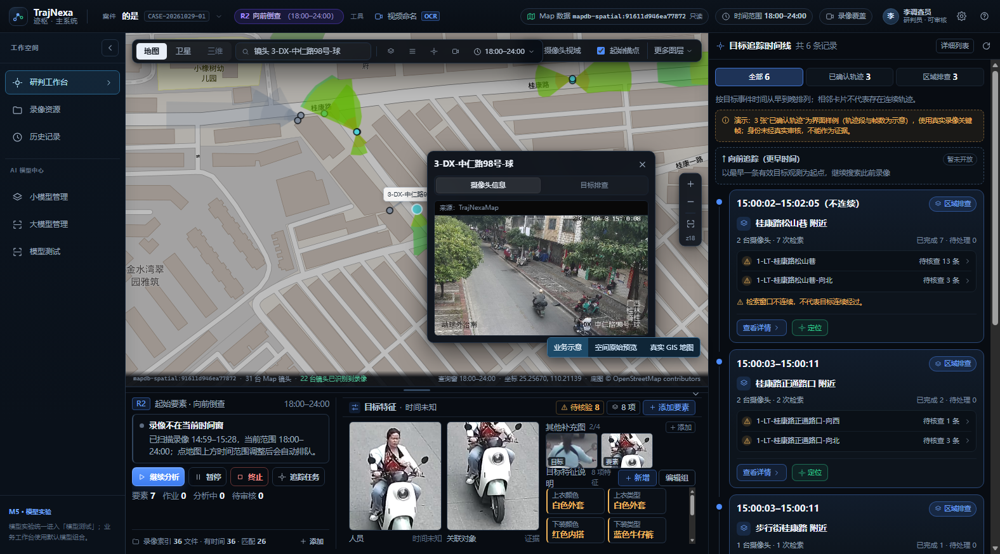
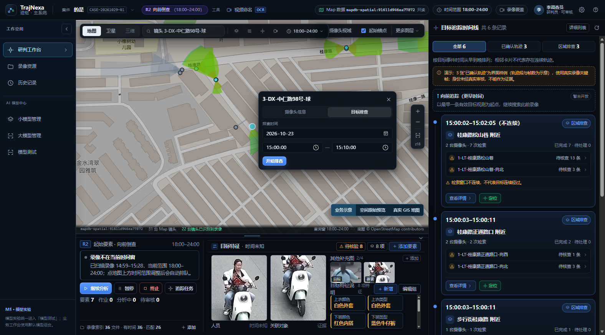

# 79 镜头卡「目标排查」页签（UI-only）

## 1. 范围与结论

- 日期：2026-11-07。
- 用户要求（m08717）：保留点击摄像头弹出的简洁卡片，只在原卡片顶部增加两个页签——「摄像头信息」「目标排查」；「摄像头信息」原有内容和操作不变；「目标排查」提供排查日期、起止时间和「开始排查」，开始后切换为「暂停 / 取消」。
- 用户补充（m08732）：「先做UI，暂时不接线」。
- 本轮只改前端镜头卡，**没有**新增后端接口、没有创建追踪/排查任务、没有轮询、没有写入 `target_spatial_observations`，也没有产生 L2 或身份结论。
- 地图点位、正式 L2 图层、TrajNexa_Map 均未改动。

## 2. 卡片结构

镜头卡仍由 `frontend/src/components/WorkspaceMap.vue` 的 `.cam-card--real` 承载，自上而下为：

1. 标题行：摄像头名称 + 关闭按钮（关闭行为不变）。
2. 页签行：`.cam-tabs`，两个 `role="tab"` 按钮，当前页签有 `.is-on` 和 `aria-selected`。
3. 内容区：
   - **摄像头信息**：保留原有的 Map 参考图/录像首帧回退、来源标注和图片失败隐藏逻辑，未改样式。
   - **目标排查**：日期输入、开始/结束时间输入、「开始排查」按钮；开始后按钮组变为「暂停 / 取消」，暂停后变为「继续 / 取消」。





## 3. 默认值与状态机

| 字段 | 默认值 | 说明 |
| --- | --- | --- |
| 排查日期 | 当前镜头在当前案件内最新录像的 `start_local` 日期 | 没有录像时用本地当天；只是 UI 默认值，不是证据时间 |
| 开始时间 | `15:00:00` | 与设计示意一致 |
| 结束时间 | `15:10:00` | 必须晚于开始时间 |

状态机只在前端内存中：

```text
idle --开始排查--> running --暂停--> paused --继续--> running
  ^                    |                 |
  +--------取消--------+-----------------+
```

- `running` / `paused` 时三个输入均 disabled，避免界面显示的时间与「已开始」的任务范围不一致。
- 开始前校验日期非空、起止非空且结束时间晚于开始时间；不满足时按钮 disabled 并显示提示。
- 关闭卡片或切换镜头会重置为 `idle` + 信息页，避免把上一个镜头的排查状态带到下一个镜头。

## 4. 未接线边界

- 「开始排查」只设置本地 `investigationStatus = "running"`，不发送任何请求。
- 运行中明确显示：「当前版本仅保留界面状态，尚未接入分析任务。」
- 不显示虚假进度、虚假命中数或“排查完成”；不把时间范围写成已分析范围。
- 该页签不产生地图点、不改变摄像头状态、不改变正式 L2，也不构成任何身份判断。

## 5. 实测

- `npx vue-tsc --noEmit`：exit 0。
- `npx vite build`：exit 0（623.77 kB JS，仅 chunk-size warning）。
- Playwright（Edge CDP 9222，1576×874，案件 `4da6cac0-5047-488e-af49-087e1513eb17`）：
  - 98 镜头卡片 360×303.4，页签为「摄像头信息 / 目标排查」，默认信息页，参考图 1 张，来源标注为「来源：TrajNexaMap」。
  - 目标页默认 `2026-10-23`、`15:00:00`、`15:10:00`；点「开始排查」后按钮为「暂停 / 取消」，输入全部 disabled。
  - 点「暂停」后为「继续 / 取消」；点「取消」回到「开始排查」。
  - 把开始改为 `15:20:00`、结束改为 `15:10:00` 时出现提示且按钮 disabled；结束改回 `15:30:00` 后按钮恢复。
  - 关闭卡片后重新打开同一镜头，回到信息页和 `idle`，不会继承上一次的运行状态。
- 控制台唯一的 404 是既有的追踪候选证据图请求，与本改动无关。

## 6. 接线前需要先定的问题

1. 「目标排查」排查的是当前镜头全部运动目标，还是用户已选定的目标（起始锚点/截图）？
2. 时间范围与案件、镜头、现有追踪任务如何绑定；同一镜头重复开始是复用任务还是新建任务？
3. 任务状态、进度、取消和失败原因从哪个接口读取；是否需要 `persisted=false` 的实验层结果。
4. 排查结果如何进入时间线/地图，如何与正式 L2、人工审核隔离。

在这些问题确定前，保持 UI-only，不把界面状态当作分析结果。
