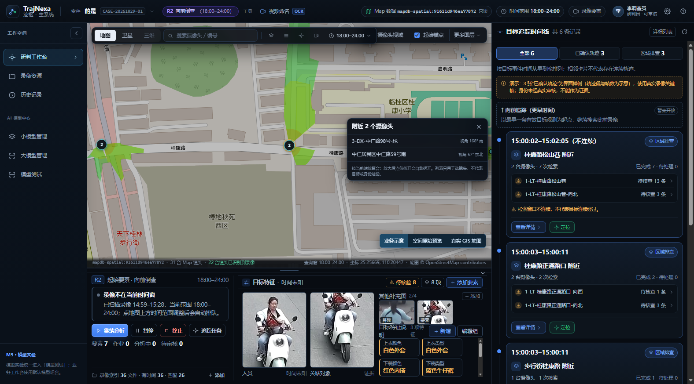
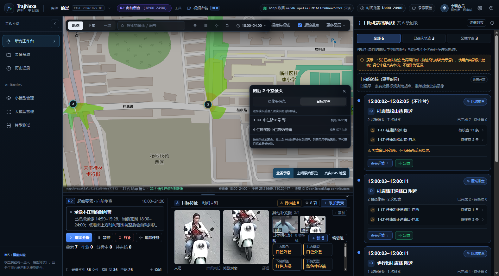
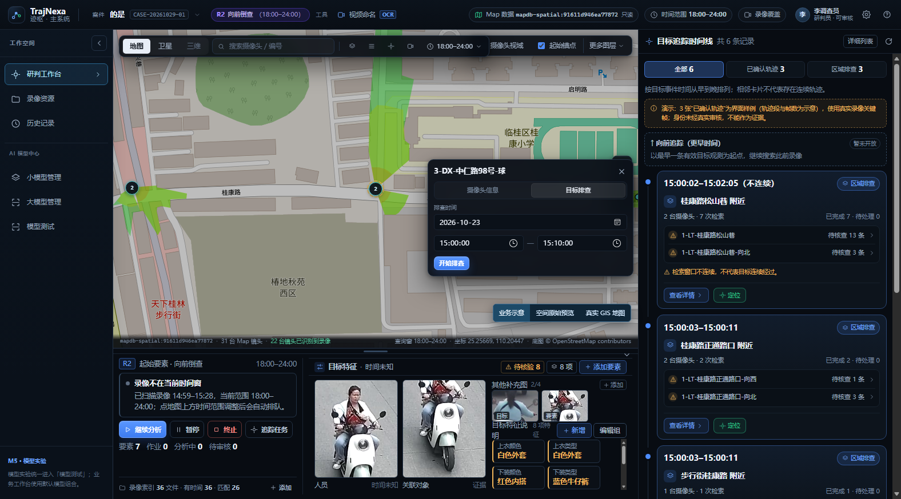

# 80 地图摄像头聚合与多行列表

## 1. 范围与结论

- 日期：2026-11-07。
- 用户要求（m08914）：地图上的摄像头缺少聚合；放大后仍聚合时，点击显示多行卡片。
- 用户后续（m09336）：聚合点再小一些；聚合卡每行右侧不放「有录像 / 无录像」，改为视角方向；点击摄像头在名称下方插入「摄像头信息 / 目标排查」TAB。
- 本轮只改 `frontend/src/components/WorkspaceMap.vue` 的镜头点位渲染和卡片，不新增后端接口、不修改 TrajNexa_Map、不写数据库、不产生正式 L2 或身份结论。
- 聚合只是地图交互：解决同一路口多个镜头点位互相遮挡、单点难以点选的问题；聚合数量、列表行和单镜头点亮状态都不代表目标、身份或空间精度。

## 2. 聚合规则

- 以当前缩放级别下的屏幕像素距离分组，阈值 `CLUSTER_RADIUS_PX = 44`。
- 同一组至少 2 台镜头时显示青色聚合点，圆内数字为镜头数；只有 1 台时仍显示原来的单镜头圆点。聚合点直径 24px，数量 >9 时 28px（收尾前为 32/38px）。
- 聚合只按屏幕距离，不按道路、名称或案件关系；不使用最大运动块、不调用追踪候选、不推断镜头之间的物理关系。
- 已选中的镜头永不并入聚合，始终单独绘制，保证它的单镜头卡片有明确锚点。
- `zoomend` 时只重绘镜头点位层，重新计算聚合；缩放后点位间距拉开会自动拆开。
- 聚合点、单镜头点、FOV 图层彼此独立；关闭「Map 镜头」图层时同时收起聚合列表。

## 3. 交互

- 点击单镜头点：沿用原行为，打开镜头卡；名称下方固定「摄像头信息 / 目标排查」两个页签。
- 点击聚合点：打开「附近 N 个摄像头」卡片；标题下方同样有「摄像头信息 / 目标排查」两个页签，默认「摄像头信息」。
- 聚合卡每行显示镜头名称和视角方向，例如 `视角 168° 南`；`bearing_deg` 缺失时写 `视角 未知`，不拿录像状态替代方向。方向来自 Map 台账 `bearing_deg`，按整数度 + 8 方位显示，不代表 FOV 边界。
- 聚合卡不再显示有/无录像文字；单镜头点仍按既有规则显示亮/灰，聚合卡不重复录像状态。排序仍按「有录像」优先、名称排序。
- 「摄像头信息」页签点击行：收起聚合卡，打开单镜头卡的「摄像头信息」页签。
- 「目标排查」页签显示「选择镜头后进入该镜头的目标排查。」；点击行：收起聚合卡，打开单镜头卡并直接落在「目标排查」页签；不会自动创建排查任务，也不会改变镜头状态。
- 关闭聚合卡：点击卡片关闭按钮、点击地图空白处、缩放地图、切换其他镜头/锚点/观测卡片，或关闭 Map 镜头图层。

## 4. 隔离边界

- 聚合和多行列表是纯前端显示状态，不写入 `target_spatial_observations`，不改变 `layer`、`persisted` 或任何正式观测。
- 列表中的镜头名称来自 TrajNexa_Map 只读快照，不是身份证据；点击行只切换查看对象。
- 不按聚合结果补造轨迹、不把多个镜头合并成同一目标、不生成跨镜头结论。

## 5. 实测

- `npx vue-tsc --noEmit`：exit 0。
- `npx vite build`：exit 0（627.82 kB JS，仅 chunk-size warning）。
- Playwright（Edge CDP 9222，2560×1271，案件 `4da6cac0-5047-488e-af49-087e1513eb17`）：
  - 初始视图 11 个聚合点，首个聚合点 24×24；放大到 z19 后为 9 个聚合点，部分点位拆开。
  - 点击 2 镜头聚合点：卡片 320×181.27，标题下出现「摄像头信息 / 目标排查」两个页签，默认「摄像头信息」；两行分别显示 `视角 168° 南`、`视角 57° 东北`，不再显示有/无录像。
  - 切到「目标排查」：显示「选择镜头后进入该镜头的目标排查。」；点击第一行后聚合卡消失，单镜头卡 360×205.39，名称下方页签仍在，并直接落在「目标排查」。
  - 从「摄像头信息」页签点击行：单镜头卡默认落在「摄像头信息」；从「目标排查」页签点击行：默认落在「目标排查」。
  - 点击地图空白处或缩放后聚合卡收起；关闭「Map 镜头」图层不残留聚合点。
- 控制台唯一的 404 是既有的追踪候选证据图请求，与本改动无关。

## 6. 已知边界

- 阈值固定为 44px：物理位置几乎重合的镜头在最大缩放下仍会聚合，这是有意的，避免两个点位完全叠住无法点选；只有点位在屏幕上拉开才会拆开。
- 聚合卡最多显示 236px 高的列表并可滚动；不提供「全部展开」「按案件筛选」等额外能力。
- 聚合卡的页签只决定「进入单镜头卡后的默认页签」，不在聚合卡内运行排查或读取录像；目标排查表单仍属于单镜头卡。
- 视角方向只有整数度和 8 方位，缺失即「未知」；不表示 FOV 边界、遮挡关系或目标方向。
- 24px 聚合点仍以数字可读和可点选为限；若继续缩小，需要同步重做触控目标和数量字号。
- 本轮不做聚合动画、不做聚合数量统计到时间线、不把聚合结果持久化。
